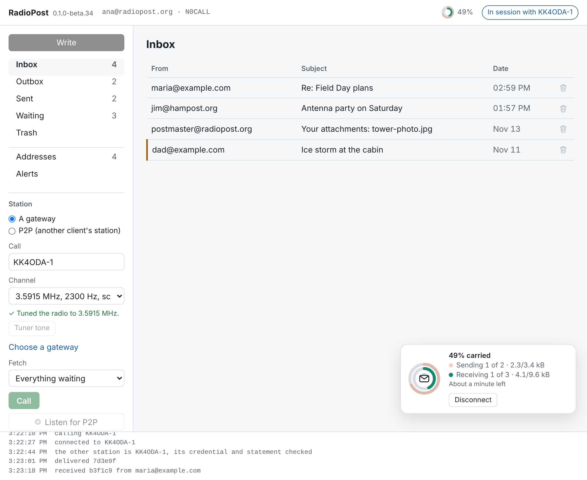
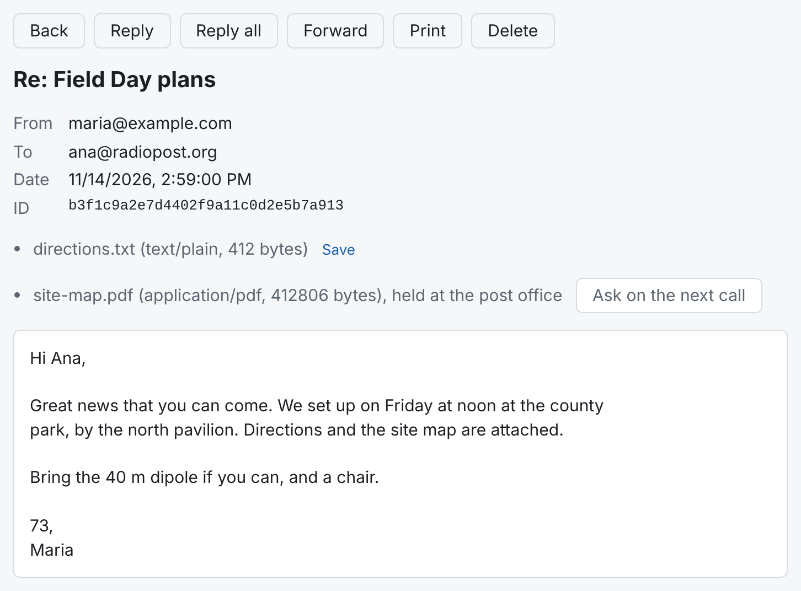
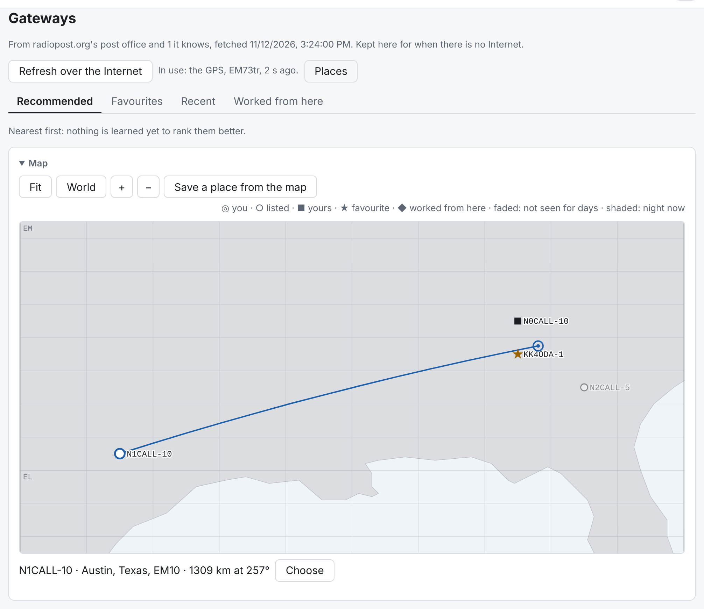
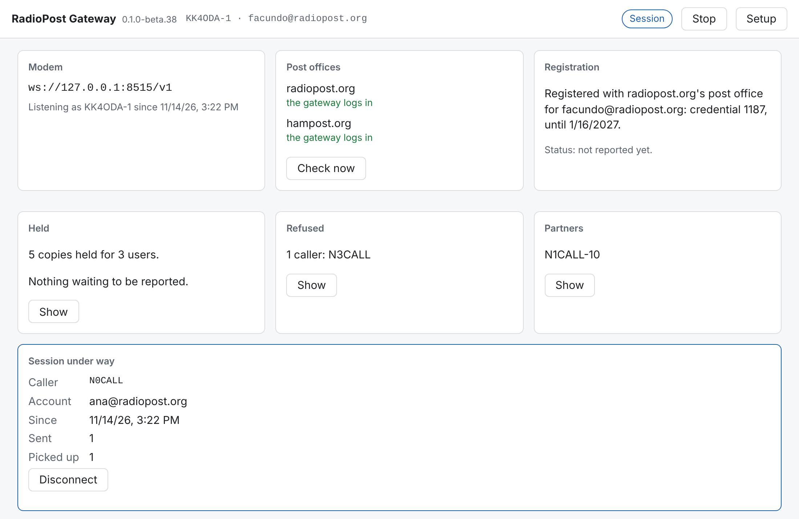
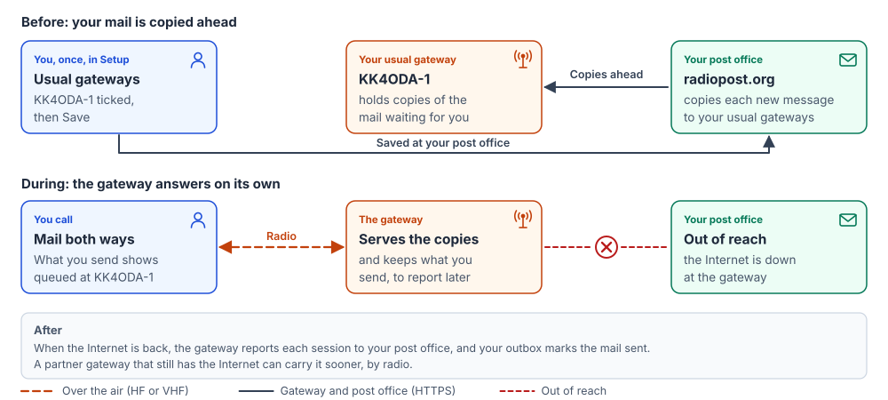

  

<h1 align="center">RadioPost</h1>

<b>Email by amateur radio, with no central server.</b>

  
  
  

  <a href="https://github.com/KK4ODA/RadioPost/releases"><b>Download</b></a> ·
  <a href="docs/manual/manual.md"><b>User's manual</b></a> ·
  <a href="docs/concept/00-concept.md"><b>How it works</b></a> ·
  <a href="spec/README.md"><b>Specifications</b></a>

RadioPost lets licensed amateurs send and receive **ordinary email by radio**. Your address is an
ordinary one, such as `ana@radiopost.org`, so anyone with Gmail or Outlook can write to you and
read your answers in their usual mail program. They need no radio and no licence. You call a
gateway, another amateur's station on the Internet, and one session sends your outbox and fetches
what waits for you.

The RadioPost client in session with the gateway KK4ODA-1 on 3.5915 MHz.
Mail goes both ways in one call.

> **Beta, and on the air.** RadioPost mail has crossed the air through a gateway since
> 2026-11-12, and the project's own post office, `radiopost.org`, has carried email since
> 2026-11-11. Installers for Windows, macOS (Apple Silicon) and Linux are on the
> [releases page](https://github.com/KK4ODA/RadioPost/releases), and the programs update
> themselves. The protocols, RP-0 to RP-6, are Stable at 1.0.0.

## How it works

Four parts, each run by whoever wants to run one:

* **Your station.** The RadioPost program and a modem on your computer, wired to your radio.
  You write and read mail here.
* **A gateway.** Another amateur's station, left on and connected to the Internet. You call it by
  radio, and it passes your session on. Any gateway takes your call, whoever runs it.
* **Your post office.** A server that keeps your mailbox and trades email with the rest of the
  world. Clubs and groups run post offices on their own domains. The project runs
  `radiopost.org`.
* **Everyone else.** Your mail leaves your post office as ordinary email, and their answers come
  back the same way.

There is no central server. Many post offices and gateways, run by different people, work as one
network because they follow the same published protocols, as email providers do. Two RadioPost
stations can also send mail to each other directly, with no gateway and no Internet.

## What you can do

**Read and answer as you would any email.** Reply, reply all, forward, an address book,
attachments. A large attachment waits at your post office until you ask for it on a call.

**Find a gateway near you.** The list comes from your post office and the ones it knows, sorted
by distance from your grid square, with each gateway's channels and hours. It is kept for when
there is no Internet.

**Run a gateway for others.** RadioPost Gateway answers calls by itself and passes each session to
the caller's post office. It shows who is calling, the copies it holds for when the Internet is
down, and which callers you refuse. It runs on the same Aether station as a Winlink gateway, on
one radio.

**Run a post office for your club.** Your own domain, your own rules, nobody's permission. The
desk takes applications, checks each callsign against the FCC's licence list, makes the
mailboxes, and watches the server's health and backups.

## When the Internet is down

Gateways keep working. A gateway you choose holds copies of your new mail ahead of time, so you can
still pick it up by radio when the Internet has gone. It keeps what you send, and reports it all
when the Internet is back. Meanwhile it hands mail between its own users at once, and it can pass
its queue by radio to a partner gateway that still reaches the Internet. The manual's
[When the Internet is down](docs/manual/manual.md#14-when-the-internet-is-down) has the details.

## On the air

RadioPost's first modem is **[Aether HF](https://github.com/KK4ODA/aether-hf)**, an open-source
HF data modem by the same author. On 2026-11-12 a mobile station sent the same 22 kB of RadioPost
mail to the KK4ODA-1 gateway twice on 3.590 MHz, at +4 to +5 dB SNR: Aether carried it in about
three minutes at 2300 Hz, and in under eight at 500 Hz. This is what the gateway heard:

Drawn from the gateway's own recording. The whole account, with the
delivery curves and the constellations, is in
<a href="https://github.com/KK4ODA/aether-hf#on-the-air">Aether's README</a>.

Aether keys the radio, checks the band rules before every transmission and sends the Morse
identifier. One Aether station serves RadioPost and Winlink programs side by side, on one radio.
RadioPost does not depend on it: any modem with an adapter will do
([RP-4](spec/rp-0004-modem-interface.md)).

## Get started

1. **What you need:** an amateur licence; an HF radio that sends and receives upper sideband
   data; an audio interface such as a SignaLink, a DigiRig or the radio's own USB audio; and a
   computer with Windows, macOS (Apple Silicon) or Linux.
2. **Set up Aether HF** with your radio, from
   [its manual](https://github.com/KK4ODA/aether-hf/blob/master/docs/manual/manual.md#part-1-getting-started).
3. **Install RadioPost** from the [releases page](https://github.com/KK4ODA/RadioPost/releases):
   the `-setup.exe` for Windows, the `.dmg` for macOS, the `.deb` or `.AppImage` for Linux.
4. **Get an address.** Ask your club whether it runs a post office. If not, use the project's
   own, `radiopost.org`: [Getting an account](docs/manual/manual.md#5-getting-an-account) says
   how. You need the Internet once, for this and the list of gateways. After that, mail goes by
   radio.
5. **Write, choose a gateway, and call.**

The [user's manual](docs/manual/manual.md) takes you through each step with pictures, and each
release carries it as a PDF. To run a gateway, install **RadioPost Gateway** from the same page
and read the manual's [Part 3](docs/manual/manual.md#part-3-radiopost-gateway). To run a post
office, start with [the server guide](docs/user/post-office.md).

## What it is for

**RadioPost is not meant to replace Winlink.** Winlink works: it has hundreds of gateways, carries
email both ways, and is used in emergencies. RadioPost does not speak Winlink's protocol and does
not ask anyone to leave it. A station can run both, on one radio.

RadioPost is a place for amateurs to **experiment and build**. Its protocols are published, with
test vectors and a conformance tester, so that anyone can write a program that works with everyone
else's:

* Write a client, a gateway or a post office of your own, or change ours. The code is open.
* Put a new modem under it with an adapter. Nothing above the modem interface changes.
* Build an application on top of it: forms, telemetry, a bulletin service, a bridge to something
  else. A message is addressed and delivered the same way whatever it carries.
* Run a post office for your club, on your own domain, with your own rules. Nobody's permission is
  needed.

The common protocol is the point. The programs here are one implementation of it, with no special
standing.

## Build your own

The protocols are the contract, not the programs. The RadioPost client, gateway and post office
service are one implementation each; you may use them, or write your own client, gateway, post
office or modem adapter from the specifications, and it will work with everyone else's.

| You are building | Start with |
|---|---|
| A client | RP-1, RP-2, RP-3; RP-4 to drive a modem |
| A gateway | RP-1, RP-2, RP-3, RP-5; RP-4 to drive modems; RP-7 to forward when cut off |
| A post office | RP-1, RP-2, RP-5, RP-6 |
| An adapter for a modem | RP-4 |

RP-0 holds the conventions they all share. [The index](spec/README.md) says which parts of each
apply. The [test vectors](vectors/README.md) give the exact bytes and verdicts: keys, credentials,
messages, every PDU, whole sessions byte for byte, the modem interface's conversations, the post
office's exchanges, email in and out, and forwarding. Check an implementation against them before
it goes on the air. [The public test service](docs/user/test-service.md) checks a program of yours
against RadioPost's over the Internet.

## Status

**RP-0 to RP-6 are Stable at 1.0.0** (2026-11-15): radiopost.org's pilot runs them, and a change
an existing implementation cannot ignore now comes only with a new protocol version (RP-0 §8.3).
RP-7, forwarding between gateways, is still a draft. All eight are written, with test vectors for
RP-1 to RP-7.

The programs follow the [order of work](docs/design/00-detailed-design.md#9-order-of-work), in
Rust, each checked against the test vectors:

* **The core library and the modem interface** ([`core/`](core/README.md)): RadioPost's objects,
  RP-3's sessions, and RP-4 carrying them between two stations.
* **Five adapters** (`adapters/`): one for [Aether HF](https://github.com/KK4ODA/aether-hf), an
  open-source HF modem, one for the Mercury HF modem, one for VARA HF and VARA FM through their
  published commands, one for AX.25 packet through a TNC's AGWPE port (Dire Wolf), and one for
  TCP. ARDOP follows.
* **The client** ([`app/client`](app/client/README.md)): mail to another station or through a
  gateway, on the command line, from its panel in a browser, or as a desktop application.
* **The gateway**: it answers users' calls and carries their sessions to their post offices, as a
  desktop application of its own, RadioPost Gateway ([`app/gateway`](app/gateway/README.md),
  [the operator's guide](docs/user/gateway.md)). When the Internet is down it serves the copies of
  users' mail placed ahead with it, queues what they send, and reports it all when the Internet is
  back; the client follows what was queued until a post office confirms it. Cut off, it hands
  mail between its own users at once, and its queue by radio to a partner gateway that reaches the
  Internet, calling it inside the partner's windows.
* **The post office service**, beside a mail server, with ordinary email both ways
  ([running a post office](docs/user/post-office.md)). The project's own post office,
  `radiopost.org`, is live.
* **The conformance tester** ([its outline](docs/design/01-conformance.md)), which checks a client,
  a gateway, a post office or an adapter, whoever wrote it.

The programs say when a newer release is out and update themselves. On-air tests can begin:
[between two stations](docs/user/on-air-tests.md), and
[email through a gateway](docs/user/on-air-gateway.md), and
[forwarding between two gateways](docs/user/on-air-forwarding.md) (later).

## Documents

| | |
|---|---|
| [The user's manual](docs/manual/manual.md) | How to send and receive email by radio with RadioPost, how to run a RadioPost gateway, and how to run a post office from its desk: step by step, illustrated, printable. |
| [The server guide](docs/user/post-office.md) | Setting up and looking after a post office on a server of your own. |
| [The concept](docs/concept/00-concept.md) | What RadioPost is and how it works, in plain language, with schematics. |
| [The detailed design](docs/design/00-detailed-design.md) | The programs, the connections between them, and the decisions behind them. |
| [The specifications](spec/README.md) | The protocols: what every client, gateway, post office and modem adapter implements. |
| [The test vectors](vectors/README.md) | Exact inputs and outputs for the protocols, to check an implementation against. |
| [The conformance tester's outline](docs/design/01-conformance.md) | What the tester will check of each role, and what each phase adds to it. |

## In this repository

| | |
|---|---|
| [`spec/`](spec/README.md) | The specifications. Where a program and a specification disagree, the specification wins. |
| [`docs/`](docs/) | The user's manual, the concept, the detailed design and the user guides, with their figures, and this page's pictures (`docs/images/`, from `tools/manual/screens.mjs`). |
| [`vectors/`](vectors/README.md) | The test vectors, generated by `tools/vectors/make.py`, never edited by hand. |
| [`core/`](core/README.md) | The Rust workspace: the core library, the modem interface, the gateway, the post office service, the conformance tester. |
| `adapters/` | The modem adapters: Aether HF, Mercury and TCP. |
| [`app/`](app/client/README.md) | The client (the `radiopost` program, its panel and the desktop application) and RadioPost Gateway ([`app/gateway`](app/gateway/README.md)). |
| [`tools/`](tools/) | The vectors' reference, the figures' generators and the documents' checker (Python, standard library only). |

## Taking part

Questions, ideas and corrections are welcome as issues. Changes to the specifications go through
pull requests, as [`CONTRIBUTING.md`](CONTRIBUTING.md) describes.

## Licence

| What | Licence |
|---|---|
| The specifications (`spec/`), the documents (`docs/`) and their figures | [CC BY 4.0](https://creativecommons.org/licenses/by/4.0/) (`LICENSE-CC-BY-4.0`) |
| Code (`core/`, `adapters/`, `app/`, `tools/`) | MIT (`LICENSE-MIT`) or Apache 2.0 (`LICENSE-APACHE`), at your option |

Anyone may implement the protocols, in open or closed software, without asking; please credit the
RadioPost project.
