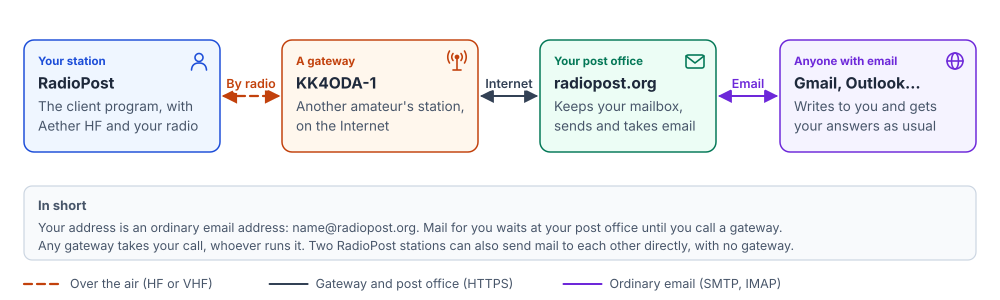
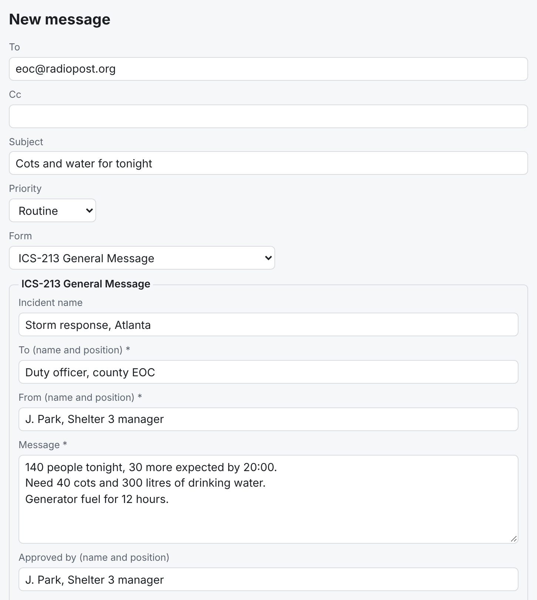
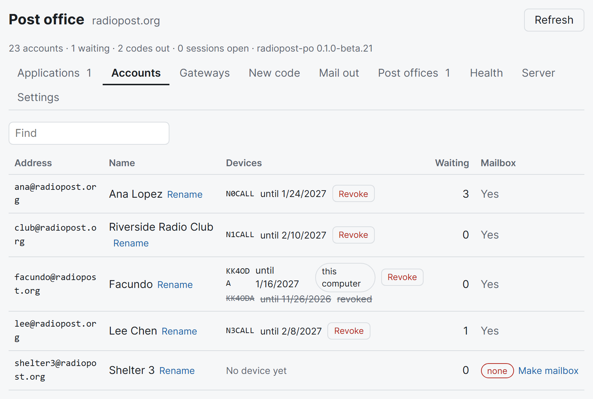

  

<h1 align="center">RadioPost</h1>

<b>Email by amateur radio, with no central server.</b>

  
  
  

  <a href="https://github.com/KK4ODA/RadioPost/releases"><b>Download</b></a> ·
  <a href="docs/manual/manual.md"><b>User's manual</b></a> ·
  <a href="docs/concept/00-concept.md"><b>How it works</b></a> ·
  <a href="spec/README.md"><b>Specifications</b></a>

RadioPost lets licensed amateurs send and receive **ordinary email by radio**. Your address is an
ordinary one, such as `ana@radiopost.org`, so anyone with Gmail or Outlook can write to you and
read your answers in their usual mail program. They need no radio and no licence. You call a
gateway, another amateur's station on the Internet, and one session sends your outbox and fetches
what waits for you.

The RadioPost client in session with the gateway KK4ODA-1 on 3.5915 MHz.
Mail goes both ways in one call.

> **Beta, and on the air.** RadioPost mail has crossed the air through a gateway since
> 2026-11-12, and the project's own post office, `radiopost.org`, has carried email since
> 2026-11-11. Installers for Windows, macOS (Apple Silicon) and Linux are on the
> [releases page](https://github.com/KK4ODA/RadioPost/releases), and the programs update
> themselves. The protocols RP-0 to RP-6 are Stable.

## What sets it apart

Email by radio is not new. This is what RadioPost does differently:

* **Your own address.** An ordinary email address at your post office's domain, such as
  `ana@radiopost.org` or your club's own, not a callsign at one shared domain.
* **No central server.** Clubs and groups run post offices on their own domains, and these work
  as one network, as email providers do. Adding a gateway or a post office needs nobody's
  permission.
* **Any gateway serves any user.** A gateway checks your credential itself, with no Internet
  needed for the check, and passes your session to your own post office, whoever runs the gateway.
* **Open from end to end.** The protocols are published, with test vectors and a conformance
  tester, and the client, the gateway and the post office are open source. Anyone can write a
  program that works with everyone else's. Nothing is encrypted, and every byte RadioPost sends
  follows a published format: over Aether, whose waveform is published too, anyone can read a
  recorded session.
* **Any modem.** One protocol over Aether HF, Mercury, VARA HF and FM, ARDOP, AX.25 packet or
  TCP, each through a small adapter. A gateway can answer on several modems.
* **Mail keeps moving when the Internet is down.** Your usual gateway holds copies of your new
  mail ahead of time, keeps what you send, hands mail between its own users at once, and can pass
  its queue by radio to a partner gateway that still reaches the Internet.
* **Few turnarounds.** A gateway session takes five transmissions, where the usual radio mail
  exchange takes eight to ten. The list of what waits comes first, and you choose what to fetch.
* **Nothing sent twice.** A message is named by its content, so one you already hold is never
  sent again, through any gateway. A message cut off by a lost link resumes from the last byte
  received, through any gateway.
* **A key for each computer.** Each computer signs your sessions with a key of its own that never
  leaves it, and your post office can revoke one device without touching the others.
* **Forms by their values.** An ICS-213 goes as the values you typed, in about a fifth less air
  time than its text. It shows as the form at the other station and prints as FEMA's paper
  ICS 213.
* **Alerts with no session.** A one-line alert reaches one station or a whole circle as a short
  broadcast, on a path too weak for a session, and can sound an alarm there until someone answers.

## How it works

Four parts, each run by whoever wants to run one:

* **Your station.** The RadioPost program and a modem on your computer, wired to your radio.
  You write and read mail here.
* **A gateway.** Another amateur's station, left on and connected to the Internet. You call it by
  radio, and it passes your session on. Any gateway takes your call, whoever runs it.
* **Your post office.** A server that keeps your mailbox and trades email with the rest of the
  world. Clubs and groups run post offices on their own domains. The project runs
  `radiopost.org`.
* **Everyone else.** Your mail leaves your post office as ordinary email, and their answers come
  back the same way.

There is no central server. Many post offices and gateways, run by different people, work as one
network because they follow the same published protocols, as email providers do. Two RadioPost
stations can also send mail to each other directly, with no gateway and no Internet.

## What you can do

**Read and answer as you would any email.** Reply, reply all, forward, attachments. Change a
message in the outbox until it goes. Print a message or make a PDF of it, and save the files it
carries. A large attachment waits at your post office until you ask for it on a call.

**Send a form in less air time.** Choose ICS-213 General Message under **Form** and fill in its
fields. Only what you type goes on the air, so a short ICS-213 takes about a fifth less time than
the same text typed out. The station that receives it shows the whole form and prints it as
FEMA's paper ICS 213, and someone reading by email gets it as text with its labels.
[Writing a message](docs/manual/manual.md#7-writing-a-message) says more.

**Find a gateway near you.** The list comes from your post office and the ones it knows, sorted
by distance from where you are (a place you saved, or your GPS), with each gateway's channels and
hours. It is kept for when there is no Internet. A map shows the gateways, you, the night side as
it is now and the great circle to the one you pick; it needs no Internet either. Each HF channel
says how likely a link is this hour, or at any hour you pick, and how fast it would go each way:
VOACAP, run on your computer both ways, read through the modem's own measured speeds. A VHF channel
says how the path goes over the terrain. Pick a channel and RadioPost tunes the radio there, and
keys a tuner tone when you ask. A gateway that scans several channels is reached on any of them:
RadioPost keeps calling until it comes round.

**Mail station to station**, with no gateway and no Internet. Switch on **Listen for P2P** and
RadioPost answers calls to any of your callsigns, session after session, until you switch it off.
To call, give the other station's callsign, the dial and the bandwidth. When you next have the
Internet, **Send reports** tells your post office, which marks the mail delivered.

**Raise an alert.** Stations that share a keyword make a circle: a family, a net, a team. An
alert to one of them, or to all of them, needs no call. At the other station it can sound an
alarm and bring RadioPost to the front until someone answers: *Received*, *Calling you now*, or a
line of their own. Anyone can read an alert, but only the circle's stations can raise one.
[Alerts](docs/manual/manual.md#101-alerts) says how.

**Keep your contacts and your callsigns.** Import contacts from a phone, Google, Outlook or
Thunderbird, and make groups for a net or a shelter team. Choose how mail from each address
sounds, from silent to an alarm, with quiet hours. Work several callsigns, such as your own and
your club's, each with its own account and mail.

**Run a gateway for others.** RadioPost Gateway answers calls by itself and passes each session to
the caller's post office. It shows who is calling, the copies it holds for when the Internet is
down, and which callers you refuse. It runs on the same Aether station as a Winlink gateway, on
one radio. With Aether it can scan up to four channels, and its registration tells callers how
long to keep calling. It can also answer on several modems, one session at a time: Aether and
Mercury on one radio, or Aether on HF and packet on VHF. You choose which of your accounts
registers it, and can unregister it to move it to another post office.

**Run a post office for your club.** Your own domain, your own rules, nobody's permission. The
desk takes applications and checks each callsign against the FCC's licence list. It flags what
looks wrong, such as a club callsign asked for by a stranger, or an address no reply can reach.
It makes every account's mailbox, sets a new password for someone who lost theirs, and watches
the server's health and backups.

## When the Internet is down

Gateways keep working. A gateway you choose holds copies of your new mail ahead of time, so you can
still pick it up by radio when the Internet has gone. It keeps what you send, and reports it all
when the Internet is back. Meanwhile it hands mail between its own users at once, and it can pass
its queue by radio to a partner gateway that still reaches the Internet. The manual's
[When the Internet is down](docs/manual/manual.md#14-when-the-internet-is-down) has the details.

## On the air

RadioPost's first modem is **[Aether HF](https://github.com/KK4ODA/aether-hf)**, an open-source
HF data modem by the same author. On 2026-11-12 a mobile station sent the same 22 kB of RadioPost
mail to the KK4ODA-1 gateway twice on 3.590 MHz, at +4 to +5 dB SNR: Aether carried it in about
three minutes at 2300 Hz, and in under eight at 500 Hz. This is what the gateway heard:

Drawn from the gateway's own recording. The whole account, with the
delivery curves and the constellations, is in
<a href="https://github.com/KK4ODA/aether-hf#on-the-air">Aether's README</a>.

On 2026-11-17 and 18 the same two stations worked 40 m at 2300 Hz, the gateway scanning 7.101
and 3.590 MHz: a 52 kB attachment crossed at about 920 bit/s, and P2P mail crossed between two
RadioPost clients under heavy QRM, an ICS-213 among it.

Aether keys the radio, checks the band rules before every transmission and identifies the
station, in Morse or in its data signal. One Aether station serves RadioPost and Winlink programs
side by side, on one radio.

## Other modems

RadioPost does not depend on Aether. It reaches a modem through an adapter, a small program that
runs beside it ([RP-4](spec/rp-0004-modem-interface.md)). RadioPost's tools hold these:

| Modem | Adapter | Tried so far |
|---|---|---|
| [Aether HF](https://github.com/KK4ODA/aether-hf) | Built into RadioPost | On the air since 2026-11-12 |
| Mercury HF | `radiopost-mercury` | On the bench, against two real Mercury modems |
| VARA HF and VARA FM | `radiopost-vara` | Against a stand-in written from VARA's published commands |
| ARDOP (ardopcf) | `radiopost-ardop` | Against a stand-in written from ardopcf's documents and source |
| AX.25 packet, on a TNC's AGWPE port (Dire Wolf and others) | `radiopost-packet` | Against a stand-in written from the AGWPE interface |

Start the adapter and put its address, such as `127.0.0.1:8600`, in RadioPost's **Modem** box. A
gateway adds its modems under **More modems**
([More than one modem](docs/manual/manual.md#more-than-one-modem)). The adapters are in the tools
archive on the [releases page](https://github.com/KK4ODA/RadioPost/releases). Alerts, scanning
and the tuner tone need Aether. Only Aether has carried RadioPost on the air so far, so a report
from a station on any of the others is welcome. A sixth adapter, `radiopost-tcp`,
joins two stations over the Internet, to try RadioPost before going on the air.

## Get started

1. **What you need:** an amateur licence; an HF radio that sends and receives upper sideband
   data; an audio interface such as a SignaLink, a DigiRig or the radio's own USB audio; and a
   computer with Windows, macOS (Apple Silicon) or Linux.
2. **Set up Aether HF** with your radio, from
   [its manual](https://github.com/KK4ODA/aether-hf/blob/master/docs/manual/manual.md#part-1-getting-started),
   or another modem with its adapter ([Other modems](#other-modems)).
3. **Install RadioPost** from the [releases page](https://github.com/KK4ODA/RadioPost/releases):
   the `-setup.exe` for Windows, the `.dmg` for macOS, the `.deb` or `.AppImage` for Linux.
4. **Get an address.** Ask your club whether it runs a post office. If not, use the project's
   own, `radiopost.org`: [Getting an account](docs/manual/manual.md#5-getting-an-account) says
   how. You need the Internet once, for this and the list of gateways. After that, mail goes by
   radio.
5. **Write, choose a gateway, and call.**

The [user's manual](docs/manual/manual.md) takes you through each step with pictures, and each
release carries it as a PDF. To run a gateway, install **RadioPost Gateway** from the same page
and read the manual's [Part 3](docs/manual/manual.md#part-3-radiopost-gateway). To run a post
office, start with [the server guide](docs/user/post-office.md).

## What it is for

**RadioPost is not meant to replace Winlink.** Winlink works: it has hundreds of gateways, carries
email both ways, and is used in emergencies. RadioPost does not speak Winlink's protocol and does
not ask anyone to leave it. A station can run both, on one radio.

RadioPost is a place for amateurs to **experiment and build**. Its protocols are published, with
test vectors and a conformance tester, so that anyone can write a program that works with everyone
else's:

* Write a client, a gateway or a post office of your own, or change ours. The code is open.
* Put a new modem under it with an adapter. Nothing above the modem interface changes.
* Build an application on top of it: telemetry, a bulletin service, a bridge to something else, or
  a new form ([`forms/`](forms/README.md) says how). A message is addressed and delivered the same
  way whatever it carries.
* Run a post office for your club, on your own domain, with your own rules. Nobody's permission is
  needed.

The common protocol is the point. The programs here are one implementation of it, with no special
standing.

## Build your own

The protocols are the contract, not the programs. The RadioPost client, gateway and post office
service are one implementation each; you may use them, or write your own client, gateway, post
office or modem adapter from the specifications, and it will work with everyone else's.

| You are building | Start with |
|---|---|
| A client | RP-1, RP-2, RP-3; RP-4 to drive a modem; RP-8 for alerts |
| A gateway | RP-1, RP-2, RP-3, RP-5; RP-4 to drive modems; RP-7 to forward when cut off |
| A post office | RP-1, RP-2, RP-5, RP-6 |
| An adapter for a modem | RP-4 |

RP-0 holds the conventions they all share. [The index](spec/README.md) says which parts of each
apply. The [test vectors](vectors/README.md) give the exact bytes and verdicts: keys, credentials,
messages and forms, every PDU, whole sessions byte for byte, the modem interface's conversations, the post
office's exchanges, email in and out, and forwarding. Check an implementation against them before
it goes on the air. [The public test service](docs/user/test-service.md) checks a program of yours
against RadioPost's over the Internet.

## Status

**RP-0 to RP-6 are Stable** (1.0.0 on 2026-11-15): radiopost.org's pilot runs them, and a change
an existing implementation cannot ignore now comes only with a new protocol version (RP-0 §8.3).
Since then they have changed only in minor and patch versions: forms (RP-2 and RP-6 1.1.0),
gateways that scan and the tuner tone (RP-4 1.1.0 and 1.2.0, RP-5 1.1.0), alerts (RP-0 1.1.0 and
RP-4 1.3.0), withdrawing a gateway's registration (RP-5 1.2.0), and the answers to 35 questions
from RadioPostKit, a second implementation, each keeping what conforming programs already send
(RP-0 1.2.0, RP-1 1.1.0, RP-2 1.2.0, RP-3 1.1.0, RP-4 1.3.1, RP-5 1.3.0), and when a gateway
listens and was last seen, and where its antennas are and how it transmits, for choosing one
(RP-5 1.4.0 and 1.5.0, RP-0 1.3.0). RP-4 also describes
the VARA, ARDOP and packet adapters. RP-7, forwarding between gateways, and RP-8, alerts, are
drafts. All nine are written, with test vectors for RP-1 to RP-8.

The programs follow the [order of work](docs/design/00-detailed-design.md#9-order-of-work), in
Rust, each checked against the test vectors:

* **The core library and the modem interface** ([`core/`](core/README.md)): RadioPost's objects,
  RP-3's sessions, and RP-4 carrying them between two stations.
* **Six adapters** (`adapters/`): one for [Aether HF](https://github.com/KK4ODA/aether-hf), an
  open-source HF modem, one for the Mercury HF modem, one for VARA HF and VARA FM through their
  published commands, one for ARDOP (ardopcf), one for AX.25 packet through a TNC's AGWPE port
  (Dire Wolf), and one for TCP.
* **The client** ([`app/client`](app/client/README.md)): mail to another station or through a
  gateway, and alerts to a circle, on the command line, from its panel in a browser, or as a
  desktop application.
* **The gateway**: it answers users' calls, on one modem or several, scanning its channels with
  Aether, and carries their sessions to
  their post offices, as a desktop application of its own, RadioPost Gateway
  ([`app/gateway`](app/gateway/README.md), [the operator's guide](docs/user/gateway.md)). When the Internet is down it serves the copies of
  users' mail placed ahead with it, queues what they send, and reports it all when the Internet is
  back; the client follows what was queued until a post office confirms it. Cut off, it hands
  mail between its own users at once, and its queue by radio to a partner gateway that reaches the
  Internet, calling it inside the partner's windows.
* **The post office service**, beside a mail server, with ordinary email both ways
  ([running a post office](docs/user/post-office.md)). The project's own post office,
  `radiopost.org`, is live.
* **The conformance tester** ([its outline](docs/design/01-conformance.md)), which checks a client,
  a gateway, a post office or an adapter, whoever wrote it.

The programs say when a newer release is out and update themselves. On-air tests can begin:
[between two stations](docs/user/on-air-tests.md), and
[email through a gateway](docs/user/on-air-gateway.md), and
[forwarding between two gateways](docs/user/on-air-forwarding.md) (later).

## Documents

| | |
|---|---|
| [The user's manual](docs/manual/manual.md) | How to send and receive email by radio with RadioPost, how to run a RadioPost gateway, and how to run a post office from its desk: step by step, illustrated, printable. |
| [The server guide](docs/user/post-office.md) | Setting up and looking after a post office on a server of your own. |
| [The concept](docs/concept/00-concept.md) | What RadioPost is and how it works, in plain language, with schematics. |
| [The detailed design](docs/design/00-detailed-design.md) | The programs, the connections between them, and the decisions behind them. |
| [The specifications](spec/README.md) | The protocols: what every client, gateway, post office and modem adapter implements. |
| [The test vectors](vectors/README.md) | Exact inputs and outputs for the protocols, to check an implementation against. |
| [The conformance tester's outline](docs/design/01-conformance.md) | What the tester will check of each role, and what each phase adds to it. |

## In this repository

| | |
|---|---|
| [`spec/`](spec/README.md) | The specifications. Where a program and a specification disagree, the specification wins. |
| [`docs/`](docs/) | The user's manual, the concept, the detailed design and the user guides, with their figures, and this page's pictures (`docs/images/`, from `tools/manual/screens.mjs`). |
| [`vectors/`](vectors/README.md) | The test vectors, generated by `tools/vectors/make.py`, never edited by hand. |
| [`core/`](core/README.md) | The Rust workspace: the core library, the modem interface, the gateway, the post office service, the conformance tester. |
| `adapters/` | The modem adapters: Aether HF, Mercury, VARA, ARDOP, AX.25 packet and TCP. |
| [`forms/`](forms/README.md) | The published form templates, ICS-213 first. A changed template is a new template. |
| [`app/`](app/client/README.md) | The client (the `radiopost` program, its panel and the desktop application) and RadioPost Gateway ([`app/gateway`](app/gateway/README.md)). |
| [`tools/`](tools/) | The vectors' reference, the figures' generators and the documents' checker (Python, standard library only). |

## Taking part

Questions, ideas and corrections are welcome as issues. Changes to the specifications go through
pull requests, as [`CONTRIBUTING.md`](CONTRIBUTING.md) describes.

## Licence

| What | Licence |
|---|---|
| The specifications (`spec/`), the documents (`docs/`) and their figures | [CC BY 4.0](https://creativecommons.org/licenses/by/4.0/) (`LICENSE-CC-BY-4.0`) |
| Code (`core/`, `adapters/`, `app/`, `tools/`) | MIT (`LICENSE-MIT`) or Apache 2.0 (`LICENSE-APACHE`), at your option |

Anyone may implement the protocols, in open or closed software, without asking; please credit the
RadioPost project.
