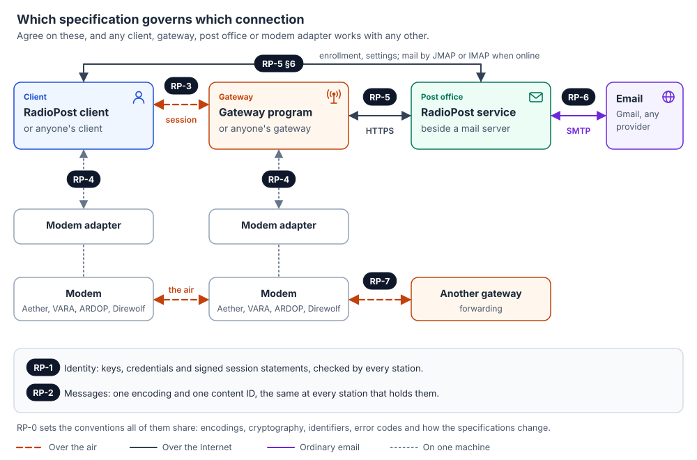
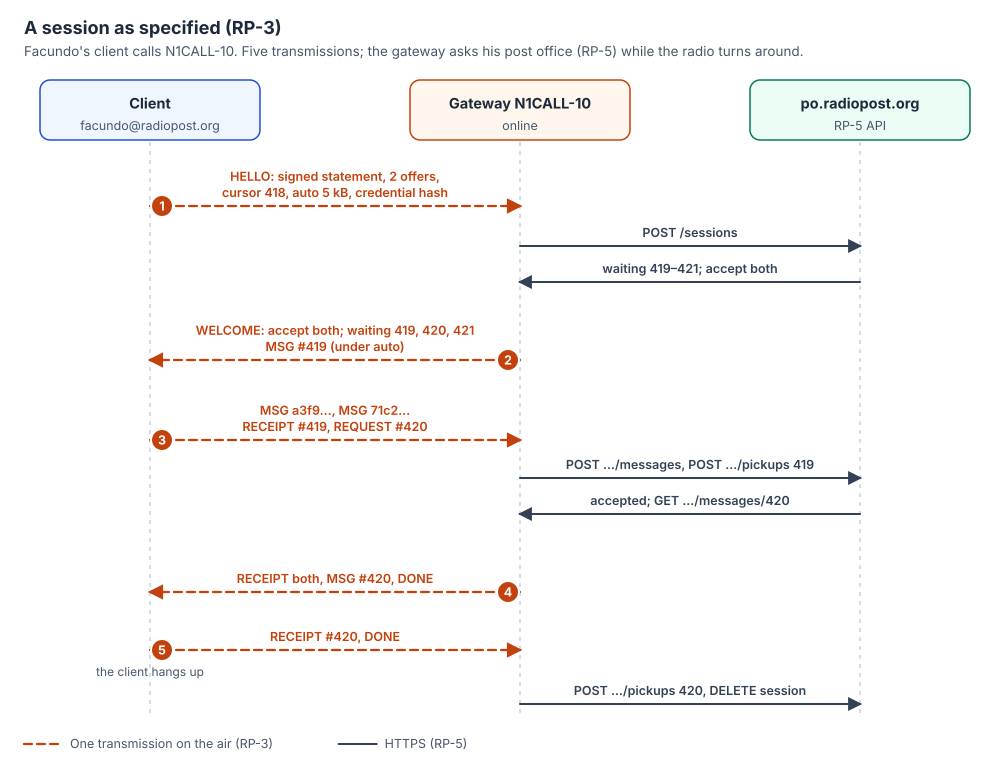

# RadioPost: detailed design

| | |
|---|---|
| **Status** | Draft |
| **Version** | 0.1.35 |
| **Updated** | 2026-11-12 |
| **Editor** | KK4ODA |
| **Licence** | [CC BY 4.0](https://creativecommons.org/licenses/by/4.0/) |
| **Follows** | [The concept](../concept/00-concept.md) |

The concept says what RadioPost is for and how it feels to use. This document says how it is
built: the programs, the connections between them, the specification that governs each
connection, and the decisions behind them.

**The specifications in [`spec/`](../../spec/README.md) are the contract.** They are what anyone
building a client, a gateway, a post office or a modem adapter implements, and where this document
and a specification disagree, the specification is right. This document is the map and the
reasoning.

RadioPost is not meant to replace Winlink (concept §1). It is a common protocol for amateurs to
experiment with and to build their own programs and applications on, which is why the
specifications come first and the programs described here have no special standing.

---

## 1. The parts and their specifications

*Figure D1.* Every connection in RadioPost is governed by one specification. Identity (RP-1) and
messages (RP-2) run through all of them.

| Program | What it does | Implements |
|---|---|---|
| **Client** | Holds the user's mail and key; talks to gateways by radio; manages the account when there is Internet. | RP-1, RP-2, RP-3 client side; RP-4 as host; RP-5 §6 |
| **Gateway** | A radio station that carries users' sessions to their post offices, checks them offline, queues mail and holds copies when the Internet is down. | RP-1, RP-2, RP-3 gateway side, RP-5 §5; RP-4 as host; RP-7 when cut off |
| **Post office** | Holds mailboxes, issues credentials, serves gateways and clients, meets ordinary email. An off-the-shelf mail server plus the RadioPost service. | RP-1 issuing, RP-2, RP-5 serving, RP-6 |
| **Modem adapter** | Lets a client or gateway use a modem: Aether, VARA, ARDOP, AX.25 packet, or TCP. | RP-4 adapter side |

RP-0 §3 makes this formal: the roles, and what each must implement. **People can use the RadioPost
programs or not**: a gateway written by someone else serves RadioPost clients, a client written by
someone else uses RadioPost gateways, and an adapter for a new modem plugs into both.

---

## 2. Principles

1. **Specifications first.** A behaviour two programs depend on is written in a specification
   before it is relied on. The reference programs have no special standing.
2. **Open on the air.** Nothing on the air is encrypted, and every encoding is published, so anyone
   can decode any transmission.
3. **Small on the air.** Every byte costs time on a weak HF path: about a fifth of a second at
   Aether's slowest rung. Formats are compact; lists send content IDs, not messages; nothing is
   sent twice.
4. **Few turnarounds.** Every change of direction costs seconds. A session is five transmissions.
5. **Standards where they exist.** Ordinary email (SMTP, IMAP, JMAP, DKIM, SPF, DMARC), DNS, HTTPS,
   CBOR, JSON, JWS, Ed25519. RadioPost invents only what has no standard: the session on the air,
   the credential, the modem interface.
6. **Works without the Internet.** Gateways check users offline, hold copies, queue mail, and later
   forward by radio.
7. **Nobody guesses.** Every exchange has a defined end: who hangs up, when a message counts as
   delivered, what an error means.
8. **Federated.** Any number of post offices and gateways, run by different people, with no central
   server.

---

## 3. Decisions

Each decision names what was chosen, why, and what was turned down. They are the design's
reasoning; the specifications hold the result.

| # | Decision | Why | Turned down |
|---|---|---|---|
| D1 | **CBOR with small integer keys** on the air and in signed objects; **JSON** off the air (RP-0 §4). | A key costs one byte; the encoding is a standard with libraries everywhere, and deterministic encoding makes hashes and signatures stable. JSON is easier to debug where bytes are cheap. | JSON on the air (several times the bytes); Protocol Buffers (needs schemas and tooling to read a capture); a custom binary format (no tools at all). |
| D2 | **Ed25519 and SHA-256**; sign, never encrypt (RP-0 §5). | Small keys (32 bytes) and signatures (64), fast, hard to misuse; encryption is not allowed on the air. | RSA (signatures four times larger); ECDSA (a bad random number leaks the key). |
| D3 | **Content IDs**: 12 bytes of SHA-256 of the message (RP-0 §6.3, RP-2 §3). | Names a message by what it is: duplicates and resumes work across gateways, and a signed list of IDs signs the messages. 12 bytes is safe for the life of the network. | Sequence numbers (not global, no deduplication); 16 or 32 bytes (bytes on every list). |
| D4 | **A compact credential as a COSE_Sign1** (RFC 9052), untagged, Ed25519 named in its protected header: 161 to 169 bytes (RP-0 §5, RP-1 §4). The post office's placements likewise (RP-7 §4.2). | Small enough to send over HF on a first visit. It is the standard envelope, with audited libraries in every common language, and the CBOR counterpart of the JWS used for JSON; with the algorithm in a signed header, a later algorithm can be added cleanly. It costs 5 bytes more than a pair of our own, about a second at 36 bit/s, on a first visit only. | X.509 certificates (several times larger, complex parsing); a signed pair of our own (5 bytes smaller, but one more format for every implementer to get right; the author chose COSE_Sign1, 2026-11-09). |
| D5 | **The first transmission is signed with the time**; a challenge only if the clocks disagree (RP-1 §6, RP-3 §5.1). | Saves a whole exchange on every session: tens of seconds on a weak path. Clocks are usually right (GPS, the Internet). | Always a challenge (one more exchange every time). |
| D6 | **A gateway keeps credentials**; the client sends a hash on later visits (RP-3 §5.1), and a forwarding gateway in each `PROOF` after the first of a user's (RP-7 §3.2). | About 160 bytes saved on every return visit and every such record: 35 seconds at 36 bit/s. | Sending the credential every time. |
| D7 | **The caller hangs up** (RP-3 §8). | Someone must, by rule. Winlink's sessions through RMS Trimode waited 30 s at every end because the program that should hang up did not. | Either side; the server side. |
| D8 | **Small PDUs** (1 kB unless both sides agree to more) (RP-3 §2). | A broken link loses at most one PDU; everything before it counts toward resuming. | Whole messages (a break loses it all). |
| D9 | **Post office keys in DNS** and in signed JWS documents (RP-1 §7). | Every post office publishes its own; DNS is already how mail is found; no registry to run. | A central key registry (central); a web of trust (hard to explain and operate). |
| D10 | **HTTPS with JSON** between gateways and post offices; bearer tokens from a signed login (RP-5 §3). | Simple, debuggable, works through any firewall; tokens are short-lived and tied to a credential. | HTTP Message Signatures (more to get right in every client); TLS client certificates (certificate handling for every gateway). |
| D11 | **A gateway acts for a user only inside that user's signed session** (RP-5 §5.1). | A stolen gateway token reads nobody's mail. | Gateways with standing access to mailboxes. |
| D12 | **Copies reach gateways by long poll**, gateway to post office (RP-5 §5.8). | Gateways sit behind home routers: outgoing connections only. | The post office pushing to gateways (needs them reachable from the Internet). |
| D13 | **The modem interface is JSON Lines over a local socket** (RP-4). | Any language can write an adapter in an afternoon; a modem can speak it natively; byte data is small. | In-process plugins (one language only); reusing VARA's interface (a proprietary vocabulary, no delivery receipts); gRPC (heavy for a script). |
| D14 | **An off-the-shelf mail server** (Stalwart) with the RadioPost service beside it (RP-6). | Email is a solved, hard problem; deliverability and security are years of work we do not need to redo. | Writing our own mail server. |
| D15 | **Refuse at the SMTP door**, never bounce later (RP-6 §2.1). | No backscatter to forged senders; the sender's own provider explains the refusal. | Accept and bounce; challenge-response email. |
| D16 | **Mail leaves from the sender's post office** (RP-6 §3.1). | Only that server can sign for the domain, so the mail is delivered, not filtered. | Sending from the gateway (fails DKIM, SPF and DMARC). |
| D17 | **DEFLATE as the baseline**; Zstandard optional; a dictionary only if it earns its place (RP-2 §4): trained on a corpus RadioPost writes and publishes, adopted if it makes messages under 1 000 bytes at least 20 % smaller than DEFLATE at their median. Phase 1 ships without it. | DEFLATE is everywhere. A dictionary keeps verbatim strings of what it was trained on and must be published, so real mail can never be its training data. | Zstandard only (not in every small environment yet); volunteers' mail after the pilot (private strings in a public dictionary); no dictionary (gives up the gain on short messages). |
| D18 | **Forwarding uses the same session protocol** (RP-7). | One protocol to implement and test; proofs travel with messages. | A separate store-and-forward protocol. |
| D19 | **A modem may be shared**: each host holds its own callsigns, answering switch and links (RP-4 §1.1). | RadioPost does not replace Winlink: a station that offers both runs them on one radio, and two modems cannot share one sound card. A call names a callsign, so the callsign decides whose call it is, as AGWPE already does. | One program at a time (the operator must choose a system); routing by an SSID convention (callsigns are the operator's choice); a switchboard program between them (one more program to run). |
| D20 | **In a station-to-station session the station called proves itself too**, with a statement over the caller's nonce (RP-1 §6.5, RP-3 §10). | Anyone can transmit any callsign, so the caller has no other way to know who answered, or whose mail it is taking. The caller's own nonce makes the statement fresh with no clock to compare. | Trusting the callsign (forged with a microphone); a challenge from the caller (one more exchange); a time-form statement checked against the clock (fails when the clocks disagree, with no way to ask again). |
| D21 | **A cut-off gateway calls its partner, and one session carries both directions** (RP-7 §1, §2). | Only the partner's windows need agreeing, and only the station that needs the link starts transmitting. The cut-off gateway is the partner's client: its queue goes out as offers, its users' mail comes back as the partner's waiting list, in the five transmissions of RP-3. | Both gateways calling each other on schedules (two schedules, twice the transmissions); the partner pushing inward mail (the cut-off gateway must listen at agreed times, and the partner start transmissions it may not be allowed to). |
| D22 | **Inward mail carries the post office's signature** (a placement, RP-7 §4.2). | A forwarding gateway could otherwise hand a cut-off area mail "from the post office" that it made up. The cut-off gateway already holds the post office's keys, and mail from the Internet has no sender's proof to carry. | Trusting the partner (any station can transmit any callsign); end-to-end proof only (Internet mail has none). |
| D23 | **Partners are configured and routes published; gateways announce nothing** (RP-7 §5, §6). A cut-off gateway keeps its records up to an hour for a partner that last said it reaches the post offices (§6.2). | An area has a few gateways, and their operators know each other. An announcement would have to be trusted: one false one draws an area's mail to a station that cannot pass it on. What a partner said in its last session is enough to prefer one that reaches the Internet, and the hour is less than a detour through a cut-off partner, which waits for a window at every hop. | Gateways announcing what they reach (trust, and checks at every gateway); handing records to whichever partner answers first (detours through cut-off partners); waiting for an online partner however long (mail held while another way is open). |
| D24 | **A cut-off gateway hands mail between its own users** (RP-7 §4.4): the addresses it received copies for in the last 30 days. | In a cut-off area much of the mail that matters is between neighbours, a shelter and the emergency operations centre, and it should not wait for the Internet or a partner's window. The copies say who uses the gateway with no list to keep. The record still takes the message to the post office, which checks it again and marks it picked up. | Waiting for the post office (no mail within the area while it is cut off); keeping mail for any address (the gateway would hold mail for strangers); going through the partner (a window and a round trip for mail that never leaves the area). |
| D25 | **Mail dropped unsent is the sender's client's to track** (RP-7 §3.6): it keeps what a cut-off gateway took, offers it again until an online gateway confirms it, and tells the sender after 30 days. | Only the client knows what it sent: the gateway may be lost or have dropped the record, and the post office never heard of the message. Offers already carry content IDs and the post office already declines what it holds, so confirming costs a few bytes in sessions the client makes anyway. | The gateway telling the sender (only if the sender calls it again, and a dropped record leaves it nothing to say); a receipt by radio for every message (air time for all mail, not just the lost); keeping records for ever (a gateway's storage is finite, and a record that cannot leave in 30 days is unlikely to). |
| D26 | **A window states the band its signal occupies, and each station checks it against its own country's table** (RP-7 §5, §5.1). RadioPost keeps the tables, the United States' first; a gateway with no table forwards only when attended. | Both stations transmit in a forwarding session, each under its own rules, and the caller may be in another country. Stating `occupied_hz` lets it check without knowing the partner's modem. Read from the rules' text and dated, the tables change with a spec version, where they can be checked. | Trusting the partner's publication (its rules may not be the caller's); each operator's own judgement only (easy to get wrong unattended); the modem alone (not every modem checks, RP-4 §8). |
| D27 | **Rust throughout**: the core library, the gateway, the RadioPost service and the client (Tauri), each a single binary (§6). | One language with Aether: one toolchain, one release pipeline, and one core library shared by every program, so the vectors test the same code everywhere. Small binaries suit a gateway on a Raspberry Pi. | A Python service over Rust bindings (two toolchains and a binding layer); Go services (the core written twice, or reached through C). |
| D28 | **Specs, vectors and code in one repository** (§6). | A spec change and the code change it causes go in one pull request, and CI runs every program against the vectors on every push, as in Aether's repository. | A separate code repository pinned to a vector version (two places to keep in step); a repository per program (four release and CI setups). |
| D29 | **The door answers Stalwart's MTA hooks** (RP-6 §2.1). | HTTP and JSON, in the same stack as the RP-5 API: the simplest to build and test. The door's rules live in the service, so a milter front can be added for a post office that runs Postfix. | Milter from the start (a binary protocol, for portability the pilot does not need); both at once (two doors to test before Phase 2). |
| D30 | **Station-to-station mail is reported over the Internet** (RP-5 §6.6, RP-3 §10): each client, with both stations' proofs; the post office files what was received as picked up and sends what was sent on to the other recipients. | Mailboxes and sent mail agree with what crossed the air, and a cc'd recipient gets the message, at no cost in air time. The proofs make the report checkable like a gateway's. | Sending each message again through a gateway (every message crosses the air twice); not reporting (mailboxes differ, cc'd recipients never get it). |
| D31 | **Third-party mail is flagged by the post office and checked by the gateway** (RP-6 §5.1, RP-3 §5.2): the post office marks mail whose sender is not shown to be licensed; the gateway hands it only to a station of its own country or one with an arrangement, read from the callsign the station operates under. | §97.115 turns on where the receiving station is, which only the gateway sees, and a portable callsign (`VE3/KK4ODA`) says it on every call. The sender's country never mattered. Licensed senders, RadioPost's own users, are not restricted. | By the account's country (wrong for a user operating abroad); domestic only (withholds mail the rules allow to Canada and most of the Americas); the sender's country (not what the rule asks). |
| D32 | **Open trust of post offices, the operator deciding** (RP-1 §7.3): a gateway trusts a post office it looked up in DNS, and one hop of the post office lists of those; its operator can block any or limit the gateway to those it names. | Like email: no gatekeeper, so a new post office reaches gateways as its users call. Every message carries the credential of the post office that vouched for its sender, so a dishonest one is found out and blocked. | A list kept by the project (a gatekeeper, against the no-centre design); only what each operator names (new post offices reach few gateways). |
| D33 | **radiopost.org enrolls on an LoTW certificate or the sysop's check** (RP-1 §1, RP-5 §6.1). | The applicant signs a challenge with the key of their ARRL Logbook of the World certificate, which names their callsign; one without LoTW is checked by the sysop against the licence database, with a code sent to the address the licence record holds. Either is enough. | LoTW only (excludes licensees without it); the sysop only (every new user waits); both (slowest, and still excludes those without LoTW). |
| D34 | **Every program updates itself from a signed update channel.** Each release carries one version, its programs ask the channel (a rolling release, `channel-beta`) when they start and every six hours, and say when a newer one is out; the desktop applications install it with Tauri's updater, the command-line programs with `update`. A file is taken only when the project's update key signed it. | Users and operators should not have to watch the releases page, and a gateway or post office left running for months must still learn of fixes. A signature, not the download's address, is what a program trusts. | Notices only (every user downloads by hand); updates without signatures (whoever controls the download controls the station); a package repository per platform (several to run). |
| D35 | **Applicants ask, operators decide, from the client** (RP-5 §6.7, §7). Anyone with a licence applies from a new device for an address; the post office keeps the application, and its operators, logged in with their own credentials, approve it (the credential goes straight to the waiting device), decline it with a reason, or send a code by post to the address on the licence. The same operator endpoints show the accounts, make codes and revoke devices. Since they go by callsign, an application naming an operator's callsign is refused, and a code naming one for anyone but the operator asking is made only when the operator confirms it (RP-5 0.15.0). | Running a post office had meant a shell on its server for every new user (check the licence by hand, `radiopost-po code`, a mailbox in the mail server, an email with both); the operators already hold a credential the post office issued, so it is their login, with no password to guess and no administration page left open on the Internet. A licence database shows a callsign exists and in whose name, which anyone can read, so the decision stays a person's (or a proof's, D33), with what the post office found shown beside it. | An administration web page with its own passwords (one more secret, open to guessing); a shell inside the client holding the server's login (the laptop becomes the server's key); approving on a licence lookup alone (the data is public, so anyone could pass as anyone); codes only (the applicant waits for a person to send one, and copies it). |
| D36 | **A gateway list is read from every post office the home knows** (RP-5 §4.4): a client takes its own post office's list and those of the post offices that one names in `/post-offices`, each checked with that post office's keys; a post office does the same for its users' usual gateways. The home's record wins; a callsign listed by two others is ambiguous. | Any gateway serves any user, so a user's list must hold the gateways registered elsewhere. The home's signed list of post offices already gives each one's address and keys, one hop from what the user trusts, as for gateways (D32). Nothing new is published. | Each post office republishing the others' gateways (it would sign records it never checked, and they go stale); a gateway registering with every post office (an account at each); a list kept by the project (a centre); the latest `updated` winning a conflict (any known post office could take a callsign over). |
| D37 | **Copies placed ahead cross post offices** (RP-5 §5.8, RP-7 §4.1): the user's post office places them at a gateway registered elsewhere, serves them only to a credential from the post office that listed it, and says `placing` in each answer; the gateway polls its own post office and those that say `placing`, and asks the others it knows at each refresh and after their users' sessions. | Users name the gateways they call, whoever registered them. The gateway sits behind a home router (D12), so only it can open the connection, and only the placing post office knows it places. Copies come without a user's session (D11's exception), so they go only to the station its own post office vouches for. | Polling every post office known (a long poll for each in the network); the user's post office handing copies to the gateway's post office to pass on (one more server that must be up, holding other post offices' mail); a flag in the session's answer only (a `via` gateway, or one named before its first session, never hears it); any known post office's credential for the callsign (any of them could collect a gateway's copies). |
| D38 | **A post office knows another only by its operators' choice** (RP-1 §7.5): it finds others as mail crosses and keeps them as seen; its operators accept or block each; for those accepted it follows the DNS records and documents, as a gateway does. | Knowing a post office lets its users' mail past the accept lists and onto the air unflagged, on its word that they are licensed. A gateway can trust from DNS because the user calling it is on the air under their own licence (D32); at the door, anyone can publish a DNS record. Following DNS keeps rotated keys and revocations current, which a typed key does not. | Trust from DNS, as a gateway's (any domain's mail past the accept lists, unflagged onto the air); one hop of lists (trust two steps from an operator's choice); a list kept by the project (a centre); keys typed by the operator only (no rotation, no revocations). |

---

## 4. A session end to end

*The RP-3 figure.* Facundo calls N1CALL-10 in Texas.

1. **The client** builds its session statement (its address, its callsign, the gateway called,
   the time, a random nonce, the IDs of the two messages it will send) and signs it with its device
   key (RP-1 §6). It sends `HELLO` with the statement's parts, the signature, the hash of its
   credential (it has called N1CALL-10 before) and where its last pickup ended.
2. **The gateway** finds the credential in its cache, checks it and the signature (RP-1 §5,
   §6.3), and, while the modem turns the link around, calls Facundo's post office:
   `POST /sessions` (RP-5 §5.2). The post office checks the statement again and answers with the
   waiting list and its view of the offers.
3. **The gateway** sends `WELCOME` and the one waiting message small enough to send unasked.
4. **The client** sends its two messages, a `RECEIPT` for the one it got, and a `REQUEST` for one
   more. The gateway hands the two messages to the post office (RP-5 §5.4), reports the pickup
   (§5.5) and fetches the requested message.
5. **The gateway** sends `RECEIPT`s, the requested message and `DONE`.
6. **The client** sends its `RECEIPT` and `DONE`, and hangs up. The gateway reports the last
   pickup and closes the session at the post office.
7. **The post office** turns Facundo's messages into ordinary email and sends them, DKIM-signed for
   `radiopost.org`, with a `Radio-Path` header naming KK4ODA and N1CALL-10 (RP-6 §3).

**Offline**, steps 2, 4 and 6 change: the gateway checks the credential and statement against the
keys and revocation list it holds, lists the copies placed ahead for Facundo, keeps his messages in
its queue, and reports everything with `POST /reports` when the Internet returns (RP-5 §5.6). The
client sees the same protocol, with `online` false and a `NOTICE` saying why. It shows Facundo's
messages as queued at KK4ODA-1 until a gateway that is online confirms them (RP-7 §3.6).

---

## 5. Inside each program

### 5.1 The client

| Part | Does | Spec |
|---|---|---|
| Keys and credentials | Generates the device key, enrolls, renews, remembers which gateways hold its credential. | RP-1, RP-5 §6 |
| Message store | Mail as standard `.eml` files, plus each message's air form and content ID. | RP-2 |
| Session engine | The client side of RP-3: `HELLO`, transfers, receipts, resume; mail queued at cut-off gateways, offered again until confirmed. | RP-3, RP-7 §3.6 |
| Modem host | Talks RPMI to an adapter; or embeds one. | RP-4 |
| Gateway list | From its post office's gateway document and those of the post offices it knows (D36); ranked by distance, band and hours. | RP-5 §4.4 |
| Interface | Folders, compose, attachments, the waiting list, where each message is. | — |

### 5.2 The gateway

| Part | Does | Spec |
|---|---|---|
| Session engine | The gateway side of RP-3. | RP-3 |
| Verifier | Checks credentials and statements, online or not. | RP-1 §5, §6 |
| Key cache | Post office keys, info documents, revocation lists, refreshed every 6 hours. | RP-1 §7, RP-5 §4 |
| Post office client | Sessions, submissions, pickups, reports; copies from its own post office and each other that says it places them (D37). | RP-5 §5 |
| Store | The outgoing queue, copies placed ahead, partial uploads, the replay cache, credentials seen. | RP-3 §7 |
| Modem host | Talks RPMI to one adapter per radio. | RP-4 |
| Rules check | Bands and segments for automatic control, when the modem does not check them. | RP-4 §8 |
| Interface | RadioPost Gateway, the gateway's own desktop application: setup, registration, start and stop, the session under way, the sessions carried, the post offices' answers; the same panel served for a browser on a gateway with no screen. | RP-5 §6.4 |
| Forwarder | When cut off: calls partners in their windows, offers session records with `PROOF`, takes inward mail and checks its placements, and hands mail between its own users. As a partner: takes records, reports them or forwards them on, holds forward items. | RP-7 |

### 5.3 The post office

**The mail server** (Stalwart): SMTP in and out, IMAP and JMAP for users' mail programs, storage,
spam filtering, DKIM signing, Sieve. Its Community edition (AGPL-3.0) is enough: clustering and high
availability are in it, and only read replicas and sharded storage are Enterprise features
([stalw.art/compare](https://stalw.art/compare), 2026-11-09). An operator who runs it unchanged has
nothing to publish; the RadioPost service talks to it over the network (hooks, JMAP, SMTP), so its
own licence is unaffected.

**The RadioPost service** beside it:

| Part | Does | Spec |
|---|---|---|
| Identity | Accounts, enrollment codes once the callsign is shown (D33), credentials, the post office's keys, revocation, the DNS and JWS documents; the post offices it knows, followed in DNS, and those seen (D38). | RP-1 |
| API | The HTTPS interface for gateways and clients. | RP-5 |
| Door | Answers the mail server's MTA hooks at `RCPT TO` and `DATA` (D29): the accept list, encryption, size. | RP-6 §2.1 |
| Converter | Email to RadioPost message and back; serials; the content-ID-to-Message-ID map. | RP-6 §2.4, §3 |
| Copies | Places and drops copies at users' usual gateways, registered with it or with a post office it knows (D37). | RP-5 §5.8 |
| Registry | Gateway records and radio routes; the gateway lists of the post offices it knows (D36). | RP-5 §4.4, §6.4, RP-7 |

The service reaches the mailboxes through JMAP and sends through SMTP submission, so another mail
server with those interfaces could replace Stalwart (concept §8.1).

### 5.4 Modem adapters

| Adapter | Modem's interface | Notes |
|---|---|---|
| Aether | Control API, WebSocket | Delivery receipts, quality, busy, rules checked by the modem. Could become native RPMI. Shareable from 0.2.0-beta.146: each program claims its callsigns (its ADR-0106, RP-4 §9.1). |
| VARA HF, VARA FM | Published TNC commands, two TCP ports | No delivery receipts. |
| Mercury | VARA-style TNC commands, two TCP ports (RP-4 §9.6) | Built, `adapters/mercury`. Delivery from its `BUFFER`, which counts what the other station has not confirmed. One program at a time; checks no band rules. Mercury does not identify the station, so the adapter sends `CQFRAME` with the station's callsign after each session. |
| ARDOP | Host command and data ports | To be checked against ARDOP's specification. |
| AX.25 | AGWPE (Direwolf, TNCs) | VHF and UHF packet. |
| TCP | Another TCP adapter (RP-4 §9.5) | The Internet over TLS; an amateur mesh such as AREDN in plain TCP, since it is on the air; tests. |

---

## 6. Reference implementations

Decided (D27, D28):

* **A shared core library** in Rust: the encodings, content IDs, credentials, statements and the
  session state machines (RP-1, RP-2, RP-3), used by all three programs and checked against the
  test vectors. Rust matches Aether, builds single binaries for Windows, macOS, Linux and the
  Raspberry Pi, and can be wrapped for other languages later.
* **The gateway and the RadioPost service** in Rust, as services.
* **The client** as a desktop application, built like the Aether app (Tauri, a panel with no build
  step), later a phone.
* **Adapters** in whatever language suits the modem; the Aether adapter first, then VARA and AGWPE.

They live in this repository beside the specifications and vectors: `core/`, a Cargo workspace (the
library, the gateway and the service), `app/` (the client) and `adapters/`. CI builds them and runs
the core against `vectors/` on every push, with the checks that run today.

---

## 7. Testing and conformance

* **Test vectors** in `vectors/` (started): messages and their content IDs and air forms (RP-2);
  credentials, their verification and session statements made with published test keys (RP-1);
  every PDU and three sessions, byte for byte: an ordinary one, uploads and downloads broken and
  resumed, and station to station (RP-3); modem interface lines, and conversations between hosts
  and a simulated modem, shared and not (RP-4); signed documents, and the post office API's
  requests and answers through a reference post office, from enrollment to an offline gateway's
  report (RP-5); email at the door, emails that become messages and messages that become email,
  between post offices too (RP-6); deterministic
  CBOR and DNS records (RP-0, RP-1). They are made by a small reference in Python, standard
  library only (`tools/vectors/`), written to read like the specifications rather than to be
  fast. `python tools/vectors/make.py` writes them and `--check` compares the reference with the
  files. Every implementation checks itself against them; a specification change updates them in
  the same pull request. Writing them found five gaps in the drafts, fixed in RP-0 0.2.0, RP-1
  0.2.0, RP-2 0.1.2, RP-3 0.1.2 and RP-5 0.2.0. The resumed and station-to-station sessions
  found three more, fixed in RP-1 0.3.0, RP-3 0.2.0 and RP-5 0.3.0: a partial download was never
  said to be sent unasked; nothing kept a resumed air form the same bytes; and the station called
  never proved who it was (D20). The modem interface's conversations found seven unwritten rules,
  fixed in RP-4 0.3.0: what a bad line gets, that a host ignores what it does not know, `refused`
  before `hello`, which `connect` errors come at once, what `ok` carries, `failed`'s codes with a
  new `aborted`, and that `received` keeps no `send` boundaries. The post office's exchanges found
  RP-5 0.4.0's: the HTTP status of each code, 401 against 403, the order of a session's checks,
  the codes of a refused message, unknown serials, a report's answer, and login and enrollment
  failures; and RP-0 0.3.0's: signed documents are plain JWS, with no context. The email vectors
  found RP-6 0.2.0's and RP-5 0.5.0's: a delivery report has a null sender, which no accept list
  matches, so bounces were refused at the door; `Radio-Path` needed the gateway's session ID, which
  RP-5 never sent; attachments were decided by limits that depend on the gateway, though the message
  is made once (now the account's `attach_bytes`); a message part could be any message of the
  session, not one for its recipient; and the door's order, encryption, executables, accept-list
  matching, quoted history, the date's form and the signature line were unwritten. Renewal and the
  accept list found RP-5 0.6.0's: a gateway could not renew its own credential (gateways were kept
  off client endpoints), what a renewed credential holds and what becomes of the old one, the
  accept list's answer and spelling, and no setting turned off the list's filling by mail sent.
  RP-7's vectors (a forwarding session, placements, records, the post office's side) found RP-7
  0.2.0's: which flags a forwarding caller's credential needs, and a record's; the placement's
  checks in order with their codes; that copies still wait for a cut-off gateway; and RP-5 0.8.0's
  refusal of a report whose path does not end at the reporter. Later decisions came with their own:
  local delivery, mail queued at a cut-off gateway, the credential's hash in `PROOF`, windows and
  the bands, choosing a partner, credentials as COSE_Sign1, station-to-station reports,
  third-party traffic and which post offices a gateway trusts. Every specification has vectors.
* **A conformance tester** that plays the other side: a client to test a gateway, a gateway to
  test a client, over its own test adapter, including broken links, resumes and wrong signatures.
  Its outline, with the tests by role and the order they are written in, is
  [the conformance tester](01-conformance.md).
* **A loopback adapter** joining two hosts through RPMI with delays and losses, for tests with no
  radio. Aether's simulated channel can carry the same sessions with real modem timing.
* **Interoperation before Candidate:** a specification becomes Candidate only when two independent
  implementations pass its vectors and complete sessions with each other (RP-0 §8.1).

---

## 8. Security, in brief

| Threat | Answer |
|---|---|
| Someone calls as another user | Every session is signed with the user's device key; the gateway and the post office both check it (RP-1 §6). |
| A lost or stolen device | The post office revokes its credential; gateways fetch the list; credentials expire within 90 days (RP-1 §4.2, §8). |
| A gateway alters or forges mail | It cannot: content IDs are hashes, and the signed statement lists them (RP-1 §6.4). |
| A gateway reads mailboxes | Only inside a user's own signed session (RP-5 §5.1). |
| Replay of a session's start | Time window and replay cache, or a challenge (RP-1 §6.3). |
| Forged email from a RadioPost domain | DKIM, SPF and DMARC (RP-6 §1). |
| Spam to radio users | Accept lists at the SMTP door (RP-6 §2). |
| A dishonest post office | Gateways and other post offices choose which post offices' keys they keep (RP-1 §7.3, §7.5). Copies placed ahead go only to the credential of the post office that listed the gateway (RP-5 §5.8). |

---

## 9. Order of work

| Phase | Delivers | Specs |
|---|---|---|
| 0 | These documents brought to complete drafts; test vectors; the conformance tester's outline. | All |
| 1 | The core library; the client; the TCP and Aether adapters; station-to-station sessions between two clients; the conformance tester's first half ([its §6](01-conformance.md)). | RP-1–RP-4 |
| 2 | The RadioPost service with Stalwart; the gateway, online; ordinary email both ways. The pilot: `radiopost.org` with KK4ODA-1. | RP-5, RP-6 |
| 3 | Copies placed ahead; the offline queue; reports. | RP-5 §5.6, §5.8 |
| 4 | Forwarding by radio. | RP-7 |
| 5 | More adapters (VARA, ARDOP, AGWPE); forms; the phone. | RP-4, new |

What the author and users ask for, inside this order and beyond it, is kept in
[the wishlist](02-wishlist.md): each wish grouped, given a proposed priority, and checked against
the specifications, with what has been set aside and why.

---

## 10. Open questions

Collected from the specifications and the concept, each to be settled in the document named.

| Question | Where |
|---|---|
| The dictionary's corpus, written and measured. | RP-2 §4 |
| ARDOP's host interface, checked against its specification. | RP-4 §9.3 |
| Third-party traffic: tables for gateway countries other than the United States. | RP-6 §5.1 |
| Forwarding: segment tables for other countries, and the US bands of shorter wavelength than 6 m. | RP-7 §8 |

---

## Change log

| Version | Date | Change |
|---|---|---|
| 0.1.0 | 2026-11-09 | First draft. |
| 0.1.1 | 2026-11-09 | Licence stated: CC BY 4.0. |
| 0.1.2 | 2026-11-09 | Test vectors started (§7). |
| 0.1.3 | 2026-11-09 | D19: a modem may be shared (RP-4 0.2.0). |
| 0.1.4 | 2026-11-09 | D20: the station called proves itself in a station-to-station session; the resumed and station-to-station test vectors (§7). |
| 0.1.5 | 2026-11-09 | The modem interface's test vectors (§7). |
| 0.1.6 | 2026-11-09 | The post office API's test vectors (§7). |
| 0.1.7 | 2026-11-09 | The email test vectors (§7). |
| 0.1.8 | 2026-11-09 | §5.4: Aether is shareable from 0.2.0-beta.146 (its ADR-0106). |
| 0.1.9 | 2026-11-09 | Renewal and accept-list test vectors (§7). |
| 0.1.10 | 2026-11-09 | D21–D23: forwarding (RP-7 0.1.0); the forwarder's part; open questions moved to RP-7 §8. |
| 0.1.11 | 2026-11-09 | RP-7's test vectors (§7). |
| 0.1.12 | 2026-11-09 | D24: local delivery at a cut-off gateway (RP-7 0.3.0); the forwarder's part; its vectors (§7). |
| 0.1.13 | 2026-11-09 | D25: mail dropped unsent is the sender's client's to track (RP-7 0.4.0). |
| 0.1.14 | 2026-11-09 | D6 covers `PROOF` (RP-7 0.5.0). |
| 0.1.15 | 2026-11-09 | D23: gateways announce nothing, and how a cut-off gateway chooses among its partners (RP-7 0.6.0). |
| 0.1.16 | 2026-11-09 | D26: the bands open to unattended forwarding (RP-7 0.7.0). |
| 0.1.17 | 2026-11-09 | The author's decisions: D27 Rust throughout, D28 one repository, D29 MTA hooks; §6 decided; Stalwart's edition and AGPL (§5.3). |
| 0.1.18 | 2026-11-09 | D4: credentials and placements as COSE_Sign1 (RP-0 0.5.0, RP-1 0.4.0, RP-7 0.8.0). |
| 0.1.19 | 2026-11-09 | D30: station-to-station mail reported over the Internet (RP-5 0.10.0). |
| 0.1.20 | 2026-11-09 | D31: third-party traffic (RP-6 0.3.0, RP-3 0.7.0, RP-5 0.11.0). |
| 0.1.21 | 2026-11-09 | D17: the dictionary's rule (RP-2 0.2.0); D32: trusting post offices (RP-1 0.5.0); D33: radiopost.org's enrollment. Phase 0's open questions settled but the data still owed. |
| 0.1.22 | 2026-11-09 | §7: the conformance tester's outline, in its own document. |
| 0.1.23 | 2026-11-09 | The TCP adapter: TLS on the Internet only; plain TCP on an amateur mesh, which is on the air (RP-4 0.5.0). |
| 0.1.24 | 2026-11-10 | §5.2: the gateway's interface, an application of its own with its own installer, as the author chose. |
| 0.1.25 | 2026-11-11 | D34: the programs update themselves from a signed update channel, as the author asked. |
| 0.1.26 | 2026-11-11 | §9: the wishlist, in its own document. |
| 0.1.27 | 2026-11-12 | The purpose, stated (written 2026-11-10 on a branch, merged now): not a replacement for Winlink, but a common protocol to experiment with and build on. D19's reason reworded to match: a station runs both systems, not a move from one to the other. |
| 0.1.28 | 2026-11-12 | D35: applications from the client, decided by the operators over the API with their own credentials (RP-5 0.14.0). |
| 0.1.29 | 2026-11-12 | §5.4: the Mercury adapter (RP-4 §9.6). |
| 0.1.30 | 2026-11-12 | §5.4: the Mercury adapter identifies the station after each session (RP-4 0.6.5). |
| 0.1.31 | 2026-11-12 | D35: nobody becomes an operator by applying, and a code that makes one is confirmed (RP-5 0.15.0). |
| 0.1.32 | 2026-11-12 | More than one post office, drafted for the author: D36, gateway lists from every post office the home knows; D37, copies placed ahead at gateways of other post offices; D38, a post office knows another by its operators' choice (RP-1 0.6.0, RP-5 0.16.0, RP-6 0.6.1, RP-7 0.9.0). The parts of §5 and §8 that change with them. |
| 0.1.33 | 2026-11-12 | D36 to D38 decided by the author. D38 built: the post office's known, seen and blocked post offices (RP-1 §7.5), followed in DNS. |
| 0.1.34 | 2026-11-12 | D36 built: the client's gateway list read from every post office its own knows (RP-5 §4.4). |
| 0.1.35 | 2026-11-12 | D37 built on the post office's side: copies at gateways of other post offices, `placing`, items only to the listing post office's credential; the gateway's polling comes with Phase 3. |
