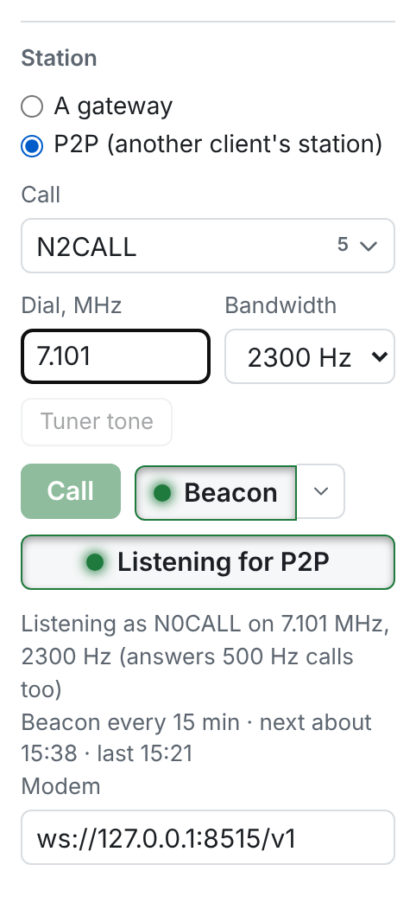
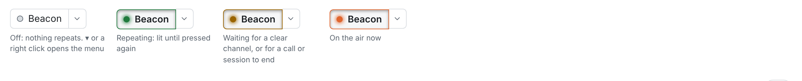
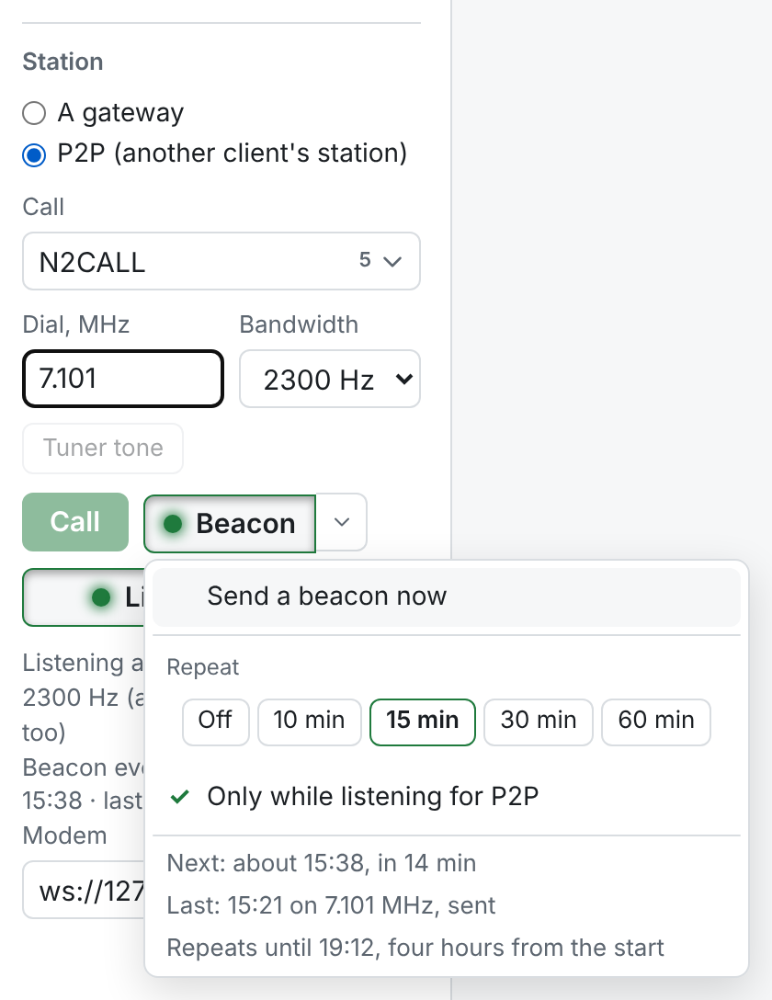
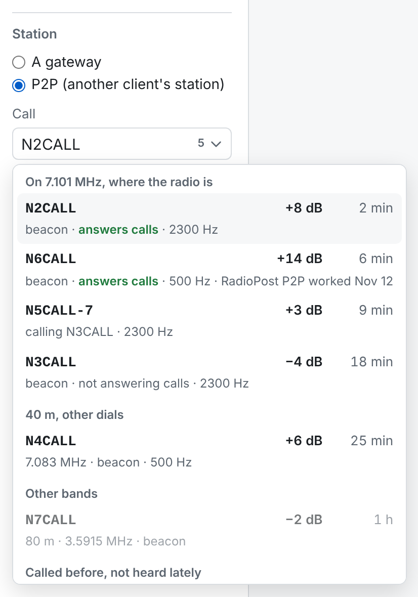
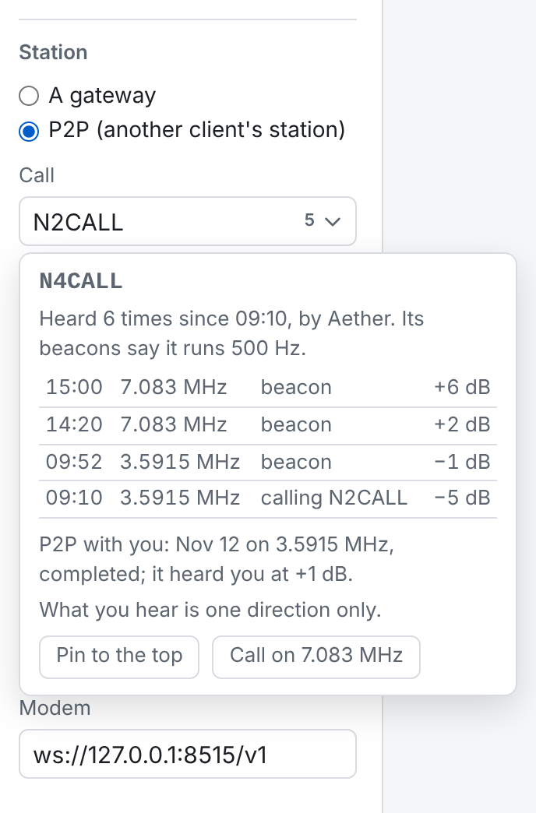

# RadioPost: finding, beaconing and calling P2P stations (a proposal)

| | |
|---|---|
| **Status** | Proposed |
| **Version** | 0.1.0 |
| **Updated** | 2026-11-27 |
| **Editor** | KK4ODA |
| **Licence** | [CC BY 4.0](https://creativecommons.org/licenses/by/4.0/) |
| **Follows** | [The wishlist](02-wishlist.md), W59; [RP-4](../../spec/rp-0004-modem-interface.md) §5, §8 |

The client can show who is on the air and beacon for its operator with three optional additions to
RPMI, two small changes to Aether and one bit on the air. Aether already keeps the stations it
hears with their SNR, dial, bandwidth and what they were doing, sends beacons on the tone floor and
repeats them politely. None of it reaches RadioPost: RPMI defines a `heard` event that no adapter
sends, and RPMI has no beacon. The proposal adds the road (RP-4 1.7.0, MINOR), then the client's
part: the stations heard in the **Call** box, and a **Beacon** split button beside **Call**. RP-3,
RP-2, RP-5 and RP-8 do not change, and nothing new goes on the air but one bit in Aether's beacon.
§10 lists eleven decisions for the author; the first is whether the client may transmit on a timer
at all.

---

## 1. What exists

### 1.1 In the client

* **Call** is already a combobox (`#callsign`, `#called-list`). In P2P its ▾ lists the stations
  called before, newest first, with the dial and bandwidth of that call (`/api/called`, from the
  attempt records). A pick fills **Call**, **Dial, MHz** and **Bandwidth** and tunes the radio.
* **Listen for P2P** (W15, D47) keeps one connection, its claims and `listen` on across sessions
  (`session::keep_listening`). The line under it says where and how the station answers, from
  RPMI `status` (`dial_hz`, `answers`, `scanning`).
* **The connection between calls** (`presence.rs`) holds Aether, and any other adapter that says it
  is shared, with `hello` alone. It hears every event the adapter sends: `busy`, `dial`,
  broadcasts. To send an alert it takes the station (activity `alerting`) and opens a short
  connection that claims the callsign.
* **Attempt records** (W57, `selection/attempts.rs`) keep every call: whom, where, how it ended,
  and, when a session ran, how each side heard the other (`quality.peer_snr_db`).
* **A repeated transmission already exists**: a circle report goes again every 10, 15, 30 or 60
  minutes, for four hours at most (RP-8 §7, `Alerts::repeat_due`, D49), while the operator is at
  the station.
* **`/api/p2p-chance`** predicts a P2P dial at the site of a gateway listed under the station's
  base callsign.
* **`rpmi::host` parses `heard`** (`Event::Heard`, RP-4 §5: `callsign`, `snr_db`?, `bandwidth`?),
  and the attempt record reads it during a call. No adapter sends it.

### 1.2 In Aether

* **The stations heard** (`heard.rs`, `heard.json`, at most 200): one entry per callsign with
  `first_heard_ms`, `last_heard_ms`, `count`, `snr_db` (last) and `best_snr_db`, `frequency_hz`
  (the dial at the last sighting, when the radio can say), `mode`, `activity` (`beacon`,
  `calling`, `answering`, `probing`, `connected`, `datagram`, `identified`), `detail` (whom it
  called or answered), `connected`, `beacons`, `last_beacon_ms` and `bandwidth_hz`. The control
  API answers `heard.list`, and every change goes to every connection as a `heard` event.
* **A beacon** (`beacon {callsign?}`, ADR-0016, ADR-0024): one tone-24 frame on the tone floor,
  5.4 s, decoded to about −19 dB on AWGN, heard on both bandwidths. Its body is the packed
  callsign and a capability byte stating the sender's bandwidth (bits 1 and 2; bits 0 and 3 to 7
  are zero). It is refused in a session, while another waits, on an answer-only station, and under
  automatic control with a rules profile in force (§97.203(d)).
* **A repeating beacon** (`beacon.every {minutes}`, `station/beacons.rs`): 10 to 240 minutes. Each
  waits for an idle station and a clear channel whatever `wait_for_clear` says; one that cannot go
  within 120 s of falling due is skipped and said, and the next keeps to the interval. It lasts
  until stopped or the daemon restarts. `status.beacon` has `every_s`, `next_in_s`,
  `last_sent_ms`, `sent`, `skipped`, `waiting` and `waiting_for_clear`.
* **The busy detector** marks the channel busy for any signal, voice and other modes included.
* **Claims** (ADR-0106, ADR-0108): while a program holds a claim, Aether's own callsigns are not
  answered. A beacon from Aether's panel names Setup's callsign (`station_callsign`), so today a
  beacon sent while RadioPost listens as `WD5EMA` invites calls to a callsign nobody answers.
* **The VARA port** turns a host's `CQFRAME <call> <bandwidth>` into a beacon and tells a host of a
  beacon heard as `CQFRAME <call> <bandwidth>` after its `SN` line.

### 1.3 Other modems

| Modem | Send a beacon | Hear one | SNR | Bandwidth | Dial |
|---|---|---|---|---|---|
| Aether | `beacon` | `heard` events, `heard.list` | yes | yes | with CAT, rigctld or FLRig |
| VARA HF | `CQFRAME <call> <bw>` | `CQFRAME` after `SN` | `SN` | yes | no |
| Mercury | `CQFRAME` (the adapter sends it already, RP-4 §9.6) | `CQFRAME` (the adapter reads it already) | if Mercury says `SN` | yes | no |
| ARDOP | `SENDID` | `IDF` blocks | to check | no | no |
| Packet (AGWPE) | a UI frame | monitored frames | no | no | no |
| TCP | none | none | none | none | none |

VARA's `CQFRAME` is in Aether's record of VARA's published command list (its
`host-interfaces.md` §1); it is checked against EA5HVK's document itself before the VARA adapter
uses it. ARDOP and packet are left for later: what ardopcf reports of an ID frame, and how a heard
list should treat AX.25 traffic, need their own look.

Every adapter but Aether's serves one host (`caps.shared` false), so the client holds no
connection to it between calls. With those modems the client hears stations only while it listens
or calls.

---

## 2. What is reused as it is

* Aether's heard list, its `heard` events and its measurements. RadioPost decodes nothing and
  measures nothing.
* Aether's beacon frame, its clear-channel wait and its rules gate. No RadioPost frame goes on the
  air for this.
* The **Call** combobox, its keyboard handling and its "called before" entries.
* The connection between calls and the listening connection, which already receive every event.
* The way an alert reaches the air between calls: the station taken from the panel, a short
  claiming connection, the station given back.
* The attempt records, for "P2P worked here before" and for how the other station heard this one.
* RP-8 §7's repeat rules for a timed transmission: four intervals, four hours at most.

---

## 3. The changes

### 3.1 RPMI: RP-4 1.7.0, three optional additions

**(a) `heard` says more.** The event keeps its three members and gains five, each optional:

| Member | Meaning |
|---|---|
| `dial_hz` | The radio's dial when the station was heard, with `caps.dial`. |
| `kind` | What was heard: `beacon`, `call` (to `to`), `answer`, `probe`, `session` (a frame of this host's own link), `datagram` or `id` (an identifier). |
| `to` | Whom a `call`, `answer` or `probe` was addressed to. |
| `answers` | With `kind` `beacon`: whether the beacon said calls to its callsign are answered now (§3.2, A2). Left out when the beacon does not say. |
| `at` | When it was heard, Unix seconds. |

On a shared modem an adapter sends `heard` for another program's session frames to no host: that
would report the program's link, which §1.1 forbids. Calls, answers, beacons and identifiers are
public, and go to every host that has said `hello`, as broadcasts do (§6).

**(b) `stations`: the modem's own list.** A host asks `{"op": "stations", "id": 4}` and is answered
with the stations the modem has heard, each in `heard`'s members, `at` always present:

```json
{"op": "stations", "id": 4, "stations": [
  {"callsign": "N2CALL", "at": 1795213320, "snr_db": 8, "dial_hz": 7101000,
   "bandwidth": 2300, "kind": "beacon", "answers": true}]}
```

It lets a client started in the morning see who the modem heard overnight. `caps.heard` says the
adapter sends `heard` and answers `stations`; without it, `stations` is `unsupported`.

**(c) `beacon` and `beacon-sent`.** With `caps.beacon`:

| `op` | Members | What the adapter does |
|---|---|---|
| `beacon` | `as`?, `ref`?, `within_s`? | Sends one beacon carrying `as` (one of this host's callsigns, its first by default), addressed to nobody, in the mode the modem's weakest listeners hear (Aether's tone floor). It goes when the channel is clear and nothing else of the station's is on the air, within `within_s` seconds (default 120, at most 600), or not at all. `ok` once the modem has taken it. |
| `beacon-sent` (event) | `ref`, `sent`, `dial_hz`?, `text`? | The beacon went (`sent` true, on `dial_hz`), or did not (`text` says why: the channel stayed busy, a session started, the rules refused it at keying). |

Refusals come at once: `refused` with no callsigns yet, under rules the modem checks (automatic
control, the band, answer-only), `not-authorized` for an `as` that is not the host's, `busy` while
a link or call of any program is up or another beacon waits. The adapter never repeats a beacon by
itself: repeating is the host's (§6). §8's list of what a host may make the modem transmit gains
beacons.

**(d) `status` gains `beaconing`**, the station's: the interval in seconds of a repeating beacon the
modem runs itself (Aether's **Repeat**), whichever program or panel started it. A host that
repeats its own beacons sees it and does not double them.

All four are MINOR (RP-0 §8.2): an adapter that says none of them and a host that ignores them work
as before. The change is announced (RP-0 §8.4), with test vectors: the reference's simulated modem
beacons and reports `heard` to the other stations, and `rpmi-lines.json` gains `beacon`'s
malformed members.

### 3.2 Aether

**A1. A program's beacon** (daemon only; no wire change). `beacon` from a connection that holds a
claim goes as the claim's first callsign unless named, and a callsign another program holds is
refused (`claimed`), as `connect_for` does for calls. It takes `ref` and `within_s`: held for a
clear channel whatever `wait_for_clear` says, dropped after `within_s`, as the repeating beacon's
120 s window is. A new `beacon-sent` event says what became of it, mirroring `datagram-sent`, so no
program reads Aether's log to find out.

**A2. "Answers calls" in the beacon** (a new meaning for a reserved bit; no protocol version). The
beacon's capability byte gains a bit set when calls to the beacon's callsign are answered at the
moment it is rendered (`answers_call_for`). An older Aether reads only the bandwidth bits, and the
VARA port's `CQFRAME` is unchanged. The `frame` and `heard` events gain `answering`. A beacon from
RadioPost while it listens says yes; one while it does not says no; VarAC's `-9` beacons say no,
since no program answers `-9`. Without A2 a client can only say "RadioPost P2P worked here on Nov
12", from its own records.

**A3. The operator's own transmission** (later, optional). Aether cannot tell when the operator
keys the microphone: the radio's receive audio goes quiet, and quiet reads as a clear channel.
Reading the radio's transmit state over CAT (Yaesu `TX;`, Kenwood `IF;`, Icom CI-V `1C 00`) before
any transmission the station starts by itself would keep a beacon off a voice over. It is a modem
change with its own ADR, not needed for the rest.

### 3.3 The adapters

* **Aether**: `heard` from Aether's `heard` events (its `activity` as `kind`, `detail` as `to`,
  `frequency_hz` as `dial_hz`, `last_heard_ms` as `at`), filtered as §3.1(a) says; `stations`
  from `heard.list`; `beacon` and `beacon-sent` from A1; `beaconing` from `status.beacon.every_s`.
  Phase 1 needs no Aether release: the events and the list exist today.
* **Mercury and VARA HF**: `heard` from `CQFRAME` with the `SN` before it; `beacon` as
  `CQFRAME <as> <bandwidth>`, taken as sent when the modem keys (`PTT`, or `PENDING` and
  `CANCELPENDING` as Mercury brackets its own `CQFRAME`).
* **ARDOP, packet, TCP**: neither cap, for now.

### 3.4 The client

* **`stations.rs`**, the stations heard: for each callsign and band, the latest observation and its
  last eight SNR readings, kept seven days, in `stations.json` in the first home (the computer's,
  as circles are). It is fed by every connection's `heard` events (between calls, listening,
  calling), the same event from two connections kept once, and filled from `stations` each time a
  connection opens. It adds what the modem's list cannot keep: a station heard on 80 m this
  morning and on 40 m now is two lines, not one.
* **`/api/stations`**: the list as **Call** shows it (§5.2), worked out from the store, the radio's
  dial, the listed gateways and the attempt records.
* **`beacons.rs`**, the schedule (§6), sans clock as `alerts.rs` is. A due beacon is sent by
  whoever holds the modem: the listening connection while listening, otherwise a short claiming
  connection as an alert is.
* **The panel**: §5.

---

## 4. Compatibility

* **The protocols.** RP-2, RP-3, RP-5, RP-6, RP-7 and RP-8 do not change. A P2P session is the
  session it is today. RP-4 1.7.0 is MINOR and announced.
* **Independent implementations** (RadioPostKit, other adapters): nothing to do. A host that
  ignores `heard`, `stations` and `beacon` loses nothing it had; an adapter that offers none says
  so by leaving the caps out.
* **On the air.** A RadioPost beacon is the modem's own beacon, so every program that lists the
  modem's beacons lists it, and RadioPost lists theirs. VarAC shows an Aether beacon named
  without a suffix as a CQ; a VarAC operator who answers it reaches RadioPost's claim, and the
  session ends at RP-3's first frame. A2 is the one on-air change: a reserved bit an older Aether
  ignores.
* **Not built: a RadioPost "presence" broadcast** (a CBOR kind under RP-0 §9.5, as alerts are). It
  would say "RadioPost listens here" exactly, but it is an RP-4 broadcast: 11 to 27 s on Aether
  against a beacon's 5.4 s, only on modems with `caps.broadcast`, and a new specification. A2 says
  the same for the price of one bit.

---

## 5. The interface

The station box keeps its shape: **Beacon** joins **Call** on its row, and one line joins the
lines under **Listen for P2P**. The stations heard open from ▾, which now carries their count.



*The mockups are the client's own panel, its API answered with made-up stations, the proposed
controls put into the page (as `tools/manual/screens.mjs` makes the manual's pictures).*

### 5.1 Beacon

A split button. Its left part is a latch, as **Listen for P2P** is: pressed, it repeats the beacon
and stays lit until pressed again; its first beacon goes at once. ▾, or a right click on either
part, opens the menu. The lamp says what the beacon is doing:



| Lamp | Meaning |
|---|---|
| dark | Nothing repeats. |
| green | Repeating. The line under **Listen** says when the next goes and when the last went. |
| amber | Due, and waiting for a clear channel, or for a call or session to end. |
| orange (`--tx`) | On the air now. |

The menu holds what a split button cannot show:



* **Send a beacon now**: one beacon, whatever the repeat says. Greyed while one waits, and for a
  minute after one went.
* **Repeat**: Off, 10, 15, 30 or 60 min. Choosing an interval starts repeating.
* **Only while listening for P2P** (on by default, decision 3): repeating starts and stops with
  **Listen for P2P**, and the first beacon goes once the radio is on the P2P dial.
* **Next**, **Last** and **Repeats until**, as the modem and the schedule say them.

The tooltip of each part says the same in a sentence, as the panel's tooltips do.

### 5.2 The stations heard, in Call

In P2P, ▾ beside **Call** shows the count of stations heard in the last half hour, and opens the
list. The list is wider than the column (23rem) and opens above the page: the side column scrolls,
and anything placed inside it is cut off at its edge (the first mockup was). It is a popover in the
top layer, or placed fixed from the field's position.



* **Groups, in this order**: *On 7.101 MHz, where the radio is*; *40 m, other dials*; *Other
  bands*; *Called before, not heard lately*. Without a dial from the modem, one group: *Heard (the
  modem cannot read the dial)*. Within a group, the most recently heard first; a station
  pinned (§8) heads its group.
* **Each line**: the callsign, the last SNR, how long ago; under it what was heard (beacon, calling
  whom, a session), whether it answers calls (A2), its bandwidth, the dial when it is not the
  radio's, and "RadioPost P2P worked Nov 12" when the attempt records say so.
* **Age**: under 30 minutes, plain; 30 minutes to 6 hours, faded; older, left out unless called
  before, with a last item *Show older*. HF changes within the hour, so a station heard an hour
  ago is a hint, not a promise.
* **SNR**: what this station heard, one direction only, as the details say. No reading: "—". A
  reading from a tone-floor frame (a beacon, a call, a probe) is a lower bound: a true +20 dB reads
  +15.6 dB on AWGN, +11.2 on ITU Moderate and +4.8 on ITU Poor (Aether's ADR-0016 §4). The line
  says what was heard, so the operator knows which kind of reading it is, and the tooltip says
  that a beacon's reading is low on a strong or fading path.
* **Left out**: the station's own callsigns, and a callsign listed as a gateway (D47: no P2P call
  to a gateway's callsign). Heard gateways belong to the gateway list (§8, item 8).
* **Picking a line** puts the callsign in **Call**, the dial it was heard on in **Dial, MHz**, and
  the bandwidth its beacon or call stated in **Bandwidth** (a station heard at 500 Hz may not
  answer 2300 Hz calls), and tunes the radio as a pick from ▾ does today.
* **Typing** filters the list to callsigns that start with what was typed. Arrows, Enter, Escape and
  Tab work as they do now.
* **While it is open** the order holds still: ages and readings change in place, a new station
  joins the end of its group, and the line under the pointer or the arrows stays the one chosen.
  Nothing ever changes what is in **Call** but the operator. Ages count on the page every 15 s.
* **Sorting**: by recency within the groups. A second order (strongest first) is one toggle in the
  list's first group heading, if the author wants it; callsign order is what typing gives.

At the window's narrowest (380 px wide), the list is as wide as the column, and a long second line
wraps:


### 5.3 A station's details (optional)

A right click on a line, or Shift+F10, opens what the client knows of the station: each
observation (time, dial, what, SNR), the P2P sessions with it from the attempt records, how it
heard this station in them, and **Pin to the top** and **Call on** its dial.



### 5.4 Checked

Each picture was rendered at 1280 × 1300 and at 380 px wide in headless Chromium. Built, the panel
check (`screens.mjs` scenes) covers 1280 × 800 and 380 × 480, the window's minimum (`min_inner_size`
in the shell), and Windows' wider fonts are checked before release.

---

## 6. How the beacon behaves

* **One owner of the schedule: the client.** The modem decides only when, inside the window it was
  given, the channel is clear. RadioPost does not use Aether's **Repeat** (`beacon.every`): it is
  the station's, not a program's, goes as Setup's callsign, has no jitter, survives the program,
  and exists on one modem. When Aether's own **Repeat** runs (`status.beaconing`), the client says
  so and starts none of its own.
* **Intervals**: 10, 15, 30 or 60 minutes, the choices RP-8 §7 offers for reports. Ten minutes is
  the least, as in Aether.
* **Jitter**: each beacon falls due one interval plus a uniform 0 to 60 s after the last. Two
  stations started together on one interval drift apart, and the clear-channel wait spreads them
  further.
* **Counted from the station's last callsign on the air**: a beacon, a call, an answer, a session
  or an identifier of this client's puts its callsign on the air, and the next beacon falls due one
  interval after it. A station in use beacons less.
* **When it waits**: never during this client's call, session or alert; not while another
  program's link is up (`busy`, or the modem's refusal); for a clear channel up to 120 s
  (`within_s`); and at least 30 s after a session ends, so both closing identifiers have gone
  (Aether's ADR-0091 holds the same). A beacon that cannot go in its window is skipped and said in
  the log; the next keeps to the interval. At most one is ever waiting: nothing piles up.
* **Four hours at most**, as a report's repeat, then it stops and the line says so; pressing
  **Beacon** again starts four more. A timed beacon is lawful under local control, with the
  operator at the station; a station left alone overnight is under automatic control, where a
  beacon is allowed only in §97.203(d)'s segments, of which 28.20 to 28.30 MHz is the one Aether's
  data may use.
* **Refusals**: the modem's reason goes to the log and the tooltip; a rules refusal (automatic
  control, the band) stops repeating, since waiting will not change it.
* **Restart**: the interval and *Only while listening* are kept (`beacon.json`, first home);
  repeating does not start again by itself (decision 4), as Aether's **Repeat** does not.
* **Voice and other modes** on the channel read busy, so the beacon waits. The operator's own
  microphone does not (A3).
* **RadioPost Gateway never beacons.** It runs under automatic control.
* **The channel's cost**: 5.4 s every 10 minutes is 0.9 % of the channel, 0.6 % at 15 minutes.

---

## 7. Frequency and band

* An observation carries the dial it was heard on: the modem's `dial_hz` in `heard`, else the
  last `dial` event the client had, else none.
* The band comes from the dial by the amateur bands' edges (160 m to 10 m, 6 m, 2 m and up), a
  small table beside the band names the predictions already use (`selection/hf.rs`); a dial
  outside every band is shown as its frequency alone.
* "Where the radio is" is the radio's dial when the modem reads it, else the **Dial, MHz** box. A
  station heard within 1 kHz of it counts as on it: a signal heard was inside the passband.
* A dial change regroups the open list at once; nothing is forgotten. A station heard on 80 m
  this morning stays an 80 m line, faded with age, and never reads as reachable on 40 m.
* Without a dial (VARA, Mercury, a radio Aether cannot read), the list says so in its one group
  heading rather than guess.

---

## 8. Further improvements, ranked

Ranked by what each does for an operator, then by cost. None adds traffic but item 2's bit; items 1
and 3 take traffic away.

| # | Improvement | Benefit | Effort | On the channel | Recommendation |
|---|---|---|---|---|---|
| 1 | The interval counted from the station's last callsign on the air (§6) | High | Low | Fewer beacons | Build, in the schedule |
| 2 | "Answers calls" in the beacon (A2) | High: the list tells a station listening from one only heard | Medium: an Aether ADR, its harness, a beta | One bit | Build, Phase 4 |
| 3 | Readiness: the pick sets bandwidth and dial; a warning when the station was heard by another modem, or states 500 Hz while **Bandwidth** says 2300 | High: fewer calls that cannot work | Low | Fewer failed calls | Build with the list |
| 4 | Stations called before, in the same list | Medium | Low: exists | None | Build with the list |
| 5 | A station's details and its SNR history (§5.3) | Medium | Medium | None | Phase 5 |
| 6 | Favourites, pinned to the top of their group | Medium | Low | None | Phase 5 |
| 7 | A sound when a favourite is heard after hours unheard (W51's sounds) | Medium for a net or a schedule | Low | None | Phase 5, off by default |
| 8 | Gateways heard shown in the gateway list, and fed to W57's learning | Medium | Medium | None | Later, with W57 |
| 9 | Quiet mode (beacons off, listening on) | Covered | None | None | **Beacon**'s latch is it; no new control |
| 10 | The operator's own transmission read over CAT (A3) | Medium: safety | Medium, in Aether | None | Later |

Not recommended: a reliability score (one direction measured, the other only from past sessions,
on paths that change by the hour); calling heard stations by itself (D44: the client suggests, the
operator calls); a RadioPost presence broadcast (§4).

---

## 9. Phases and tests

Each phase is built, tested and released on its own, the manual and its screenshots updated in the
same commit (CLAUDE.md, the manual's rule).

| Phase | What | Needs |
|---|---|---|
| 1. Hearing | RP-4 1.7.0's `heard` members and `stations`, with vectors; the Aether adapter's mapping; `stations.rs`, `/api/stations`; the list in **Call**; readiness (item 3) | No Aether release, no transmission |
| 2. Beacon now | Aether A1 (ADR, beta); RP-4's `beacon` and `beacon-sent`; the Aether, Mercury and VARA adapters; the simulated modem beacons; **Send a beacon now** | Decisions 1, 6 and 7 |
| 3. Repeating | `beacons.rs`; the latch, the menu, the line; `status.beaconing`; persistence | Decisions 2 to 5 |
| 4. Answers calls | Aether A2 (ADR, harness, beta); `answers` in the list | Decision 8 |
| 5. Optional | Details, favourites, the favourite's sound, heard gateways | Each the author's choice |

**What is tested, and where:**

| Case | Test |
|---|---|
| A beacon now, and one refused | The simulated modem (`core/rpmi`), two clients on a loopback: A beacons, B's `/api/stations` lists A; a beacon in a session is `busy` |
| No interval under 10 minutes | `beacons.rs`, sans clock: every interval between two beacons is at least 600 s, over 10 000 simulated hours with random sessions and busy spans |
| Jitter | The same: due times spread over 0 to 60 s past the interval |
| Busy channel | The schedule with the modem's `beacon-sent` `sent` false: skipped, said once, the next on the interval; never two waiting |
| No beacon in a session | The schedule and the simulated modem: none during a call, a session, an alert, or another program's link |
| Several stations on one interval | Aether's scenario harness: three stations repeating every 10 minutes for 4 hours of air, `channel_server` counting overlaps per dial: none radiated |
| The list, live | The panel in headless Chromium against a stand-in: events arrive while the list is open; the chosen line and **Call** do not move |
| Callsigns and SSIDs | `stations.rs`: `N2CALL` and `N2CALL-7` are two lines; the station's own callsigns and listed gateways are left out |
| Dial, band and bandwidth changes | `stations.rs` and the panel: regrouped on a `dial` event; a pick sets **Bandwidth** from the station's statement |
| No SNR | A `heard` without `snr_db` shows "—" |
| The modem goes and comes back | `presence` and `keep_listening`: the store survives; `stations` fills it again on reconnect |
| Restart | `beacon.json` read back; repeating off after a restart |
| A modem without the caps | The TCP adapter: no ▾ count, no **Beacon** (or **Beacon** greyed with the modem named), the rest as before |
| Window sizes | The panel check at 1280 × 800 and 380 × 480; the list never cut |
| Regression | `cargo test` in `core/` (P2P and gateway sessions, the conformance tester's C-01 to C-08 and A-01 to A-04), the Aether adapter against two `aetherd` over `[sim]` |

**Acceptance**: in the simulated runs, no beacon while any link or call is up and no two beacons of
one station less than 600 s apart; in the harness, no radiated overlap between beacons; in the
panel, every line of the list readable at 380 px; the P2P and gateway tests unchanged.

---

## 10. Decisions for the author

1. **A timed transmission from the client.** D44 says the client "never calls, retries or probes
   by itself", and W57's decision "no automatic transmission, ever". A repeating beacon is one the
   operator turns on. Recommended: allow it on D49's terms for reports (the operator starts it, at
   the station; four hours at most), and say so in D44.
2. **Who repeats.** Recommended: the client (§6). The alternative is Aether's `beacon.every`,
   extended per program and given jitter, and a timer in every other adapter.
3. **Only while listening**, on by default. Recommended: on; a beacon from a station not
   listening invites calls nobody answers. Off makes the beacon a propagation check only.
4. **After a restart**: settings kept, repeating not started again. Recommended.
5. **Four hours at most.** Recommended, as reports. The alternative is until stopped.
6. **RP-4 1.7.0**: `heard`'s five members, `stations`, `beacon` and `beacon-sent`, `beaconing`;
   MINOR, announced.
7. **Aether A1**: a program's beacon under its claim, with `ref`, `within_s` and `beacon-sent`.
8. **Aether A2**: "answers calls" in the beacon, and when. It changes no protocol version, but it
   is a new meaning on the air, and P5-7 waits for four weeks without air protocol changes before
   the first stable release. Recommended: after `v0.2.0`, unless the author counts a reserved bit
   as no change.
9. **Identification of a repeated beacon.** A beacon carries its callsign packed in Aether's 6-bit
   code and no identifier (ADR-0075). Aether's own guide calls whether that meets §97.119(b)(3) an
   open question. Repeating makes the question come up every few minutes, not newly. The choices:
   as today; or each scheduled beacon followed by the station's identifier (Morse, or ADR-0127's
   data identifier in ASCII, about 3.5 s more on the tone floor). The licensee's call.
10. **Gateways' callsigns kept out of the P2P list** (D47's consequence). Recommended.
11. **The client's own store, by band** (§3.4), beside the modem's list. Recommended: the modem keeps
    one line a callsign, and the other modems keep none.

The request needs no change to RadioPost's own protocols and little in Aether. Phase 1 can start
today without a transmission or an Aether release. The first decision decides whether Phases 2 and
3 happen at all.

---

## Change log

| Version | Date | Change |
|---|---|---|
| 0.1.0 | 2026-11-27 | First draft, from the author's request: beacons, the stations heard, and calling them from **Call**. Review of the client and Aether, RP-4 additions, Aether's A1 to A3, mockups, phases, tests and eleven decisions. |
