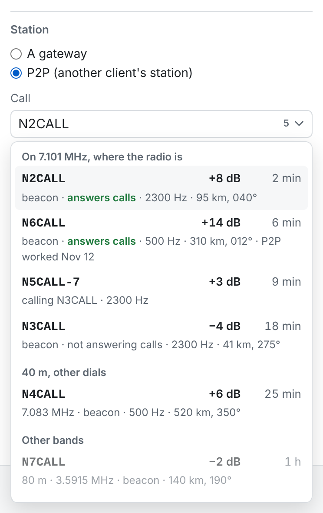

# RadioPost: finding, beaconing and calling P2P stations

| | |
|---|---|
| **Status** | Accepted; Phases 1 to 4 built |
| **Version** | 0.5.0 |
| **Updated** | 2026-11-28 |
| **Editor** | KK4ODA |
| **Licence** | [CC BY 4.0](https://creativecommons.org/licenses/by/4.0/) |
| **Follows** | [The wishlist](02-wishlist.md), W59; [RP-4](../../spec/rp-0004-modem-interface.md) §5, §8; D51 |

The client shows the stations its modem hears in the **Call** box, and beacons for its operator,
once or every few minutes, with the station's position in the beacon. The author accepted the
design on 2026-11-28, with the answers in §11. Aether already keeps the stations it hears with
their SNR, dial, bandwidth and what they were doing, and sends beacons on the tone floor. None of
it reaches RadioPost: RPMI defines a `heard` event that no adapter sends, and RPMI has no beacon.
So the work is one optional addition to RPMI (RP-4 1.7.0, MINOR), four changes to Aether, the
Mercury and VARA adapters, and the client's list, schedule and **Beacon** split button. RP-2, RP-3,
RP-5 and RP-8 do not change. On the air, Aether's beacon gains one bit and an optional position in
the frame it already sends: no extra air time.

---

## 1. What exists

### 1.1 In the client

* **Call** is already a combobox (`#callsign`, `#called-list`). In P2P its ▾ lists the stations
  called before, newest first, with the dial and bandwidth of that call (`/api/called`, from the
  attempt records). A pick fills **Call**, **Dial, MHz** and **Bandwidth** and tunes the radio.
* **Listen for P2P** (W15, D47) keeps one connection, its claims and `listen` on across sessions
  (`session::keep_listening`). The line under it says where and how the station answers, from
  RPMI `status` (`dial_hz`, `answers`, `scanning`).
* **The connection between calls** (`presence.rs`) holds Aether, and any other adapter that says it
  is shared, with `hello` alone. It hears every event the adapter sends: `busy`, `dial`,
  broadcasts. To send an alert it takes the station (activity `alerting`) and opens a short
  connection that claims the callsign.
* **Attempt records** (W57, `selection/attempts.rs`) keep every call: whom, where, how it ended,
  and, when a session ran, how each side heard the other (`quality.peer_snr_db`).
* **A repeated transmission already exists**: a circle report goes again every 10, 15, 30 or 60
  minutes, for four hours at most (RP-8 §7, `Alerts::repeat_due`, D49), while the operator is at
  the station.
* **The station's position** (W55, `selection/position.rs`): the position in use is a GPS with a
  fresh fix, else the saved place chosen. The log keeps the 6-character grid only.
* **`/api/p2p-chance`** predicts a P2P dial at the site of a gateway listed under the station's
  base callsign.
* **`rpmi::host` parses `heard`** (`Event::Heard`, RP-4 §5: `callsign`, `snr_db`?, `bandwidth`?),
  and the attempt record reads it during a call. No adapter sends it.

### 1.2 In Aether

* **The stations heard** (`heard.rs`, `heard.json`, at most 200): one entry per callsign with
  `first_heard_ms`, `last_heard_ms`, `count`, `snr_db` (last) and `best_snr_db`, `frequency_hz`
  (the dial at the last sighting, when the radio can say), `mode`, `activity` (`beacon`,
  `calling`, `answering`, `probing`, `connected`, `datagram`, `identified`), `detail` (whom it
  called or answered), `connected`, `beacons`, `last_beacon_ms` and `bandwidth_hz`. The control
  API answers `heard.list`, and every change goes to every connection as a `heard` event.
* **A beacon** (`beacon {callsign?}`, ADR-0016, ADR-0024): one tone-24 frame on the tone floor,
  5.4 s, decoded to about −19 dB on AWGN, heard on both bandwidths. The frame carries 24 bytes:
  the 3-byte DATA header, a length byte, the 7-byte packed callsign and a capability byte stating
  the sender's bandwidth (bits 1 and 2; bits 0 and 3 to 7 are zero). About 11 bytes are spare. An
  older receiver reads the callsign and the capability byte and looks no further. A beacon is
  refused in a session, while another waits, on an answer-only station, and under automatic
  control with a rules profile in force (§97.203(d)).
* **A repeating beacon** (`beacon.every {minutes}`, `station/beacons.rs`): 10 to 240 minutes. Each
  waits for an idle station and a clear channel whatever `wait_for_clear` says; one that cannot go
  within 120 s of falling due is skipped and said, and the next keeps to the interval. It lasts
  until stopped or the daemon restarts. `status.beacon` has `every_s`, `next_in_s`,
  `last_sent_ms`, `sent`, `skipped`, `waiting` and `waiting_for_clear`.
* **The station's grid** (`[operator] grid`, Setup step 1), today written only into recordings.
* **The busy detector** marks the channel busy for any signal, voice and other modes included. It
  cannot tell when the operator keys the microphone: the radio's receive audio goes quiet, and
  quiet reads as a clear channel.
* **Claims** (ADR-0106, ADR-0108): while a program holds a claim, Aether's own callsigns are not
  answered. A beacon from Aether's panel names Setup's callsign (`station_callsign`), so today a
  beacon sent while RadioPost listens as `WD5EMA` invites calls to a callsign nobody answers.
* **The VARA port** turns a host's `CQFRAME <call> <bandwidth>` into a beacon and tells a host of a
  beacon heard as `CQFRAME <call> <bandwidth>` after its `SN` line.

### 1.3 Other modems

| Modem | Send a beacon | Hear one | SNR | Bandwidth | Dial | Position |
|---|---|---|---|---|---|---|
| Aether | `beacon` | `heard` events, `heard.list` | yes | yes | with CAT, rigctld or FLRig | with A4 (§3.2) |
| VARA HF | `CQFRAME <call> <bw>` | `CQFRAME` after `SN` | `SN` | yes | no | no |
| Mercury | `CQFRAME` (the adapter sends it already, RP-4 §9.6) | `CQFRAME` (the adapter reads it already) | if Mercury says `SN` | yes | no | no |
| ARDOP | `SENDID` | `IDF` blocks | to check | no | no | no |
| Packet (AGWPE) | a UI frame | monitored frames | no | no | no | no |
| TCP | none | none | none | none | none | none |

VARA's `CQFRAME` is in Aether's record of VARA's published command list (its
`host-interfaces.md` §1); it is checked against EA5HVK's document itself before the VARA adapter
uses it. ARDOP and packet are left for later.

Every adapter but Aether's serves one host (`caps.shared` false), so the client holds no
connection to it between calls. With those modems the client hears stations while it listens or
calls.

---

## 2. What is reused as it is

* Aether's heard list, its `heard` events and its measurements. RadioPost decodes nothing and
  measures nothing.
* Aether's beacon frame, its clear-channel wait and its rules gate.
* The **Call** combobox, its keyboard handling and its "called before" entries.
* The connection between calls and the listening connection, which already receive every event.
* The way an alert reaches the air between calls: the station taken from the panel, a short
  claiming connection, the station given back.
* The attempt records, for "P2P worked here before" and for how the other station heard this one.
* RP-8 §7's repeat rules for a timed transmission: four intervals, four hours at most.
* W55's position in use, and the world map that **Reports** and **Choose a gateway** draw.

---

## 3. The changes

### 3.1 RPMI: RP-4 1.7.0

One MINOR, announced change (RP-0 §8.2, §8.4). An adapter that offers none of it and a host that
ignores it work as before.

**(a) `heard` says more.** The event keeps its three members and gains six, each optional:

| Member | Meaning |
|---|---|
| `dial_hz` | The radio's dial when the station was heard, with `caps.dial`. |
| `kind` | What was heard: `beacon`, `call` (to `to`), `answer`, `probe`, `session` (a frame of this host's own link), `datagram` or `id` (an identifier). |
| `to` | Whom a `call`, `answer` or `probe` was addressed to. |
| `answers` | With `kind` `beacon`: whether the beacon said calls to its callsign are answered now (A2). Left out when the beacon does not say. |
| `position` | Where the beacon says its station is: `lat` and `lon` in degrees, and `precision`, one of `grid4`, `grid6` or `exact`; for a grid, the square's centre and `grid`, the locator. |
| `at` | When it was heard, Unix seconds. |

On a shared modem an adapter sends `heard` for another program's session frames to no host: that
would report the program's link, which §1.1 forbids. Calls, answers, beacons and identifiers are
public, and go to every host that has said `hello`, as broadcasts do (§6).

**(b) `stations`: the modem's own list.** A host asks `{"op": "stations", "id": 4}` and is answered
with the stations the modem has heard, each in `heard`'s members, `at` always present:

```json
{"op": "stations", "id": 4, "stations": [
  {"callsign": "N2CALL", "at": 1795213320, "snr_db": 8, "dial_hz": 7101000,
   "bandwidth": 2300, "kind": "beacon", "answers": true,
   "position": {"lat": 34.4621, "lon": -83.7514, "precision": "exact"}}]}
```

A client started in the morning sees who the modem heard overnight. `caps.heard` says the adapter
sends `heard` and answers `stations`; without it, `stations` is `unsupported`.

**(c) `beacon` and `beacon-sent`.** With `caps.beacon`:

| `op` | Members | What the adapter does |
|---|---|---|
| `beacon` | `as`?, `ref`?, `within_s`?, `dial_hz`?, `position`? | Sends one beacon carrying `as` (one of this host's callsigns, its first by default), addressed to nobody, in the mode the modem's weakest listeners hear (Aether's tone floor). It goes when the channel is clear and nothing else of the station's is on the air, within `within_s` seconds (default 120, at most 600), or not at all. With `dial_hz`, it goes on that dial: a scanning modem takes its scan there, as for a broadcast (§6); a modem that is not scanning there refuses it. With `position` (as in `heard`, `lat`, `lon` and `precision`) and `caps.position`, the beacon carries it. `ok` once the modem has taken it. |
| `beacon-sent` (event) | `ref`, `sent`, `dial_hz`?, `text`? | The beacon went (`sent` true, on `dial_hz`), or did not (`text` says why: the channel stayed busy, a session started, the rules refused it at keying). |

Refusals come at once: `refused` with no callsigns yet, under rules the modem checks (automatic
control, the band, answer-only), `not-authorized` for an `as` that is not the host's, `busy` while
a link or call of any program is up or another beacon waits. The adapter never repeats a beacon by
itself: repeating is the host's (§6). §8's list of what a host may make the modem transmit gains
beacons.

**(d) `status` gains `beaconing`**, the station's: the interval in seconds of a repeating beacon the
modem runs itself (Aether's **Repeat**), whichever program or panel started it. A host that
repeats its own beacons sees it and does not double them.

Test vectors: the reference's simulated modem beacons, with and without a position, and reports
`heard` to the other stations; `rpmi-lines.json` gains `beacon`'s malformed members.

### 3.2 Aether

All four ship in the next Aether beta. A2 and A4 put something new on the air; by the author's
reading (2026-11-28, §11 decision 10) additive bytes with no version change are not an
air-protocol change for P5-7, and the four weeks before `v0.2.0` keep running.

**A1. A program's beacon** (daemon only). `beacon` from a connection that holds a claim goes as the
claim's first callsign unless named, and a callsign another program holds is refused (`claimed`),
as `connect_for` does for calls. It takes `ref`, `within_s` (held for a clear channel whatever
`wait_for_clear` says, dropped after) and `dial_hz` (a scan goes there to send it, as a datagram
does under ADR-0129 §15). A new `beacon-sent` event says what became of it, so no program reads
Aether's log to find out.

**A2. "Answers calls" in the beacon** (a reserved bit of the capability byte). It is set when
calls to the beacon's callsign are answered at the moment the beacon is rendered
(`answers_call_for`). The `frame` and `heard` events gain `answering`. A beacon from RadioPost
while it listens says yes; one while it does not says no; VarAC's `-9` beacons say no, since no
program answers `-9`.

**A3. The operator's own transmission.** Before any transmission the station starts by itself (a
beacon, a call, a probe), Aether reads the radio's transmit state where it reaches the radio over
CAT (Yaesu `TX;`, Kenwood `IF;`, Icom CI-V `1C 00`, rigctld `t`, FLRig `rig.get_ptt`), and waits
while the radio is already transmitting. A radio keyed by RTS or DTR with no CAT, or by a host
program, cannot be asked; the station says so once. Its own ADR; tested on the FTDX10 and the
TS-480 before repeating beacons ship.

**A4. The position in the beacon.** After the capability byte, one byte names the precision (none,
4-character grid, 6-character grid, exact), then 2, 4 or 6 bytes of position: exact is latitude
and longitude in 24 bits each, about 2 m, finer than a GPS fix. With the exact position the body is
15 bytes and the frame still one tone-24 frame of 5.4 s. The position is the one a program gave
in `beacon`; a beacon given none (the panel's, VarAC's `CQFRAME`) carries Aether's own
`[operator] grid` when one is set. The heard list, `heard.list`, and the `frame` and `heard`
events gain `position`. The ADR settles the bits; an older Aether ignores the bytes, which a
mixed-version harness pair confirms.

### 3.3 The adapters

* **Aether**: `heard` from Aether's `heard` events (`activity` as `kind`, `detail` as `to`,
  `frequency_hz` as `dial_hz`, `last_heard_ms` as `at`, `answering` as `answers`, `position`),
  filtered as §3.1(a) says; `stations` from `heard.list`; `beacon` and `beacon-sent` from A1;
  `beaconing` from `status.beacon.every_s`.
* **Mercury and VARA HF**: `heard` from `CQFRAME` with the `SN` before it; `beacon` as
  `CQFRAME <as> <bandwidth>`, taken as sent when the modem keys (`PTT`, or `PENDING` and
  `CANCELPENDING` as Mercury brackets its own `CQFRAME`). No position either way. VARA's after
  the published document confirms `CQFRAME`.
* **ARDOP, packet, TCP**: neither cap, for now.

### 3.4 The client

* **`stations.rs`**, the stations heard: for each callsign and band, the latest observation, its
  position when a beacon gave one, and its last eight SNR readings, kept seven days, in
  `stations.json` in the first home (the computer's, as circles are). It is fed by every
  connection's `heard` events (between calls, listening, calling), the same event from two
  connections kept once, and filled from `stations` each time a connection opens.
* **`/api/stations`**: the list as **Call** shows it (§5.2), worked out from the store, the radio's
  dial, the station's position in use, the listed gateways and the attempt records.
* **`beacons.rs`**, the schedule (§6), sans clock as `alerts.rs` is. A due beacon is sent by
  whoever holds the modem: the listening connection while listening, otherwise a short claiming
  connection as an alert is.
* **The panel**: §5.

---

## 4. Compatibility

* **The protocols.** RP-2, RP-3, RP-5, RP-6, RP-7 and RP-8 do not change. A P2P session is the
  session it is today. RP-4 1.7.0 is MINOR and announced.
* **Independent implementations** (RadioPostKit, other adapters): nothing to do. A host that
  ignores `heard`, `stations` and `beacon` loses nothing it had; an adapter that offers none says
  so by leaving the caps out.
* **On the air.** A RadioPost beacon is the modem's own beacon, so every program that lists the
  modem's beacons lists it, and RadioPost lists theirs. The "answers calls" bit and the position
  are Aether's, in the frame Aether already sends; an older Aether reads the callsign and the
  bandwidth and nothing more. VarAC shows an Aether beacon named without a suffix as a CQ; a VarAC
  operator who answers it reaches RadioPost's claim, and the session ends at RP-3's first frame.
* **A position on the air is public.** It goes exactly by default (§11 decision 8): anyone
  listening learns where the station is. The beacon menu offers less, and says what goes.
* **Identification is unchanged** (§11 decision 11): the beacon's packed callsign, no identifier
  after it, as Aether does today (ADR-0075). Aether's guide leaves open whether that meets
  §97.119(b)(3); the licensee answers for it.
* **Not built: a RadioPost "presence" broadcast** (a CBOR kind under RP-0 §9.5, as alerts are). It
  would be 11 to 27 s on Aether against a beacon's 5.4 s, only on modems with `caps.broadcast`,
  and a new specification. A2 and A4 say the same in the beacon.

---

## 5. The interface

The station box keeps its shape: **Beacon** joins **Call** on its row, and one line joins the
lines under **Listen for P2P**. The stations heard open from ▾, which carries their count.


*The mockups are the client's own panel, its API answered with made-up stations, the controls put
into the page (as `tools/manual/screens.mjs` makes the manual's pictures).*

### 5.1 Beacon

A split button. Its left part is a latch, as **Listen for P2P** is: pressed, it repeats the beacon
and stays lit until pressed again; its first beacon goes at once (or, with *Only while listening*,
once listening has tuned the radio). ▾, or a right click on either part, opens the menu. The lamp
says what the beacon is doing:


| Lamp | Meaning |
|---|---|
| dark | Nothing repeats. |
| green | Repeating. The line under **Listen** says when the next goes and when the last went. |
| amber | Due, and waiting for a clear channel, for a call or session to end, or for the operator's own transmission (A3). |
| orange (`--tx`) | On the air now. |


* **Send a beacon now**: one beacon, whatever the repeat says. Greyed while one waits, and for a
  minute after one went.
* **Repeat**: Off, 10, 15, 30 or 60 min. Choosing an interval starts repeating.
* **Only while listening for P2P**, ticked by default: repeating starts and stops with **Listen
  for P2P**. Unticked, beacons repeat whether or not the station listens, and say so (A2).
* **Position in the beacon**: None, 4-char grid, 6-char grid or Exact (the default), and under it
  what goes and where it came from: the GPS and its fix's age, or the saved place. With no position
  in use, the line says Aether's own grid goes, or none.
* **Next**, **Last** and **Repeats until**, as the modem and the schedule say them.

Each part's tooltip says the same in a sentence, as the panel's tooltips do.

### 5.2 The stations heard, in Call

In P2P, ▾ beside **Call** shows the count of stations heard in the last half hour, and opens the
list. The list is wider than the column (23rem) and opens above the page: the side column scrolls,
and anything placed inside it is cut off at its edge. It is a popover in the top layer, or placed
fixed from the field's position.


* **Groups, in this order**: *On 7.101 MHz, where the radio is*; *40 m, other dials*; *Other
  bands*; *Called before, not heard lately*. Without a dial from the modem, one group: *Heard (the
  modem cannot read the dial)*. Within a group, the most recently heard first, a favourite at its
  top (§8). No other order.
* **Each line**: the callsign, the last SNR, how long ago; under it what was heard (beacon, calling
  whom, a session), whether it answers calls (A2), its bandwidth, its distance and bearing from
  this station when its beacon gave a position, the dial when it is not the radio's, and "P2P
  worked Nov 12" when the attempt records say so.
* **Age**: under 30 minutes, plain, and counted in ▾'s number; 30 minutes to 6 hours, faded; older,
  left out behind a last item, *Show older*, except favourites and stations called before. The
  store keeps seven days.
* **SNR**: what this station heard, one direction only. No reading: "—". A reading from a
  tone-floor frame (a beacon, a call, a probe) is a lower bound: a true +20 dB reads +15.6 dB on
  AWGN, +11.2 on ITU Moderate and +4.8 on ITU Poor (Aether's ADR-0016 §4). The tooltip says so.
* **Left out**: the station's own callsigns, and a callsign listed as a gateway (D47). Heard
  gateways show in the gateway list instead (§8).
* **Picking a line** puts the callsign in **Call**, the dial it was heard on in **Dial, MHz**, and
  the bandwidth its beacon or call stated in **Bandwidth** (a station heard at 500 Hz may not
  answer 2300 Hz calls), and tunes the radio as a pick from ▾ does today. A station heard by
  another modem than the one in the Modem box is marked, and its line says which.
* **Typing** filters the list to callsigns that start with what was typed. Arrows, Enter, Escape and
  Tab work as they do now.
* **While it is open** the order holds still: ages and readings change in place, a new station
  joins the end of its group, and the line under the pointer or the arrows stays the one chosen.
  Nothing ever changes what is in **Call** but the operator. Ages count on the page every 15 s.

At the window's narrowest (380 px wide), the list is as wide as the column, and a long second line
wraps:



### 5.3 A station's details

A right click on a line, or Shift+F10, opens what the client knows of the station: each sighting
(time, dial, what, SNR), its position and how far it is, the P2P sessions with it from the attempt
records and how it heard this station in them, and **Pin to the top** and **Call on** its dial.


### 5.4 Checked

Each picture was rendered at 1280 × 1300 and at 380 px wide in headless Chromium. Built, the panel
check (`screens.mjs` scenes) covers 1280 × 800 and 380 × 480, the window's minimum (`min_inner_size`
in the shell), and Windows' wider fonts are checked before release.

---

## 6. How the beacon behaves

* **One owner of the schedule: the client.** The modem decides only when, inside the window it was
  given, the channel is clear. RadioPost does not use Aether's **Repeat** (`beacon.every`). When
  Aether's own **Repeat** runs (`status.beaconing`), the client says so and starts none of its own.
* **Intervals**: 10, 15, 30 or 60 minutes, as RP-8 §7's reports.
* **Counted from the station's last callsign on the air**: a beacon, a call, an answer, a session
  or an identifier of this client's puts its callsign on the air, and the next beacon falls due one
  interval after the last of them, plus a uniform 0 to 60 s. A station in use beacons less, and two
  stations started together drift apart.
* **When it waits**: never during this client's call, session or alert; not while another
  program's link is up; while the radio is transmitting (A3); for a clear channel up to 120 s
  (`within_s`); and at least 30 s after a session ends, so both closing identifiers have gone. A
  beacon that cannot go in its window is skipped and said in the log; the next keeps to the
  interval. At most one is ever waiting.
* **Four hours at most**, then it stops and the line says so; pressing **Beacon** again starts four
  more. A timed beacon is lawful under local control, with the operator at the station; a station
  left alone is under automatic control, where a beacon is allowed only in §97.203(d)'s segments,
  of which 28.20 to 28.30 MHz is the one Aether's data may use.
* **A station whose gateway scans** (RadioPost Gateway on the same Aether): each scheduled beacon
  goes on the next of the scan's dials (`dial_hz`), the scan taken there to send it, so each band
  hears one beacon a cycle. With three dials and 15 minutes, each dial hears one every 45 minutes.
* **Refusals**: the modem's reason goes to the log and the tooltip; a rules refusal (automatic
  control, the band) stops repeating, since waiting will not change it.
* **Restart**: the interval, *Only while listening* and the position's precision are kept
  (`beacon.json`, first home); repeating does not start again by itself.
* **RadioPost Gateway never beacons.** It runs under automatic control.
* **The channel's cost**: 5.4 s every 10 minutes is 0.9 % of the channel, 0.6 % at 15 minutes.

---

## 7. Positions

* **What goes**: the position in use (W55), at the precision chosen (exact by default), with each
  beacon RadioPost asks for. A moving station with a GPS sends where it is at each beacon. With no
  position in use, RadioPost sends none and Aether puts its own Setup grid in, when set.
* **What comes**: the position in another station's beacon, kept with the sighting (§3.4).
* **Distance and bearing** on each line and in the details: from this station's position in use,
  "95 km, 040°", the distance to a grid square's centre, and "within 4 km" when the square is
  6-character, "within 100 km" when 4-character.
* **The map**: *Show on the map*, the list's last item, opens the client's world map with the
  stations heard that gave a position, faded with age as in the list.
* **Band prediction**: for a station whose beacon gave a position in the last seven days,
  `/api/p2p-chance` predicts at that position, as it does today at a listed gateway's site, and
  names a better band.

---

## 8. Further work, as decided

| Item | Benefit | Effort | On the channel | Decision |
|---|---|---|---|---|
| The interval counted from the station's last callsign on the air (§6) | High | Low | Fewer beacons | Built, in the schedule |
| "Answers calls" in the beacon (A2) | High | Medium | One bit | Built |
| Readiness: the pick sets bandwidth and dial; a mark when another modem heard the station | High | Low | Fewer failed calls | Built, with the list |
| Called before, in the same list | Medium | Low | None | Built, with the list |
| The operator's own transmission over CAT (A3) | Medium: safety | Medium, in Aether | None | Built before repeating ships |
| A station's details and its SNR history (§5.3) | Medium | Medium | None | Built |
| Favourites, at the top of their group | Medium | Low | None | Built |
| A sound when a favourite is heard after hours unheard (W51) | Medium | Low | None | Built, off by default |
| Gateways heard: in the gateway list, and to W57's learning | Medium | Medium | None | Built |
| Positions: distance and bearing, the map, band prediction (§7) | Medium | Medium | None | Built |
| Quiet mode | Covered | None | None | **Beacon**'s latch is it |
| A second order (strongest, nearest) | Low | Low | None | Not built |
| A reliability score | Low: one direction measured | Medium | None | Not built |
| Calling heard stations by itself | None (D44) | — | More | Not built |
| A RadioPost presence broadcast | Low | High | 11 to 27 s a time | Not built (§4) |

---

## 9. Phases

Each phase is built, tested and released on its own; the manual and its screenshots change in the
same commit (CLAUDE.md, the manual's rule).

| Phase | What | Transmits |
|---|---|---|
| 1. Hearing | RP-4 1.7.0, all of it, with vectors; the Aether adapter's `heard` and `stations`; Mercury's and VARA's `heard` (VARA after the document check); `stations.rs`, `/api/stations`; the list in **Call**, readiness, called before | No |
| 2. Aether | A1, A2, A3 and A4, each with its ADR, in one beta; vectors, `two_daemons` tests, a harness scenario, a mixed pair against beta.182 | No new kind |
| 3. Beacon now | `beacon` and `beacon-sent` in the three adapters; **Send a beacon now**; the position's precision; distance and bearing in the list | One beacon on demand |
| 4. Repeating | `beacons.rs`; the latch, its lamp, the menu, the line; scanned dials in turn; `beaconing`; `beacon.json` | Beacons on a timer |
| 5. Positions and extras | The map; band prediction at a station's position; details; favourites and their sound; gateways heard | No |

---

## 10. Tests

| Case | Test |
|---|---|
| A beacon now, and one refused | The simulated modem (`core/rpmi`), two clients on a loopback: A beacons, B's `/api/stations` lists A with its position; a beacon in a session is `busy` |
| No interval under 10 minutes | `beacons.rs`, sans clock: every interval between two beacons is at least 600 s, over 10 000 simulated hours with random sessions and busy spans |
| Jitter, and the last callsign | The same: due times one interval plus 0 to 60 s after the last callsign on the air, beacon or call |
| Busy channel | `beacon-sent` `sent` false: skipped, said once, the next on the interval; never two waiting |
| No beacon in a session | None during a call, a session, an alert, or another program's link |
| The operator's transmission (A3) | Aether, against a stand-in radio reporting TX: the beacon waits; on the FTDX10 and the TS-480 by hand |
| Several stations on one interval | Aether's scenario harness: three stations repeating every 10 minutes for 4 hours of air, `channel_server` counting overlaps per dial: none radiated |
| Scanning station | The simulated scan: beacons go on its dials in turn |
| Position on the air (A4) | Aether's vectors: each precision round trips; the exact body is one tone-24 frame; a beta.182 daemon in a mixed pair still lists the callsign and bandwidth |
| Position in the client | Distance and bearing against worked cases; none without a position; W55's GPS falling back to the saved place |
| The list, live | The panel in headless Chromium against a stand-in: events arrive while the list is open; the chosen line and **Call** do not move |
| Callsigns and SSIDs | `N2CALL` and `N2CALL-7` are two lines; the station's own callsigns and listed gateways are left out |
| Dial, band and bandwidth | Regrouped on a `dial` event; a pick sets **Bandwidth** from the station's statement |
| No SNR | A `heard` without `snr_db` shows "—" |
| The modem goes and comes back | The store survives; `stations` fills it again on reconnect |
| Restart | `beacon.json` read back; repeating off after a restart |
| A modem without the caps | The TCP adapter: no ▾ count; **Beacon** greyed with the modem named; the rest as before |
| Window sizes | The panel check at 1280 × 800 and 380 × 480; the list never cut |
| Regression | `cargo test` in `core/` (P2P and gateway sessions, the conformance tester's C-01 to C-08 and A-01 to A-04), the Aether adapter against two `aetherd` over `[sim]`, Aether's quick scenarios |

**Acceptance**: in the simulated runs, no beacon while any link or call is up and no two beacons of
one station less than 600 s apart; in the harness, no radiated overlap between beacons; a beacon
with an exact position takes 5.4 s, as one without; in the panel, every line of the list readable
at 380 px; the P2P and gateway tests unchanged.

---

## 11. The author's decisions (2026-11-28)

1. **The client may beacon on a timer**, on D49's terms for reports: the operator starts it at the
   station, and it repeats for four hours at most (D51).
2. **The client keeps the schedule**; the modem only waits for a clear channel.
3. **Only while listening for P2P**: a tick, on by default, which the operator may clear.
4. **After a restart**: settings kept, repeating not started again.
5. **Intervals** 10, 15, 30 and 60 minutes, as reports.
6. **RP-4 1.7.0**, all of it: `heard`'s new members, `stations`, `beacon` and `beacon-sent`,
   `beaconing`.
7. **Aether A1** and **A2**, as §3.2 describes them.
8. **The position goes in Aether's beacon**, exactly by default, the operator choosing none, a
   4-character or a 6-character grid instead (A4).
9. **Its source**: RadioPost's position in use; a beacon given none carries Aether's own grid.
10. **A2 and A4 ship in the next Aether beta**, not counted as an air-protocol change for P5-7.
11. **A repeated beacon is identified as today**: the packed callsign in its frame, no identifier
    after it.
12. **Listed gateways' callsigns are left out of the P2P list.**
13. **The client keeps its own record, by band, for seven days.**
14. **Extras built**: a station's details, favourites, a favourite's sound, gateways heard.
15. **Positions heard are used for** distance and bearing, the map, and band prediction; no sort by
    distance.
16. **One order**: most recent first.
17. **Beacon is the split button as mocked.**
18. **The interval counts from the station's last callsign on the air.**
19. **A3 is built with the beacons**, before repeating ships.
20. **Mercury and VARA too**, VARA after its document confirms `CQFRAME`; stations heard through
    them while listening or calling.
21. **A station whose gateway scans** beacons on each scanned dial in turn.
22. **Age**: 30 minutes plain, faded to 6 hours, hidden after.

The work needs no change to RadioPost's own protocols. Phase 1 starts without a transmission or an
Aether release; Phase 2 is one Aether beta with four ADRs.

---

## Change log

| Version | Date | Change |
|---|---|---|
| 0.1.0 | 2026-11-27 | First draft, from the author's request: beacons, the stations heard, and calling them from **Call**. Review of the client and Aether, RP-4 additions, Aether's A1 to A3, mockups, phases, tests and eleven decisions. |
| 0.2.0 | 2026-11-28 | Accepted, with the author's answers (§11) and the position in the beacon (A4, §7) added at the author's ask: A1 gains `dial_hz`, A3 is built with the beacons, a scanning station beacons on its dials in turn, the extras are built, and the mockups show distance, bearing and the position's precision. |
| 0.3.0 | 2026-11-28 | Phase 1 built: RP-4 1.7.0 with its vectors (the reference's simulated modem beacons, `rpmi-lines.json`'s cases marked `unless` for an adapter with the cap); `rpmi::position`; the Aether adapter's `heard` and `stations` from Aether's own; Mercury's CQ frames as stations heard; VARA's left off until checked; the client's `stations.rs` and `/api/stations`; **Call**'s list in P2P (manual 1.63.0). |
| 0.4.0 | 2026-11-28 | Phases 2 and 3 built. Aether 0.2.0-beta.183: ADR-0139 (a program's beacon, `beacon-sent`), ADR-0140 (the answers bit), ADR-0141 (the radio's own transmitting, over CAT, rigctld or FLRig) and ADR-0142 (the position), with a harness scenario that passes both ways against beta.182. RP-4 1.8.0: `beacon`'s `modem_position` false, so that **None** keeps Aether's own grid square out, while a station with no position in use lets it in (§7). The Aether adapter's `beacon` and `beacon-sent`; Mercury's `CQFRAME`, with its busy detector on; the client's `beacons.rs`, `/api/beacon`, **Beacon**'s menu with **Send a beacon now** and **Position in the beacon** (manual 1.64.0). Repeating, its latch and its line are Phase 4. |
| 0.5.0 | 2026-11-28 | Phase 4 built: `beacons.rs`'s schedule (`start_repeating`, `tick` with the station's `Context`, `on_air`, the jitter, four hours, `refused`), the panel's `keep_beaconing` every 2 s (the listening connection sends a beacon due; an idle station, with *Only while listening* unticked, a connection of its own), a scanning station's dials in turn, `status.beaconing` read into `Where` so the client sends none beside Aether's own; **Beacon**'s latch, **Repeat**, **Only while listening for P2P**, **Next**, **Last** and **Repeats until**, and the line under **Listen** (manual 1.65.0). The lamp's orange *on the air* is not built: RPMI tells no keying to a host. |
