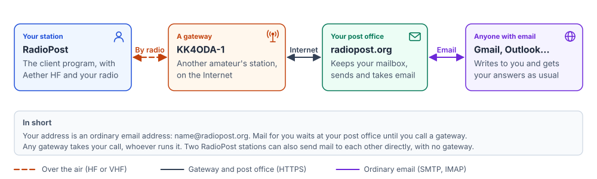
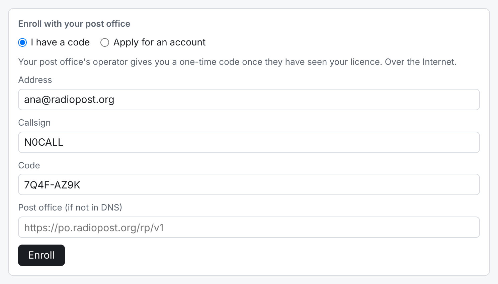
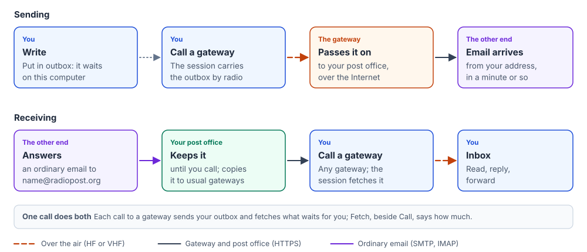
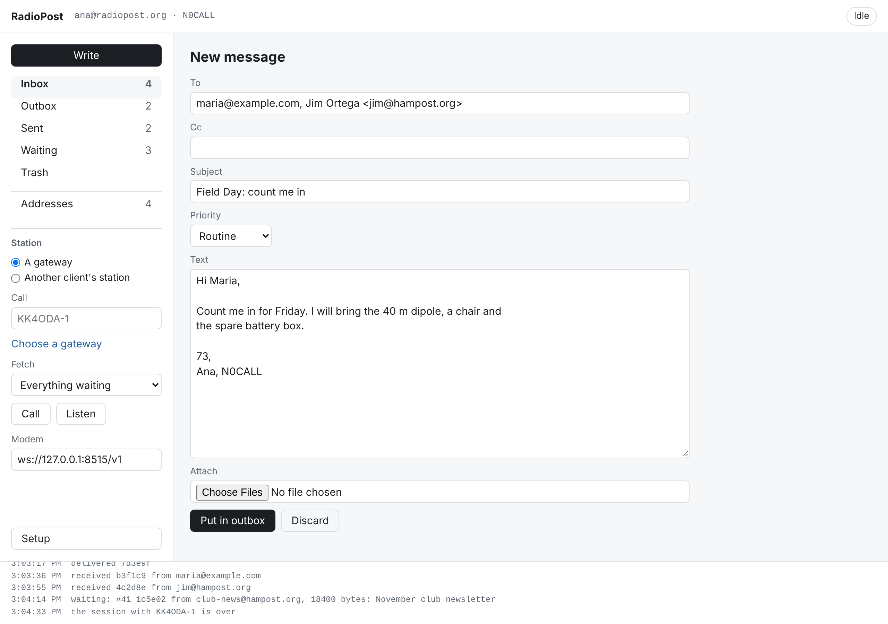
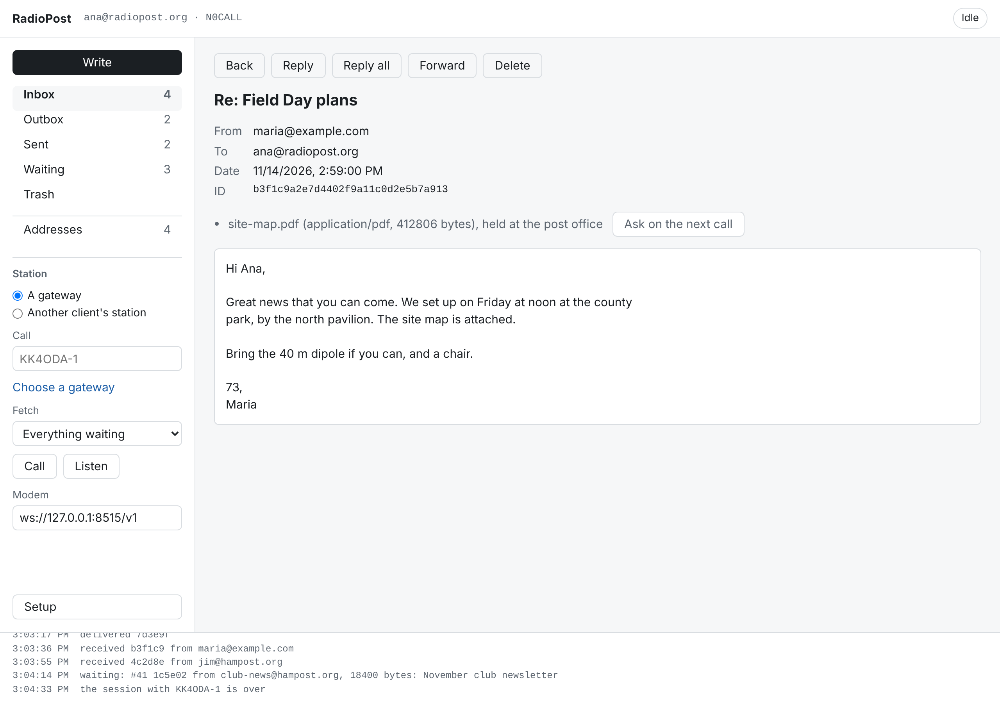
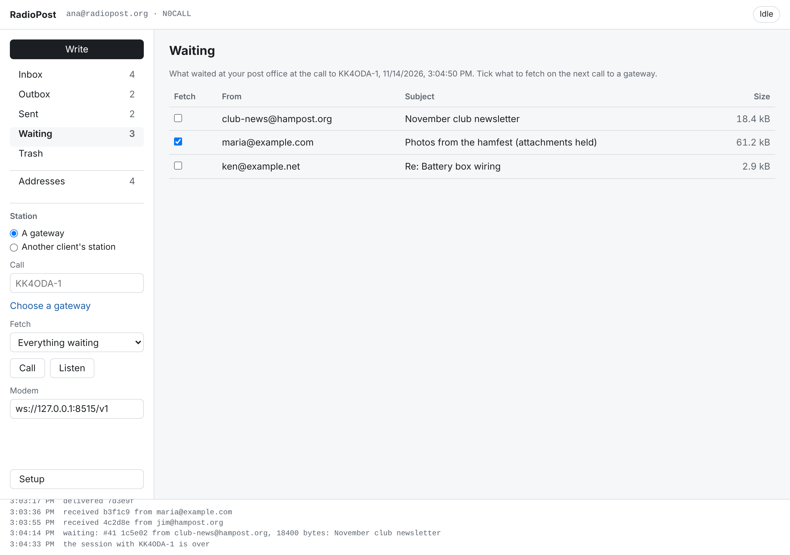
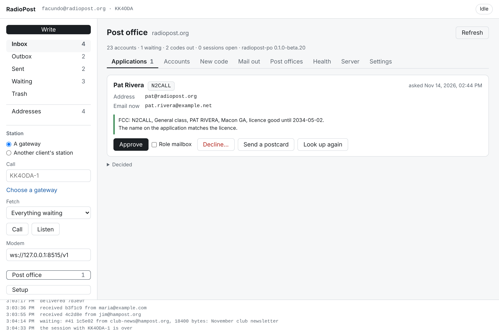
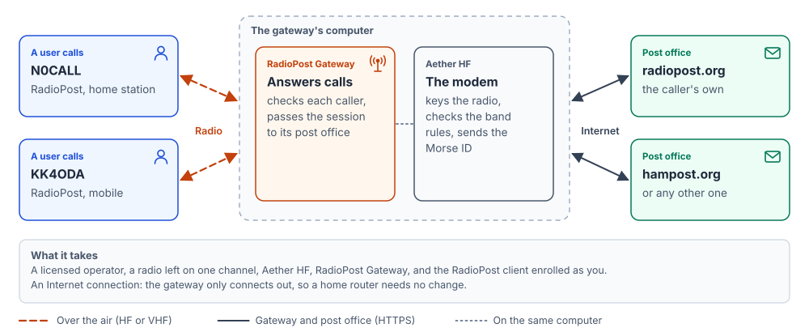
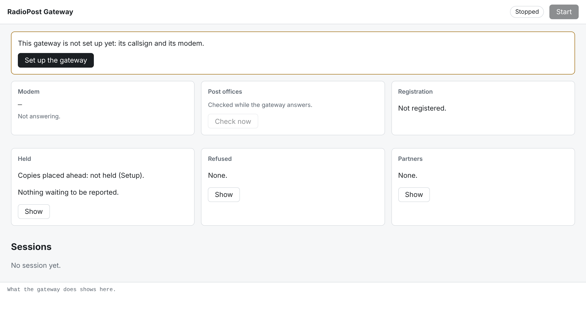

# RadioPost user's manual

**The RadioPost client and RadioPost Gateway: email by amateur radio.**

| | |
|---|---|
| **Status** | Current |
| **Version** | 1.0.0 |
| **Updated** | 2026-11-15 |
| **Describes** | RadioPost 0.1.0-beta.20 |
| **Licence** | CC BY 4.0 |

This manual shows you how to send and receive email by radio with RadioPost, and how to run a
RadioPost gateway for others. It is written for licensed amateurs. You do not need to know how
RadioPost works inside.

The modem RadioPost uses, Aether HF, has
[its own manual](https://github.com/KK4ODA/aether-hf/blob/master/docs/user/manual.md). This
manual points to it wherever Aether is the place to set something.

## Contents

<!-- toc -->

**[Part 1. Getting started](#part-1-getting-started)**

- [1. About this manual](#1-about-this-manual)
- [2. What RadioPost is](#2-what-radiopost-is)
- [3. What you need](#3-what-you-need)
- [4. Installing RadioPost](#4-installing-radiopost)
- [5. Getting an account](#5-getting-an-account)

**[Part 2. The RadioPost client](#part-2-the-radiopost-client)**

- [6. The RadioPost window](#6-the-radiopost-window)
- [7. Writing a message](#7-writing-a-message)
- [8. Calling a gateway](#8-calling-a-gateway)
- [9. Reading your mail](#9-reading-your-mail)
- [10. Station to station](#10-station-to-station)
- [11. Working several callsigns](#11-working-several-callsigns)
- [12. Setup, box by box](#12-setup-box-by-box)
- [13. Addresses and the Trash](#13-addresses-and-the-trash)
- [14. When the Internet is down](#14-when-the-internet-is-down)
- [15. If you run a post office](#15-if-you-run-a-post-office)

**[Part 3. RadioPost Gateway](#part-3-radiopost-gateway)**

- [16. What a gateway does](#16-what-a-gateway-does)
- [17. Before you set up a gateway](#17-before-you-set-up-a-gateway)
- [18. Setting up the gateway](#18-setting-up-the-gateway)
- [19. Running the gateway](#19-running-the-gateway)
- [20. Refusing a caller](#20-refusing-a-caller)
- [21. When the Internet is down at the gateway](#21-when-the-internet-is-down-at-the-gateway)
- [22. Partners: forwarding by radio](#22-partners-forwarding-by-radio)
- [23. A gateway with no screen](#23-a-gateway-with-no-screen)
- [24. What the gateway keeps](#24-what-the-gateway-keeps)

**[Part 4. Help](#part-4-help)**

- [25. RadioPost and Aether HF](#25-radiopost-and-aether-hf)
- [26. The rules](#26-the-rules)
- [27. Troubleshooting](#27-troubleshooting)
- [28. Reporting a problem](#28-reporting-a-problem)
- [29. Glossary](#29-glossary)
- [30. Quick reference](#30-quick-reference)

**[Appendix](#appendix)**

- [Where to read more](#where-to-read-more)
- [Keeping this manual current](#keeping-this-manual-current)
- [Change log](#change-log)

<!-- /toc -->

---

# Part 1. Getting started

## 1. About this manual

### Which version this is

Two numbers at the top of this manual tell you what you are reading:

- **Version** is this manual's own version. It goes up each time the manual changes. The
  [change log](#change-log) at the end says what changed.
- **Describes** is the RadioPost release the manual is written for. It moves with every release.

The copy in the repository follows the programs as they are being built. Releases after
0.1.0-beta.20 also carry their own copy as a PDF file, named `RadioPost-Manual-<release>.pdf`,
beside the installers. Use that one if you want the manual for exactly the version you
installed.

To see which RadioPost you have:

- **RadioPost Gateway**: the last line of its **Setup** page says *RadioPost Gateway* and the
  version.
- **RadioPost**, the client: when a newer release is out, the line at the top of the window says
  *… is out (this is …)*, with your version.

### Printing the manual

- **Download the PDF** from the release page (see [Installing RadioPost](#4-installing-radiopost)).
  It is Letter size, with a cover, the contents and page numbers, and prints on A4 too.
- **Make it yourself** from a copy of the repository:
  `python tools/manual/build.py pdf`. It needs Python 3.12 or later and Google Chrome or
  Chromium. Without Chrome, `python tools/manual/build.py html` writes a web page you can open
  in any browser and print with **Print**, then **Save as PDF**.

### How the manual is written

- **Bold** is something on the screen you click, tick or read: a button, a box, a tab.
- *Italics* is what a program says to you.
- `Code` is something you type exactly.
- Numbered steps are done in order. Bullet points are not.
- A box like this one is a note you should not skip:

> **Note.** RadioPost never encrypts anything. Everything it sends can be read by anyone who
> hears it. That is the law for amateur radio.

The example people and callsigns in this manual are made up: `N0CALL`, `N1CALL` and so on, with
addresses at `example.com`. `KK4ODA-1` is the project's real test gateway, and `radiopost.org`
is the project's real post office.

## 2. What RadioPost is

RadioPost lets you send and receive **ordinary email by radio**. Your address looks like any
other: `name@radiopost.org`. Anyone with Gmail, Outlook or any email account can write to you,
and get your answers in their usual mail program. They do not need a radio or a licence.



*Figure 1. How RadioPost carries your email.*

Four kinds of thing work together:

- **Your station.** Your computer runs RadioPost (the client) and Aether HF (the modem), wired to
  your radio. You write and read mail here.
- **A gateway.** Another amateur's station, left on and connected to the Internet. You call it
  by radio, and it passes your mail on. Any gateway takes your call, whoever runs it.
- **Your post office.** A server on the Internet that keeps your mailbox and exchanges email with
  the rest of the world. Clubs and groups run post offices. The project runs `radiopost.org`.
- **Everyone else's email.** RadioPost mail leaves your post office as ordinary email.

Mail for you waits at your post office. When you call a gateway, the session sends what is in
your outbox and fetches what waits for you. Two RadioPost stations can also send mail to each
other directly, with no gateway and no Internet ([Station to station](#10-station-to-station)).

When the Internet is down, gateways keep working. A gateway you chose can hold copies of your
mail ahead of time, and it keeps what you send until it can pass it on
([When the Internet is down](#14-when-the-internet-is-down)).

**Words you will meet:**

| Word | Means |
|---|---|
| Account | Your mailbox at a post office, with one address. |
| Credential | A small signed file that proves your address and callsign belong together. Your post office issues it. RadioPost keeps it and renews it. |
| Enroll | Get a credential for this computer, with a one-time code. |
| Session | One radio contact between two stations, from the call to the end. |
| Gateway | A station that passes sessions to post offices over the Internet. |

There is a full [glossary](#29-glossary) at the end.

**What RadioPost is not.** It is not Winlink, and does not talk to Winlink's programs. It is
not meant to replace Winlink. You can run both on one radio. RadioPost is a place for amateurs
to experiment and build: every protocol it uses is published.

## 3. What you need


*Figure 2. Your station: what connects to what.*

- **An amateur radio licence.** Your post office checks it before it gives you an account.
- **An HF radio** that can send and receive upper sideband data, with its antenna.
- **An audio interface** between the radio and the computer: a SignaLink, a DigiRig, or the
  radio's own USB audio. It carries the sound both ways and keys the radio.
- **A computer** with Windows, macOS (Apple Silicon) or Linux.
- **Aether HF 0.2.0-beta.146 or later**, set up and working with your radio. Its
  [own manual](https://github.com/KK4ODA/aether-hf/blob/master/docs/user/manual.md#2-installing-and-first-start)
  says how. Aether keys the radio, checks the band rules and sends your Morse identifier at the
  end of each session.
- **RadioPost**, the client ([next chapter](#4-installing-radiopost)).
- **The Internet, once**, to get your account and the list of gateways. After that, mail goes by
  radio.

> **Note.** Aether must key the radio **itself**. In Aether's Setup, step 2, choose CAT, serial,
> rigctld, FLRig, CM108 or VOX, not *Host*. Set to *Host*, Aether transmits only for the program
> that keys it, and RadioPost's calls never reach the air.

Aether listens on two ports. RadioPost uses only the first:

| Port | What it is | Who uses it |
|---|---|---|
| 8515 | Aether's control port | RadioPost, RadioPost Gateway, Aether's own window |
| 8300 (and 8301) | Aether's host programs port | Winlink Express, VarAC, RMS Trimode |

Leave both as they are. Never set the host programs port to 8515: Aether then stops at start.

## 4. Installing RadioPost

1. Open the project's [releases page](https://github.com/KK4ODA/RadioPost/releases). The newest
   release is at the top.
2. Under **Assets**, download the installer named **RadioPost** for your computer:
   - Windows: the file ending in `-setup.exe`.
   - macOS: the file ending in `.dmg`.
   - Linux: the `.deb` file (Debian, Ubuntu) or the `.AppImage` file (any other).
3. Run it. The installers are not signed yet, so your computer asks once:
   - Windows: SmartScreen says it protected your PC. Click **More info**, then **Run anyway**.
   - macOS: Control-click the app, then **Open**.
4. Open **RadioPost**. The first time, it opens on **Setup**: get your account next
   ([Getting an account](#5-getting-an-account)).

The same page has **RadioPost Gateway**, the program for running a gateway
([Part 3](#part-3-radiopost-gateway)), a tools archive with the command-line programs, and (after
0.1.0-beta.20) this manual as a PDF.

**Updates.** When a newer release is out, a line at the top of RadioPost's window says so. Click
**Update and restart**. RadioPost downloads it, checks that the project signed it, installs it
and opens again. On Linux with a `.deb`, it asks for your password, as installing a package does.

**Where RadioPost keeps your things.** In the folder `.radiopost` in your home folder. On
Windows that is `C:\Users\<you>\.radiopost`. It holds your key, your credential, your mail and
the log `radiopost.log`. Back it up as you would any mail.

> **Note.** Each computer needs its own enrollment. Do not copy the `.radiopost` folder to a
> second computer: two computers would then share one key.

## 5. Getting an account

You need an account at a post office before you can send mail. There are two ways to get one.
Both go over the Internet, and both end with a credential on this computer.


*Figure 3. Two ways to get an account.*

Ask your club whether it runs a post office. If not, use the project's, `radiopost.org`.

### 5.1 With a code from the operator

1. Email the post office's operator from the address your licence record holds. Give your
   callsign and the name you want before the `@`, such as `ana` for `ana@radiopost.org`. For
   `radiopost.org`, write to `postmaster@radiopost.org`.
2. The operator checks your licence and answers with a one-time **code**, such as `7Q4F-AZ9K`.
   It works once, for seven days.
3. Open RadioPost. On **Setup**, under *Enroll with your post office*, choose **I have a code**.
4. Fill in:
   - **Address**: the address you were given, such as `ana@radiopost.org`.
   - **Callsign**: your callsign as licensed, with no SSID (no `-1`).
   - **Code**: the code.
   - **Post office (if not in DNS)**: leave it empty, unless the operator gave you an address
     for it.
5. Click **Enroll**.



*Figure 4. Enrolling with a code.*

RadioPost makes this computer's key, finds the post office, and keeps the credential. The top of
the window now shows your address and callsign. Setup says *Enrolled as …* and when the
credential runs out.

### 5.2 By applying

Some post offices take applications from the client. You apply, the operators check your licence,
and RadioPost collects your credential once they approve.

1. On **Setup**, under *Enroll with your post office*, choose **Apply for an account**. Two
   more boxes appear.
2. Fill in:
   - **Address**: the address you want, in lowercase, such as `ana@radiopost.org`.
   - **Callsign**: your callsign as licensed, with no SSID.
   - **Name on your licence**: exactly as it is printed on the licence.
   - **Your email now**: an ordinary email address where the post office can write to you about
     the application.
   - **Post office (if not in DNS)**: leave it empty.
3. Click **Apply**.


*Figure 5. Applying for an account. The marks show the list of callsigns (1), the choice (2) and
the Apply button (3).*

The form is replaced by *Applied for …*. Leave RadioPost open. It asks the post office every
minute, and takes the credential as soon as the operators approve. To ask at once, click
**Check now**.


*Figure 6. An application waiting for the operators.*

What the operators can decide:

| RadioPost says | What it means | What to do |
|---|---|---|
| *Approved: … Welcome to RadioPost.* | Your account is ready. | Nothing. You can send mail. |
| *The application … was declined.* | The operators said no. Their reason is shown. | Fix what they asked for, and apply again. |
| *A code … is coming by post.* | They want proof of where you live. A card goes to the address on your licence. | When it comes, choose **I have a code** and enroll with it. |
| *The post office no longer knows the application* | Applications are kept 30 days. | Apply again. |

### 5.3 If the post office refuses

| RadioPost says | What it means | What to do |
|---|---|---|
| *it takes no applications, or not for that domain* | The post office is not taking applications now, or the address is at a domain it does not serve. | Check the part after `@`. Ask the operator for a code instead. |
| *that address is taken, or already asked for* | Someone has that address, or an application for it is waiting. | Choose another address. |
| *a field is not as it should be* | Usually an SSID on the callsign, capitals in the address, or an empty name. | Fix the field, then **Apply** again. |
| *… operates this post office, so nobody may apply with it* | That callsign runs the post office. Nobody becomes an operator by applying. | The operator makes a code for it instead ([The post office desk](#15-if-you-run-a-post-office)). |
| *cannot reach …* | No Internet, or the post office is down. | Try again later. |

### 5.4 Your credential

Your credential lasts 90 days. In its last month RadioPost renews it by itself: over the Internet
while its window is open, or during a call to a gateway. The log at the bottom says when it did,
or why it could not. **Renew credential**, in Setup, renews it at once.

If it ever runs out, Setup says so in red. Ask your operator for a new code and click **Enroll
again with a new code**.

---

# Part 2. The RadioPost client

## 6. The RadioPost window


*Figure 7. The RadioPost window.*

1. **Who you are**: your address and callsign. With several callsigns, this is a list to choose
   from ([Working several callsigns](#11-working-several-callsigns)).
2. **What the station is doing**: *Idle*, *Calling …*, *Listening*, *In session with …* or
   *Renewing credential*. After a failed session it reads *Last session failed*: point at it to
   see why.
3. **Write**: a new message.
4. **The folders**, with how many messages each holds:
   - **Inbox**: messages received.
   - **Outbox**: messages waiting to go out on the next session.
   - **Sent**: messages another station has taken.
   - **Waiting**: what waited at your post office at your last call to a gateway.
   - **Trash**: messages you deleted.
   - **Addresses**: your address list.
5. **Station**: whom to call, and the **Call** and **Listen** buttons. **Modem** is where
   RadioPost finds Aether, `ws://127.0.0.1:8515/v1`. Change it only if Aether's control port is
   not the usual one.
6. **The folder or message you are looking at.** Click a row to read it.
7. **Setup**: your account, post office, accept list, usual gateways and keys.
8. **The log**: what RadioPost did, line by line, with the time.

Every button and box has a tooltip: rest the mouse on it to read what it does.

## 7. Writing a message



*Figure 8. A message out, and the answer back.*

You write messages at any time. They wait in the outbox until a session carries them.

1. Click **Write**.
2. In **To**, type the address. Several addresses go with commas between them:
   `maria@example.com, Jim Ortega <jim@hampost.org>`. As you type, RadioPost offers addresses
   from your address list: use the arrow keys and **Enter**, or click one.
3. **Cc** takes copies the same way.
4. Type a **Subject** and the **Text**.
5. Leave **Priority** at *Routine*. *Emergency* is for emergency traffic only.
6. To attach a file, click **Attach**. Keep files small: every byte goes on the air. A file must
   fit on the air on its own (64 kB).
7. Click **Put in outbox**.



*Figure 9. Writing a message.*

RadioPost checks each address before it takes the message. If one is wrong, it says which, and
keeps what you wrote.

**Who can write back.** Your post office lets email in only from addresses on your **accept
list**. Writing to someone adds them to it, so their answer gets through. You can add others in
Setup ([Accept list](#accept-list)).

**The outbox.** Messages wait there until a session carries them. A message a gateway took while
it could not reach the Internet carries a tag: *queued at* that gateway
([When the Internet is down](#14-when-the-internet-is-down)).


*Figure 10. The outbox.*

**Changed your mind?** The trash can at the end of a row moves the message to the **Trash**.
The note that follows has **Undo**.

## 8. Calling a gateway

A call to a gateway sends your outbox and fetches what waits for you, in one session.

### 8.1 Choose a gateway

1. Under **Station**, choose **A gateway**, then click **Choose a gateway**.
2. Click **Refresh over the Internet**. The list comes from your post office, and from the post
   offices it knows. RadioPost keeps it for when there is no Internet.
3. Type **Your grid**, your Maidenhead grid square such as `EM73`, and click **Save**. The
   nearest gateways move to the top, with their distance.
4. Each gateway shows its **Channels** (dial frequency, upper sideband, and the bandwidth Aether
   uses there) and its **Hours**. Click **Choose** beside the one you want. Its callsign goes in
   **Call**.


*Figure 11. Choosing a gateway.*

### 8.2 Tune and call

1. In Aether, tune the radio to one of the gateway's channels, and set Aether's **Bandwidth**
   to the one listed there (500 or 2300 Hz). Aether's manual covers both: the
   [Radio dial](https://github.com/KK4ODA/aether-hf/blob/master/docs/user/manual.md#radio-dial)
   and [Setup step 4](https://github.com/KK4ODA/aether-hf/blob/master/docs/user/manual.md#step-4-modem-settings).
2. Listen for a moment. Do not call over another station.
3. In RadioPost, set **Fetch**:
   - **Everything waiting**: all your mail comes.
   - **Up to 10 kB each** or **Up to 50 kB each**: only messages up to that size come. The rest
     wait for a later call.
   - **Only the list of what waits**: nothing comes but the list. Use it on a weak path.

   Messages of 1,000 bytes or less come anyway, whatever **Fetch** says.
4. Click **Call**.

### 8.3 During the session

The state at the top reads *Calling …*, then *In session with …*. A card at the bottom right
shows how far the mail has got:

- The **outer ring** is what you send. The **inner ring** is what comes in.
- The lines say how many messages are whole, the kilobytes, and about how long is left.
- The header shows the same as a small ring with the percentage.

A message counts as sent once Aether has put it on the air, not when RadioPost hands it over.


*Figure 12. A session under way.*

The log says what happens: the call, each message delivered or received, what waits, and the end.
A few short messages take a minute or two at 2300 Hz on a fair path, longer on a weak one. Your
email reaches the other end within a minute of the session, from your RadioPost address.

To stop a session, close the window. RadioPost asks first, because closing ends the session and
leaves the other station waiting. What did not cross is offered again on your next call.

## 9. Reading your mail

Click a message in the **Inbox** to read it.



*Figure 13. Reading a message.*

- **Reply** answers the sender. The other end's mail program keeps the thread. RadioPost does not
  quote the message you answer, because every byte goes on the air: it shows the original under
  your text, for you only.
- **Reply all** also copies everyone else it went to.
- **Forward** passes the message on, with its text and files. You can untick files you do not
  want to carry.
- **Delete** moves it to the Trash (or press the Delete key).
- **Add to addresses**, beside the sender, puts the sender on your address list.

**Attachments held at the post office.** A file too large for the radio does not come with its
message. Under it you see *held at the post office* and the button **Ask on the next call**.

1. Click **Ask on the next call**.
2. Call a gateway. It answers that your files are coming in a new message.
3. Call again. The files come in a message from `postmaster@` your post office.

**The Waiting folder** shows what waited at your post office at your last call to a gateway.
Tick a message to fetch it on the next call, whatever **Fetch** says. A message a cut-off gateway
kept for you has no tick box: it comes with what you fetch.



*Figure 14. Choosing what to fetch next.*

## 10. Station to station

Two RadioPost stations can send mail to each other directly by radio. No gateway, no post office
and no Internet are needed during the session. Each station proves who it is with its
credential.


*Figure 15. Station to station.*

Agree on a frequency and a bandwidth first. Both stations tune Aether to them.

**The station that answers:**

1. Click **Listen**. The state reads *Listening*. RadioPost answers one call, as the callsign at
   the top of the window.
2. To stop waiting, click **Stop**.

**The station that calls:**

1. Under **Station**, choose **Another client's station**.
2. In **Call**, type the other station's callsign.
3. Click **Call**.

Mail addressed to the other station's address crosses. Each side keeps a record of the session.
When you next have the Internet, a line under the Station box says how many sessions wait to be
reported: click **Send reports**. Your post office then marks your sent mail as delivered.

## 11. Working several callsigns

One RadioPost can work several callsigns, such as your own and a club callsign. Each callsign has
its own account, its own address and its own mail.


*Figure 16. Several callsigns on one computer.*

### 11.1 Add a callsign

Before you start:

- RadioPost must already work with your first callsign.
- You need RadioPost 0.1.0-beta.13 or later. If Setup has no **Add another callsign** button,
  update first.
- The computer must be on the Internet.
- Choose the new address, such as `club@radiopost.org`. Use lowercase letters, digits, dots,
  dashes or underscores before the `@`.
- Have ready the callsign exactly as licensed (no SSID), the name on that licence, and an email
  address where the post office can reach you now.

Steps:

1. Make sure the state at the top says **Idle**.
2. Click **Setup**.
3. Click **Add another callsign**, at the bottom of the first box. RadioPost switches to the new
   callsign. The list at the top reads *New callsign, not yet enrolled*.
4. If the post office's operator gave you a code for it, choose **I have a code** and enroll as
   in [section 5.1](#51-with-a-code-from-the-operator). Otherwise choose **Apply for an
   account** and apply as in [section 5.2](#52-by-applying) (Figure 5 shows this case).
5. Leave RadioPost open, with the new callsign chosen, until it says *Approved*. It only checks
   the application while that callsign is chosen.

### 11.2 Use it

- **Choose a callsign before each session**, from the list at the top of the window. A call goes
  out as the callsign shown there. **Listen** answers only that callsign.
- You can change it only while the station is idle.
- Each callsign has its own folders. The address list and the log are shared.
- Every credential renews while RadioPost is open, chosen or not.

### 11.3 Take one off

Choose it at the top, open **Setup**, and click **Remove this callsign**, then click again to
confirm. This only works once its folders and trash are empty. Its credential stays valid at the
post office until it runs out or is revoked. Your first callsign cannot be removed: the others
are kept inside its folder.

> **Note: if you run the post office yourself.** You approve the application from your own
> callsign:
>
> 1. In the list at the top, choose your own callsign. The **Post office** button appears.
> 2. Open **Post office**, then **Applications**, and click **Approve**. Tick **Role mailbox**
>    first if several licensed operators will share it, as with a club callsign.
> 3. Choose the new callsign again, open **Setup** and click **Check now**.
>
> If the application was refused with *it takes no applications*, turn applications on first:
> **Post office**, **Settings**, tick **Take applications for accounts**. It saves at once.
> Or skip the application: make a **New code** on the desk, and enroll the new callsign with it.

## 12. Setup, box by box

Click **Setup** at the bottom of the left-hand column.


*Figure 17. Setup.*

### Enroll with your post office

Says whom this computer is enrolled as, and until when. **Enroll again with a new code** is for a
credential that ran out or was revoked. **Add another callsign** and **Remove this callsign** are
here too ([section 11](#11-working-several-callsigns)).

### Post office

Says how RadioPost reaches your post office: *Found by its domain's DNS records* is normal.
**API** is only for a post office whose records are not published yet: type the address its
operator gave you and click **Save**. **Renew credential** renews at once.

### Accept list

Email reaches you only from the addresses and domains listed here. Writing to someone adds them.
To let a whole organisation write to you, add its domain with an `@` in front, such as
`@redcross.org`. Click **Add**. **Read** fetches the list from your post office. **Remove**
takes one off.

### Usual gateways

The gateways you name here get a copy of your waiting mail ahead of time, so you can pick it up
there while the Internet or your post office is down
([section 14](#14-when-the-internet-is-down)).

1. Tick the gateways you call most. Each one says whether it *holds copies*.
2. Tick **Skip mail I have read in a mail program** if you also read your mail on the Internet:
   mail you already read there is not offered by radio.
3. Click **Save**. Your post office keeps the setting. **Read** fetches it again.

The list needs the Internet and a gateway list ([section 8.1](#81-choose-a-gateway)).

### This device's key, Credential, Post offices trusted

These three boxes are for tests and special cases. You do not need them with a normal account:
enrolling fills them in.

- **This device's key** is this computer's public key. A test post office may ask for it.
- **Credential** takes a credential issued by hand, pasted in hexadecimal.
- **Post offices trusted** lists the post offices whose keys RadioPost trusts. A test post
  office's operator may give you a domain and key to add.

## 13. Addresses and the Trash

**Addresses** is your address list. Everyone you write to is added, with the name you typed
before the address. To and Cc offer it as you type.

- **Find** shows the entries that match.
- Type `Name <address>` in the box and click **Add** to add one by hand.
- Click a row, or its pencil, to write to it. The trash can takes it off the list (with
  **Undo**).

The address list is this computer's own. Who may email you is the accept list, in Setup.

**Trash** holds what you deleted, and says which folder each message came from.

- **Restore** puts a message back where it was.
- **Delete forever** removes it for good: click twice.
- **Empty trash** deletes everything in it for good.

Deleting is on this computer only. Your post office, gateways and other stations keep what they
hold.

## 14. When the Internet is down

RadioPost keeps working when the Internet fails at a gateway.


*Figure 18. When the Internet is down.*

**Before.** Name your usual gateways in Setup ([section 12](#usual-gateways)). Your post office
then copies each new message for you to them as it arrives.

**During.** Call a gateway as usual. If it cannot reach your post office, the log says so in a
notice. The gateway:

- hands you the copies it holds for you;
- keeps what you send, to pass on later;
- hands you mail from its other users at once, if it holds copies for you.

Messages you send through it stay in your outbox, tagged *queued at* that gateway. RadioPost
offers them again on later calls to other gateways, until one that reaches the Internet confirms
them. They are not offered to the same gateway while it was cut off at your last call.

**After.** When the gateway's Internet is back, it reports your session to your post office. Your
next call marks those messages sent.

> **Note.** A message queued for 30 days with no confirmation is tagged *may have been dropped*,
> in red. RadioPost still offers it on each call.

Held attachments cannot be asked for while the gateway is cut off.

## 15. If you run a post office

If your callsign runs a post office, RadioPost shows a **Post office** button in the left-hand
column. It opens the operator's desk. This chapter covers what the desk does with users. Setting
up the post office itself is in [the post office guide](../user/post-office.md).



*Figure 19. The operator's desk, Applications tab.*

**Applications.** Each person waiting shows their name, callsign, the address asked for, their
email now, and what the post office found of the callsign (the FCC's records, QRZ). That is
evidence, not proof: anyone can read who holds a callsign.

- **Approve** makes the account. The applicant's RadioPost collects the credential within a
  minute. Tick **Role mailbox** first for a mailbox shared by several licensed operators.
- **Decline…** asks for a reason, which the applicant reads.
- **Send a postcard** makes a code good for 30 days and a card to print and post to the address
  on the licence.
- **Look up again** asks the licence databases again.

**Settings.** **Take applications for accounts** turns applications on or off. Off, the client
refuses with *it takes no applications*.

**New code.** A one-time code for someone you know holds the callsign: a new account, or a new
device for an existing one. Give them the code; it works once, for a week.

The other tabs (**Accounts**, **Mail out**, **Post offices**, **Health**, **Server**) are covered
in [the post office guide](../user/post-office.md).

---

# Part 3. RadioPost Gateway

## 16. What a gateway does

A gateway is a station other amateurs call to send and fetch their mail. It answers each call,
checks who is calling, and passes the session to the caller's post office over the Internet. Any
licensed operator can run one.



*Figure 20. A gateway station.*

A gateway is usually left answering with nobody at the radio. It is then under **automatic
control**, and the rules for that apply ([The rules](#26-the-rules)).

When the Internet is down, a gateway keeps answering. It can hold copies of its users' mail, keep
what they send, and pass it to a partner gateway by radio
([section 21](#21-when-the-internet-is-down-at-the-gateway)).

## 17. Before you set up a gateway

The gateway's computer needs:

- **An HF radio and Aether HF 0.2.0-beta.146 or later**, working with the radio.
- **Aether keying the radio itself** (Aether's Setup, step 2: CAT, serial, rigctld, FLRig, CM108
  or VOX, not *Host*). If the same computer runs RMS Trimode with Aether set to *Host*, close
  Trimode and change Aether's keying. An Aether profile for each makes the switch one click.
- **Aether's ports as they are** (8515 for RadioPost; [section 3](#3-what-you-need)).
- **An Internet connection.** The gateway only connects out, so a home router needs no change.
- **RadioPost**, the client, on the same computer, **enrolled as you** with your own code. The
  gateway registers in your name through it. You can keep using RadioPost on another computer
  too, with its own code.
- **RadioPost Gateway**, from the [releases page](https://github.com/KK4ODA/RadioPost/releases):
  the installer named **RadioPost Gateway** for your computer.

You do not copy the gateway's callsign into Aether. While RadioPost Gateway runs, it tells Aether
which callsign to answer, and Aether's Setup shows it greyed, such as *KK4ODA-1 · RadioPost
Gateway*. When the gateway stops, Aether's own callsign comes back.

## 18. Setting up the gateway

Open RadioPost Gateway. Until it is set up and registered, it says what is missing.



*Figure 21. RadioPost Gateway before setup.*

Click **Set up the gateway**. Setup has three steps.


*Figure 22. Setting up the gateway.*

### Step 1. The gateway

1. **Callsign**: yours with an SSID, such as `KK4ODA-1`. Callers call this.
2. **Modem**: leave `ws://127.0.0.1:8515/v1`, where Aether listens on the same computer.
3. **Country**: where the gateway operates, in two letters, such as `US`. It decides which
   third-party mail the gateway may hand over.
4. Leave **The modem does not check the band rules: I do** clear. Aether checks them.
5. Keep **Answer calls when the app opens** ticked for a gateway left on its own.
6. Tick **Hold copies of users' mail, for when the Internet is down** if the computer has room to
   spare. Set how many **Users**, how many **Days** a copy is kept, and the **Largest message**
   kept with its text.
7. Click **Save**. The gateway makes its key, shown under the form.

If you change the copies setting later, register again (step 2) so your post office knows.

### Step 2. Registration

The form shows the account the RadioPost client on this computer is enrolled as.

1. **RadioPost app's home**: the folder where the client keeps its key and credential. Leave it.
2. Under **Channels**, add each dial frequency where callers will find the gateway, in MHz, upper
   sideband, with Aether's bandwidth there (500 or 2300 Hz). **Add a channel** adds a row.
3. **Grid** and **Place** help callers choose a gateway near them. **Hours** says when it answers:
   `always`, or in words such as `1800-0200 UTC`.
4. Click **Register**.

Your post office lists the gateway for its users and gives it a credential for 90 days. The
gateway renews it by itself in its last month, while it answers. If renewing keeps failing, the
log says why, and the **Registration** box turns red two weeks before it runs out: register again
the same way.

A post office's operator can also issue the gateway's credential by other means. Paste it under
**A credential issued by other means** and click **Keep credential**.

### Step 3. Post offices (optional)

The gateway finds each user's post office on the Internet by itself. Name one here only while its
records are not published yet: its **Domain** and its **API address** (`https://…/rp/v1`).

## 19. Running the gateway

Click **Start**, at the top. The gateway claims its callsign at Aether and listens.


*Figure 23. The RadioPost Gateway window.*

1. **The gateway's callsign**, and the account it is registered under.
2. **What it is doing** (the table below).
3. **Start** and **Stop**.
4. **Setup**. Settings change only while the gateway is stopped.
5. **Modem**: where it reaches Aether, and since when it listens.
6. **Post offices**: whether each post office let the gateway log in at the last check. It checks
   every ten minutes while it answers. **Check now** checks at once.
7. **Registration**: the gateway's credential and when it runs out (red two weeks ahead).
8. **Held**: copies placed ahead and sessions waiting to be reported
   ([section 21](#21-when-the-internet-is-down-at-the-gateway)).
9. **Refused**: callers you refuse ([section 20](#20-refusing-a-caller)).
10. **Partners**: gateways this one forwards to by radio
    ([section 22](#22-partners-forwarding-by-radio)).
11. **Sessions**: each session carried, newest first: who called, the account, how long, the
    messages sent and picked up, and how it ended.
12. **The log**: what the gateway does, with the time.

| The badge says | Means |
|---|---|
| Stopped | Not answering. |
| Waiting for the modem | Aether is not running, is restarting (saving Aether's Setup restarts it), or cannot be reached. The gateway tries every five seconds. |
| Listening | It holds its callsign at Aether and answers calls. |
| Session | A user's session is under way. |

While a session runs, a box shows who called, the account, since when, and the messages so far.


*Figure 24. A session at the gateway.*

**Stopping and closing.** **Stop** ends a session under way and lets Aether go. Closing the
window stops the gateway too. If it is answering, it asks first and says what closing stops.

**Left on its own.** With **Answer calls when the app opens** ticked, the gateway answers as soon
as it opens. To open it when you sign in:

- Windows: put a shortcut to RadioPost Gateway in the Startup folder (press Win+R, type
  `shell:startup`).
- macOS: add it to **Login Items** (System Settings, General).
- Linux: add it to your desktop's startup applications.

**Arranging the windows.** RadioPost Gateway, the RadioPost client and Aether each open where you
left them. One layout for one screen: the gateway on the left, full height; Aether in **Compact**
at the top right; the RadioPost client under Aether.

**Updates.** A line at the top says when a newer release is out (it checks when it opens and every
six hours). **Update and restart** stops the gateway, installs the update and starts it again,
answering as before.

## 20. Refusing a caller

Refuse a station that misuses the gateway, such as one sending mail the rules do not allow on the
air. The operator who learns of it must stop it.

1. In the **Refused** box, click **Show**.
2. In the first box, type the caller:
   - an address, such as `ana@example.org`, refuses that account;
   - a callsign without an SSID, such as `N3CALL`, refuses every SSID of it;
   - a callsign with an SSID, such as `N3CALL-5`, refuses that station only.
3. In the second box, write why, for yourself. The caller never sees it.
4. Click **Refuse**.

It applies from the caller's next call, whether the gateway is answering or not. The caller is
told only that this gateway's operator does not carry its sessions. The Sessions list shows such
a call as *refused*. **Carry again** takes a caller off the list.

## 21. When the Internet is down at the gateway

**Copies placed ahead.** With **Hold copies** ticked (Setup, step 1) and the gateway registered,
the post offices of users who name this gateway as usual copy their waiting mail here as it
arrives. A message up to the size you set is kept with its text; a larger one is only listed. A
copy goes when its user picks the message up, here or anywhere, or after the days you set.

**A session while cut off.** When a caller's post office cannot be reached, the gateway answers on
its own and tells the caller so:

- it checks the caller itself, with the post office's keys and list of revoked credentials, which
  it keeps while online. A caller from a post office it never reached is refused;
- it hands the caller the copies it holds for them;
- it keeps what the caller sends, written to disk before it tells the caller it has it;
- mail between two of its own users is handed over at once, at the other's next call.

**When the Internet is back,** the gateway reports each session to the caller's post office,
oldest first. It tries every minute. A session refused by the post office is dropped, and the log
says why. One not reported in 30 days is dropped too.

The **Held** box shows it all. **Show** lists each copy (whose, from whom, until when, never the
text), each session waiting to be reported with its last try, and the last reports.


*Figure 25. What the gateway holds, its partners and the callers it refuses.*

## 22. Partners: forwarding by radio

A partner is another gateway, named by its callsign, that this one can reach by radio. While this
gateway is cut off, it can hand its waiting sessions to a partner that still has the Internet, so
the mail does not wait for the Internet to come back here.

1. **Stop** the gateway: partners change only while it is stopped.
2. In the **Partners** box, click **Show**, type the other gateway's callsign and click **Add**.
3. Ask the other gateway's operator to do the same with yours. A gateway answers forwarding calls
   from its partners only.
4. **Start** the gateway again.

While the gateway answers, **Forward now** beside a partner calls it between sessions and hands it
every session waiting to be reported. Both gateways must be on the same channel. The partner
reports them to the post offices, or forwards them on if it is cut off too. In the same call the
partner hands back mail its post office gave it for this gateway's users.

The gateway can also call a partner by itself while it is cut off, during the partner's
**windows**: times when the partner listens for forwarding calls. Windows are set on the command
line for now ([section 23](#23-a-gateway-with-no-screen)): `radiopost-gateway window --dial MHZ
--bandwidth HZ --every S --at S --length S`, then register again to publish them.

## 23. A gateway with no screen

On a computer with no screen, run the gateway from the command line with the same folder:

```
radiopost-gateway panel
```

It comes in the tools archive of the same release. It serves the gateway's window at
`http://127.0.0.1:8621/` for a browser on that computer, or through an SSH tunnel:
`ssh -L 8621:127.0.0.1:8621 the-gateway`. It answers calls when the gateway is set to answer at
start. A service manager such as systemd can run it; the
[gateway guide](../user/gateway.md#6-a-gateway-with-no-screen) has an example unit.

Useful commands:

| Command | Does |
|---|---|
| `radiopost-gateway held` | What the gateway holds. |
| `radiopost-gateway block --caller N3CALL --note "why"` | Refuse a caller. `unblock --caller N3CALL` carries it again. |
| `radiopost-gateway blocked` | The callers and post offices refused. |
| `radiopost-gateway partner --add N1CALL-10` | Name a partner (`--remove` to drop it). |
| `radiopost-gateway forward --to N1CALL-10` | Call a partner once, when the gateway is not answering. |
| `radiopost-gateway windows` | The forwarding windows, and whether each may be published. |
| `sudo radiopost-gateway update` | Install the newest release, then restart the service. |

## 24. What the gateway keeps

In the folder `.radiopost-gateway` in your home folder (Setup's last line says where):

| File | Holds |
|---|---|
| `gateway.json` | The settings. |
| `key.hex` | The gateway's key. Back it up: a new key needs a new registration. Never share it. |
| `credential.hex` | The gateway's credential. |
| `store.json` | Copies placed ahead, sessions waiting to be reported, and what it knows of partners. Keep it. |
| `sessions.json` | The last 200 sessions. |
| `refused.json` | The callers you refuse. |
| `gateway.log` | The log, with the date and time (UTC). Past 2 MB it becomes `gateway.log.old`. |

---

# Part 4. Help

## 25. RadioPost and Aether HF

RadioPost is the mail program. Aether HF is the modem. Each is set up in its own window:

| To do this | Use | Where |
|---|---|---|
| Your account, your mail, whom to call | RadioPost | This manual |
| Sound card, keying, drive level | Aether | [Setup, step 2](https://github.com/KK4ODA/aether-hf/blob/master/docs/user/manual.md#step-2-radio-interface) |
| Your licence class, control and band rules | Aether | [Setup, step 1](https://github.com/KK4ODA/aether-hf/blob/master/docs/user/manual.md#step-1-callsign-and-rules) |
| Bandwidth (500 or 2300 Hz) | Aether | [Setup, step 4](https://github.com/KK4ODA/aether-hf/blob/master/docs/user/manual.md#step-4-modem-settings) |
| The frequency | Aether | [Radio dial](https://github.com/KK4ODA/aether-hf/blob/master/docs/user/manual.md#radio-dial) |
| Recording a session's audio | Aether | [Record](https://github.com/KK4ODA/aether-hf/blob/master/docs/user/manual.md#record-the-radios-audio) |
| Sending your logs to the project | Aether | [Send files](https://github.com/KK4ODA/aether-hf/blob/master/docs/user/manual.md#9-log-and-sending-files) |

**Callsigns.** RadioPost calls and answers as the callsign it was enrolled with. You never copy it
into Aether. While a RadioPost program holds a callsign, Aether's Setup shows it greyed in place
of Aether's own.

**Aether's header.** While RadioPost is open, Aether's header shows *✓ RadioPost client* between
calls, and *✓ RadioPost client · listening* while it listens (Aether 0.2.0-beta.159 and RadioPost
0.1.0-beta.15 or later). RadioPost Gateway shows there too, *listening* while it answers.

**Other programs.** Aether can serve Winlink Express, VarAC or RMS Trimode beside RadioPost, on
its host programs port. One program at a time answers for one callsign: close a program that uses
the same callsign as RadioPost while you test. Aether's manual covers them in
[section 12](https://github.com/KK4ODA/aether-hf/blob/master/docs/user/manual.md#12-using-winlink-express-pat-varac-and-kiss-programs).

## 26. The rules

These notes follow the US rules (Part 97). Check your own country's.

- **Control.** At your own station you are at the controls (local control). A gateway left
  answering with nobody at the radio is under **automatic control**. Set Aether's control to
  *Automatic* there: Aether then transmits only in the segments where automatic control is
  allowed, so register the gateway's channels in those segments.
- **Identification.** Aether sends each station's Morse identifier at the end of each session,
  and nothing in Morse during it. The rules ask for your callsign at least every ten minutes, so
  keep each session under ten minutes.
- **No encryption.** RadioPost signs messages to prove who sent them. It never encrypts them.
  Anyone can read every message.
- **Third-party traffic.** Email between you and someone who is not a licensed amateur is
  third-party traffic. In the United States it may go between US stations. The post office marks
  such mail, and a gateway hands it over only where its country allows.
- **No business.** Do not send messages for business or pay.

## 27. Troubleshooting

### The client

| You see | Do |
|---|---|
| **Call** and **Listen** are greyed | This callsign has no credential yet: enroll it ([section 5](#5-getting-an-account)). |
| *cannot reach the modem's adapter at ws://127.0.0.1:8515/v1* | Start Aether. Check the **Modem** box. |
| The call goes out but nothing answers | Check the dial and the bandwidth against the gateway's channel. Check the gateway's hours. Try another gateway. |
| Aether refuses RadioPost's calls | Aether is keyed by a host program. In Aether's Setup, step 2, choose CAT, serial, rigctld, FLRig, CM108 or VOX. |
| Aether stops at start: *127.0.0.1:8515 is already in use* | Aether's host programs port was set to 8515. Put it back to 8300 ([Aether's troubleshooting](https://github.com/KK4ODA/aether-hf/blob/master/docs/user/manual.md#14-troubleshooting)). |
| *a session is under way: try again when it ends* | Wait for the session to end, or close the window to stop it. |
| *renewing the credential: try again in a moment* | Wait a few seconds. |
| Setup says the credential ran out | Ask your operator for a new code, then **Enroll again with a new code**. |
| *Your settings could not be read* | Usual gateways need the Internet. Try **Read** again when you have it. |
| *No gateway list yet* | Open **Choose a gateway** and **Refresh over the Internet** while you have the Internet. |
| A message tagged *queued at …* | A gateway took it while cut off. It is offered again until a gateway that reaches the Internet confirms it. |
| A message tagged *may have been dropped* | Queued for 30 days with no word. It is still offered on each call. |
| *the other station sent ERROR …* | The other station refused something. The text says what. |
| An application refused | See [section 5.3](#53-if-the-post-office-refuses). |

### The gateway

| You see | Do |
|---|---|
| *Waiting for the modem: cannot reach the modem* | Start Aether. Check the **Modem** address in Setup. |
| *Waiting for the modem: the modem refused* | Another program holds the callsign at Aether, or Aether refused it: Aether's log says why. |
| **Start** is greyed | The gateway is not set up or not registered: follow the notice. |
| Register: *… holds no device key* | The RadioPost client on this computer is not enrolled. Enroll it first, with its own code. |
| *This modem does not check the band rules* | Aether's rules are off, as they are when a host program keys the radio. Set Aether's keying and rules (its Setup, steps 1 and 2). |
| A post office *not found* | Its records are not published: name it in Setup, step 3. |
| A post office *refused the gateway* | The credential ran out or was revoked: register again (Setup, step 2). |
| A session ended *nothing heard for 300 seconds* | The path faded or the caller left. The caller's mail resumes on its next call. |
| *polling … for copies: post-office-unreachable* | The Internet or the post office is down. The gateway answers from what it holds. |
| Held: sessions waiting, last try *not reached* | They are reported when the post office can be reached. |

## 28. Reporting a problem

Open an issue on [RadioPost's repository](https://github.com/KK4ODA/RadioPost/issues). Say:

- the date and time (UTC), the band, frequency and bandwidth, and your grid square;
- what you did, what you expected, and what happened;
- which versions of RadioPost and Aether you run.

Attach the log:

- the client's `radiopost.log`, in the `.radiopost` folder (it keeps no addresses or subjects of
  your mail);
- the gateway's `gateway.log`, in the `.radiopost-gateway` folder.

For a session that failed or was slow, turn on Aether's **Record** before you try again, then use
Aether's **Send files…** on its Log tab. It sends Aether's recording with both RadioPost logs.

## 29. Glossary

| Word | Means |
|---|---|
| Accept list | The addresses and domains allowed to email you. Writing to someone adds them. |
| Account | Your mailbox at a post office, with one address. |
| Aether HF | The open-source HF modem RadioPost uses. It has its own program and manual. |
| Automatic control | Operating with nobody at the radio, as a gateway left answering does. |
| Bandwidth | How wide Aether's signal is: 500 or 2300 Hz. Both stations of a session use the same. |
| Channel | A gateway's dial frequency, with the bandwidth it uses there. |
| Client | RadioPost, the program you send and read mail with. |
| Credential | A signed file that proves your address and callsign belong together. Lasts 90 days and renews itself. |
| Cut off | A gateway that cannot reach the Internet. It goes on answering. |
| Device key | This computer's own key. It never leaves the computer. |
| Enroll | Get a credential for this computer with a one-time code. |
| Fetch | What a call to a gateway brings back of the mail waiting for you. |
| Gateway | A station that passes sessions between radio and post offices. |
| Held attachment | A file too large for the radio, kept at your post office until you ask for it. |
| Listen | Wait for one station to call you directly. |
| Operator (of a post office) | Someone who runs a post office: approves accounts and gives codes. |
| Partner | Another gateway this one forwards mail to by radio when cut off. |
| Post office | The server that keeps your mailbox and exchanges email with the world. |
| Queued | Sent through a cut-off gateway and not yet confirmed by your post office. |
| Role mailbox | An account several licensed operators share, such as a club's. |
| Session | One radio contact between two stations. |
| Station to station | Mail sent directly between two RadioPost stations, with no gateway. |
| Usual gateway | A gateway you named in Setup, which gets copies of your mail ahead of time. |
| Waiting | What waited at your post office at your last call to a gateway. |

## 30. Quick reference

**Send and fetch mail**

1. **Write**, fill in **To**, **Subject** and **Text**, **Put in outbox**.
2. **Choose a gateway**, **Choose** one.
3. In Aether: tune to its channel, set its bandwidth.
4. Set **Fetch**. Listen that the frequency is clear.
5. **Call**. Watch the card at the bottom right.
6. Read your new mail in the **Inbox**.

**Station to station**

1. Agree on a frequency and bandwidth. Both tune Aether.
2. One clicks **Listen**.
3. The other chooses **Another client's station**, types the callsign, **Call**.
4. Later, with the Internet: **Send reports**.

**Add a callsign**

1. **Setup**, **Add another callsign**.
2. **I have a code** and **Enroll**, or **Apply for an account** and **Apply**.
3. Keep RadioPost open with that callsign chosen until it says *Approved*.
4. Choose the callsign at the top before each session.

**Start a gateway**

1. Aether running and keying the radio itself.
2. The RadioPost client on the same computer enrolled as you.
3. RadioPost Gateway: **Setup**, steps 1 and 2, **Register**.
4. **Start**. The badge says *Listening*.

---

# Appendix

## Where to read more

| Subject | Document |
|---|---|
| Aether HF, the modem | [Aether HF operator's manual](https://github.com/KK4ODA/aether-hf/blob/master/docs/user/manual.md) |
| Running a gateway, in more depth | [The gateway guide](../user/gateway.md) |
| Running a post office | [The post office guide](../user/post-office.md) |
| On-air tests through a gateway | [Email through a gateway](../user/on-air-gateway.md) |
| On-air tests between two stations | [Station to station](../user/on-air-tests.md) |
| How RadioPost works | [The concept](../concept/00-concept.md) |
| The protocols | [The specifications](../../spec/README.md) |
| Releases | [github.com/KK4ODA/RadioPost/releases](https://github.com/KK4ODA/RadioPost/releases) |
| Bugs and ideas | [github.com/KK4ODA/RadioPost/issues](https://github.com/KK4ODA/RadioPost/issues) |

## Keeping this manual current

This manual is part of the programs. A change to anything a user or a gateway operator sees or
sets (a window, a box, a button, a setting or its default, a message, a file kept) updates the
manual in the same commit. The rule is in `CONTRIBUTING.md`.

- **Versions.** The manual's **Version** goes up with each change, by the same rule as the
  specifications: the last number for a correction, the middle one for something added or
  changed, the first one for a reorganisation. Each change adds a row to the change log below,
  and the header's **Version** and **Updated** match its last row. `tools/check_docs.py` (CI)
  holds them to that. **Describes** is the release version: `tools/release.py bump` moves it with
  every other version in the repository, and `tools/release.py check` (CI) holds it.
- **The contents** are made from the headings: `python tools/manual/build.py toc` rewrites them,
  and `python tools/manual/build.py check` (CI) fails when they are stale, when a figure number is
  out of order, or when a picture is missing.
- **The schematics** are drawn by `tools/figures/manual.py`, with the same drawing kit as the
  concept's figures. Edit the script and run it; CI checks the SVGs match it.
- **The screenshots** are taken of the real windows with made-up data by
  `node tools/manual/screens.mjs`. Run it after changing what a window shows, look at each
  picture, and commit them with the manual.
- **The PDF** is built by `python tools/manual/build.py pdf` and attached to every release.

## Change log

| Version | Date | Changes |
|---|---|---|
| 1.0.0 | 2026-11-15 | First edition: the client, RadioPost Gateway, and how they work with Aether HF. |
