# RadioPost user's manual

**The RadioPost client and RadioPost Gateway: email by amateur radio.**

| | |
|---|---|
| **Status** | Current |
| **Version** | 1.69.0 |
| **Updated** | 2026-11-28 |
| **Describes** | RadioPost 0.1.0-beta.41 |
| **Licence** | CC BY 4.0 |

This manual shows you how to send and receive email by radio with RadioPost, how to run a
RadioPost gateway for others, and how a post office's operators look after it from the post office
desk. It is written for licensed amateurs. You do not need to know how RadioPost works inside.

The modem RadioPost uses, Aether HF, has
[its own manual](https://github.com/KK4ODA/aether-hf/blob/master/docs/manual/manual.md). This
manual points to it wherever Aether is the place to set something.

## Contents

<!-- toc -->

**[Part 1. Getting started](#part-1-getting-started)**

- [1. About this manual](#1-about-this-manual)
- [2. What RadioPost is](#2-what-radiopost-is)
- [3. What you need](#3-what-you-need)
- [4. Installing RadioPost](#4-installing-radiopost)
- [5. Getting an account](#5-getting-an-account)

**[Part 2. The RadioPost client](#part-2-the-radiopost-client)**

- [6. The RadioPost window](#6-the-radiopost-window)
- [7. Writing a message](#7-writing-a-message)
- [8. Calling a gateway](#8-calling-a-gateway)
- [9. Reading your mail](#9-reading-your-mail)
- [10. Station to station](#10-station-to-station)
- [11. Working several callsigns](#11-working-several-callsigns)
- [12. Setup, box by box](#12-setup-box-by-box)
- [13. Addresses and the Trash](#13-addresses-and-the-trash)
- [14. When the Internet is down](#14-when-the-internet-is-down)
- [15. If you run a post office](#15-if-you-run-a-post-office)

**[Part 3. RadioPost Gateway](#part-3-radiopost-gateway)**

- [16. What a gateway does](#16-what-a-gateway-does)
- [17. Before you set up a gateway](#17-before-you-set-up-a-gateway)
- [18. Setting up the gateway](#18-setting-up-the-gateway)
- [19. Running the gateway](#19-running-the-gateway)
- [20. Refusing a caller](#20-refusing-a-caller)
- [21. When the Internet is down at the gateway](#21-when-the-internet-is-down-at-the-gateway)
- [22. Partners: forwarding by radio](#22-partners-forwarding-by-radio)
- [23. A gateway with no screen](#23-a-gateway-with-no-screen)
- [24. What the gateway keeps](#24-what-the-gateway-keeps)

**[Part 4. The post office desk](#part-4-the-post-office-desk)**

- [25. The desk at a glance](#25-the-desk-at-a-glance)
- [26. Applications](#26-applications)
- [27. Accounts and devices](#27-accounts-and-devices)
- [28. Codes](#28-codes)
- [29. Mail out](#29-mail-out)
- [30. Other post offices](#30-other-post-offices)
- [31. Health](#31-health)
- [32. The server: jobs and a terminal](#32-the-server-jobs-and-a-terminal)
- [33. Backups and DKIM keys](#33-backups-and-dkim-keys)
- [34. Settings](#34-settings)

**[Part 5. Help](#part-5-help)**

- [35. RadioPost and Aether HF](#35-radiopost-and-aether-hf)
- [36. The rules](#36-the-rules)
- [37. Troubleshooting](#37-troubleshooting)
- [38. Reporting a problem](#38-reporting-a-problem)
- [39. Glossary](#39-glossary)
- [40. Quick reference](#40-quick-reference)

**[Appendix](#appendix)**

- [Where to read more](#where-to-read-more)
- [Keeping this manual current](#keeping-this-manual-current)
- [Change log](#change-log)

<!-- /toc -->

---

# Part 1. Getting started

## 1. About this manual

### Which version this is

Two numbers at the top of this manual tell you what you are reading:

- **Version** is this manual's own version. It goes up each time the manual changes. The
  [change log](#change-log) at the end says what changed.
- **Describes** is the RadioPost release the manual is written for. It moves with every release.

The copy in the repository follows the programs as they are being built. The manual for exactly
the version you installed comes with it:

- **Installed with RadioPost.** Releases after 0.1.0-beta.41 install this manual as a PDF with
  the client, with RadioPost Gateway and in the tools archive. In either window, open **Setup**,
  then **Manual and licences**, **Open the manual**
  ([Manual and licences](#manual-and-licences)). It needs no Internet, and **Ctrl+F** searches
  it.
- **On the release page.** Releases after 0.1.0-beta.20 carry the same PDF, named
  `RadioPost-Manual-<release>.pdf`, beside the installers.

To see which RadioPost you have, look beside the program's name at the top left of its window:
*RadioPost 0.1.0-beta.29*, or *RadioPost Gateway 0.1.0-beta.29*. The **Updates** box in
**Setup** says it too.

### Printing the manual

- **Print the PDF** installed with RadioPost (**Setup**, **Open the manual**), or download it
  from the release page (see [Installing RadioPost](#4-installing-radiopost)). It is Letter
  size, with a cover, the contents and page numbers, and prints on A4 too.
- **Make it yourself** from a copy of the repository:
  `python tools/manual/build.py pdf`. It needs Python 3.12 or later and Google Chrome or
  Chromium. Without Chrome, `python tools/manual/build.py html` writes a web page you can open
  in any browser and print with **Print**, then **Save as PDF**.

### How the manual is written

- **Bold** is something on the screen you click, tick or read: a button, a box, a tab.
- *Italics* is what a program says to you.
- `Code` is something you type exactly.
- Numbered steps are done in order. Bullet points are not.
- A box like this one is a note you should not skip:

> **Note.** RadioPost never encrypts anything. Everything it sends can be read by anyone who
> hears it. That is the law for amateur radio.

The example people and callsigns in this manual are made up: `N0CALL`, `N1CALL` and so on, with
addresses at `example.com`. `KK4ODA-1` is the project's real test gateway, and `radiopost.org`
is the project's real post office.

## 2. What RadioPost is

RadioPost lets you send and receive **ordinary email by radio**. Your address looks like any
other: `name@radiopost.org`. Anyone with Gmail, Outlook or any email account can write to you,
and get your answers in their usual mail program. They do not need a radio or a licence.


*Figure 1. How RadioPost carries your email.*

Four kinds of thing work together:

- **Your station.** Your computer runs RadioPost (the client) and Aether HF (the modem), wired to
  your radio. You write and read mail here.
- **A gateway.** Another amateur's station, left on and connected to the Internet. You call it
  by radio, and it passes your mail on. Any gateway takes your call, whoever runs it.
- **Your post office.** A server on the Internet that keeps your mailbox and exchanges email with
  the rest of the world. Clubs and groups run post offices. The project runs `radiopost.org`.
- **Everyone else's email.** RadioPost mail leaves your post office as ordinary email.

Mail for you waits at your post office. When you call a gateway, the session sends what is in
your outbox and fetches what waits for you. Two RadioPost stations can also send mail to each
other directly, with no gateway and no Internet ([Station to station](#10-station-to-station)).

When the Internet is down, gateways keep working. A gateway you chose can hold copies of your
mail ahead of time, and it keeps what you send until it can pass it on
([When the Internet is down](#14-when-the-internet-is-down)).

**Words you will meet:**

| Word | Means |
|---|---|
| Account | Your mailbox at a post office, with one address. |
| Credential | A small signed file that proves your address and callsign belong together. Your post office issues it. RadioPost keeps it and renews it. |
| Enroll | Get a credential for this computer, with a one-time code. |
| Session | One radio contact between two stations, from the call to the end. |
| Gateway | A station that passes sessions to post offices over the Internet. |

There is a full [glossary](#39-glossary) at the end.

**What RadioPost is not.** It is not Winlink, and does not talk to Winlink's programs. It is
not meant to replace Winlink. You can run both on one radio. RadioPost is a place for amateurs
to experiment and build: every protocol it uses is published.

## 3. What you need


*Figure 2. Your station: what connects to what.*

- **An amateur radio licence.** Your post office checks it before it gives you an account.
- **An HF radio** that can send and receive upper sideband data, with its antenna.
- **An audio interface** between the radio and the computer: a SignaLink, a DigiRig, or the
  radio's own USB audio. It carries the sound both ways and keys the radio.
- **A computer** with Windows, macOS (Apple Silicon) or Linux.
- **Aether HF 0.2.0-beta.146 or later**, set up and working with your radio. Its
  [own manual](https://github.com/KK4ODA/aether-hf/blob/master/docs/manual/manual.md#part-1-getting-started)
  says how. Aether keys the radio, checks the band rules and sends your Morse identifier at the
  end of each session.
- **RadioPost**, the client ([next chapter](#4-installing-radiopost)).
- **The Internet, once**, to get your account and the list of gateways. After that, mail goes by
  radio.

> **Note.** Aether must key the radio **itself**. In Aether's Setup, step 2, choose CAT, serial,
> rigctld, FLRig, CM108 or VOX, not *External program*. Set to *External program*, Aether transmits only for the program
> that keys it, and RadioPost's calls never reach the air.

Aether listens on two ports. RadioPost uses only the first:

| Port | What it is | Who uses it |
|---|---|---|
| 8515 | Aether's control port | RadioPost, RadioPost Gateway, Aether's own window |
| 8300 (and 8301) | Aether's external programs port | Winlink Express, VarAC, RMS Trimode |

Leave both as they are. Never set the external programs port to 8515: Aether then stops at start.
Leave Aether's **External programs** box unchecked for RadioPost, as it says beside the box.

## 4. Installing RadioPost

1. Open the project's [releases page](https://github.com/KK4ODA/RadioPost/releases). The newest
   release is at the top.
2. Under **Assets**, download the installer named **RadioPost** for your computer:
   - Windows: the file ending in `-setup.exe`.
   - macOS: the file ending in `.dmg`.
   - Linux: the `.deb` file (Debian, Ubuntu) or the `.AppImage` file (any other).
3. Run it. The installers are not signed yet, so your computer asks once:
   - Windows: SmartScreen says it protected your PC. Click **More info**, then **Run anyway**.
   - macOS: Control-click the app, then **Open**.
4. Open **RadioPost**. The first time, it opens on **Setup**: get your account next
   ([Getting an account](#5-getting-an-account)).

The same page has **RadioPost Gateway**, the program for running a gateway
([Part 3](#part-3-radiopost-gateway)), a tools archive with the command-line programs, and (after
0.1.0-beta.20) this manual as a PDF.

On Windows, the tools archive of RadioPost 0.1.0-beta.40, `radiopost-tools-windows-x64.zip`, is a
tar archive under a zip's name, and Explorer says it is empty. Windows' own `tar` opens it. In
PowerShell:

```
mkdir C:\RadioPost-tools
```

```
C:\Windows\System32\tar.exe -xf "$HOME\Downloads\radiopost-tools-windows-x64.zip" -C C:\RadioPost-tools
```

The programs are then in `C:\RadioPost-tools\radiopost-tools-windows-x64`. The next release's
archive is a real zip.

**Updates.** When a newer release is out, a line at the top of RadioPost's window says so. Click
**Update and restart**. RadioPost downloads it, checks that the project signed it, installs it
and opens again. On Linux with a `.deb`, it asks for your password, as installing a package does.
RadioPost asks for a newer release when it opens and every six hours. To ask now, as when a
release has just come out, click **Check for updates** in **Setup**, **Updates**.

**Where RadioPost keeps your things.** In the folder `.radiopost` in your home folder. On
Windows that is `C:\Users\<you>\.radiopost`. It holds your key, your credential, your mail and
the log `radiopost.log`. Back it up as you would any mail.

Your favourites, blocks and gateways of your own are in `selection/gateways.json`. RadioPost
also keeps a record of every call you place, in its folder `selection/attempts`: the station
called, the channel, where you were, how much mail was waiting, and how the call ended and why
(answered, no answer, the channel busy, refused, the link lost). RadioPost learns from them how
each gateway works from your station ([8.1](#81-choose-a-gateway), *What your calls teach*); what it
learned is kept in `selection/learned.json`, worked out again whenever the records change, and what
you told it to forget in `selection/forgotten.json`. They stay on this computer, and hold no
addresses or subjects of your mail.

> **Note.** Each computer needs its own enrollment. Do not copy the `.radiopost` folder to a
> second computer: two computers would then share one key.

## 5. Getting an account

You need an account at a post office before you can send mail. There are two ways to get one.
Both go over the Internet, and both end with a credential on this computer.


*Figure 3. Two ways to get an account.*

Ask your club whether it runs a post office. If not, use the project's, `radiopost.org`.

### 5.1 With a code from the operator

1. Email the post office's operator from the address your licence record holds. Give your
   callsign and the name you want before the `@`, such as `ana` for `ana@radiopost.org`. For
   `radiopost.org`, write to `postmaster@radiopost.org`.
2. The operator checks your licence and answers with a one-time **code**, such as `7Q4F-AZ9K`.
   It works once, for seven days.
3. Open RadioPost. On **Setup**, under *Enroll with your post office*, choose **I have a code**.
4. Fill in:
   - **Address**: the address you were given, such as `ana@radiopost.org`.
   - **Callsign**: your callsign as licensed, with no SSID (no `-1`).
   - **Code**: the code.
   - **Post office (if not in DNS)**: leave it empty, unless the operator gave you an address
     for it.
5. Click **Enroll**.


*Figure 4. Enrolling with a code.*

RadioPost makes this computer's key, finds the post office, and keeps the credential. The top of
the window now shows your address and callsign. Setup says *Enrolled as …* and when the
credential runs out.

### 5.2 By applying

Some post offices take applications from the client. You apply, the operators check your licence,
and RadioPost collects your credential once they approve.

1. On **Setup**, under *Enroll with your post office*, choose **Apply for an account**. Two
   more boxes appear.
2. Fill in:
   - **Address**: the address you want, such as `ana@radiopost.org`. RadioPost writes it in
     lowercase.
   - **Callsign**: your callsign as licensed, with no SSID.
   - **Name on your licence**: exactly as it is printed on the licence.
   - **Your email now**: an ordinary email address where the post office can write to you about
     the application.
   - **Post office (if not in DNS)**: leave it empty.
3. Click **Apply**.


*Figure 5. Applying for an account. The marks show the list of callsigns (1), the choice (2) and
the Apply button (3).*

The form is replaced by *Applied for …*. Leave RadioPost open. It asks the post office every
minute, and takes the credential as soon as the operators approve. To ask at once, click
**Check now**.


*Figure 6. An application waiting for the operators.*

What the operators can decide:

| RadioPost says | What it means | What to do |
|---|---|---|
| *Approved: … Welcome to RadioPost.* | Your account is ready. | Nothing. You can send mail. |
| *The application … was declined.* | The operators said no. Their reason is shown. | Fix what they asked for, and apply again. |
| *A code … is coming by post.* | They want proof of where you live. A card goes to the address on your licence. | When it comes, choose **I have a code** and enroll with it. |
| *The post office no longer knows the application* | Applications are kept 30 days. | Apply again. |

### 5.3 If the post office refuses

| RadioPost says | What it means | What to do |
|---|---|---|
| *it takes no applications, or not for that domain* | The post office is not taking applications now, or the address is at a domain it does not serve. | Check the part after `@`. Ask the operator for a code instead. |
| *that address is taken, or already asked for* | Someone has that address, or an application for it is waiting. | Choose another address. |
| *a field is not as it should be* | Usually an SSID on the callsign, a character in the address other than letters, digits, `.`, `-` and `_`, or an empty name. | Fix the field, then **Apply** again. |
| *… operates this post office, so nobody may apply with it* | That callsign runs the post office. Nobody becomes an operator by applying. | The operator makes a code for it instead ([New codes](#28-codes)). |
| *cannot reach …* | No Internet, or the post office is down. | Try again later. |

### 5.4 Your credential

Your credential lasts 90 days. In its last month RadioPost renews it by itself: over the Internet
while its window is open, listening for P2P calls or not, or during a call to a gateway. The log at
the bottom says when it did, or why it could not. **Renew credential**, in Setup, renews it at
once.

If it ever runs out, Setup says so in red. Ask your operator for a new code and click **Enroll
again with a new code**.

---

# Part 2. The RadioPost client

## 6. The RadioPost window


*Figure 7. The RadioPost window.*

1. **Who you are**: your address and callsign. With several callsigns, this is a list to choose
   from ([Working several callsigns](#11-working-several-callsigns)). To its left, beside
   *RadioPost*, is the version you are running.
2. **What the station is doing**: *Idle*, *Calling …*, *Listening*, *Waiting for the modem*,
   *In session with …* or *Renewing credential*. After a failed session it reads *Last session
   failed*: point at it to see why.
3. **Write**: a new message. In a narrow window it opens in a window of its own
   ([In a narrow window](#71-in-a-narrow-window)).
4. **The folders**, with how many messages each holds:
   - **Inbox**: messages received.
   - **Outbox**: messages waiting to go out on the next session.
   - **Sent**: messages another station has taken.
   - **Waiting**: what waited at your post office at your last call to a gateway.
   - **Trash**: messages you deleted.
   - **Addresses**: your address list.
   - **Alerts**: alerts to and from the stations that share a keyword with you
     ([Alerts](#101-alerts)).
   - **Reports**: the forms you received or sent that carry a position, on a map
     ([Reports](#91-reports)).
5. **Station**: whom to call, on which channel, and the **Call** and **Listen for P2P** buttons.
   The box called **Call** keeps the last gateway, or the last station, you called, and **▾** at
   its right lists the others. The green **Call** button puts the station on the air. **Listen for P2P** is a switch:
   click it and it stays in, its lamp lit, and reads **Listening for P2P**. RadioPost then answers
   station-to-station calls to your callsign until you click it again. **Modem** is where
   RadioPost finds Aether, `ws://127.0.0.1:8515/v1`. Change it only if Aether's control port is
   not the usual one, or to call with another modem ([8.4](#84-calling-with-mercury)).
6. **The folder or message you are looking at.** Click a row to read it. A paperclip marks a
   message with files. A faded one means its files are held at the post office
   ([9](#9-reading-your-mail)). Rest the mouse on it to see how many and how large.
7. **Setup**: your account, post office, accept list, usual gateways and keys.
8. **The log**: what RadioPost did, line by line, with the time.

Every button and box has a tooltip: rest the mouse on it to read what it does.

Two borders move. Drag the border above the log up or down to make the log taller or shorter, and
the border to the right of the left column sideways to make the column wider or narrower. The
border shows a blue line while the mouse is on it. With the keyboard, press **Tab** until the line
shows, then use the arrow keys: each press moves the border 10 pixels, or 50 with **Shift**. A
double click puts a border back where it was. RadioPost keeps both sizes for the next time it
starts. The folder or message you are looking at always keeps some room: the log stops 160 pixels
under the top bar, and the column stops 400 pixels from the window's right edge.

When the window is narrow (720 pixels wide or less, at 100 % display scale), its parts stack in
one column: **Write**, the folders side by side, **Station**, then the folder or message you are
looking at. The buttons keep their own widths there, **Call** and **Listen for P2P** among them,
not the window's.

## 7. Writing a message


*Figure 8. A message out, and the answer back.*

You write messages at any time. They wait in the outbox until a session carries them.

1. Click **Write**.
2. In **To**, type the address. Several addresses go with commas between them:
   `maria@example.com, Jim Ortega <jim@hampost.org>`. As you type, RadioPost offers addresses
   from your address list: use the arrow keys and **Enter**, or click one. RadioPost writes every
   address in lowercase, so `Maria@Example.com` and `maria@example.com` are one address.
3. **Cc** takes copies the same way.
4. Type a **Subject** and the **Text**.
5. Leave **Priority** at *Routine*. *Emergency* is for emergency traffic only.
6. To attach a file, click **Attach**. Keep files small: every byte goes on the air. A file must
   fit on the air on its own (64 kB).
7. Click **Put in outbox**.


*Figure 9. Writing a message.*

RadioPost checks each address before it takes the message. If one is wrong, it says which, and
keeps what you wrote.

**Forms.** To send a form, such as an ICS-213 General Message, choose it under **Form**. Its fields
appear below. Fill in the ones marked with a star, and any others you need. The **Subject** is the
form's subject, and the date and time are the message's own. **Note** takes anything you add below
the form; it is usually empty.

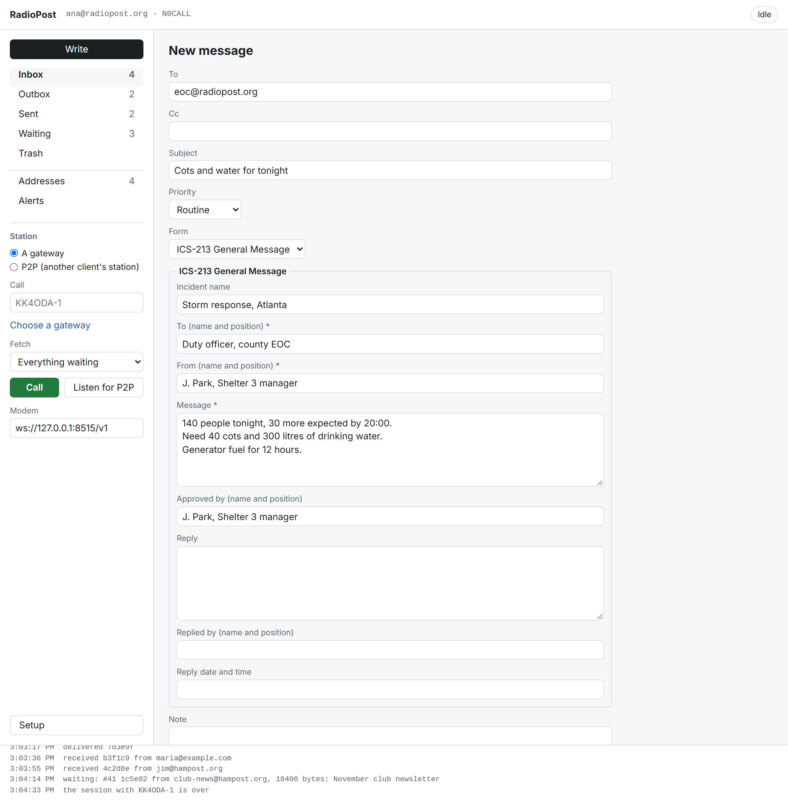

*Figure 10. Writing a form.*

Only what you type goes on the air. The form's wording stays on each computer, so a form takes less
time than the same text typed out (about a fifth less for a short ICS-213). The station that
receives it shows the whole form, by gateway or P2P ([9](#9-reading-your-mail)). Someone reading
it by email gets it as text, with the labels, and under **Maps:** a link to OpenStreetMap for each
position (with a `geo:` address after it, for map apps).

If a field is missing or too long, RadioPost says which, and keeps what you wrote. A form that
reaches a program without that form shows its values by field number.

**The forms.** RadioPost holds FEMA's ICS forms **ICS-202 Incident Objectives**, **ICS-204
Assignment List**, **ICS-205 Incident Radio Communications Plan**, **ICS-205A Communications
List**, **ICS-206 Medical Plan**, **ICS-208 Safety Message/Plan**, **ICS-210 Resource Status
Change**, **ICS-211 Incident Check-In List**, **ICS-213 General Message**, **ICS-213RR Resource
Request Message** and **ICS-214 Activity Log**, and its own **Check-In**, **Check-Out**,
**Communications Log**, **Damage Report**, **Position Report**, **Situation Report** and **Storm
Report**. Their dates and times are UTC, and their signatures are left for the paper form.

**Your group's own forms.** A group can write forms of its own, in the same way as RadioPost's.
Import one from its file in Setup ([Forms kept here](#forms-kept-here)), or get it from a form that
came in ([9](#9-reading-your-mail)): it is then under **Form** with the others. RadioPost hands it
to your post office, so that someone reading your form by email gets its labels too, and other
stations can get it from there. Every station that reads your form needs it: give them the file,
or let them click **Get the form**.

Some fields take more than text:

- **A position**, such as a report's **Location**, starts with where your station is
  ([Places and GPS](#places-and-gps)): the GPS's fix, or your place. Under it RadioPost says where
  it came from and exactly what goes, such as *Goes as: 33.78123, -84.38765 (EM73ts)*. Type
  another as decimal degrees, north and east positive (`33.78123, -84.38765`), or as a grid
  square (`EM73ts`). It goes exactly as shown. To send less, type fewer decimals or a grid square:
  a grid square goes as its centre, with how far off that may be (*±108.1 km* for EM73).
- **A date and time** is UTC.
- **Check boxes** in a row: tick every one that applies.
- **A number with a unit**, such as **Hail size (in)**, takes decimals up to the places the form
  allows; RadioPost says when there are more.
- **A table**, such as an ICS-205's channels, has a row of boxes for each line. **Add a row** adds
  one and **×** removes it. Empty rows are left out.

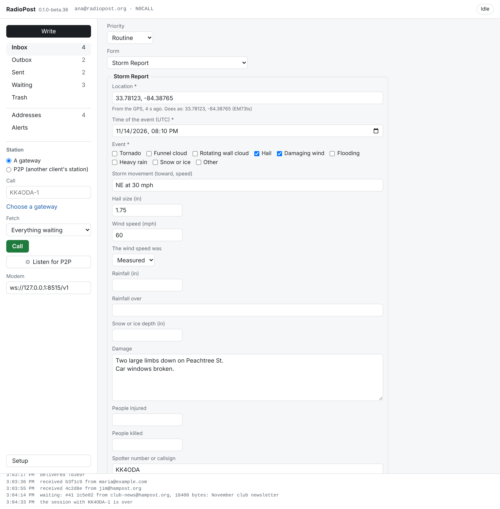

*Figure 11. A Storm Report, its location from the GPS.*

**Who can write back.** Your post office lets email in only from addresses on your **accept
list**. Writing to someone adds them to it, so their answer gets through. You can add others in
Setup ([Accept list](#accept-list)).

**The outbox.** Messages wait there until a session carries them. A message a gateway took while
it could not reach the Internet carries a tag: *queued at* that gateway
([When the Internet is down](#14-when-the-internet-is-down)).


*Figure 12. The outbox.*

**Changing a message.** Until it leaves your computer, a message in the outbox can be changed, all
of it.

1. Point at its row and click the pencil, or open it and click **Edit**.
2. **Edit message** holds what you wrote: **To**, **Cc**, **Subject**, **Priority**, the text, and
   the form with its fields if it has one. Its files are listed, ticked: untick one to leave it
   out. **Attach** adds others.
3. Click **Save in outbox**. The changed message takes the old one's place in the outbox, and the
   old one is gone. **Cancel** leaves it as it was.

RadioPost does not change a message that has left, or may be leaving, and says why:

- a message tagged *queued at* a gateway: that gateway passes it on as it is;
- a message in **Sent**;
- any message while a session is under way: it may be going out. Edit it when the session ends.

To correct a message that has left, write a new one.

While **Listening for P2P** is on and no station has called, you write, change and delete
messages as usual. A station that calls takes what is in the outbox for it at that moment.

**Changed your mind?** The trash can at the end of a row moves the message to the **Trash**.
The note that follows has **Undo**.

### 7.1 In a narrow window

In a narrow RadioPost window the folders and the call box come first, and a message being written
would be far down the window. So there **Write** opens the message in a window of its own, beside
the RadioPost window: you need not make the RadioPost window wider to write. **Reply**, **Reply
all**, **Forward**, **Edit**, and writing to an address or a group open in a window of their own
too.

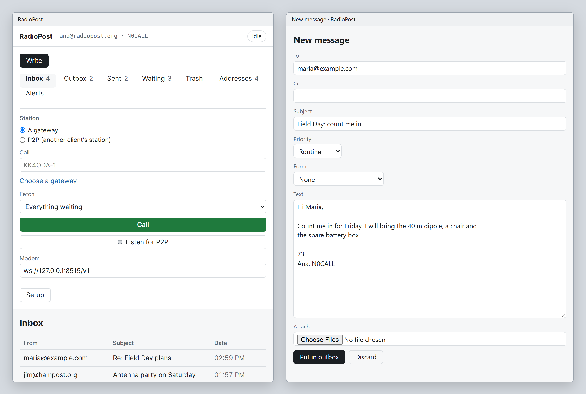

*Figure 13. A narrow RadioPost window, and a message written in a window of its own.*

It is the same form, and it works as above: forms, files, the message you answer or change.

- **Put in outbox** (**Save in outbox** for a message changed) puts the message in the outbox and
  closes the window. If the RadioPost window shows a folder or a message, it shows the **Outbox**.
- **Discard** closes the window, and the message is gone (**Cancel** leaves a message changed as it
  was).
- **Write** clicked again while its window is open brings that window to the front, with what you
  typed; so does **Edit** on the same message.
- The window opens where you left the last one, at the same size.
- Closing RadioPost closes these windows too, with what is in them.

With `radiopost panel` in a web browser, the message opens in a pop-up window. If the browser
blocks pop-ups, RadioPost says so and you write in the panel as in a wide window; allow pop-ups
for the panel's address to write in a window of its own.

## 8. Calling a gateway

A call to a gateway sends your outbox and fetches what waits for you, in one session.

### 8.1 Choose a gateway

1. Under **Station**, choose **A gateway**, then click **Choose a gateway**.
2. Click **Refresh over the Internet**. The list comes from your post office, and from the post
   offices it knows. RadioPost keeps it for when there is no Internet.
3. The nearest gateways are at the top, with their distance from where you are: to where the
   gateway's antennas are, when its record says, else to the middle of its grid square. The line beside
   **Places** says which position that is, such as *In use: the GPS, EM73tr, 2 s ago* or *In use:
   Home, EM73tr*. Your places and your GPS are set in **Setup**, under
   [Places and GPS](#places-and-gps); **Places** takes you there.
4. Each gateway shows its **Channels** (dial frequency, upper sideband, the modem the gateway
   answers on there, and the bandwidth a call there goes at; on an FM channel, *FM* and the
   channel's width, such as *145.050 MHz, Aether FM, FM, 12.5 kHz*) and its **Hours**. A gateway
   with two modems can list one dial twice, once for each, such as *7.1035 MHz, Aether HF, 500 Hz*
   and *7.1035 MHz, Mercury, 2300 Hz*. A channel marked *scanned* is one of several the gateway
   listens on in turn with one radio. Click **Choose** beside the one you want. Its callsign goes
   in **Call**, and the radio is tuned at once ([8.2](#82-tune-and-call)) to the first of its
   channels in **Channel**.

   **Channel** offers only the channels of the modem in **Modem**: RadioPost asks that modem its
   name when the window opens and when **Modem** changes. It offers them all while it does not
   know the modem yet, and when the gateway lists none for it. Then the line under **Channel**
   says so, such as *N2CALL-5 lists no Mercury channel, only Aether HF: a call from this modem is
   not answered there.*


*Figure 14. Choosing a gateway.*

**The views.** The tabs above the list show it four ways:

- *Recommended*: every gateway listed, and your own, nearest first. Each HF channel shows its
  chance this hour, corrected by what your calls taught once there are some (below). Ranking the
  list by them comes in a later version.
- *Favourites*: the gateways and channels you starred.
- *Recent*: your last calls, newest first: whom you called, on which channel, how it ended
  (*completed*, *no answer, nothing heard*, *the channel was busy*, *the link was lost*…) and how
  long it took. **Choose** picks that gateway again. Under the list, *What your calls teach* says
  how many calls learning uses, and forgets some of them (below).
- *Worked from here*: the gateways you finished a session with from within 50 km of where you
  are now (2 km on channels of 30 MHz and up).

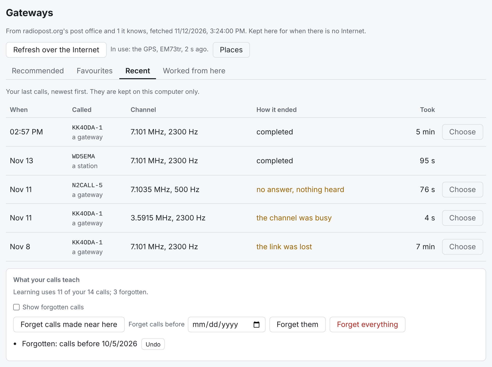

*Figure 15. Your last calls.*

**Marking gateways.** Click **☆** beside a gateway's callsign to make it a favourite, or beside
one of its channels to make only that channel one. A favourite channel is offered first when you
choose the gateway. **Block** leaves a gateway out of the list; the line under the list counts
what is left out, and **Show them** brings them back so you can **Unblock** one. **⊘** beside a
channel leaves only that channel out. **Last call** says how your last call to each gateway
ended. Under **Where**, each gateway says when it answers and how long ago its record *changed*.
One that gives listening times says whether it listens now (*listening now, until 02:00*, or *not
listening now: from 18:00*). Each says when it was last *seen* by its post office, that is when
its computer was last on and online. A gateway not seen for two days is shown faded: its computer
may be off, or it may be cut off from the Internet and still answering by radio. So is one whose
post office's list has not been fetched for a week, with the list's age. One your modem has heard
on the air in the last seven days says when, how strongly and where: *heard 12 min ago at +6 dB on
7.101 MHz*. That is one direction only: how you hear it.

**The map.** Above the list, **Map** shows the gateways of the view on a map of the world, with
you (◎), the night side as it is now and the Maidenhead fields. Zoomed in, the squares are drawn
too, and named as you come closer. ○ is a gateway listed, ■ one of your own, ★ a favourite and ◆
one worked from here. A faded mark is one not seen for days. Click a gateway, on the map or on its
row in the list, to pick it: it is marked in both, the great circle from you to it is drawn, and
the line under the map says where it is, how far, and its bearing from you, the way to point a
beam. **Choose** there does what it does in the list. Turn the mouse wheel to zoom about the
pointer, or click **+** and **−**. Drag to move. **Fit** shows you and the gateways of the view,
**World** the whole world. A gateway whose record gives no grid square is not on the map, and the
**Map** line says how many. The map needs no Internet: its land is Natural Earth's, and comes with
RadioPost. Click **Map** to fold it away; RadioPost remembers.

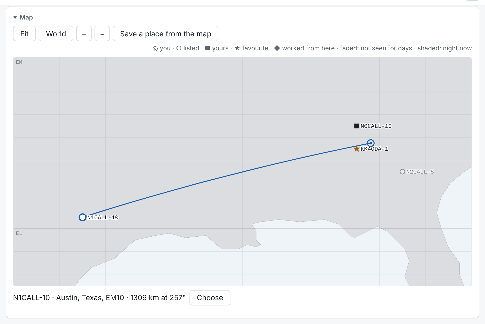

*Figure 16. The gateways on the map, one picked.*

**The chance on an HF channel.** Under each of a gateway's HF channels a line says how likely a
link is at this hour, and how fast it would go: *Likely to work: links on 98 % of days at 20Z,
about 2.2 kbit/s each way*, in green, amber (*may work*) or red (*unlikely to work*). RadioPost
works it out with VOACAP, the HF propagation model, run on this computer: once from you to the
gateway and once back, since each way has its own transmitter and its own receiver's noise. Your
end is the station profile in use (Setup, [Station profiles](#station-profiles)), and the
gateway's is what its record says, else 100 W into a dipole 10 m up. The chance is the share of the
month's days, at this hour, when your call and the gateway's answer both get through and the band
is open. The rate is Aether's own at the strength VOACAP predicts, on the days it links, read from
Aether's measured ladder for the kind of path: one hop, near-vertical, several hops. Point at the
line to see the strength each way, the path, and what was assumed. A channel for another modem says
how open the band is and how strong each way, without a rate: RadioPost has no measurements of
that modem. The prediction is worked out for the month, once, and kept: it needs no Internet.

It is a monthly average, not today's band, and often optimistic: on one 69 km path on 80 m that
Aether measured on the air, VOACAP's median was 6 to 8 dB stronger than what was read. Once you
have called a gateway on a band, RadioPost corrects it from your own calls (*What your calls
teach*, below). If the line says *HF not predicted*, it says
why: where you are is not known, the channel is outside 80 m to 10 m, or your station profile does
not cover that band.

The VOACAP engine comes with RadioPost's installers. It was developed by NTIA's Institute for
Telecommunication Sciences; RadioPost carries the voacapl port of it, built by hf-predict, and NTIA's
notice and the port's terms are installed with it. If the engine is missing, the line above the
list says so once. The command-line `radiopost panel` looks for it where `RADIOPOST_VOACAP` says, or
in a folder named `engine` beside the program.

**What your own receiver heard.** If [hf-predict](https://github.com/KK4ODA/hf-predict) runs on
this computer and listens to FT8 with WSJT-X, RadioPost asks it what you heard in the last hour from
stations near each gateway. The answer goes in a second line under the channel: *FT8 from 3 stations
near it heard here on 40 m in the last hour, the strongest at -8 dB*, or *Nothing from near it heard
here on 40 m in the last hour, in 25 min of listening*. Three stations or more raise the chance that
the band is open toward the gateway, by a fixed amount for now. They never change the rate: FT8 is
heard far below what a link needs. A band not listened to says nothing. Without hf-predict, or at
another time, the line is simply not there.

**Another time.** To see which gateway to try tonight, or on another day, pick it in **At** beside
**Places**: the next evening at 20:00, the next morning at 08:00, or **A date and hour…**, which
opens a box for any date and hour of your local time. Each HF channel then shows its chance at that
hour of that month, and each gateway whether it listens then. A VHF path does not change with the
time. The line above the list says what is assumed: *Today, 08:00 PM local (01Z): the month's
prediction for that hour; today's conditions not included; no storm forecast; your position as in
use now*. **Now** goes back to the present. The *Recent* view, your past calls, has no **At**.

**What your calls teach.** Every call you place is kept (section [4](#4-installing-radiopost)),
and RadioPost learns from them how each gateway's path compares with the model, each way, how often
the gateway answers at each time of day, and how fast Aether carries there. Once you have called a
gateway on a band, the line under that channel is worked out with what was learned and ends
*learned from your calls*: *Likely to work: links on 92 % of days at 20Z, about 2.3 kbit/s sending,
2.7 kbit/s receiving · learned from your calls*. Point at it to see the model's own line and what
was learned: how many decibels stronger or weaker each way is than predicted, with how sure that
is, how often the gateway answered, and how much of Aether's expected rate it carried. A VHF
channel gets a second line under its terrain, *Learned from your calls: margin about 31 dB · likely
to work*. A call that failed teaches too: one with nothing heard is shared between the gateway being
away and the path being too weak, by how likely each was then; one where the gateway was heard but
did not answer says it was there and your signal did not reach it. A cancelled call, a busy
channel or a fault at your own station teaches nothing about the gateway. Older calls count less:
half as much after two months for the path, after two weeks for when it answers.

**Details**, beside each gateway, shows what the model says now, what was learned and what your
calls measured in the last 30 days, side by side for each of its channels: the signal each way,
how often it answered, the chance of a link, the rate and the links lost. A disagreement shows
there rather than being averaged away. Under them, how often it answered in each three hours of the
day, and your last calls to it. **Close** puts the details away.

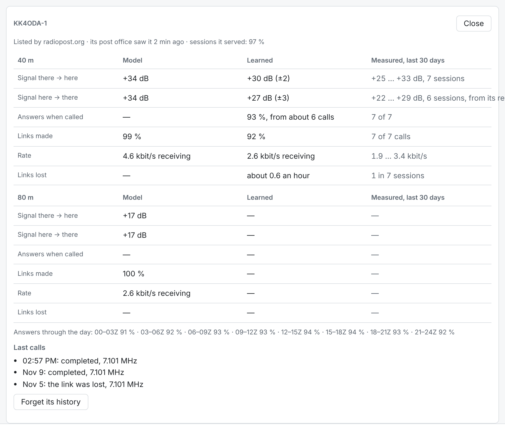

*Figure 17. What your calls taught about KK4ODA-1.*

**When your own station is at fault.** If your last calls in a day, to two gateways or more, all
failed with nothing heard though each was likely to work, the line under the list says so: *Your
last 4 calls failed on 2 gateways that usually answer. Check the radio, antenna and audio before
blaming the gateways.* Until it clears, those calls count less against the gateways. Check the
cable to the radio, the antenna and Aether's levels.

**Forgetting.** After a change to your station, a new antenna or more power, the old calls no
longer say how your station works now. **Forget its history** in a gateway's details leaves your
calls to it so far out of learning. In the *Recent* view, *What your calls teach* forgets the calls
made within a kilometre of where you are now (**Forget calls made near here**, clicked twice), the
calls before a day you pick (**Forget calls before** and **Forget them**), or every call so far
(**Forget everything**, clicked twice). Forgetting deletes nothing: the calls stay in the list,
and **Show forgotten calls** shows them struck through. Each rule is listed with an **Undo**, and
**Bring its history back** in a gateway's details undoes its rule. Calls placed after a rule count
as usual.

**The terrain of a VHF path.** Under a gateway's channel of 30 MHz or more, a line says how the
path from you to it goes over the ground: *Fresnel zone partly obstructed at 1.5 km · diffraction
about 4 dB (P.526) · margin about 54 dB · likely to work*, in green, amber (*may work*) or red
(*unlikely to work*). It needs three things. The gateway's record must say where its antennas are,
not only its grid square. Where you are must be better than a grid square's middle: a place typed
as a latitude and longitude, picked on the map, or the GPS. And the terrain between must be on this
computer: RadioPost fetches it only when you ask, since a tile of a degree square is about 5 MB
(45 MB at 30 m). Until then the line says what is missing, such as *1 tile to fetch, about 5 MB*.
Paths over 150 km are not worked out.

Click **Terrain** on the line to see the path. The drawing shows the ground between you, with the
Earth's bulge added, the straight line between the two antennas, and below it the dashed line of
60 % of the first Fresnel zone, which a path wants clear. A dot marks where the ground comes
closest, or stands highest above the line. The table gives the link budget each way: what reaches
the other radio, what its modem needs, the margin and the chance. Under it, every value RadioPost
had to assume, such as the gateway's feed line or your antenna's height, is named. Move **Your
antenna** to try another height: the path and the budget are worked out again, the line above the
slider says how much more or less margin that gives than your profile's height, and your station
profile keeps its own. **Fetch the terrain** fetches the tiles this path crosses, and **Fetch
finer data, 30 m** the same at 30 m. The data is the Copernicus DEM, a surface model: trees and
buildings count as ground, as the radar saw them between 2010 and 2015.

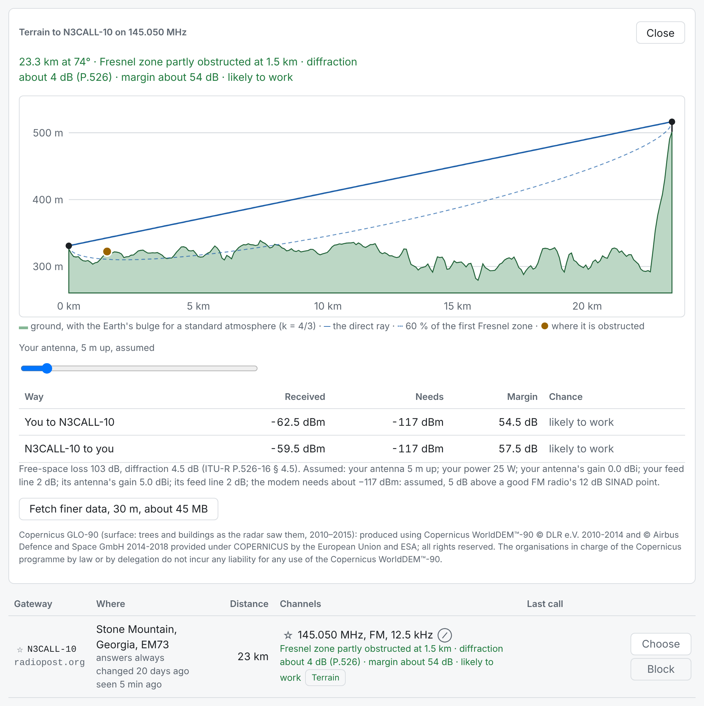

*Figure 18. The terrain to a VHF gateway.*

The diffraction is worked out by ITU-R P.526-16, and the chance from the margin against a 10 dB
spread over places. Where ground stands close to an antenna (trees or a building a few hundred
metres away, or a slope rising steeply from it), the line ends *less certain*, with where: *less
certain: ground 0.1 km from the gateway's antenna, 13° up*. No terrain model has been checked on
such paths, and two of them can differ there by 10 dB or more, so the chance is read against a
14 dB spread instead, and **Terrain** says so under the table. It is a guide, not a promise: buildings near you, the antenna's pattern, and the
gateway's real power all count. The radio's own threshold is assumed too, since no modem publishes
one as a measurement.

**The terrain map.** Under the world map, **Terrain map** shows you and the VHF gateways of the
view whose records say where their antennas are, over the ground as the terrain on this computer
shows it: hills lit from the north-west, drawn twice as steep as they are so that gentle country
still shows, and the sea pale blue. Where no terrain is held it is left empty. A line runs from you
to each gateway, in the colour of its chance: green *likely to work*, amber *may work*, red
*unlikely to work*, grey dashes where the path is not worked out yet. A triangle marks where a path
is obstructed, amber where the ground is inside the Fresnel zone and red where it rises above the
line between the antennas. Click a gateway or its line to pick it: its line thickens, and it is
picked in the list and on the world map too. The bar at the bottom left is the scale. The map
needs no Internet and fetches nothing: it is drawn from the terrain already held. Click **Terrain
map** to fold it away; RadioPost remembers.

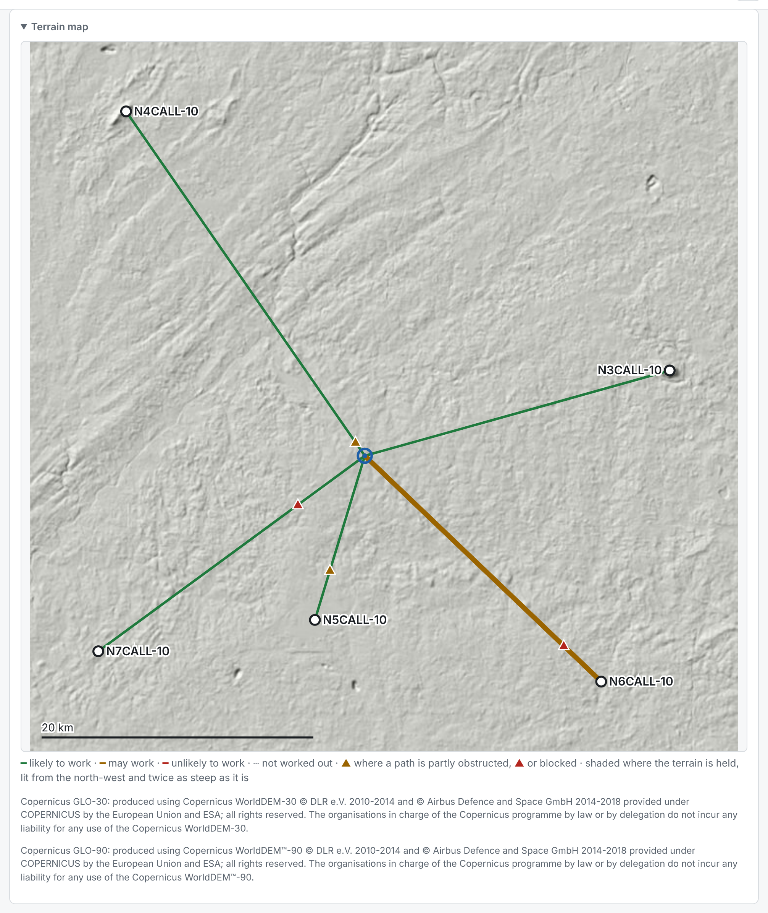

*Figure 19. The terrain map.*

Under the map, as under the terrain of a path, is the notice the elevation data's licence asks for.
Figures 17 and 18 are drawn from Copernicus GLO-90: produced using Copernicus WorldDEM™-90 © DLR
e.V. 2010-2014 and © Airbus Defence and Space GmbH 2014-2018 provided under COPERNICUS by the
European Union and ESA; all rights reserved. The organisations in charge of the Copernicus
programme by law or by delegation do not incur any liability for any use of the Copernicus
WorldDEM™-90.

To save a place from the map, click **Save a place from the map**, then click the spot. The line
under the map gives its latitude and longitude. Type a name and click **Save as a place**. It joins
your places in **Setup**, under [Places and GPS](#places-and-gps), and **Set from** says *The map*.

**A gateway of your own.** For a station no post office lists, such as a partner for
station-to-station mail, a test gateway, or a club's station not yet registered, open **Add a
gateway of your own**. Type its callsign, grid square and where it is, a channel's **Dial** in MHz
and its **Bandwidth**, and when it answers, then click **Add**. Add again with the same callsign
to give it another channel. It is marked *yours*, and **Remove** forgets it. It stays on this
computer: your post office never places mail at it.

### 8.2 Tune and call

**A gateway you called before.** When you choose **A gateway**, **Call** shows the last gateway you
called, on the channel you called it on: when RadioPost starts, and when you come back from P2P.
If you had put another gateway there before switching to P2P, that one comes back instead. Coming
back tunes nothing. For another gateway you called, click **▾** at the right of **Call**, or press
the down arrow in it. The list shows each gateway you called once, newest first, with its channel
and how long ago. Click one, or move to it with the arrows and press Enter. Its channels go in
**Channel**, the one you called it on picked, and the radio is tuned there at once. Escape closes
the list. A gateway you blocked is not in it, and one no longer listed keeps only the channel you
called it on.

1. Pick the **Channel** to call on. RadioPost tunes the radio there at once, before you call, so
   you can set the radio and the antenna tuner for it. The line under it says what happened:
   - *✓ Tuned the radio to 7.101 MHz.* Aether set the radio's dial (it reaches the radio over
     CAT, rigctld or FLRig).
   - *Set the radio's dial to 7.101 MHz (USB) yourself: the modem cannot set it.* Aether keys
     this radio without CAT, so it cannot set the dial. Turn the radio to that dial yourself.
     Aether's own manual says how to let it set the dial: CAT keying in its
     [Setup step 2](https://github.com/KK4ODA/aether-hf/blob/master/docs/manual/manual.md#step-2-radio-interface).

   The call goes at the bandwidth listed with the channel, 500 or 2300 Hz, whatever Aether's own
   **Bandwidth** (its Setup step 4) says. Aether moves to it for the call and goes back after.
   The log says it: *calling KK4ODA-1 at 2300 Hz*. Before RadioPost 0.1.0-beta.38 a gateway call
   went at Aether's own **Bandwidth**, and a gateway on 2300 Hz answered a 500 Hz call at 500 Hz.
2. If your antenna needs a tuner for this channel, click **Tuner tone**. Aether keys ten seconds of
   steady carrier at its transmit level. Set the tuner while it sounds. Click **Stop tone** to stop
   it sooner. Aether keys no tone while it hears the channel in use.
3. Listen for a moment. Do not call over another station.
4. In RadioPost, set **Fetch**:
   - **Everything waiting**: all your mail comes.
   - **Up to 10 kB each** or **Up to 50 kB each**: only messages up to that size come. The rest
     wait for a later call.
   - **Only the list of what waits**: nothing comes but the list. Use it on a weak path.

   Messages of 1,000 bytes or less come anyway, whatever **Fetch** says.
5. Click **Call**. If the radio is not on the channel any more, RadioPost tunes it there first.
   After the session the radio stays on the channel: you chose it.


*Figure 20. The radio tuned to the channel picked.*

On a *scanned* channel the gateway may be on another channel when you call. RadioPost asks Aether
to keep calling as long as the gateway's record says it takes to come round, often a minute or
more. An Aether before 0.2.0-beta.162 cannot be asked: the log says the call may end before the
gateway comes round. Call again, or call on another of its channels.

On such a long call, Aether may go on at 500 Hz after four tries at 2300 Hz go unanswered, to a
station it does not know runs 2300 Hz. The log then says *connected to KK4ODA-1 at 500 Hz* and
*the link runs at 500 Hz, not the 2300 Hz asked: the modem moved the call*.

### 8.3 During the session

The state at the top reads *Calling …*, then *In session with …*. A card at the bottom right
shows how far the mail has got:

- While RadioPost calls, and then while it finds out what there is to carry, a short arc spins
  round the envelope: amber while it calls, blue once in session, like the state at the top.
- The **outer ring** is what you send, in orange-red, the colour of transmitting. The **inner
  ring** is what comes in, in green. The ring of the way not moving just now is faded, and so is
  the dot on its line.
- The lines say how many messages are whole, the kilobytes, and about how long is left.
- The header shows the same as a small ring with the percentage.
- When the session ends the card stays a few seconds, both rings in one colour: green with a tick
  when everything crossed or there was nothing to carry, amber when some of it did not or you
  stopped it, red when the session failed.

Red on the card means only mail going out, or a session that failed.

A message counts as sent once Aether has put it on the air, not when RadioPost hands it over.


*Figure 21. A session under way.*

The log says what happens: the call, each message delivered or received, what waits, and the end.
A few short messages take a minute or two at 2300 Hz on a fair path, longer on a weak one. Your
email reaches the other end within a minute of the session, from your RadioPost address.

**Stopping.** While a call or a session is under way, the card has a button under its lines:

- **Stop calling**, while RadioPost calls. The call stops at once. Nothing has gone out.
- **Disconnect**, during a session. Aether sends what it already holds, then ends the link. The
  other station hears it end.
- **Abort** takes Disconnect's place once you have clicked it. Click it when Disconnect takes too
  long on a weak path: the link ends at once, and what Aether still held is dropped.

Nothing is lost either way. Mail the other station did not take whole stays in your **Outbox**
and goes on your next call. A message you received in part is kept, and the rest comes on your
next call, through any gateway. The state at the top reads *Stopped*, and the card ends amber, not
red. A call you stopped does not count against the gateway in what your calls teach
([8.1](#81-choose-a-gateway)).

Closing the window during a call or a session asks first, then aborts it the same way before
RadioPost closes.

### 8.4 Calling with Mercury

RadioPost calls through the modem its **Modem** box names. A gateway that also answers on Mercury
([More than one modem](#more-than-one-modem)) can be called with Mercury:

1. Start Mercury, keying your radio itself. With an interface keyed by its RTS line, such as a
   DigiRig on COM9, in PowerShell in Mercury's folder:

   ```
   .\mercury.exe -P serial -A COM9 -i 'CAPTURE-ID' -o 'PLAYBACK-ID'
   ```

   `.\mercury.exe -z` lists the sound cards and their IDs, and the same command with `-Q` in place
   of `-i` and `-o` keys the radio for one second, to test the keying
   ([section 18](#aether-and-mercury-on-one-radio) has both). Close Aether first if it holds the
   same port. If Aether runs on this computer with its external programs port or its KISS port on,
   start Mercury with `-p 8400 -b 8410` as a gateway does, and give its adapter
   `--mercury 127.0.0.1:8400`.
2. Start Mercury's adapter, `radiopost-mercury.exe` from the tools archive. Its own settings fit:
   it waits at `127.0.0.1:8600` and finds Mercury at `127.0.0.1:8300`.
3. In RadioPost, put `127.0.0.1:8600` in **Modem**.
4. Choose the gateway, set the radio's dial yourself, and call, as in [8.2](#82-tune-and-call).

With Mercury:

- The line under **Channel** says *Set the radio's dial to … yourself: the modem cannot set it*.
  Mercury reaches no dial. There is no **Tuner tone** either, and no alerts.
- **Channel** offers the gateway's Mercury channels only, such as *7.101 MHz, Mercury, 2300 Hz*.
  A gateway with no Mercury channel stays in the box, its other channels listed, and the line
  under **Channel** says it lists none for Mercury: a call from Mercury is not answered there.
- Mercury checks no band rules. Keep your transmissions within them yourself.
- After the session the adapter identifies your station with Mercury's CQ frame, which carries
  your callsign. Mercury sends no Morse identifier.

Mercury first carried RadioPost on the air on 27 November 2026: a mobile's two sessions with the
KK4ODA-1 gateway on 7.101 MHz at 2300 Hz.

## 9. Reading your mail

Click a message in the **Inbox** to read it.


*Figure 22. Reading a message.*

- **Reply** answers the sender. The other end's mail program keeps the thread. RadioPost does not
  quote the message you answer, because every byte goes on the air: it shows the original under
  your text, for you only. A form shows there as its text, the sender's note below it.
- **Reply all** also copies everyone else it went to.
- **Forward** passes the message on, with its text and files. You can untick files you do not
  want to carry. A form goes as its text, each label with its value, the sender's note below it.
  So its **Subject**, **Date** and **Time** stay the original's (sent as a form again, they would
  be your message's own), and the station it reaches shows it as text, not as a form. The labels
  go on the air too, so it takes a little longer than the form did.
- **Print** prints it. To make a PDF, choose *Save as PDF* (on Windows, *Microsoft Print to
  PDF*) as the printer. A message prints as it shows, without the buttons. An ICS form prints as
  FEMA's paper form (ICS 202, 204, 205, 205A, 206, 208, 210, 211, 213, 213 RR and 214), its
  blocks numbered as there, its tables with their rows, and its signature lines blank to sign on
  paper. Under it come the sender, the recipients, the date and time in UTC, the
  message's ID, its files and the sender's note.
- **Delete** moves it to the Trash (or press the Delete key).
- **Edit**, on a message in the **Outbox**, changes it before it goes
  ([section 7](#7-writing-a-message)).
- **Add to addresses**, beside the sender, puts the sender on your address list.

**A form** shows as the form, in a box under the attachments: its name, then each field filled
in, its label beside its value, in the form's order, under the form's headings; a table shows as
a table. The **Subject**, **Date** and **Time** are the message's own. The sender's note, if any, follows in a box of its own. A form your computer
does not hold shows as *Form* and a number, its values by field number. Click **Get the form**
under its name: RadioPost asks your post office for it, then the sender's, and shows the form once
it has it. Only the form's wording comes, over the Internet; nothing goes on the air. If neither
post office has it, ask the sender for the form's file and import it in Setup
([Forms kept here](#forms-kept-here)).

**Files.** Click **Save** beside a file to save it in the **Downloads** folder in your home
folder. RadioPost never writes over a file already there: a second `grid.txt` is saved as
`grid (2).txt`. It says where the file went. Open it from there with the program of your choice.
A file came from another station, so treat it as you would a download: RadioPost keeps only the
last part of its name and leaves out characters your system does not allow. On Windows it marks
the file as downloaded, so Windows warns before running it and opens a document in its
protected view.

**Attachments held at the post office.** A file too large for the radio does not come with its
message. Under it you see *held at the post office* and the button **Ask on the next call**.

1. Click **Ask on the next call**.
2. Call a gateway. It answers that your files are coming in a new message.
3. Call again. The files come in a message from `postmaster@` your post office.

**The Waiting folder** shows what waited at your post office at your last call to a gateway.
Tick a message to fetch it on the next call, whatever **Fetch** says. A message a cut-off gateway
kept for you has no tick box: it comes with what you fetch. A faded paperclip marks a message
whose files are held at the post office: they do not come with it. Once it has come, open it to
ask for them.


*Figure 23. Choosing what to fetch next.*

### 9.1 Reports

Forms that carry a position are **Reports** too: a damage, storm or situation report, a check-in
or check-out, a position report, an ICS-206's helipads. Click **Reports** in the list on the left.
The map shows where each one is, and the list under it each report, the newest first. The reports
your circles sent by broadcast are there too, and yours: the list says *Position Report, in
Riverside net*, with the sender's callsign ([10.5](#105-send-a-report)).

- **Form** shows one form's reports, or all of them.
- **Written** shows those written in the last day, three days or week, or at any time.
- **Colour by** colours the marks by one of the form's choices, such as a Damage Report's
  **Damage**: the first choice green, the last red, *Unknown* and *Other* grey. The key above the
  map names the colours.
- Click a mark or a line to pick it in both. Under the map RadioPost says what and where it is.
  **Open the message** opens it; a report heard by broadcast has no message to open
  ([10.5](#105-send-a-report)). **OpenStreetMap** shows the place on openstreetmap.org, with its
  streets, in your web browser; openstreetmap.org then knows the place.
- **Fit** shows every report shown. **+** and **−**, or the mouse wheel, zoom; drag to move. The
  map draws land only roughly, and the Maidenhead squares and subsquares as you zoom in.
- **Save as CSV** writes the reports shown to a file for a spreadsheet: a line for each
  position, with the date, the sender and recipients, the form, the position and its grid square,
  and, when all are of one form, each of its fields. **Save as GeoJSON** writes them for a map
  program such as QGIS, ArcGIS or CalTopo. Both go in your **Downloads** folder, never over a file
  already there.

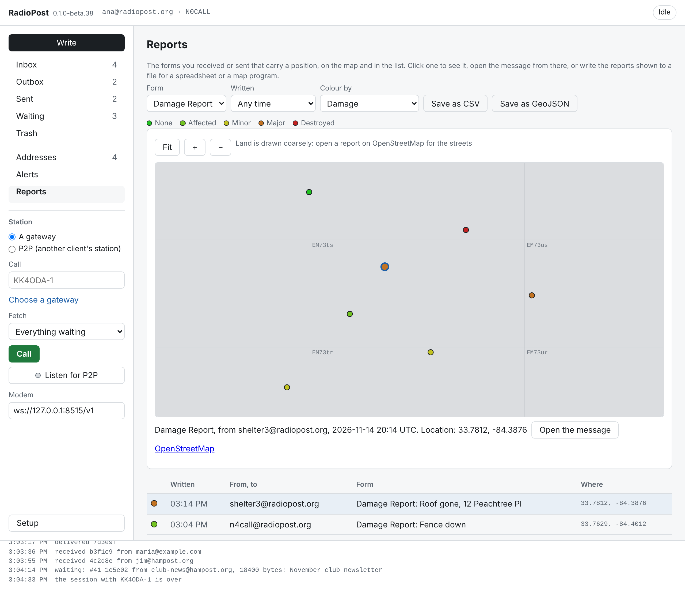

*Figure 24. Damage reports, coloured by damage.*

### 9.2 In a mail program

When you have the Internet, an ordinary mail program reads your RadioPost mailbox: Thunderbird,
Outlook, or the mail app on a phone. The RadioPost client has no button for this, since it fetches
mail only by radio. The mailbox is on your post office's mail server: RadioPost reaches it by radio
through a gateway, the mail program over the Internet.

**The password.** The post office makes your mailbox with your account and gives its password
once. If you applied, it is in the welcome email sent to **Your email now**. If you enrolled with
a code, the operator gives it to you with the code. It is the mailbox's password only: RadioPost
never uses it. Change it the first time you sign in, on the mail server's web page: open the
server's name in a web browser, such as `https://po.radiopost.org`, and sign in with your address.
If you lose the password, ask your operator for a new one ([section 27](#27-accounts-and-devices)).
Your RadioPost computers go on working.

**The settings.** Some mail programs find them from your address. If yours does not, type them in.
In Thunderbird, add the account with your address and the mailbox's password, click **Configure
manually**, and fill in:

| Field | Incoming server | Outgoing server |
|---|---|---|
| **Protocol** | IMAP | SMTP |
| **Hostname** | `po.radiopost.org` | `po.radiopost.org` |
| **Port** | 993 | 465 |
| **Connection security** | SSL/TLS | SSL/TLS |
| **Authentication method** | Normal password | Normal password |
| **Username** | Your address, such as `ana@radiopost.org` | Your address, such as `ana@radiopost.org` |

Other mail programs ask for the same values under similar names. `po.radiopost.org` is the mail
server of `radiopost.org`. At another post office, use the server its welcome email names, or ask
its operator.

**What the two share.** Each shows what you did in the other:

- Mail sent to you comes to both: to the mail program as it arrives, to RadioPost on your next
  call.
- Mail you pick up by radio is marked read in the mail program within a few minutes.
- Mail you send by radio appears in the mail program's Sent folder, marked read.
- Mail you read in the mail program still comes by radio, unless you tick **Skip mail I have read
  in a mail program** in Setup ([Usual gateways](#usual-gateways)). With it ticked, the post office
  takes what you read there as picked up: it leaves your waiting mail, and gateways holding copies
  of it for you drop them.
- Mail you send from the mail program goes as ordinary email, and its recipients join your accept
  list, so their answers reach you. RadioPost's **Sent** does not show it: the client lists only
  what it sent itself.

The read marks, the Sent folder and **Skip mail I have read in a mail program** need your post
office to reach its mail server's mailboxes
([the post office guide, chapter 15](../user/post-office.md#15-one-mailbox-radio-and-mail-programs)).
If they do not work, tell your operator.

**Mail to another RadioPost user.** Mail you write in a mail program to another RadioPost user
reaches them by radio too, so it goes on the air. Write it as you would by radio: plain text, never
encrypted, no business ([section 36](#36-the-rules)). Your post office refuses mail to a user of
its own that is encrypted or has a program attached (a file such as `.exe`, `.bat` or `.js`), and
your mail program shows why: *Mail to radiopost.org travels by amateur radio, where encryption is
not allowed and programs are not carried.* Then it goes to nobody on the message. Send it again
without the encryption or the program, or send it to the others alone. The post office cannot tell
that a licensed amateur wrote it, so it counts as third-party traffic: a gateway hands it only to
stations in its own country, or in one with a third-party arrangement.

## 10. Station to station

Two RadioPost stations can send mail to each other directly by radio. No gateway, no post office
and no Internet are needed during the session. Each station proves who it is with its
credential.

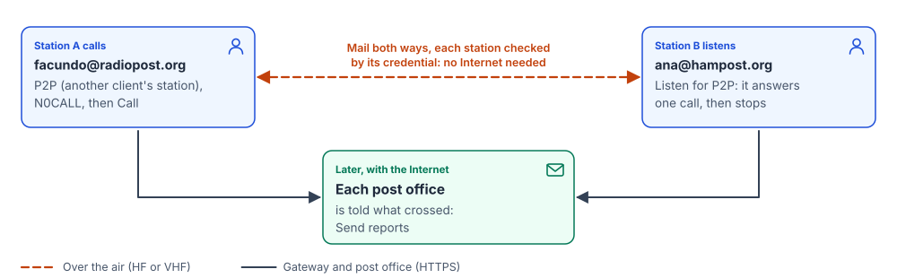

*Figure 25. Station to station.*

Agree on a frequency and a bandwidth first.

**The station that answers:**

1. Choose **P2P (another client's station)** and type the frequency in **Dial, MHz**.
   **Listen for P2P** tunes the radio there when it starts. If RadioPost Gateway on this station
   scans its channels, the radio stays with the scan, and callers call on one of those channels.
2. Click **Listen for P2P**. The switch stays in, its lamp lights green, and it reads
   **Listening for P2P**. The state reads *Listening*. RadioPost answers P2P calls to the callsign
   at the top of the window or to any other of yours. Rest the mouse on the switch to see the
   callsigns it answers as. While it listens, Aether runs 2300 Hz, which answers calls at 500 Hz
   too, whatever Aether's own **Bandwidth** says; it goes back when you stop listening.
   The line under the switch says where and how the station answers, as Aether reports it:
   *Listening as KK4ODA on 7.103 MHz, 2300 Hz (answers 500 Hz calls too)*, or *on the channels
   the station scans: 7.101, 3.590 and 14.107 MHz*. Tell this to the station that will call you.
   In amber, *500 Hz calls only* means a 2300 Hz call is not answered: an external program on
   Aether, such as VarAC, chose 500 Hz for the station.
3. Leave it on. After each session, however it ended, RadioPost listens again by itself. If
   Aether goes away (it restarts, say), the lamp turns amber and the state reads *Waiting for the
   modem*. RadioPost tries again every 5 seconds and listens as soon as Aether is back.
4. To stop listening, click **Listening for P2P** again. During a session, the session goes on to
   its end, and listening stops then.

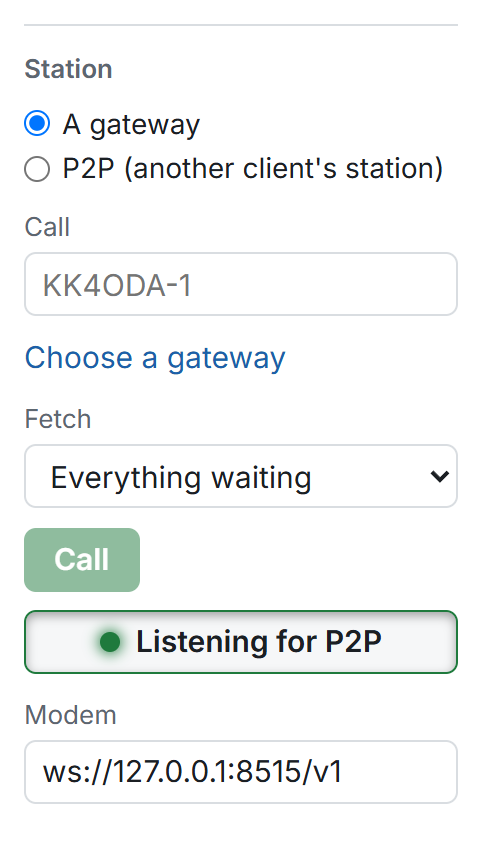

*Figure 26. Listening for P2P, switched on.*

While the switch is on, **Call** and **Tuner tone** are greyed: the radio is listening. Click
**Listening for P2P** to stop listening, then call.

Everything else goes on while the station listens. Write, change and delete messages as usual: a
station that calls takes what is in the outbox for it then, even a message saved a moment before.
During a session, **Write** and the buttons that change messages are greyed until it ends.
**Disconnect** on the session card ends a session you answered, as it ends one you called
([8.3](#83-during-the-session)); the station goes on listening. RadioPost renews your credential while it listens, as it does at other times
([5.4](#54-your-credential)), and a station that calls meanwhile is answered at once.

**The station that calls:**

1. Under **Station**, choose **P2P (another client's station)**. **Call** shows the last station
   you called, with that call's **Dial, MHz** and **Bandwidth**.
2. In **Call**, type the other station's callsign, or pick one your modem heard or you called
   before under **▾** (below).
3. In **Dial, MHz**, type the frequency you agreed, such as `7.103`. RadioPost tunes the radio
   there at once, or says which dial to set yourself, as in [8.2](#82-tune-and-call).
   **Tuner tone** keys ten seconds of carrier for your antenna tuner.
4. Choose the **Bandwidth** you agreed: **2300 Hz** or **500 Hz**. For the call, Aether moves the
   whole station to it, and back after. A station listening with RadioPost answers either.
5. Click **Call**.

When the station you call has a gateway listed under its callsign (KK4ODA's KK4ODA-1), the line
under the dial predicts the band from that gateway's site: *40 m to KK4ODA, predicted at
KK4ODA-1's site, 95 km away. Unlikely to work: links on 12 % of days at 00Z. 80 m, 3.590 MHz:
likely to work.* It is amber when the band is unlikely to work. Short paths close on the higher
bands after dark: 40 m can skip right over a station 100 km away in the evening, when 80 m still
works. With no gateway listed, the line predicts where the station's own beacon said it is, when
your modem heard one in the last seven days: *40 m to N2CALL, predicted at the position its beacon
gave, 95 km away*. Nothing shows for a station with neither.

If the other station also runs a gateway that scans its channels, and you call on one of them, the
call keeps trying as long as the gateway's scan, so it reaches the station when the scan comes back
to that channel. The activity says *a gateway at KK4ODA's station scans 7.101 MHz: the call keeps
trying 54 s*. On a frequency the gateway does not scan, the station hears you only if its operator
stopped the scan and tuned there.

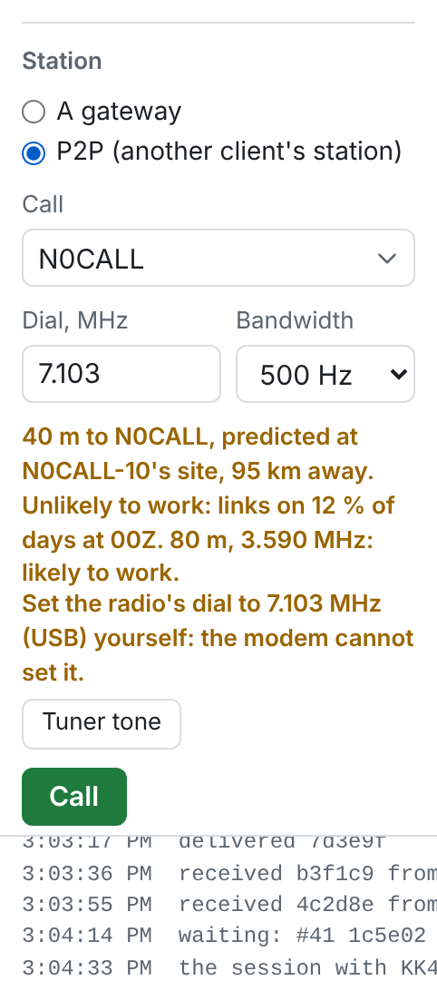

*Figure 27. A station call: the band predicted, on a radio whose dial Aether cannot set.*

**The stations your modem heard.** In P2P, the number beside **▾** at the right of **Call** says
how many stations your modem heard in the last half hour. Click **▾**, or press the down arrow in
**Call**, to see them. The list groups them by where they were heard: *On 7.101 MHz, where the
radio is*, then the other dials of the same band, then the other bands. Each line gives the
callsign, the strength your station heard it at and how long ago, and under it what was heard: a
beacon, a station calling another, a session with you. A beacon from an Aether that says so tells
whether the station answers calls now, and where it is: the line gives its distance and bearing
from you. *P2P worked Nov 12* means a session with that station came up before. Lines more than
half an hour old are faded, and those more than six hours old wait behind **Show older**. After
the stations heard come the stations you called before and have not heard lately, with the dial
and bandwidth of that call.

Click a line, or move to it with the arrows and press Enter: its callsign, the dial it was heard
on and the bandwidth it runs go in, and the radio is tuned there at once. Type in **Call** to
narrow the list to the callsigns that start with what you typed. Escape closes the list. While the
list is open it does not reorder: readings change in place, and a new station joins the end of its
group.

The strength is what your station heard: one direction only. A beacon reads low on a strong or
fading path, so a station heard at +5 dB may be stronger. A modem hears only stations of its own
kind: Aether hears Aether stations, and Mercury hears Mercury's CQ frames. With Mercury the list
fills while you listen or call; VARA lists nothing yet. Gateways and your own callsigns are left
out. RadioPost keeps what it heard for seven days, each station once a band, in `stations.json` in
your home folder.

Choosing **A gateway** again brings back the gateway that was in **Call**, on its channel
([8.2](#82-tune-and-call)), and choosing P2P again brings back this station. Switching tunes
nothing.


*Figure 28. The stations your modem heard, and those you called before.*

**Beacons.** **Beacon**, beside **Call**, puts your callsign on the air, addressed to nobody, so
that stations listening list you, with how well they hear you. It is a switch, as **Listen for P2P**
is: click it and it stays in, its lamp green, and RadioPost beacons every 15 minutes for four hours
at most, until you click it again. Its lamp is amber while a beacon waits for a clear channel. The
line under **Listen for P2P** says what it does: *Beacon every 15 min · next about 3:38 PM · last
3:17 PM*.

Click **▾** beside it, or right-click either part, for its menu:

- **Send a beacon now**: one beacon, on the channel picked or where the radio is. It waits up to
  two minutes for a clear channel. While you listen it goes on the listening connection, and
  listening goes on; otherwise the Station box reads *Sending a beacon* until it has gone. The line
  under **Listen for P2P** then says what it did: *Beacon sent at 3:17 PM on 7.101 MHz*, or why it
  did not go. Another may go a minute after.
- **Repeat**: **Off**, **10 min**, **15 min**, **30 min** or **60 min**. An interval starts
  repeating at it; **Off** stops it.
- **Only while listening for P2P**, ticked at first: beacons go only while **Listen for P2P** is
  on, so that a station that lists you can call you. Unticked, they go whether you listen or not,
  and say that you do not answer calls.
- **Position in the beacon**: **None**, **4-char grid**, **6-char grid** or **Exact**, the
  default. The line under it says what your next beacon tells of where you are, and where that
  came from: the GPS, or a place ([Places and GPS](#places-and-gps)). A place given as a grid
  square goes as that square at most. Everyone listening hears it. With no position in use, Aether
  puts in its own Setup grid square, if it has one; with **None** it puts in nothing.
- **Next**, **Last** and **Repeats until**.

The interval counts from when your callsign was last on the air for RadioPost: a beacon, a call or
a session, so a station in use beacons less. Up to a minute is added at random, so that two
stations started together drift apart. A beacon waits while you call or are in a session; one that
cannot go within its two minutes is skipped, and the next keeps to the interval. With a RadioPost
gateway on the same Aether scanning its channels, each beacon goes on the next of them. While Aether
repeats a beacon of its own (its **Repeat**), RadioPost sends none. Repeating stops after four hours
and when the rules refuse a beacon, such as under automatic control. RadioPost does not start it
again when it restarts. A beacon on a timer is for when you are at the station: a station left
alone is under automatic control, where a beacon is allowed only in a few segments (§97.203(d)).

A beacon also says whether calls to your callsign are answered now: yes while you listen for P2P.
It needs a modem that sends beacons: Aether 0.2.0-beta.183 or later, or Mercury with its busy
detector on. VARA sends none for RadioPost yet. RadioPost keeps your choices in `beacon.json` in
your home folder.


*Figure 29. Beacon's menu.*

**A station's details.** A right click on a line of the list, or Shift+F10 on the line picked,
shows what RadioPost knows of the station: how often and how strongly it was heard, on which dials
and bands, whether it answers calls, where its beacon says it is and how far away, and your P2P
sessions with it and how it heard you. **Call on 7.083 MHz** puts it in **Call** with its dial and
bandwidth. **Pin to the top** makes it a favourite: a star, first in its group. In Setup, *Sounds
and notifications* can give *A favourite station heard again after three hours* a sound; it has
none at first. RadioPost keeps your favourites in `stations.json`.

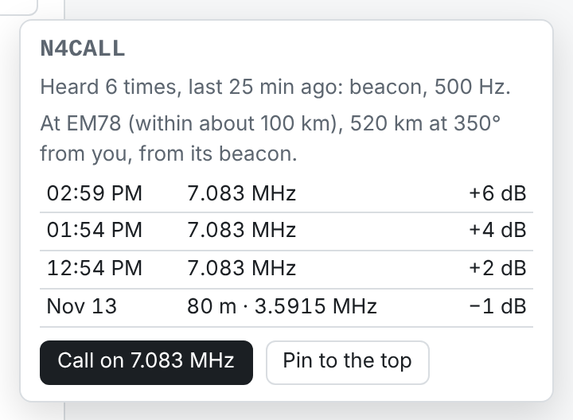

*Figure 30. A station's details.*

**On the map.** When a station heard gave its position, the list's last line is **Show on the
map**: the stations on the world map, bright when heard in the last half hour and faded after, and
you in blue. Click one to put it in **Call**.

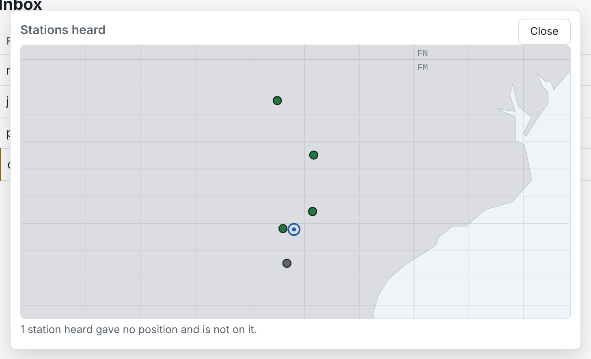

*Figure 31. The stations heard, on the map.*

Mail addressed to the other station's address crosses. Each side keeps a record of the session.
When you next have the Internet, a line under the Station box says how many sessions wait to be
reported: click **Send reports**. Your post office then marks your sent mail as delivered.

**A station that also runs a gateway.** RadioPost Gateway holds the gateway's own callsign, such
as `KK4ODA-1`. A station call to a gateway RadioPost has listed is not placed: RadioPost says
*KK4ODA-1 is a gateway: it takes gateway calls, not P2P calls. For P2P, call the station's own
callsign, KK4ODA*, and the message's **Call KK4ODA** button calls that one. A gateway not listed
yet still answers the call, then hangs up and says *KK4ODA-1 is a gateway: for P2P, call the other
operator's own callsign while their client listens*. To work that operator station to station,
call their own callsign (`KK4ODA`). Their RadioPost client must be listening (**Listen for P2P**) under it, beside the
gateway on the same Aether. The gateway need not close: Aether serves both programs, each for its
own callsigns.

### 10.1 Alerts

An alert tells another station, or a group of stations, that you need them now. It is one line
of text, such as *Please call me on 146.52 now*. At the other station it sounds an alarm and
brings RadioPost's window to the front until the operator answers it.

An alert needs no call and no session. Aether sends it once, to everyone listening, as a short
broadcast: about 16 seconds on the air, and 11 for each answer. It gets through on a path too weak
for a session, and it can reach a whole group at once.

An alert goes on one dial, and only stations listening there hear it. RadioPost picks the dial
for you (section 10.3): the other station's gateway channel when it runs a listed gateway,
otherwise the circle's **watch dial**, the dial its stations agree to keep their radios on.
Every answer goes back on the dial the alert was heard on.

Only stations that share a **keyword** can alert each other. Stations that typed the same keyword
make a **circle**: a family, a net, a team. Every alert carries a short check that only that
keyword can make, so RadioPost sounds only for alerts from your circles. Anyone listening can
still read every alert: nothing is encrypted.

You need:

- Aether as your modem. VARA, ARDOP, Mercury and packet carry no alerts.
- RadioPost open. Alerts arrive only while its window is open (or `radiopost panel` runs).
- A clock right to a few minutes. An alert more than ten minutes from your clock is not taken.


*Figure 32. Alerts.*

### 10.2 Set up a circle

Agree on a keyword with the others first, by voice or in person, never on the air. Four words or
more. RadioPost can make one for you.

1. Click **Alerts** in the left-hand column.
2. Under **Circles**, type a **Name** for it, such as `Family`. The others may name it otherwise.
3. Type the **Keyword**, or click **Make one** and tell the others the words it shows. Capitals and
   extra spaces do not count.
4. Type the **Watch dial, MHz**, if the circle keeps one: the dial its stations keep their radios
   on, such as `7.101`. Agree on it with the keyword. You can leave it empty, and change it later
   in the circle's row.
5. Choose **When an alert arrives**: **Time-sensitive** sounds the alarm. The others are quieter
   (see [Sounds and notifications](#sounds-and-notifications)).
6. Click **Add the circle**.
7. Read the circle's **Check**, such as `9853 7abf`, to the others. The same check at every station
   means the same keyword. A different check means a typing mistake: delete it and add it again.

Short keywords can be guessed from one alert heard on the air, so RadioPost refuses one under 8
characters and warns under four words.

RadioPost keeps each circle's keyword on this computer, hidden. To tell it to someone who joins
the circle later, click **Show** in the circle's **Keyword** column: the words appear, in lower
case with single spaces, as the circle's key is made from them. **Hide** covers them again, and
they are hidden again when you leave Alerts. Tell them by voice or in person, never on the air.
A circle added before RadioPost kept keywords says *Not kept*. Type its keyword again under
**Circles** and click **Add the circle**: the circle keeps its name, check and settings, and its
keyword is kept from then on.

**Delete** at the end of a circle's row removes the circle from this computer, its keyword with
it. Click it, then click **Click again to delete** within four seconds. Its alerts are no longer
heard or sent here, and its alerts and reports still waiting for the modem do not go out. The
other stations keep the circle. To join it again, add it with its keyword.

**Answer by itself**, ticked, sends *heard* as soon as an alert for you arrives, even when nobody
is at the radio. That is an automatic transmission: untick it where your rules allow those only in
some segments ([section 36](#36-the-rules)).

**Keep your radio on the watch dial.** Alerts to the whole circle go there. If your radio is on
another dial, a red line at the top of the Alerts view says so. If your station also runs
RadioPost Gateway and the gateway scans, make the watch dial one of the gateway's channels:
the scan then visits it, and the red line says when a circle's watch dial is not one of them.

### 10.3 Send an alert

1. Under **Send an alert**, choose the **Circle**.
2. In **To**, type the callsign of the station to alert. Leave it empty to alert everyone in the
   circle.
3. Check the **Dial**. RadioPost offers, in this order:
   - the channels of the other station's gateway, when it runs one in your gateway list, the one
     predicted best first;
   - the circle's watch dial;
   - **Where the radio is**.
4. Type the **Message**: one line, up to 100 bytes. Plain words: anyone can read it.
5. Click **Send alert**. While it goes out the state reads *Sending an alert*; a call cannot start
   meanwhile.

RadioPost tunes the radio to the dial to send the alert, and leaves it there to hear the answers.
A modem that cannot set the radio's dial sends it where the radio is, and the log says so. If your
own RadioPost Gateway scans this radio, tuning it stops the scan, as any tuning does.

**A station whose gateway scans** visits each of its dials for only a few seconds, less than an
alert takes on the air. So when the other station's gateway scans the dial you send on, RadioPost
sends the same alert again and again until the gateway has had time to come round to that dial,
at most about a minute. It stops as soon as a *heard* comes back. An alert to the whole circle
does the same when any gateway in your list scans the watch dial.

The list shows what each alert became:

- *on the air*, then *heard* when the other station's RadioPost has it, *seen* when its operator
  has answered the alarm, and *answered* with their line. The dial it went on shows beside the
  callsigns;
- *not heard* when no *heard* came: RadioPost sent it a second time after a minute, then gave up;
- *not sent* when it could not go out, with the reason: the station was busy with a session for
  five minutes, or the modem carries no alerts.

### 10.4 When an alert arrives

For a time-sensitive circle, an alarm sounds every 20 seconds, RadioPost's window comes to the
front, and a red box shows the alert, with the dial it was heard on.


*Figure 33. An alert arriving.*

- **Acknowledge** stops the alarm. The other station sees *seen*.
- **Received**, **Calling you now** and **Can't now** answer with that line, and stop the alarm.
- Type a line of your own and click **Reply** to answer with it.
- **Call back** stops the alarm, puts the sender's callsign in **Call**, as a P2P call, and the
  dial the alert was heard on in **Dial, MHz**. Check it and click **Call**
  ([section 10](#10-station-to-station)).

Your answers go on the dial the alert was heard on, even minutes later. If your station's gateway
scans, the scan goes back to that dial to send them.

If several alerts wait, the oldest shows first. An alert from a circle at another level shows as
a banner instead, with its own sound. If one callsign sends more than five alerts in ten minutes,
the rest are shown quietly.

### 10.5 Send a report

A circle can also share reports by broadcast: a Position Report, a Storm Report or any form with a
position, for the circle's map, with no call. Only stations that know the circle's keyword show it,
and nobody answers it. Anyone listening can read it.

1. In **Alerts**, open **Send a report**.
2. Choose the **Circle**. Leave **To** empty for everyone in it, or type one station's callsign,
   such as net control's.
3. **Dial** is where it goes, as for an alert: the circle's watch dial, or where the radio is.
4. Choose the **Form**. Only forms with a position are offered. Fill it in as in a message: the
   position starts with where your station is ([7](#7-writing-a-message)).
5. **Send** says how often: **Once**, or **Every 10 min**, **15**, **30** or **60**.
6. Click **Send report**.

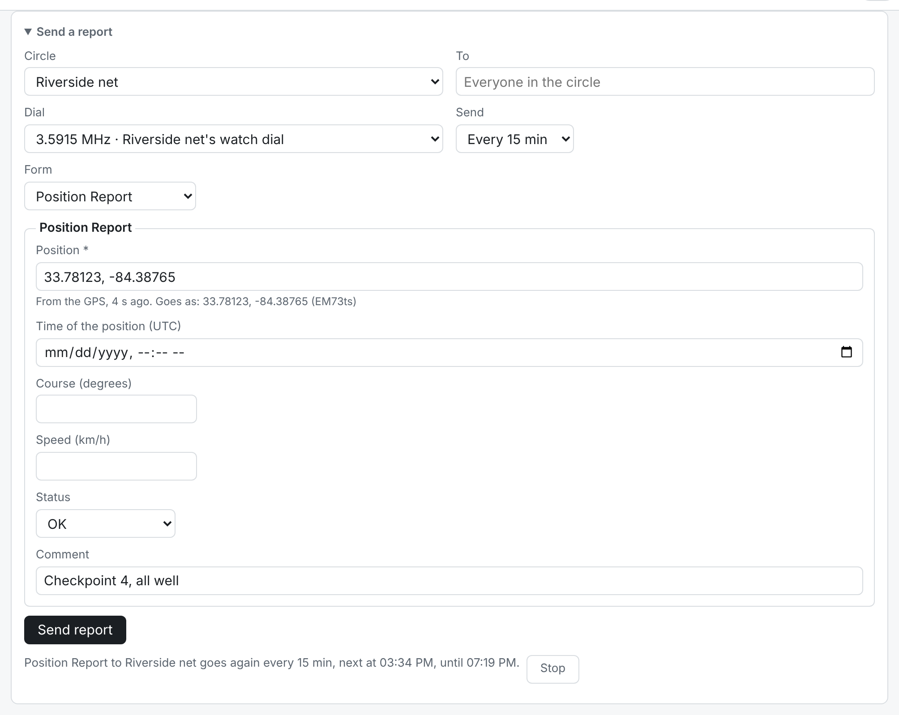

*Figure 34. A Position Report going to a circle every 15 minutes.*

A report sent again goes only while RadioPost's window is open, and for four hours at most. Each
time, a position that was your station's own (not one you typed) is brought up to date, so the net
sees you move. The line under the button says when it goes next. **Stop** stops it, and so does
sending another report.

Keep reports short: every 33 bytes is about five seconds more on the air with Aether. A Position
Report with its position and status is about 16 seconds. RadioPost refuses one over 512 bytes,
about 86 seconds. Reports you send and hear show in **Reports** ([9.1](#91-reports)). To be sure
a report arrived, send it as mail.

## 11. Working several callsigns

One RadioPost can work several callsigns, such as your own and a club callsign. Each callsign has
its own account, its own address and its own mail.

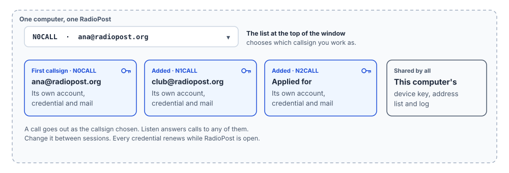

*Figure 35. Several callsigns on one computer.*

### 11.1 Add a callsign

Before you start:

- RadioPost must already work with your first callsign.
- You need RadioPost 0.1.0-beta.13 or later. If Setup has no **Add another callsign** button,
  update first.
- The computer must be on the Internet.
- Choose the new address, such as `club@radiopost.org`. Use lowercase letters, digits, dots,
  dashes or underscores before the `@`.
- Have ready the callsign exactly as licensed (no SSID), the name on that licence, and an email
  address where the post office can reach you now.

Steps:

1. Make sure the state at the top says **Idle**.
2. Click **Setup**.
3. Click **Add another callsign**, at the bottom of the first box. RadioPost switches to the new
   callsign. The list at the top reads *New callsign, not yet enrolled*.
4. If the post office's operator gave you a code for it, choose **I have a code** and enroll as
   in [section 5.1](#51-with-a-code-from-the-operator). Otherwise choose **Apply for an
   account** and apply as in [section 5.2](#52-by-applying) (Figure 5 shows this case).
5. Leave RadioPost open, with the new callsign chosen, until it says *Approved*. It only checks
   the application while that callsign is chosen.

### 11.2 Use it

- **Choose a callsign before each session**, from the list at the top of the window. A call goes
  out as the callsign shown there. **Listen for P2P** answers calls to any of your callsigns. A call
  to another than the one shown is carried by that callsign: its mail goes to that callsign's
  folders, and the log says *answering as …*.
- You can change it only while the station is idle.
- Each callsign has its own folders. The address list and the log are shared.
- Every credential renews while RadioPost is open, chosen or not.

### 11.3 Take one off

Choose it at the top, open **Setup**, and click **Remove this callsign**, then click again to
confirm. This only works once its folders and trash are empty. Its credential stays valid at the
post office until it runs out or is revoked. Your first callsign cannot be removed: the others
are kept inside its folder.

> **Note: if you run the post office yourself.** You approve the application from your own
> callsign:
>
> 1. In the list at the top, choose your own callsign. The **Post office** button appears.
> 2. Open **Post office**, then **Applications**, and click **Approve**. Tick **Role mailbox**
>    first if several licensed operators will share it, as with a club callsign.
> 3. Choose the new callsign again, open **Setup** and click **Check now**.
>
> If the application was refused with *it takes no applications*, turn applications on first:
> **Post office**, **Settings**, tick **Take applications for accounts**. It saves at once.
> Or skip the application: make a **New code** on the desk, and enroll the new callsign with it.

## 12. Setup, box by box

Click **Setup** at the bottom of the left-hand column.


*Figure 36. Setup.*

### Enroll with your post office

Says whom this computer is enrolled as, and until when. **Enroll again with a new code** is for a
credential that ran out or was revoked. **Add another callsign** and **Remove this callsign** are
here too ([section 11](#11-working-several-callsigns)).

### Post office

Says how RadioPost reaches your post office: *Found by its domain's DNS records* is normal.
**API** is only for a post office whose records are not published yet: type the address its
operator gave you and click **Save**. **Renew credential** renews at once.

### Accept list

Email reaches you only from the addresses and domains listed here. Writing to someone adds them.
To let a whole organisation write to you, add its domain with an `@` in front, such as
`@redcross.org`. Click **Add**. **Read** fetches the list from your post office. **Remove**
takes one off.

### Usual gateways

The gateways you name here get a copy of your waiting mail ahead of time, so you can pick it up
there while the Internet or your post office is down
([section 14](#14-when-the-internet-is-down)).

1. Tick the gateways you call most. Each one says whether it *holds copies*.
2. Tick **Skip mail I have read in a mail program** if you also read your mail on the Internet
   ([section 9.2](#92-in-a-mail-program)): mail you already read there is not offered by radio.
3. Click **Save**. Your post office keeps the setting. **Read** fetches it again.

The list needs the Internet and a gateway list ([section 8.1](#81-choose-a-gateway)).

### Places and GPS

Where your station is. The gateway list is in order of distance from it
([section 8.1](#81-choose-a-gateway)), and each call's record keeps it, on this computer only.

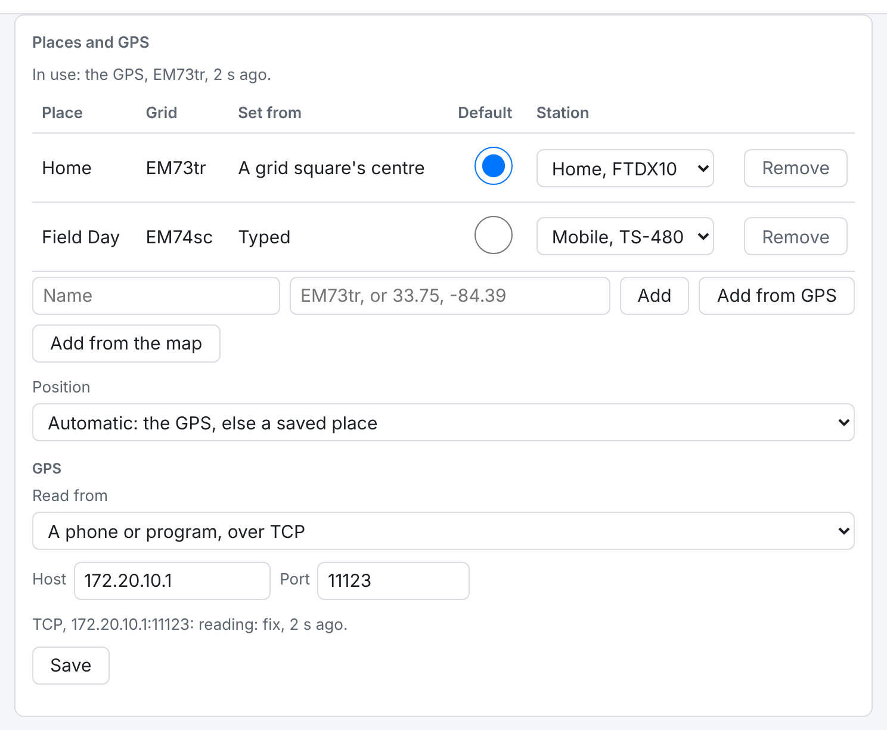

*Figure 37. Places and GPS.*

The line at the top says which position is in use, and why when it is not the GPS's present fix:
*In use: the GPS, EM73tr, 2 s ago*, or *GPS silent for 6 minutes: using Home, EM73tr.*

**Places.** Type a **Name** and where the place is: a grid square such as `EM73tr`, or a latitude
and longitude such as `33.75, -84.39` (or `33.75N 84.39W`). Click **Add**. A grid square is used
by its centre, and **Set from** says so: a 6-character square is about 5 by 8 km. **Add from GPS**
saves the GPS's present fix as a place, with its height. **Add from the map** takes you to the map
on the Gateways page: click the spot, name it and save it ([section 8.1](#81-choose-a-gateway)).
The **Default** place is used when
nothing better is known. **Station** names the station profile the place uses (below). **Remove**
forgets a place. If you had typed a grid square on the Gateways page before, it is your first
place, *Home*.

**Position** chooses what is used:

- *Automatic*: the GPS while its fix is less than two minutes old. Otherwise the place you saved
  nearest the GPS's last fix, within 2 km. Otherwise the default place.
- *The GPS*: the same, but it says that the GPS gives no position when there is no GPS.
- *Always Home* (one for each place): that place, whatever the GPS says.

**GPS.** In **Read from**, choose where the position comes from, then click **Save**:

- *A serial port: USB or Bluetooth*: a GPS receiver on USB, or a Bluetooth receiver paired as a
  serial port. Pick its **Port** (click **List again** after plugging it in). Leave **Speed** on
  *Find*: RadioPost tries 4800, 9600, 38400 and 115200 baud and keeps the one that works.
- *A phone or program, over TCP*: an app that serves NMEA, such as GPS2IP on an iPhone (its
  socket mode) or Share GPS on Android. Type the phone's address and port. Over the iPhone's own
  hotspot the address is `172.20.10.1`; GPS2IP's examples use port `11123`.
- *A phone or program, over UDP*: an app that sends NMEA to this computer. Type the port it
  sends to.
- *gpsd*: on Linux, when gpsd already reads the receiver. Its port is 2947.
- *No GPS*: places only.

The line under the settings says what the GPS is doing: *reading: fix, 2 s ago*, *no fix for 30 s*
(the receiver is still finding satellites), *silent for 2 minutes*, or *not connected* and why. The
free GPS2IP Lite stops sending after four minutes; RadioPost says so and uses your places.

Your position stays on this computer. The log says only the 6-character grid square, and nothing
is sent to a post office or a gateway. The call records keep the position itself.

### Station profiles

What your station is, so that a prediction of a path need not guess. The **VHF** side is what the
terrain of a VHF path is worked out with ([8.1](#81-choose-a-gateway)), and each call's record
names the profile in use.

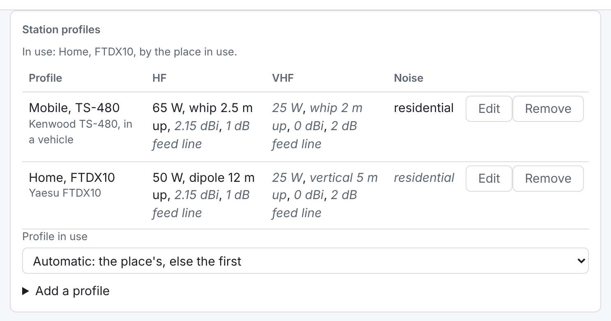

*Figure 38. Station profiles.*

Each profile shows what a prediction would use at **HF** and at **VHF** and above: the power, the
antenna and its height, its gain, and the feed line's loss, and the **Noise** where it is. A value
in plain type is one you set. One in faint italics is assumed, because you left it empty: 100 W at
HF with a dipole 10 m up, 25 W at VHF with 0 dBi 5 m up (2 m in a vehicle), 1 dB and 2 dB of feed
line, a residential neighbourhood's noise.

To add one, open **Add a profile**. Give it a **Name**, and fill in what you know: **Radio**, **In
a vehicle**, then **Power, W**, **Antenna**, **Height, m**, **Gain, dBi** and **Feed line, dB** at
HF and at VHF, and **Noise** (industrial, residential, rural, remote). Leave the rest empty. Click
**Save profile**. **Edit** changes one, and **Remove** forgets it.

**Profile in use**: *Automatic* takes the profile the place in use names in its **Station**, else
the default place's, else the first. Or pick one.

### Terrain

The elevation data RadioPost judges VHF paths with ([8.1](#81-choose-a-gateway)). It is fetched only
when you ask, from the Copernicus DEM's public copy, and kept on this computer.

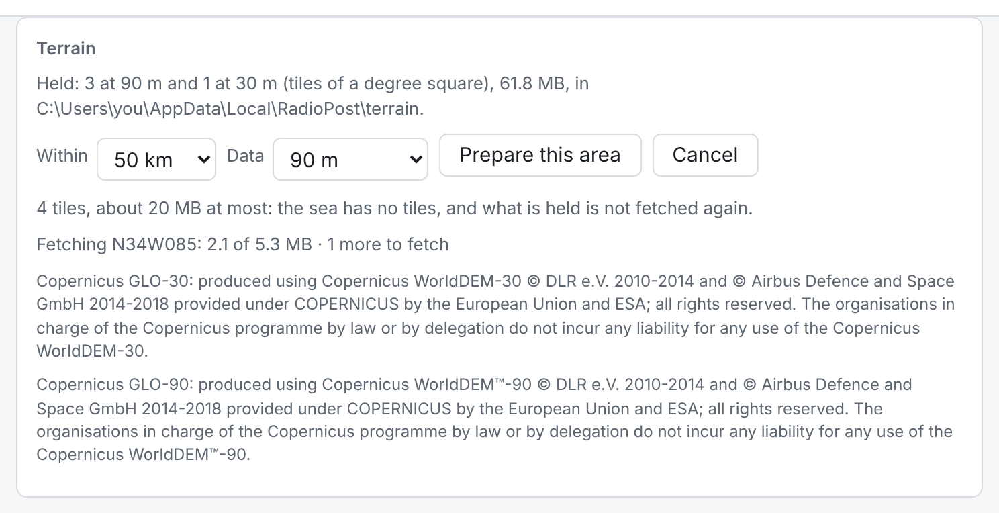

*Figure 39. Terrain.*

The first line says what is held: tiles of a degree square, at 90 m or 30 m, their size, and the
folder. To have the terrain before you go where there is no Internet, pick how far around the place
in use (**Within** 25, 50, 100 or 150 km) and the **Data** (**90 m**, or **30 m, finer**, about nine
times the size), then click **Prepare this area**. The line under it says how many tiles and about
how many MB, at most: the sea has no tiles, and what is held is not fetched again. While tiles are
fetched, a line says which, and **Cancel** stops after the one under way. A tile that could not be
fetched is named, with why. The notices under them are what the data's licence asks to be said.
The card follows the position in use: save, choose or remove a place, or let the GPS find a fix,
and its lines change at once.

### Sounds and notifications

RadioPost plays a sound when something happens, and tells you about new mail by its sender.

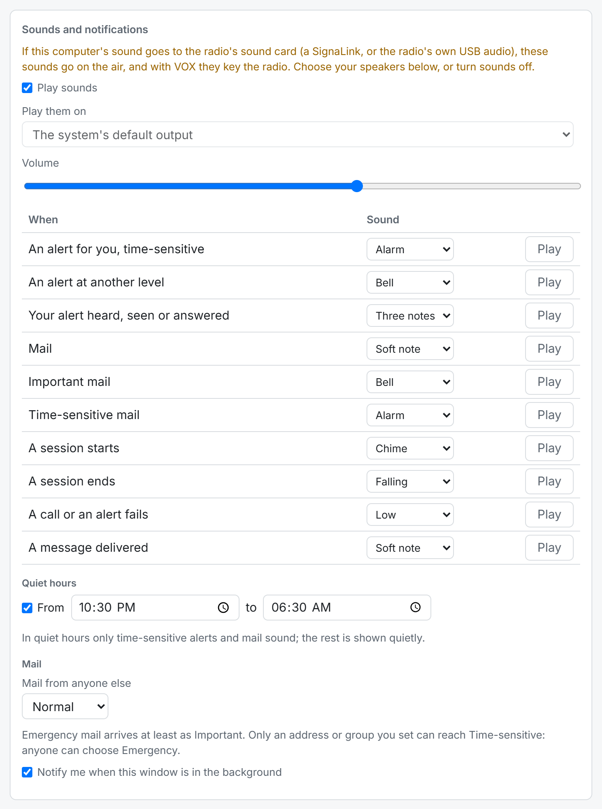

*Figure 40. Sounds and notifications.*

**Mind the radio's sound card.** If this computer's sound goes to the radio's sound card (a
SignaLink, or the radio's own USB audio), these sounds go on the air, and with VOX they key the
radio. Choose your speakers in **Play them on**, or untick **Play sounds**.

- **Play sounds** turns every sound on or off.
- **Play them on** chooses the speakers. If the list shows no names, click **Name the devices**:
  the window opens the microphone for a moment to read them. Where the window cannot choose,
  sounds play on the system's default output.
- **Volume** sets every sound's loudness.
- The table gives each event its sound. **Play** plays it.
- **Quiet hours**: tick **From** and set the times. Then only time-sensitive alerts and mail
  sound; the rest is shown quietly.
- **Mail from anyone else** says how mail arrives from an address with no level of its own.
- **Notify me when this window is in the background** also shows the system's notification.

Every arrival has one of four **levels**:

| Level | What happens |
|---|---|
| **Silent** | Counted in its folder. No sound. |
| **Normal** | A soft sound and a note at the bottom right. |
| **Important** | Its own sound, and a banner at the top until you open it or dismiss it. |
| **Time-sensitive** | An alarm every 20 seconds until you answer it, through quiet hours too. |

A circle has its level ([section 10.2](#102-set-up-a-circle)). Mail takes its sender's level, set
in Addresses ([section 13](#13-addresses-and-the-trash)). Emergency mail arrives at least as
Important. Only an address or a group you set can reach Time-sensitive: anyone can choose
Emergency.

### Forms kept here

The forms your group made, kept on this computer for every callsign it works. RadioPost's own
forms come with the program and are not listed.

- **Import a form…** takes a form's file: the JSON a group writes its forms in, as RadioPost's own
  are written, or the file **Export** made. RadioPost checks it and says what is wrong with one
  that is not a form.
- **Export** saves a form in your **Downloads** folder, to give to another station.
- **Remove**, clicked twice, stops holding a form. Its forms then show by field number until you
  get it again.

RadioPost hands each form kept here to your post office over the Internet, once, when you import it
and then every hour until it gets through. The post office then writes your forms into email with
their labels, and gives the form to any station that asks for it.

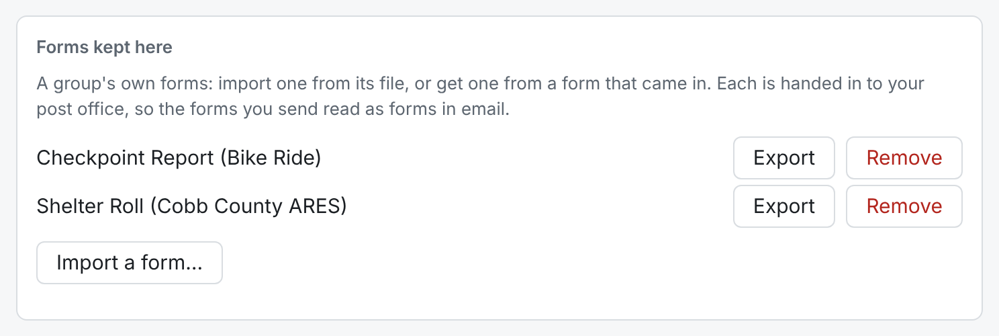

*Figure 41. Forms kept here.*

### This device's key, Credential, Post offices trusted

These three boxes are for tests and special cases. You do not need them with a normal account:
enrolling fills them in.

- **This device's key** is this computer's public key. A test post office may ask for it.
- **Credential** takes a credential issued by hand, pasted in hexadecimal.
- **Post offices trusted** lists the post offices whose keys RadioPost trusts. A test post
  office's operator may give you a domain and key to add.

### Updates

The version of RadioPost you are running, when it last asked for a newer release, and what it
found. It asks when it opens and every six hours. **Check for updates** asks now. When a newer
release is out, the line at the top of the window offers **Update and restart**.

### Manual and licences

- **Open the manual** opens this manual, the PDF installed with RadioPost, in your PDF viewer.
  It needs no Internet, and **Ctrl+F** searches it. The server guide, for a post office's
  operators, is in the same folder.
- **Licences** opens the folder of licences installed with RadioPost: its own (MIT or Apache 2.0
  for the programs, CC BY 4.0 for the documents) and those of the open-source parts it is built
  from. You agree to nothing to use RadioPost; the licences say what you may do when you copy or
  change it.

A copy built from the repository has none installed: both buttons open the copies on GitHub
instead.

## 13. Addresses and the Trash

**Addresses** is your address list. Everyone you write to is added, with the name you typed before
the address. To and Cc offer it as you type. Addresses are kept in lowercase: `Ana@HamPost.org` and
`ana@hampost.org` are one entry. A list from an earlier version that held both shows them as one,
its messages counted together.

- **Find** shows the entries that match.
- Type `Name <address>` in the box and click **Add** to add one by hand.
- Click a row, or its pencil, to write to it. The trash can takes it off the list (with
  **Undo**).
- **Import contacts…** reads a contact file: a vCard (`.vcf`) from a phone, Google Contacts,
  Outlook or Apple Contacts, or a CSV export from Google, Outlook or Thunderbird. Its addresses
  join the list with their names. An address already on the list keeps its name. The file's
  groups, labels or categories become groups. RadioPost says what it added and what it left out.

**Groups** put several addresses under one name, for a net or a shelter team:

1. Under **Groups**, type the group's name, then its addresses with commas between them. The
   address list is offered as you type.
2. Click **Save**.
3. To write to it, type its name in **To** and pick it, or click its row or its pencil. Every
   address in it goes in To.

The people button changes a group; the trash can takes it away (with **Undo**), and its addresses
stay on the list. Every address in a group goes on the air, so a large group makes a long
header.

**Notify** says how mail from an address, or from anyone in a group, arrives: **Silent**,
**Normal**, **Important** or **Time-sensitive** ([Sounds and
notifications](#sounds-and-notifications)). **Default** follows Setup. An address in several
groups takes the highest of their levels, and its own if it has one.

The address list and the groups are this computer's own. Who may email you is the accept list,
in Setup.

**Trash** holds what you deleted, and says which folder each message came from.

- **Restore** puts a message back where it was.
- **Delete forever** removes it for good: click twice.
- **Empty trash** deletes everything in it for good.

Deleting is on this computer only. Your post office, gateways and other stations keep what they
hold.

## 14. When the Internet is down

RadioPost keeps working when the Internet fails at a gateway.


*Figure 42. When the Internet is down.*

**Before.** Name your usual gateways in Setup ([section 12](#usual-gateways)). Your post office
then copies each new message for you to them as it arrives.

**During.** Call a gateway as usual. If it cannot reach your post office, the log says so in a
notice. The gateway:

- hands you the copies it holds for you;
- keeps what you send, to pass on later;
- hands you mail from its other users at once, if it holds copies for you.

Messages you send through it stay in your outbox, tagged *queued at* that gateway. RadioPost
offers them again on later calls to other gateways, until one that reaches the Internet confirms
them. They are not offered to the same gateway while it was cut off at your last call.

**After.** When the gateway's Internet is back, it reports your session to your post office. Your
next call marks those messages sent.

> **Note.** A message queued for 30 days with no confirmation is tagged *may have been dropped*,
> in red. RadioPost still offers it on each call.

Held attachments cannot be asked for while the gateway is cut off.

## 15. If you run a post office

If your callsign is one of a post office's operators, RadioPost shows a **Post office** button in
the left-hand column. It opens the post office desk: applications, accounts, codes, the server's
health, its jobs, its backups and its settings. [Part 4](#part-4-the-post-office-desk) covers it,
tab by tab.

---

# Part 3. RadioPost Gateway

## 16. What a gateway does

A gateway is a station other amateurs call to send and fetch their mail. It answers each call,
checks who is calling, and passes the session to the caller's post office over the Internet. Any
licensed operator can run one.


*Figure 43. A gateway station.*

A gateway is usually left answering with nobody at the radio. It is then under **automatic
control**, and the rules for that apply ([The rules](#36-the-rules)).

When the Internet is down, a gateway keeps answering. It can hold copies of its users' mail, keep
what they send, and pass it to a partner gateway by radio
([section 21](#21-when-the-internet-is-down-at-the-gateway)).

## 17. Before you set up a gateway

The gateway's computer needs:

- **An HF radio and Aether HF 0.2.0-beta.146 or later**, working with the radio.
- **Aether keying the radio itself** (Aether's Setup, step 2: CAT, serial, rigctld, FLRig, CM108
  or VOX, not *External program*). If the same computer runs RMS Trimode with Aether set to *External program*, close
  Trimode and change Aether's keying. An Aether profile for each makes the switch one click.
- **Aether's ports as they are** (8515 for RadioPost; [section 3](#3-what-you-need)).
- **An Internet connection.** The gateway only connects out, so a home router needs no change.
- **RadioPost**, the client, on the same computer, **enrolled as you** with your own code. The
  gateway registers in your name through it. With several callsigns in it, each with its own
  account and post office ([section 11](#11-working-several-callsigns)), you choose which one the
  gateway registers with. You can keep using RadioPost on another computer too, with its own code.
- **RadioPost Gateway**, from the [releases page](https://github.com/KK4ODA/RadioPost/releases):
  the installer named **RadioPost Gateway** for your computer.

You do not copy the gateway's callsign into Aether. While RadioPost Gateway runs, it tells Aether
which callsign to answer, and Aether's Setup shows it greyed, such as *KK4ODA-1 · RadioPost
Gateway*. When the gateway stops, Aether's own callsign comes back.

## 18. Setting up the gateway

Open RadioPost Gateway. Until it is set up and registered, it says what is missing.


*Figure 44. RadioPost Gateway before setup.*

Click **Set up the gateway**. Setup has three steps.


*Figure 45. Setting up the gateway.*

### Step 1. The gateway

1. **Callsign**: yours with an SSID, such as `KK4ODA-1`. Callers call this.
2. **Modem**: leave `ws://127.0.0.1:8515/v1`, where Aether listens on the same computer.
3. **More modems**: leave it empty, unless the gateway is to answer on other modems too
   ([More than one modem](#more-than-one-modem)).
4. **Country**: where the gateway operates, in two letters, such as `US`. It decides which
   third-party mail the gateway may hand over.
5. Leave **The modem does not check the band rules: I do** clear while Aether is the only modem:
   Aether checks them. With more modems, tick it.
6. Keep **Answer calls when the app opens** ticked for a gateway left on its own.
7. Keep **Report its status to its post office, for anyone to see** ticked, unless you would
   rather not. Callers then see whether the gateway is on the air (see *Its status* in
   [section 19](#19-running-the-gateway)).
8. Tick **Hold copies of users' mail, for when the Internet is down** if the computer has room to
   spare. Set how many **Users**, how many **Days** a copy is kept, and the **Largest message**
   kept with its text.
9. Click **Save**. The gateway makes its key, shown under the form.

If you change the copies setting later, register again (step 2) so your post office knows.

### Step 2. Registration

The gateway registers with a post office as one of your accounts in the RadioPost client on this
computer. That post office lists the gateway for its users, and the gateway's credential names
that account's address. A gateway is registered with one post office at a time.

1. **RadioPost app's home**: the folder where the client keeps its keys and credentials. Leave it.
2. **Account**: the client's accounts, each callsign and address with its post office in brackets,
   such as *KK4ODA · facundo@radiopost.org (radiopost.org)*. It starts on the one the client has
   chosen. Pick the one the gateway registers with. The line under it says, before you click,
   where the gateway will be registered and as whom, and the button names the post office:
   **Register with radiopost.org**.
3. Under **Channels**, add each dial frequency where callers will find the gateway, in MHz, upper
   sideband, with the **Modem** callers use there and its **Bandwidth** (for Aether, 500 or
   2300 Hz). On an FM radio the frequency is the channel's, and the bandwidth the channel's width.
   **Add a channel** adds a row. **Station** opens to say how the gateway transmits and receives
   there: **Power, W**, the **Antenna** (vertical, dipole, yagi, j-pole, collinear, loop, nvis,
   whip or other), its **Height, m** above the ground, its **Gain, dBi**, and for a beam where it
   **Points to**, in degrees from true north. Each is optional. Callers' programs use them to work
   out a VHF link budget each way, and say which values they assumed. The button shows what you
   gave, such as *100 W, dipole, 12 m*, and opens the fields in a row under the channel.
4. Tick **Scan these channels** to listen on all of them with one radio. Aether moves the radio
   over them, a while on each, the first being home. It never leaves a channel while a call is
   arriving or a session is up. This needs Aether 0.2.0-beta.162 or later, a radio Aether can tune
   (CAT, rigctld or FLRig), and two to four channels, all for the first modem. The gateway's
   record then says how long a caller's call must keep trying to find it; the gateway adds that,
   registering again from this computer, the first time it scans.
5. **Grid** and **Place** help callers choose a gateway near them. **Hours** says when it answers:
   `always`, or in words such as `1800-0200 UTC`. **Listening times, UTC** says the same for
   callers' programs, so they can tell whether the gateway listens now: each day's times such as
   `18:00-02:00`, several with commas. Leave it empty if the gateway listens always. Left as
   `always`, **Hours** then says the same times in words.
6. **Site** says where the antennas are, for callers' programs that judge a VHF path over the
   terrain: **Latitude** and **Longitude** in degrees (west is negative), and **Antenna height,
   m** above the ground. Give as many decimal places as you are content to publish: two are about
   a kilometre, four about 11 m. The site must be in the **Grid** square; if it is not, the gateway
   says which square it is in and does not register. Leave it empty to publish only the grid
   square: a caller's program then cannot check the terrain.
7. Click **Register with …**.

List only channels the gateway listens on: the ones it scans, or the one its radio sits on. A
caller on any other channel is never answered.

Your post office lists the gateway for its users and gives it a credential for 90 days. The
gateway renews it by itself in its last month, while it answers. If renewing keeps failing, the
log says why, and the **Registration** box turns red two weeks before it runs out: register again
the same way.

Once registered, the top of step 2 says where: *KK4ODA-1 is registered with radiopost.org's post
office (https://po.radiopost.org/rp/v1), from KK4ODA · facundo@radiopost.org.* The form keeps the
channels, grid, place and hours you registered, so registering again changes only what you change.

A post office's operator can also issue the gateway's credential by other means. Paste it under
**A credential issued by other means** and click **Keep credential**.

#### Unregistering, or moving to another post office

**Unregister**, beside the line that says where the gateway is registered, takes it off that post
office. Stop the gateway first, then click **Unregister**, and again to confirm. Logged in as the
account it was registered from, the gateway asks its post office to withdraw it:

- the post office takes it off its list of gateways, so its users no longer see it;
- it revokes the gateway's credential, so the gateway can no longer log in there;
- it stops placing copies of users' mail at the gateway, and the gateway drops the copies it
  holds. The mail itself stays in the users' mailboxes.

The form keeps your channels, grid and place, for registering again.

**To move the gateway** to another post office, such as from radiopost.org to your own: click
**Unregister**, pick the other account under **Account**, and click **Register with …**. While
the gateway is registered, registering it with another account's post office is refused: the
line under **Account** turns red and says to unregister first.

The gateway refuses to unregister while sessions it carried with the Internet down still wait to
be reported (**Held**): they hold users' mail. Start it with the Internet up, let it report them,
then unregister. A post office that does not take withdrawals yet keeps the gateway on its list:
the gateway says so and keeps its registration. Ask that post office's operators to remove it
([Gateways registered here](#gateways-registered-here)), then click **Unregister** again.

### Step 3. Post offices (optional)

The gateway finds each user's post office on the Internet by itself. Name one here only while its
records are not published yet: its **Domain** and its **API address** (`https://…/rp/v1`).

### More than one modem

A gateway can answer on several modems: Aether and Mercury on one radio, or Aether on HF and
packet on VHF, each on a radio of its own. Aether is the first modem, in **Modem**. Each other
modem is reached through its adapter, a small program in the tools archive, and the adapter's
address goes in **More modems**, one a line.

- The gateway carries **one session at a time**. While a session runs on one modem, the others do
  not answer. A call another modem answered just before is ended once the session is over.
- Calls to partners ([section 22](#22-partners-forwarding-by-radio)) go on the first modem.
- Only Aether checks the band rules. The gateway uses another modem only with **The modem does
  not check the band rules: I do** ticked, and that modem's transmissions are yours to keep within
  the rules ([The rules](#36-the-rules)).
- Only Aether scans. Leave **Scan these channels** clear when another modem shares Aether's radio.

The KK4ODA-1 gateway first answered on Aether and Mercury at once, on one radio, on 27 November
2026 (7.101 MHz, 2300 Hz), and carried a mobile's mail over each. A report from your gateway is
welcome.

#### The adapters

| Adapter | Modem | Where it reaches the modem, unless told |
|---|---|---|
| `radiopost-mercury` | Mercury | `--mercury 127.0.0.1:8300`, Mercury's control port; its data port is the next |
| `radiopost-vara` | VARA HF, or VARA FM with `--fm` | `--vara 127.0.0.1:8300`, VARA's command port; its data port is the next |
| `radiopost-ardop` | ARDOP (ardopcf) | `--ardop 127.0.0.1:8515` |
| `radiopost-packet` | A packet TNC's AGWPE port, such as Dire Wolf's | `--tnc 127.0.0.1:8000`, and `--port 0`, the TNC's first radio port |

Every adapter waits for the gateway at `127.0.0.1:8600` unless given `--listen`. Give each one its
own port, from 8601 up. Some of these modems' own ports are Aether's: 8300 and 8301 are Aether's
external programs port, 8100 its KISS port and 8515 its control port. Run such a modem on other
ports, and tell its adapter where.

#### Aether and Mercury on one radio

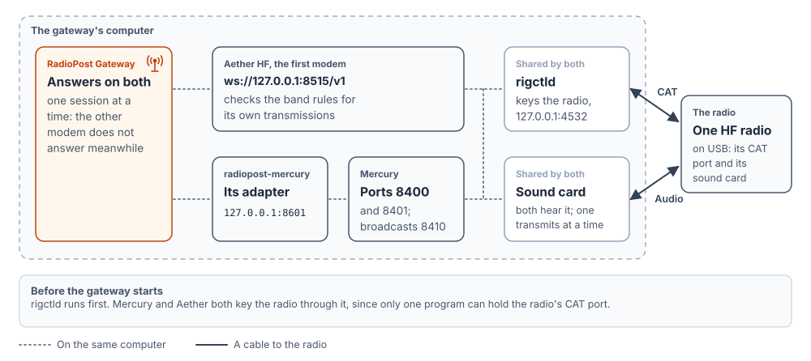

*Figure 46. Aether and Mercury on one radio.*

Both modems hear the radio's receive audio all the time, and only one transmits at a time. Only
one program can hold the radio's CAT port, so both key the radio through rigctld, Hamlib's radio
server, which serves several programs at once.

The steps set up an FTDX10 on Windows, its CAT on COM6 at 38400 baud. Use your own radio's model,
port and rate. The commands go in PowerShell. The gateway is off the air from step 1 to step 10.

1. **Free the radio's CAT port.** In RadioPost Gateway, click **Stop** and close it. Close Aether
   too: keyed over CAT, it holds the port.
2. **Get Hamlib.** Download the newest `hamlib-w64-….zip` from
   [Hamlib's releases](https://github.com/Hamlib/Hamlib/releases) and unzip it to `C:\Hamlib`.
   Its programs are in `C:\Hamlib\bin`. Open PowerShell there and find your radio's model number:

   ```
   .\rigctld.exe -l | Select-String FTDX
   ```

   The FTDX10's line starts `1042  Yaesu  FTDX-10`. Aether's Setup, step 2, shows the CAT port and
   rate Aether used.
3. **Start rigctld**, and leave its window open:

   ```
   .\rigctld.exe -m 1042 -r COM6 -s 38400 -T 127.0.0.1
   ```

   `-T 127.0.0.1` keeps rigctld to this computer. To check it, open a second PowerShell window in
   the same folder and ask for the dial:

   ```
   .\rigctl.exe -m 2 -r 127.0.0.1:4532 f
   ```

   It prints the dial in hertz, such as `7101000`. Model 2 is Hamlib's network client: it talks to
   rigctld, not to the radio.
4. **Point Aether at rigctld.** Open Aether. In its Setup, step 2, set **Radio control** to
   **rigctld**, at `127.0.0.1:4532`, and save
   ([Aether's manual](https://github.com/KK4ODA/aether-hf/blob/master/docs/manual/manual.md#step-2-radio-interface)).
   **Dial** then reads *Aether, through rigctld*, and Aether's header shows the dial. On the
   Session tab, under **Keying and drive**, **Key 1 s** keys the radio for one second with no
   audio.
5. **Install Mercury** from [Mercury's releases](https://github.com/Rhizomatica/mercury/releases)
   (`Mercury_HF_Modem_Setup.exe`). Open PowerShell in its folder, `C:\Program Files\MercuryHF`,
   and run Mercury from there: it reads its settings from `mercury.ini` in the folder it starts in.
   Use `mercury.exe`, the program without a window; `mercury-ui.exe` is the one with a window.
   List the sound cards:

   ```
   .\mercury.exe -z
   ```

   Each card has a name and an ID: the playback cards first, then the capture cards. Note the two
   IDs of the radio's card, such as `FTDX10 (USB AUDIO  CODEC)`. The capture ID starts `{0.0.1.`
   and the playback ID `{0.0.0.`. Then test Mercury's keying through rigctld:

   ```
   .\mercury.exe -R 2 -A 127.0.0.1:4532 -Q
   ```

   The radio transmits for one second, with no audio, and Mercury says *PTT OFF. Test complete.*
6. **Start Mercury** on its own ports, keyed through rigctld, on the radio's card. Leave its window
   open:

   ```
   .\mercury.exe -p 8400 -b 8410 -R 2 -A 127.0.0.1:4532 -i 'CAPTURE-ID' -o 'PLAYBACK-ID'
   ```

   - `-p 8400`: Mercury's control port; its data port is 8401. Its own, 8300 and 8301, are
     Aether's external programs port.
   - `-b 8410`: its broadcast port. Its own, 8100, is Aether's KISS port.
   - `-R 2 -A 127.0.0.1:4532`: key the radio through rigctld. Without them Mercury keys nothing,
     and its adapter does not either: Mercury would play its audio with the radio not
     transmitting.
   - `-i` and `-o`: the capture and playback IDs from step 5, such as
     `'{0.0.1.00000000}.{a99eb1c1-90c3-4555-a8b8-416f79b14b47}'`. Keep the single quotes:
     without them PowerShell reads the braces as code.

   Mercury names the card it opened, both ways, and says *Listening on TCP port 8400* and *8401*.
   Its `mercury.ini` also opens a feed for Mercury's own window on port 10000, to any network. If
   Windows Defender Firewall asks about Mercury, click **Cancel**: Mercury's ports take any
   connection without a password, and programs on this computer still reach them.

   Check that Aether's waterfall still moves: the two programs now share the radio's card. If it
   stopped, Mercury took the card for itself; stop Mercury and do not go on.

   Set Mercury's transmit level as its own documentation says. Aether's level does not change it.
7. **Start the adapter.** It is `radiopost-mercury.exe`, in the tools archive
   ([section 4](#4-installing-radiopost) says how to open it). In a third PowerShell window, in
   its folder:

   ```
   .\radiopost-mercury.exe --listen 127.0.0.1:8601 --mercury 127.0.0.1:8400
   ```

   It says *RPMI on 127.0.0.1:8601, Mercury's control port at 127.0.0.1:8400*. Leave its window
   open. Mercury serves one program at a time: while the adapter holds it, no other program
   reaches Mercury.
8. **The gateway's Setup, step 1.** Open RadioPost Gateway and click **Setup**. Put
   `127.0.0.1:8601` in **More modems**. Tick **The modem does not check the band rules: I do**:
   Mercury neither checks them nor says where the radio's dial is, and without the tick the
   gateway leaves it unused (the log says *127.0.0.1:8601 will not be used: …*). Aether still
   checks its own transmissions. Mercury's are yours: keep the radio on a dial where an unattended
   station may send Mercury's signal. On 7.101 MHz it stays within 3 kHz above the dial, inside
   40 m's automatic-control segment, 7.100 to 7.105 MHz. Click **Save**. The gateway says
   *Saved. Register again so the post office knows.*
9. **Step 2, the registration.** Clear **Scan these channels**: a scan would move the radio under
   Mercury, and the gateway refuses to scan a dial listed twice. Under **Channels**, keep only the
   dial the radio stays on, with **Modem** set to **Aether HF**, and remove the others: without a scan the
   gateway listens nowhere else. Click **Add a channel** and give the same dial, **Modem**
   set to **Mercury**, and the **Bandwidth** callers should call at: 500, 2300 or 2750 Hz. Click
   **Register with …**.

   A gateway that scanned gives up its other channels while Mercury shares its radio. To scan
   again later, remove the Mercury channel first.
10. **Start.** Click **Start**. The log says:

    - *listening as KK4ODA-1 on ws://127.0.0.1:8515/v1 and 127.0.0.1:8601*;
    - *registered again, since what it listens on changed: …*, when the gateway scanned before;
    - *also listening on 127.0.0.1:8601*: Mercury answers.

    The last line is the check. The **Modem** box names both modems as Setup has them, whether or
    not they answer. *waiting for 127.0.0.1:8601: …* means the adapter or Mercury is not running.
    The gateway tries again every 5 seconds, so start the one missing and leave the gateway
    running.

After each Mercury session the adapter identifies the station with Mercury's CQ frame, which
carries the callsign in Mercury's own signal. Mercury sends no Morse identifier.

On Linux, a sound card that one program opens directly (Mercury's `plughw:…`) is closed to the
other: put both behind PulseAudio or PipeWire (Mercury's `-x pulse`). This has not been tried with
Aether yet.

#### Starting them with Windows

rigctld, Mercury and the adapter start in that order: Mercury needs rigctld when it starts, and the
adapter needs Mercury. Aether and RadioPost Gateway can start in any order. Aether reaches rigctld
only when it needs the radio, and the gateway tries the adapter again every 5 seconds.

A file in Windows' Startup folder starts the three at each login. Open it in Notepad:

```
notepad "$env:APPDATA\Microsoft\Windows\Start Menu\Programs\Startup\gateway-helpers.bat"
```

Let Notepad create it, paste this in with your radio's numbers, Mercury's card IDs and the
adapter's folder, and save:

```bat
@echo off
start "rigctld" /min C:\Hamlib\bin\rigctld.exe -m 1042 -r COM6 -s 38400 -T 127.0.0.1
timeout /t 3 /nobreak >nul
start "Mercury" /min /d "C:\Program Files\MercuryHF" "C:\Program Files\MercuryHF\mercury.exe" -p 8400 -b 8410 -R 2 -A 127.0.0.1:4532 -i "CAPTURE-ID" -o "PLAYBACK-ID"
timeout /t 5 /nobreak >nul
start "radiopost-mercury" /min C:\RadioPost-tools\radiopost-tools-windows-x64\radiopost-mercury.exe --listen 127.0.0.1:8601 --mercury 127.0.0.1:8400
```

Here the IDs go in double quotes. `/d` starts Mercury in its own folder, so it reads `mercury.ini`
and writes its log there.

To try the file without restarting the computer:

1. Close the three PowerShell windows: rigctld, Mercury and the adapter.
2. Double-click `gateway-helpers.bat` in the Startup folder. Three minimized windows appear on
   the taskbar.
3. The gateway's log says *the adapter of 127.0.0.1:8601 went away …*, then *also listening on
   127.0.0.1:8601* once the adapter is back.
4. In Aether, click **Key 1 s** again: the radio keys, so Aether found rigctld again.

#### A modem on a second radio

A modem with a radio of its own shares nothing: it has its own keying and its own sound card. For
packet on VHF, run Dire Wolf on the VHF radio, then its adapter:

```
radiopost-packet --listen 127.0.0.1:8602 --tnc 127.0.0.1:8000
```

Put `127.0.0.1:8602` in **More modems** and tick **The modem does not check the band rules: I
do**, as for Mercury. In step 2, add its channel with **Modem** set to **Packet**: on FM the frequency is
the channel's, and the bandwidth its width, 12500 or 25000 Hz. While one radio carries a session,
the other does not answer.

### Updates

Below the steps, **Updates** says which RadioPost Gateway you are running, when it last asked for
a newer release, and what it found. **Check for updates** asks now.

Below it, **Manual and licences** opens this manual and the licences installed with RadioPost
Gateway, as in the client ([Manual and licences](#manual-and-licences)).

## 19. Running the gateway

Click **Start**, at the top. The gateway claims its callsign at Aether and listens.

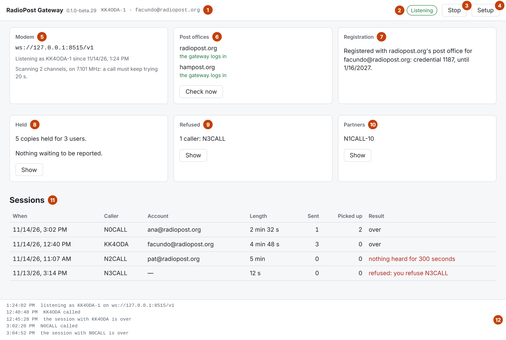

*Figure 47. The RadioPost Gateway window.*

1. **The gateway's callsign**, and the account it is registered under. To its left, beside
   *RadioPost Gateway*, is the version you are running.
2. **What it is doing** (the table below).
3. **Start** and **Stop**.
4. **Setup**. Settings change only while the gateway is stopped.
5. **Modem**: where it reaches Aether and any more modems, as Setup has them, and since when it
   listens. Whether another modem answers is in the log: *also listening on 127.0.0.1:8601*. A gateway
   that scans adds *Scanning 3 channels, on 7.101 MHz: a call must keep trying 40 s*, or why it is
   not scanning.
6. **Post offices**: whether each post office let the gateway log in at the last check. It checks
   every ten minutes while it answers. **Check now** checks at once.
7. **Registration**: the gateway's credential and when it runs out (red two weeks ahead). Under
   it, what the gateway last told its post office about being on the air, and when.
8. **Held**: copies placed ahead and sessions waiting to be reported
   ([section 21](#21-when-the-internet-is-down-at-the-gateway)).
9. **Refused**: callers you refuse ([section 20](#20-refusing-a-caller)).
10. **Partners**: gateways this one forwards to by radio
    ([section 22](#22-partners-forwarding-by-radio)).
11. **Sessions**: each session carried, newest first: who called, the account, how long, the
    messages sent and picked up, and how it ended (**Result**, in the table below).
12. **The log**: what the gateway does, with the time.

| The badge says | Means |
|---|---|
| Stopped | Not answering. |
| Waiting for the modem | Aether is not running, is restarting (saving Aether's Setup restarts it), or cannot be reached. The gateway tries every five seconds. |
| Listening | It holds its callsign at Aether and answers calls. |
| Not answering here | The modem does not check the band rules, and the radio is outside the segments where an unattended station may answer. The gateway answers again once the radio is back in one. With Aether's rules on, you do not see this. |
| Session | A user's session is under way. |

**Result** is green for a session that was done, amber for one cut short, red for one that
failed, and plain when you ended it. Point at it to read more: the modem's reason for a lost link,
or the code a refusal carried. Whatever did not cross is offered again on the station's next call.

| Result | Means |
|---|---|
| Completed | The caller hung up with the session done. For a call to a partner, the gateway hung up once its session was over; the tooltip says what it forwarded. |
| Cut short | A station hung up before the session was done, or with a message part sent. |
| Link lost | The modem lost the link, usually a fade: Aether's link timeout. |
| Timed out | Nothing was heard for five minutes, so the gateway hung up. |
| Refused by you | The caller is on your **Refused** list ([section 20](#20-refusing-a-caller)). |
| Refused: … | The gateway refused the caller: its credential, for example, is missing or invalid. |
| Post office unreachable | The caller's post office did not answer. The caller was told. |
| Post office not found | The gateway could not find the caller's post office. |
| Post office refused: … | The caller's post office refused the session: its credential expired, for example. |
| Error from caller: … | The caller ended the session with an error, such as a credential of this gateway it did not accept. |
| Disconnected by you | You clicked **Disconnect**. |
| Aborted by you | You clicked **Abort**. |
| Call stopped by you | You clicked **Stop calling** on a call to a partner. |
| Gateway stopped | You clicked **Stop**, or closed the window, during the session. |
| Modem error | The gateway lost its connection to the modem. |
| No answer | A call to a partner: no link came up. |
| Call failed | A call to a partner: the modem said why it failed. |
| Ended | Kept by RadioPost Gateway 0.1.0-beta.40 or earlier, which did not say whether a session was done. |

While a session runs, a box shows who called, the account, since when, and the messages so far.


*Figure 48. A session at the gateway.*

**Ending one session.** The box has a button that ends this session only. The gateway goes on
answering:

- **Disconnect**: Aether sends what it already holds, then ends the link. The caller hears it end.
- **Abort** takes Disconnect's place once you have clicked it. Click it when Disconnect takes too
  long on a weak path: the link ends at once.
- **Stop calling**, while the gateway calls a partner ([section 22](#22-partners-forwarding-by-radio)):
  the call stops at once.

Nothing is lost. What did not cross is offered again on the station's next call, and a message
sent in part goes on from where it stopped. **Sessions** says *Disconnected by you*, *Aborted by
you* or *Call stopped by you*.

**Stopping and closing.** **Stop** ends a session under way and lets Aether go: the gateway stops
answering. Closing the window stops the gateway too. If it is answering, it asks first and says
what closing stops.

**Its status, for anyone to see.** Unless you untick **Report its status to its post office, for
anyone to see** in Setup, the gateway tells its post office whether it is on the air. The post
office publishes it, and radiopost.org's gateway directory shows it beside the gateway. It says:

- what the gateway is doing: **Listening**, in a **Session**, **Waiting for the modem**, or
  **Stopped**;
- which of its registered channels it listens on now;
- what keeps it from working fully: a modem that does not answer, the radio outside the segments
  where it may answer, or settings it cannot run with;
- the hour in which its last session ended, such as *in the hour from 14:00*.

It never says who called or what was carried. The gateway tells its post office when something
changes, and every five minutes otherwise, while the app is open, started or stopped. Closing the
app tells it the gateway stopped. A gateway not heard from for 15 minutes shows as *Not heard
from*. **Registration** says what was last reported, and when. Untick the box and save, and what
the gateway reported is withdrawn: its post office publishes nothing for it.

**Left on its own.** With **Answer calls when the app opens** ticked, the gateway answers as soon
as it opens. To open it when you sign in:

- Windows: put a shortcut to RadioPost Gateway in the Startup folder (press Win+R, type
  `shell:startup`).
- macOS: add it to **Login Items** (System Settings, General).
- Linux: add it to your desktop's startup applications.

**Arranging the windows.** RadioPost Gateway, the RadioPost client and Aether each open where you
left them. One layout for one screen: the gateway on the left, full height; Aether in **Compact**
at the top right; the RadioPost client under Aether.

**Updates.** A line at the top says when a newer release is out. The gateway asks when it opens and
every six hours; **Check for updates**, at the foot of **Setup**, asks now. **Update and restart** stops the gateway, installs the update and starts it again,
answering as before.

### When a scan stops

If you tune the radio yourself, in Aether, at the radio or with **Stop** on Aether's scan line, the
scan stops and the radio stays where you put it. Aether also ends a scan when fewer than two of its
channels are left that the radio will take. The gateway says so in its log and on **Modem**, and
does not start the scan again by itself: you moved the radio for a reason. Click **Stop** and
**Start** to scan again. A call to a partner ([section 22](#22-partners-forwarding-by-radio))
stops the scan for the call and starts it again after.

When a scan ends, the gateway registers again with the one channel the radio stays on, so your
post office stops offering callers the others and a call that waits for a scan. Its log says
*listening on 7.101 MHz only, until the scan runs again*, then *registered again*. When the scan
runs again, it registers all its channels again. If the radio is on none of them, the log asks
you to register the gateway with the channel it listens on.

## 20. Refusing a caller

Refuse a station that misuses the gateway, such as one sending mail the rules do not allow on the
air. The operator who learns of it must stop it.

1. In the **Refused** box, click **Show**.
2. In the first box, type the caller:
   - an address, such as `ana@example.org`, refuses that account;
   - a callsign without an SSID, such as `N3CALL`, refuses every SSID of it;
   - a callsign with an SSID, such as `N3CALL-5`, refuses that station only.
3. In the second box, write why, for yourself. The caller never sees it.
4. Click **Refuse**.

It applies from the caller's next call, whether the gateway is answering or not. The caller is
told only that this gateway's operator does not carry its sessions. The Sessions list shows such
a call as *refused*. **Carry again** takes a caller off the list.

## 21. When the Internet is down at the gateway

**Copies placed ahead.** With **Hold copies** ticked (Setup, step 1) and the gateway registered,
the post offices of users who name this gateway as usual copy their waiting mail here as it
arrives. A message up to the size you set is kept with its text; a larger one is only listed. A
copy goes when its user picks the message up, here or anywhere, or after the days you set.

**A session while cut off.** When a caller's post office cannot be reached, the gateway answers on
its own and tells the caller so:

- it checks the caller itself, with the post office's keys and list of revoked credentials, which
  it keeps while online. A caller from a post office it never reached is refused;
- it hands the caller the copies it holds for them;
- it keeps what the caller sends, written to disk before it tells the caller it has it;
- mail between two of its own users is handed over at once, at the other's next call.

**When the Internet is back,** the gateway reports each session to the caller's post office,
oldest first. It tries every minute. A session refused by the post office is dropped, and the log
says why. One not reported in 30 days is dropped too.

The **Held** box shows it all. **Show** lists each copy (whose, from whom, until when, never the
text), each session waiting to be reported with its last try, and the last reports.


*Figure 49. What the gateway holds, its partners and the callers it refuses.*

## 22. Partners: forwarding by radio

A partner is another gateway, named by its callsign, that this one can reach by radio. While this
gateway is cut off, it can hand its waiting sessions to a partner that still has the Internet, so
the mail does not wait for the Internet to come back here.

1. **Stop** the gateway: partners change only while it is stopped.
2. In the **Partners** box, click **Show**, type the other gateway's callsign and click **Add**.
3. Ask the other gateway's operator to do the same with yours. A gateway answers forwarding calls
   from its partners only.
4. **Start** the gateway again.

While the gateway answers, **Forward now** beside a partner calls it between sessions and hands it
every session waiting to be reported. Both gateways must be on the same channel. The partner
reports them to the post offices, or forwards them on if it is cut off too. In the same call the
partner hands back mail its post office gave it for this gateway's users.

**Windows** are the times a gateway listens for its partners' calls: a channel, and a time that
comes round every hour or every few hours. To set this gateway's own:

1. **Stop** the gateway, and open the **Partners** view.
2. Under **Windows**, type the dial in MHz (upper sideband), choose Aether's bandwidth, how often
   the window opens, when (UTC; for every hour only the minutes count), and for how many minutes.
3. Click **Add**. A window is refused when Aether's signal on it would not lie inside a segment
   where the rules let an unattended station start a data transmission; the message says why.
   On 40 m, dials from 7.0998 to 7.1022 MHz fit at 2300 Hz.
4. **Register again** in Setup: partners read your windows from your record at your post office.

While it is cut off, the gateway calls each partner by itself during that partner's windows. It
tries once, then twice more a minute apart if nobody answers, then waits for the next window. It
never calls while Aether says the channel is busy. When Aether can set the radio's dial, the
gateway tunes the radio to the partner's window and back after the call, and says so in the log.
Otherwise the partner's window must be on the channel your radio is on. The **Next window** column shows when each
partner's next window opens (*None published* until the gateway has read the partner's record).
If one partner reached the Internet at its last call and opens a window within the hour, the
gateway keeps its sessions for that partner, and calls the others only to collect its users'
mail.

On the command line ([section 23](#23-a-gateway-with-no-screen)): `radiopost-gateway window
--dial 7.101 --bandwidth 2300 --every 3600 --at 900 --length 600`, `windows`, and
`window --remove 1`.

## 23. A gateway with no screen

On a computer with no screen, run the gateway from the command line with the same folder:

```
radiopost-gateway panel
```

It comes in the tools archive of the same release. It serves the gateway's window at
`http://127.0.0.1:8621/` for a browser on that computer, or through an SSH tunnel:
`ssh -L 8621:127.0.0.1:8621 the-gateway`. It answers calls when the gateway is set to answer at
start. A service manager such as systemd can run it; the
[gateway guide](../user/gateway.md#6-a-gateway-with-no-screen) has an example unit.

Useful commands:

| Command | Does |
|---|---|
| `radiopost-gateway held` | What the gateway holds. |
| `radiopost-gateway accounts` | The client's accounts the gateway can register with, and where it is registered now. |
| `radiopost-gateway register --account facundo@radiopost.org --channel 7101000,USB,aether,2300` | Register with that account's post office. `--account` takes the address, the callsign or the number `accounts` gives, and is needed when the client holds more than one. `--listens 18:00-02:00` gives each day's listening times in UTC; without it the gateway listens always. `--site 33.79,-84.33,12` gives the site (latitude, longitude, antenna height in metres), and `--station 7101000,100,dipole,12,` a channel's station (dial in hertz, watts, antenna, metres, dBi, and where a beam points), any field after the dial left empty. |
| `radiopost-gateway unregister` | Withdraw the registration, as **Unregister** does. Stop the gateway first. `--here` forgets it on this computer only, for a post office that cannot be reached. |
| `radiopost-gateway block --caller N3CALL --note "why"` | Refuse a caller. `unblock --caller N3CALL` carries it again. |
| `radiopost-gateway blocked` | The callers and post offices refused. |
| `radiopost-gateway partner --add N1CALL-10` | Name a partner (`--remove` to drop it). |
| `radiopost-gateway forward --to N1CALL-10` | Call a partner once, when the gateway is not answering. |
| `radiopost-gateway windows` | The forwarding windows, and whether each may be published. |
| `radiopost-gateway scan --dial 3.590 --dial 7.101` | Scan these channels from the next start, the first home (`--off` to stop; `scan` alone lists them). |
| `radiopost-gateway status --off` | Stop reporting the gateway's status, and withdraw what it reported (`--on` to report again; `status` alone says which). |
| `sudo radiopost-gateway update` | Install the newest release, then restart the service. |

## 24. What the gateway keeps

In the folder `.radiopost-gateway` in your home folder (Setup's last line says where):

| File | Holds |
|---|---|
| `gateway.json` | The settings. |
| `key.hex` | The gateway's key. Back it up: a new key needs a new registration. Never share it. |
| `credential.hex` | The gateway's credential. Gone once the gateway is unregistered. |
| `record.json` | What was last registered, and from which account and post office; after **Unregister**, what was registered alone. |
| `store.json` | Copies placed ahead, sessions waiting to be reported, and what it knows of partners. Keep it. |
| `sessions.json` | The last 200 sessions. |
| `refused.json` | The callers you refuse. |
| `gateway.log` | The log, with the date and time (UTC). Past 2 MB it becomes `gateway.log.old`. |

---

# Part 4. The post office desk

## 25. The desk at a glance

A post office keeps its users' mailboxes and exchanges their mail with the rest of the world. Its
operators run it from the RadioPost client, on the **post office desk**. This part is for them.
Setting up the server itself (the mail server, the web server, DNS) is in
[the post office guide](../user/post-office.md).

**Who sees it.** The desk goes by callsign. RadioPost shows a **Post office** button in the
left-hand column when the callsign chosen at the top of the window is one of the post office's
operators. The number on the button is how many applications wait. Nobody becomes an operator by
applying: the post office's settings name its operators.

**What it needs.** The Internet. The desk talks to your post office as you, with your credential.

**Opening it.** Click **Post office**. At the top:

- **Post office** and the domain it serves, such as *radiopost.org*.
- A summary line: how many accounts, applications waiting, codes not yet used, sessions open, the
  post office's version, mail waiting to go out by email, and a newer release when there is one.
- **Refresh** asks the post office again.

| Tab | What you do there | Chapter |
|---|---|---|
| **Applications** | Approve, decline or postcard the people asking for an account. | [26](#26-applications) |
| **Accounts** | See every account and its devices; rename; revoke a lost device. | [27](#27-accounts-and-devices) |
| **Gateways** | See the gateways registered here and from which account; unregister one. | [27](#gateways-registered-here) |
| **New code** | Make a one-time code for a new account or a new device. | [28](#28-codes) |
| **Mail out** | See mail sent by radio still waiting to go out by email. | [29](#29-mail-out) |
| **Post offices** | Know, forget or block other post offices. | [30](#30-other-post-offices) |
| **Health** | Read the hourly check of the whole post office. | [31](#31-health) |
| **Server** | Run jobs on the server, open a terminal, keep backups, rotate keys. | [32](#32-the-server-jobs-and-a-terminal) and [33](#33-backups-and-dkim-keys) |
| **Settings** | Applications, licence lookups, mailboxes. | [34](#34-settings) |

Every button and box has a tooltip that says what it does.

## 26. Applications

When applications are on ([Settings](#34-settings)), licensees can ask for an account from their
RadioPost client ([section 5.2](#52-by-applying)). You are emailed when one arrives, and it waits
on this tab.

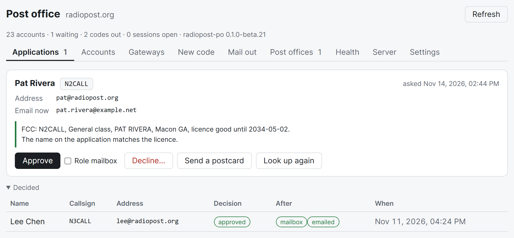

*Figure 50. Applications.*

Each application shows the person's name, callsign and when they asked, the **Address** they
want, their **Email now**, and what the post office found of the callsign:

- a **green** bar: an active licence in the applicant's name;
- an **amber** bar: something to check, such as another name, a club callsign or an earlier
  application;
- a **red** bar: no licence, or one no longer valid; a club callsign asked for by someone who is
  neither the club nor its trustee; or an **Email now** at a domain kept for examples, such as
  `example.com`, which no email can reach.

A club callsign is never green. The post office also looks up the club's trustee, and says whether
the applicant gave the club's name or the trustee's. Get the trustee's word before you approve.

That is evidence, not proof: anyone can read who holds a callsign. To decide:

1. Read the evidence. Click **Look up again** to ask the licence databases again.
2. Choose one:
   - **Approve** makes the account and issues its credential. The applicant's RadioPost collects
     it within a minute, while it is open. Tick **Role mailbox** first for a mailbox several
     licensed operators share, such as a club's or a shelter's.
   - **Decline…** opens a box for the reason. Type a sentence the applicant will read (the list
     offers common ones) and click **Send**.
   - **Send a postcard** makes a code good for 30 days, and a card to print and post to the
     address on the licence. Whoever holds the card can read that address, so it shows the
     applicant lives there.

When you approve, the post office can also make the person's mailbox and email them a welcome with
their first password ([Settings](#mailboxes)). For a postcard it does both when the person enrolls
with the card's code, once the licence is proved.

**Decided** lists the applications decided in the last week: the decision, and after it whether
the mailbox was made (*mailbox*, or *no mailbox* in red) and the applicant emailed (*emailed* or
*not emailed*). A postcard shows its code and **Print the card**.

> **Note.** An application naming one of the post office's own operator callsigns can only be
> declined: approved, it would give its holder this desk. The card says so in red. An operator
> adds a device of their own with a code instead ([section 28](#28-codes)).

## 27. Accounts and devices

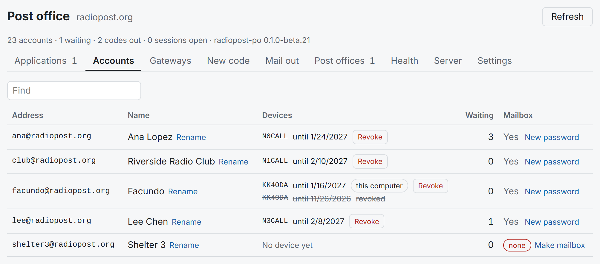

*Figure 51. Accounts.*

Every account, one a row:

- **Address**, the account.
- **Name**, the name on the email the account sends. **Rename** (or **Name it**) changes it:
  type the name and click **Save**.
- **Devices**: each computer enrolled for the account, with its callsign and until when its
  credential runs. *this computer* marks the one you are using. A revoked one is crossed out.
- **Waiting**: messages waiting for the account's next call to a gateway.
- **Mailbox**: *Yes* when the mail server has the account's mailbox, with **New password**, and
  *none* in red when it does not. Without one, email from outside is refused for the account.
  Empty when the post office cannot ask the mail server ([Settings](#mailboxes)).

**Find** shows the accounts whose address, name or callsign contains what you type.

**A missing mailbox.** Click **Make mailbox** beside *none*. The post office makes it and shows its
password for mail programs once, with **Copy**. It keeps no copy. Give it to the person off the
air, by email, by phone or in person, never in a message by radio: nothing on the air is
encrypted.

**A forgotten password.** The mail server has no way for people to reset their own password, so
they ask you. Click **New password** beside *Yes*, then again to confirm: the old password stops
working at once. The post office sets a new one and shows it once, with **Copy**. Only the
password changes; the person's app passwords and passkeys stay. Give it to them off the air, as
above. Their RadioPost devices are not affected: they do not use this password.

**A lost or stolen computer.** Click **Revoke** beside its device, then again to confirm. Every
credential of that device stops working: it can no longer log in or call a gateway. Gateways
learn of it from the post office's list of revoked credentials. The account itself stays; give
its owner a code for their new computer ([section 28](#28-codes)).

Revoking the computer you are using takes the desk away from it: the button says so first.

### Gateways registered here

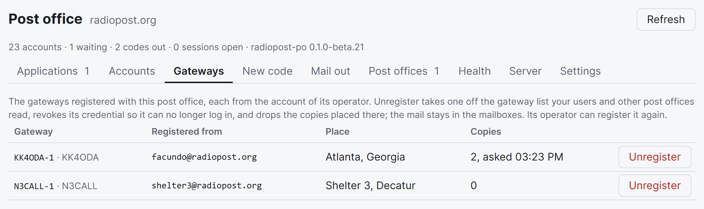

*Figure 52. Gateways.*

The **Gateways** tab lists each gateway registered with your post office, one a row:

- **Gateway**: its callsign, and its operator's.
- **Registered from**: the account that registered it. Its credential names that address.
- **Place**, as its record says.
- **Copies**: copies of users' mail placed at the gateway and not yet taken, and when it last
  asked for them.

**Unregister**, clicked twice, takes a gateway off your post office: off the list your users and
other post offices read, its credential revoked so it can no longer log in, and the copies placed
there dropped. The mail itself stays in the mailboxes. Use it for a gateway registered here by
mistake, or one whose operator can no longer reach it. Its operator can register it again. A
gateway's operator can also unregister it from RadioPost Gateway
([section 18](#unregistering-or-moving-to-another-post-office)).

## 28. Codes

A code lets someone enroll without applying: for a new account, or for a new device of an account
that exists. Use it for someone you know holds the callsign.


*Figure 53. Making a code.*

1. Open **New code**.
2. Fill in:
   - **Address**: the account, at your post office's domain.
   - **Callsign**: their callsign, as on the air.
   - **Name**: the name on the email the account sends. Leave it empty to keep an existing
     account's name.
3. Click **Check the licence** to see what the post office finds of that callsign and name.
4. Tick **A role mailbox** for a shared mailbox.
5. Click **Make code**.

The code shows in large letters, with whom it is for and until when. **Copy** copies it. Give it
to the person by email, by phone or on paper. It works once, for a week. They enroll with it in
their RadioPost's Setup ([section 5.1](#51-with-a-code-from-the-operator)).

For a new address, the post office also makes the account's mailbox, and shows its password for
mail programs under the code, once, with its own **Copy**. Give it with the code, off the air,
never in a message by radio. If the mailbox could not be made, a red line says why: make it from
**Accounts** ([section 27](#27-accounts-and-devices)) before mail from outside can arrive. A code
for a new device of an existing account makes no mailbox.

> **Note.** A code naming one of the post office's operator callsigns, for someone else's address,
> would give its holder this desk. The desk stops first with a red box, *This person will be able
> to run the post office*, and makes the code only if you click **Make it anyway**. A code for a
> new device of your own needs no box.

## 29. Mail out

**Mail out** lists mail your users sent by radio that waits to go out as ordinary email: the
message's ID, whom it is for, and since when. Normally it is empty: mail leaves within a minute.

Mail that stays here means the mail server is not taking it. Look at [Health](#31-health), and
run the **mail-log** job on the [Server](#32-the-server-jobs-and-a-terminal) tab to read the mail
server's log.

## 30. Other post offices

Your users' mail reaches every other post office as ordinary email, whether you know it or not. A
post office you **know** is one whose word you take that its users are licensed:

- mail from its users needs no place on your users' accept lists, and goes on the air without the
  third-party flag;
- its gateways log in here, and your users can use them;
- your post office lists its gateways for your users' clients.

Know only post offices whose operators you trust to check callsigns. At first none is known.

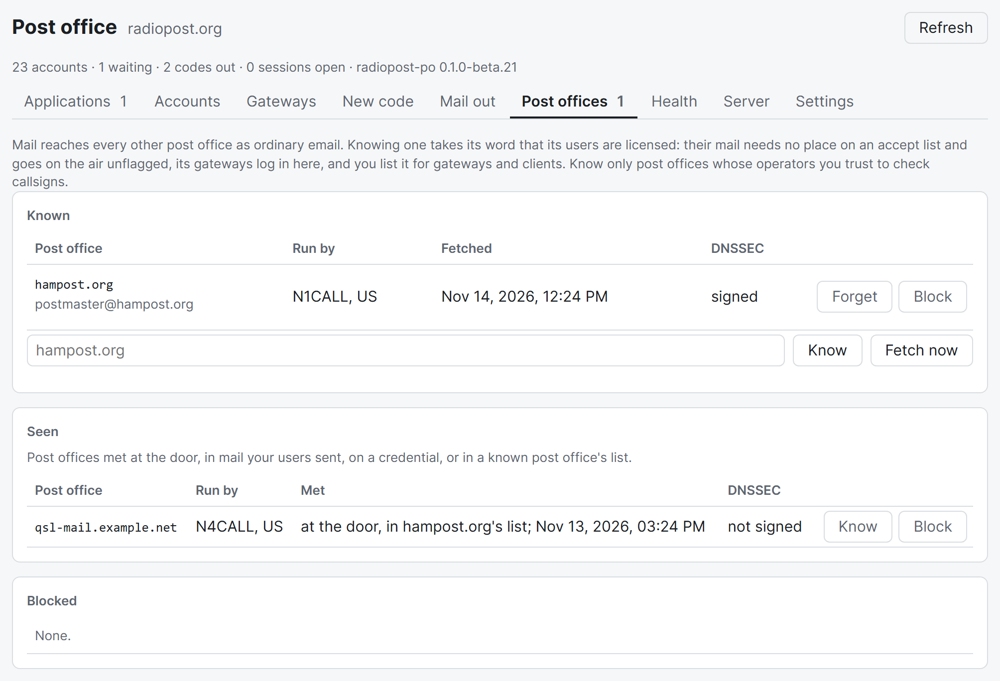

*Figure 54. Other post offices.*

- **Known**: the post offices you know, who runs each, when its records were last fetched, and
  whether DNSSEC signed them. They are fetched again every six hours. **Forget** stops knowing one;
  **Block** also hides it. To know a new one, type its domain and click **Know**. **Fetch now**
  fetches them all at once.
- **Seen**: post offices the service met (at the door, in mail your users sent, on a credential,
  or in a known post office's list) and that publish a RadioPost record. **Know** one, or **Block**
  it so it is not shown again.
- **Blocked**: those you blocked. **Unblock** lets one be seen again.

A known post office that cannot be fetched keeps what was last fetched. After a day, Health turns
red, because its list of revoked credentials may be out of date.

## 31. Health

The post office checks itself every hour, from outside and inside, and emails its contact address
when a check turns red, and again when all pass.


*Figure 55. Health.*

Each line is one check:

| Mark | Means |
|---|---|
| ✓ (green) | Passes. |
| ! (amber) | Worth a look soon. No email is sent for amber. |
| ✗ (red) | Something to fix. The **Health** tab shows how many. |
| • (grey) | For your information, such as a newer release. |

It checks the post office's DNS records, its certificate and its API from outside, the door
where mail comes in, the mail server, free disk space, mail stuck going out, last night's backups,
whether every account has its mailbox at the mail server, when a backup last left the server,
whether the jobs runner is installed, the DKIM keys' age and a key rotation waiting on you, and
each known post office's records.

- **Check now** runs every check at once (a few seconds).
- **DKIM selectors**: give the names of your DKIM keys once, as your mail server names them
  (such as `v1-rsa-20261110, v1-ed25519-20261110`), and click **Save**. The check then looks for
  their records in DNS.

## 32. The server: jobs and a terminal

The **Server** tab lets you look after the server without logging in to it.


*Figure 56. Jobs and a terminal.*

**Jobs** are a fixed list of tasks the server's administrator account runs for you:

| Job | Does |
|---|---|
| **update** | Installs the newest RadioPost release, its signature checked, and restarts the post office. |
| **restart**, **restart-mail** | Restarts the post office, or the mail server. |
| **certificate** | Copies the web server's certificate to the mail server now. |
| **services** | Says whether the post office, the mail server and the web server run. |
| **log**, **mail-log** | The last lines of the post office's or the mail server's log. |
| **disk**, **firewall**, **ports**, **logins** | Disk space, the firewall's rules, what listens on which port, who logged in lately. |
| **system-updates** | Installs the operating system's security updates now rather than tonight. |
| **mail-backup** | Backs up the mailboxes now (done each night). |
| **check** | Checks the post office from outside. |

Click **Run** beside a job. **update**, **restart** and **restart-mail** ask for a second click.
The line under the job says it is waiting, running, then done or failed, when and by whom.
**What it said** shows its output.

If every job stays *asked for, waiting for the runner*, the jobs runner is not installed. The tab
says the one command to run on the server, once.

**When you need more.** For what no job does:

- **Open a terminal** opens a terminal on this computer, logged in to the server by SSH, such as
  `root@po.radiopost.org`. It uses this computer's own SSH key: the desk keeps no password and no
  key of the server's. **Setting up the key, once** says how.
- **Copy for Claude** copies the server's state (versions, checks, settings, the jobs' last output;
  no mail, no names, no keys) to paste into a Claude session that helps you.

## 33. Backups and DKIM keys

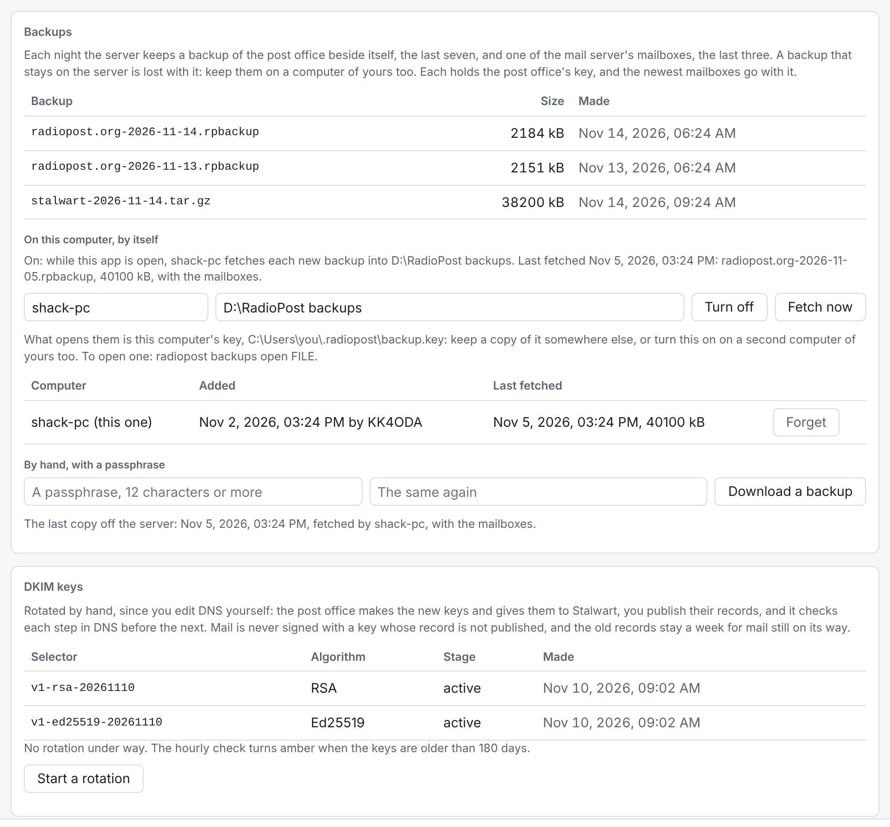

*Figure 57. Backups and DKIM keys.*

### Backups

Each night the server keeps a backup of the post office beside itself (the last seven), and one of
the mail server's mailboxes (the last three). The table lists them. A backup that stays on the
server is lost with it, so keep copies on a computer of yours. There are two ways.

**On this computer, by itself** (the better way):

1. Type a name for this computer, such as `shack-pc`, and the folder the backups go to (a drive
   of its own, or a folder another program copies elsewhere). Left empty, the folder is
   `RadioPost backups` in your home folder.
2. Click **Turn on**.

While RadioPost is open, it looks every hour and fetches each new backup, sealed to a key only
this computer holds. **Fetch now** looks at once. The last ten are kept.

> **Note.** The key that opens these backups is a file on this computer (the box names it,
> `backup.key`). Lose the computer and its key, and its backups go with them. Keep a copy of the
> key somewhere else, such as a USB stick in a drawer, or turn this on on a second computer too.

The table under it lists every computer the backups go to. **Forget** one that was lost or given
away: the post office stops sealing backups to it.

**By hand, with a passphrase.** Type a passphrase of 12 characters or more, twice, and click
**Download a backup**. The backup, with the newest mailboxes, is sealed with the passphrase and
kept on this computer in `RadioPost backups`. Without the passphrase nobody can open it, you
included.

The line at the bottom says when a copy last left the server. Health turns amber 7 days after the
last one and red after 30. Restoring a backup on a new server is in
[the server guide](../user/post-office.md#11-backups-and-restoring).

### DKIM keys

The mail server signs outgoing mail with DKIM keys, so receivers can tell it came from your
domain. Since you edit DNS yourself, the keys are rotated by hand, one checked step at a time. The
table shows the keys, their algorithm, their stage and when they were made. Health turns amber
when they are older than 180 days.

1. Click **Start a rotation**. The post office makes new keys and gives them to the mail server,
   signing nothing yet.
2. The desk shows a TXT record for each new key. Click **Copy** beside each and publish it at your
   DNS provider (most want the name without the domain, the part ending in `._domainkey`).
3. Click **Switch to the new keys**. The desk checks each record is visible in DNS, then the new
   keys sign.
4. Keep the old records for a week, for mail still on its way. The desk says until when.
5. When the desk asks, remove the old records from DNS and click **End the rotation**. It checks
   they are gone.

**Stop**, before the switch, takes the new keys back.

## 34. Settings


*Figure 58. Settings.*

### Applications

**Take applications for accounts** lets licensees apply from their RadioPost client. Each
application then waits on the Applications tab. It saves as soon as you tick it. Untick it to close
applications: only the codes you make then let anyone in, and the client tells applicants *it
takes no applications*.

### Licence lookups

What the post office finds of each callsign shows beside each application and code.

- **Look US callsigns up in a copy of the FCC's licence database** keeps a copy of the FCC's
  file on the server, fetched each week (about 200 MB to fetch, 170 MB kept). Lookups stay on the
  server: nobody learns whom you look up. **Fetch it now** fetches it at once.
- **QRZ.com**, with your own account, for callsigns of every country: type your QRZ username and
  password and click **Save**. Without an XML subscription QRZ gives only a few fields. **Clear**
  forgets the account.

### Mailboxes

The mail server refuses email for an account with no mailbox, so each account needs one. Under
**Make each mailbox**, choose:

- **By hand, in the mail server**: you make each one yourself.
- **In Stalwart, by its API**: give **Stalwart's address** as the server reaches it (such as
  `http://127.0.0.1:8080`) and an **API key** made in Stalwart's administration. The post office
  makes the mailbox wherever an account begins: when you approve (it emails the new user their
  first password), with a code for a new address (the password shows under the code), and when a
  postcard's code is used (the welcome brings it). **Accounts** and **Health** show any account
  without one.
- **By a program on the server**: name the program; it is given the address and the name.

Click **Save**, then **Check**: it asks the mail server without making anything. The line under
it says whether welcome emails can go out.

### This post office

Its domains, its operators' callsigns, its contact address and its API address, as the post office
publishes them.

---

# Part 5. Help

## 35. RadioPost and Aether HF

RadioPost is the mail program. Aether HF is the modem. Each is set up in its own window:

| To do this | Use | Where |
|---|---|---|
| Your account, your mail, whom to call | RadioPost | This manual |
| Sound card, keying, drive level | Aether | [Setup, step 2](https://github.com/KK4ODA/aether-hf/blob/master/docs/manual/manual.md#step-2-radio-interface) |
| Your licence class, control and band rules | Aether | [Setup, step 1](https://github.com/KK4ODA/aether-hf/blob/master/docs/manual/manual.md#step-1-callsign-and-rules) |
| Bandwidth (500 or 2300 Hz) | Aether's own; RadioPost asks for a gateway channel's, and a station call's **Bandwidth** | [Setup, step 4](https://github.com/KK4ODA/aether-hf/blob/master/docs/manual/manual.md#step-4-modem-settings) |
| The frequency | RadioPost's **Channel** or **Dial, MHz**, which tune Aether when it can set the dial; otherwise Aether or the radio | [Radio dial](https://github.com/KK4ODA/aether-hf/blob/master/docs/manual/manual.md#radio-dial) |
| Recording a session's audio | Aether | [Recording](https://github.com/KK4ODA/aether-hf/blob/master/docs/manual/manual.md#recording-the-radios-audio) |
| Sending your logs to the project | Aether | [Send files](https://github.com/KK4ODA/aether-hf/blob/master/docs/manual/manual.md#sending-files) |

**Callsigns.** RadioPost calls and answers as the callsign it was enrolled with. You never copy it
into Aether. Aether's Setup step 1 keeps the **Aether callsign**, for Aether standalone use; while
a RadioPost program holds a callsign, the note after that box names it and the program.

**External programs.** Leave Aether's **External programs** (its Setup step 5) unchecked for
RadioPost: they are programs written for VARA, such as Winlink Express, VarAC and RMS Trimode,
and RadioPost is not one. Tick it only when one of them runs on the station too.

**Bandwidth.** A call goes at the bandwidth RadioPost asks for: the gateway channel's, or a
station call's **Bandwidth**. Aether moves the station to it for the call and goes back after.
While RadioPost listens, Aether runs 2300 Hz, which answers 500 Hz calls too,
whatever Aether's own **Bandwidth** (its Setup step 4) says, and goes back to it when RadioPost
stops listening or closes (Aether 0.2.0-beta.174 and RadioPost 0.1.0-beta.36 or later). Aether's
header then says *2300 Hz · listening*. An external program's own bandwidth, VarAC's 500 Hz on its
calling frequency say, comes first: RadioPost's listening line then says *500 Hz calls only*.

**Aether's header.** While RadioPost is open, Aether's header shows *✓ RadioPost client* between
calls, and *✓ RadioPost client · listening* while it listens (Aether 0.2.0-beta.159 and RadioPost
0.1.0-beta.15 or later). RadioPost Gateway shows there too, *listening* while it answers.

**Other programs.** Aether can serve Winlink Express, VarAC or RMS Trimode beside RadioPost, on
its external programs port. One program at a time answers for one callsign: close a program that uses
the same callsign as RadioPost while you test. Aether's manual covers them in
[Part 4](https://github.com/KK4ODA/aether-hf/blob/master/docs/manual/manual.md#part-4-aether-with-other-programs).

## 36. The rules

These notes follow the US rules (Part 97). Check your own country's.

- **Control.** At your own station you are at the controls (local control). A gateway left
  answering with nobody at the radio is under **automatic control**. Set Aether's control to
  *Automatic* there: Aether then transmits only in the segments where automatic control is
  allowed, so register the gateway's channels in those segments.
- **Identification.** Aether sends each station's Morse identifier at the end of each session,
  and nothing in Morse during it. The rules ask for your callsign at least every ten minutes, so
  keep each session under ten minutes.
- **No encryption.** RadioPost signs messages to prove who sent them. It never encrypts them.
  Anyone can read every message. An alert's check proves it came from your circle; its text stays
  plain, and the keyword never goes on the air.
- **Alerts answered by themselves.** **Answer by itself** sends *heard* with nobody at the radio:
  automatic control. Untick it where the rules allow that only in some segments.
- **Third-party traffic.** Email between you and someone who is not a licensed amateur is
  third-party traffic. In the United States it may go between US stations. The post office marks
  such mail, and a gateway hands it over only where its country allows.
- **No business.** Do not send messages for business or pay.

## 37. Troubleshooting

### The client

| You see | Do |
|---|---|
| **Call** and **Listen for P2P** are greyed | This callsign has no credential yet: enroll it ([section 5](#5-getting-an-account)). |
| **Call** is greyed, and **Listening for P2P** is in | The station is listening for P2P calls. Click **Listening for P2P** to stop, then call ([section 10](#10-station-to-station)). |
| **Listening for P2P** is in, its lamp amber; the state reads *Waiting for the modem* | RadioPost cannot reach Aether. Start Aether, or check the **Modem** box. RadioPost tries again every 5 seconds and listens as soon as Aether answers. Point at the state to see why. |
| *cannot reach the modem's adapter at ws://127.0.0.1:8515/v1* | Start Aether. Check the **Modem** box. |
| The call goes out but nothing answers | Check the dial against the gateway's channel, and the log's *calling … at … Hz* against its bandwidth. Check the gateway's hours. Try another gateway. |
| *Your last 4 calls failed on 2 gateways that usually answer* | Your calls are probably not getting out. Check the radio, the antenna, the cable to the radio and Aether's levels before trying more gateways. Those calls count less against the gateways until it clears ([8.1](#81-choose-a-gateway)). |
| Aether refuses RadioPost's calls | Aether is keyed by an external program. In Aether's Setup, step 2, choose CAT, serial, rigctld, FLRig, CM108 or VOX. |
| Aether stops at start: *127.0.0.1:8515 is already in use* | Aether's external programs port was set to 8515. Put it back to 8300 ([Aether's ports](https://github.com/KK4ODA/aether-hf/blob/master/docs/manual/manual.md#20-the-programs-and-their-ports)). |
| *a session is under way: try again when it ends* | Wait for the session to end, or click **Disconnect** on the session card ([8.3](#83-during-the-session)). |
| *the modem did not say the link had ended: the session is ended here* | Aether did not answer **Abort** within ten seconds. RadioPost ended the session on its side; nothing is lost. Check that Aether is running and that its panel shows no session. |
| *the station is listening for P2P calls: click Listening for P2P to stop it first* | A call, tuning, the tuner tone, refreshing the gateway list, an update and most of Setup wait while the station listens. Click **Listening for P2P** to stop, then try again. Writing, changing and deleting messages go on while it listens. |
| *renewing the credential: try again in a moment* | Wait a few seconds. |
| *this message cannot be changed while a session is under way* | It may be going out. Edit it when the session ends. |
| *it is queued at …, which will pass it on as it is, so it can no longer be changed* | That gateway holds it. Write a new message to correct it. |
| Setup says the credential ran out | Ask your operator for a new code, then **Enroll again with a new code**. |
| *Your settings could not be read* | Usual gateways need the Internet. Try **Read** again when you have it. |
| A mail program refuses your password | It needs the mailbox's password, from the welcome email or the operator. RadioPost holds no copy. If it is lost, ask your operator for a new one ([section 9.2](#92-in-a-mail-program)). |
| Mail you read in a mail program still comes by radio | Tick **Skip mail I have read in a mail program** in Setup, **Usual gateways**, and click **Save** ([section 9.2](#92-in-a-mail-program)). |
| *No gateway list yet* | Open **Choose a gateway** and **Refresh over the Internet** while you have the Internet. |
| A message tagged *queued at …* | A gateway took it while cut off. It is offered again until a gateway that reaches the Internet confirms it. |
| A message tagged *may have been dropped* | Queued for 30 days with no word. It is still offered on each call. |
| *the other station sent ERROR …* | The other station refused something. The text says what. |
| *Set the radio's dial to … MHz (USB) yourself: the modem cannot set it* | Aether keys this radio without CAT and cannot set its dial. Turn the radio to that dial. To let Aether set it, key the radio by CAT in Aether's Setup, step 2. |
| *Not tuned: … busy …* | A session is up on the station, yours or another program's. Pick the channel again when it has ended. |
| **Tuner tone** refused | Aether keys no tone while the channel is in use, or while its rules forbid it there. Wait, or check the dial. |
| *… is a gateway: it takes gateway calls, not P2P calls. For P2P, call the station's own callsign, …* | You chose **P2P (another client's station)** and typed a listed gateway's callsign. Click the message's **Call** button, or type the operator's own callsign ([section 10](#10-station-to-station)). |
| *… is a gateway: for P2P, call the other operator's own callsign while their client listens* | You called a gateway's callsign as **P2P (another client's station)**. Call its operator's own callsign, and ask them to click **Listen for P2P** ([section 10](#10-station-to-station)). |
| An application refused | See [section 5.3](#53-if-the-post-office-refuses). |
| An alert stays *not heard* | The other station's RadioPost was closed, its circle's check differs from yours, its clock is more than ten minutes off, or the path failed. Read your checks to each other. |
| An alert is *not sent* | The station was in a session for five minutes, or the **Modem** is not Aether. |
| *an alert is going out: try again in a moment* | Wait for the alert to go out: about 16 seconds once the channel is clear. |
| No sound | Click anywhere in the window once after it opens: windows play nothing before. Check **Play sounds**, the volume, **Play them on** and quiet hours. |
| A sound keyed the radio | The sounds play on the radio's sound card. Choose your speakers in **Play them on**, or set the computer's default output to them. |

### The gateway

| You see | Do |
|---|---|
| *Waiting for the modem: cannot reach the modem* | Start Aether. Check the **Modem** address in Setup. |
| *Waiting for the modem: the modem refused* | Another program holds the callsign at Aether, or Aether refused it: Aether's log says why. |
| **Start** is greyed | The gateway is not set up or not registered: follow the notice. |
| Register: *… holds no device key* | The RadioPost client on this computer is not enrolled. Enroll it first, with its own code. |
| Register: *… is registered with radiopost.org's post office now* | You picked an account at another post office. **Unregister** first, then register with the account you want ([section 18](#unregistering-or-moving-to-another-post-office)). |
| Unregister: *… still wait to be reported* | Sessions carried with the Internet down hold users' mail. **Start** the gateway with the Internet up, let it report them, then unregister. |
| Unregister: *… keeps KK4ODA-1 on its gateway list* | That post office does not take withdrawals yet. Ask its operators to remove the gateway, then click **Unregister** again. |
| *This modem neither checks the band rules nor says where the radio's dial is* | Aether's rules are off, as they are when an external program keys the radio, and it cannot read the dial. Set Aether's keying and rules (its Setup, steps 1 and 2). |
| *127.0.0.1:8601 will not be used: this modem neither checks the band rules …* | A modem in **More modems**, such as Mercury, checks no rules. Tick **The modem does not check the band rules: I do** in Setup, step 1, and keep its transmissions within the rules yourself ([More than one modem](#more-than-one-modem)). |
| *waiting for 127.0.0.1:8601: cannot reach the modem* | That adapter is not running. Start it, and its modem before it. The gateway tries again every 5 seconds. |
| *the adapter of 127.0.0.1:8601 went away … opening it again* | Its window was closed, or the computer is starting. Start it again, or run `gateway-helpers.bat` ([Starting them with Windows](#starting-them-with-windows)). |
| Explorer says `radiopost-tools-windows-x64.zip` is empty | 0.1.0-beta.40's tools archive is a tar archive. Open it with Windows' own `tar` ([section 4](#4-installing-radiopost)). |
| Aether's waterfall stops when Mercury starts | Mercury took the radio's sound card for itself. Stop Mercury; Aether hears again. |
| *The radio is at … MHz: … outside the segments*, badge **Not answering here** | Aether's rules are off, so the gateway judges the dial itself. Turn the radio to the gateway's channel. |
| *could not tune the radio back* | The radio stayed on the partner's or gateway's channel after a call. Tune it back in Aether. |
| *listening on … MHz only, until the scan runs again* | The scan ended ([When a scan stops](#when-a-scan-stops)); the gateway registered again with that channel alone. Click **Stop** and **Start** to scan again. |
| *… sent ERROR not-authorized: called for station-to-station mail, and a gateway answered* | A RadioPost client called the gateway's callsign for station-to-station mail. Nothing to do. To work you station to station, it calls your own callsign while your client listens. |
| A post office *not found* | Its records are not published: name it in Setup, step 3. |
| A post office *refused the gateway* | The credential ran out or was revoked: register again (Setup, step 2). |
| A session ended *nothing heard for 300 seconds* | The path faded or the caller left. The caller's mail resumes on its next call. |
| *polling … for copies: post-office-unreachable* | The Internet or the post office is down. The gateway answers from what it holds. |
| Held: sessions waiting, last try *not reached* | They are reported when the post office can be reached. |

### The post office desk

| You see | Do |
|---|---|
| No **Post office** button | The callsign chosen at the top is not one of the post office's operators: choose yours. The desk also needs the Internet. |
| Applicants are told *it takes no applications* | Tick **Take applications for accounts** in **Settings**. |
| *no mailbox* beside an approved account, or *none* under **Mailbox** in **Accounts** | The mail server has no mailbox for it, so email from outside is refused (the sender gets *Mailbox does not exist*). Click **Make mailbox** in **Accounts**; if it fails, check **Settings**, **Mailboxes**, with **Check**, or make it in the mail server by hand. |
| Someone cannot sign in to their mail: they forgot the password | **New password** beside their mailbox in **Accounts**. Give them the new one off the air. |
| *not emailed* beside a decision | The email to the applicant did not go. **Settings**, **Mailboxes** says whether the post office can send email. |
| A red line in **Health** | Fix what it says. You are emailed when a line turns red, and again when all pass. |
| Mail waits in **Mail out** | The mail server is not taking it: run the **mail-log** job and read it. |
| Jobs stay *asked for, waiting for the runner* | The jobs runner is not installed. Run the command the **Server** tab gives, once, on the server. |
| *The last copy off the server* is old | Open RadioPost on the computer that fetches backups, or **Download a backup**. |

## 38. Reporting a problem

Open an issue on [RadioPost's repository](https://github.com/KK4ODA/RadioPost/issues). Say:

- the date and time (UTC), the band, frequency and bandwidth, and your grid square;
- what you did, what you expected, and what happened;
- which versions of RadioPost and Aether you run.

Attach the log:

- the client's `radiopost.log`, in the `.radiopost` folder (it keeps no addresses or subjects of
  your mail);
- for a call that failed, the client's call records, the folder `selection/attempts` in the same
  folder (they say where you were, to about a metre);
- the gateway's `gateway.log`, in the `.radiopost-gateway` folder.

For a session that failed or was slow, turn on Aether's **Record** before you try again, then use
Aether's **Send files…** on its Log tab. It sends Aether's recording with both RadioPost logs.

## 39. Glossary

| Word | Means |
|---|---|
| Accept list | The addresses and domains allowed to email you. Writing to someone adds them. |
| Alert | One line that sounds an alarm at another station in your circle until its operator answers. |
| Account | Your mailbox at a post office, with one address. |
| Aether HF | The open-source HF modem RadioPost uses. It has its own program and manual. |
| Automatic control | Operating with nobody at the radio, as a gateway left answering does. |
| Bandwidth | How wide Aether's signal is: 500 or 2300 Hz. Both stations of a session use the same. |
| Beacon | Your callsign on the air once, addressed to nobody: stations listening list you, with how well they heard you, whether you answer calls, and where you are if you let it say. |
| Channel | A gateway's dial frequency, with the bandwidth it uses there: a call there goes at it. Picking one tunes the radio. |
| Check (of a circle) | Eight characters made from a circle's keyword. The same check means the same keyword. |
| Circle | The stations whose operators typed the same keyword, and so can alert each other. |
| Client | RadioPost, the program you send and read mail with. |
| Credential | A signed file that proves your address and callsign belong together. Lasts 90 days and renews itself. |
| Cut off | A gateway that cannot reach the Internet. It goes on answering. |
| Desk | The post office desk: the client's **Post office** view, for a post office's operators. |
| DKIM key | A key the mail server signs outgoing mail with, so receivers can tell it came from your domain. |
| Device key | This computer's own key. It never leaves the computer. |
| Enroll | Get a credential for this computer with a one-time code. |
| Fetch | What a call to a gateway brings back of the mail waiting for you. |
| Fresnel zone | The space round the straight line between two antennas that a VHF signal needs. Ground inside 60 % of the first one costs signal. |
| Gateway | A station that passes sessions between radio and post offices. |
| Held attachment | A file too large for the radio, kept at your post office until you ask for it. |
| Job | A task on the post office's server that the desk asks for, from a fixed list. |
| Level | How something arrives: Silent, Normal, Important or Time-sensitive. |
| Known post office | Another post office whose word your post office takes that its users are licensed. |
| Link budget | What reaches a radio: the power, less the losses on the way, plus the antennas' gains. The margin is what is left over what the modem needs. |
| Listen for P2P | A switch. While it is in, reading **Listening for P2P**, other clients can call you directly, station to station; after each session RadioPost listens again, until you click it again. Meanwhile you write, change and delete messages as usual. A gateway on your station goes on answering its own callsign. |
| Operator (of a post office) | Someone who runs a post office: approves accounts and gives codes. |
| Partner | Another gateway this one forwards mail to by radio when cut off. |
| Post office | The server that keeps your mailbox and exchanges email with the world. |
| Queued | Sent through a cut-off gateway and not yet confirmed by your post office. |
| Role mailbox | An account several licensed operators share, such as a club's. |
| Session | One radio contact between two stations. |
| Station to station | Mail sent directly between two RadioPost stations, with no gateway. Also called P2P. |
| Terrain | The elevation of the ground, fetched in tiles of a degree square, for judging VHF paths. |
| Tuner tone | Ten seconds of steady carrier, for setting an antenna tuner on the channel picked. |
| Usual gateway | A gateway you named in Setup, which gets copies of your mail ahead of time. |
| Waiting | What waited at your post office at your last call to a gateway. |

## 40. Quick reference

**Send and fetch mail**

1. **Write**, fill in **To**, **Subject** and **Text**, **Put in outbox**.
2. **Choose a gateway**, **Choose** one. Or keep the last one you called, shown in **Call**, or
   pick another you called under **▾**.
3. Pick its **Channel**: the radio is tuned there at once if Aether can, and the call goes at its
   bandwidth. **Tuner tone** if needed.
4. Set **Fetch**. Listen that the frequency is clear.
5. **Call**. Watch the card at the bottom right.
6. Read your new mail in the **Inbox**.

**Station to station**

1. Agree on a frequency. The one who answers types it in **Dial, MHz** and clicks
   **Listen for P2P**, which tunes there and answers 500 and 2300 Hz calls. It stays on until
   clicked again.
2. The other chooses **P2P (another client's station)**, types the callsign, the **Dial, MHz** and the
   **Bandwidth**, or picks a station heard or called before under **▾**, then **Call**.
3. With a station that runs a gateway, call its operator's own callsign, not the gateway's.
4. Later, with the Internet: **Send reports**.
5. To be listed by the stations listening: **Beacon**, which repeats while you listen, or **▾**
   beside it and **Send a beacon now**.

**Alert a station**

1. Once: **Alerts**, add a circle with the keyword you agreed, and read your checks to each other.
2. **Send an alert**: the **Circle**, the callsign in **To** (empty for everyone), one line,
   **Send alert**.
3. Watch it become *heard*, *seen* and *answered*.

**Add a callsign**

1. **Setup**, **Add another callsign**.
2. **I have a code** and **Enroll**, or **Apply for an account** and **Apply**.
3. Keep RadioPost open with that callsign chosen until it says *Approved*.
4. Choose the callsign at the top before each session.

**Approve an applicant** (post office operators)

1. Choose your own callsign at the top. Click **Post office**.
2. **Applications**: read the licence check.
3. **Approve** (tick **Role mailbox** first for a shared one), or **Decline…** with a reason.

**Start a gateway**

1. Aether running and keying the radio itself.
2. The RadioPost client on the same computer enrolled as you.
3. RadioPost Gateway: **Setup**, steps 1 and 2: pick the **Account**, then **Register with …**.
4. **Start**. The badge says *Listening*.

---

# Appendix

## Where to read more

| Subject | Document |
|---|---|
| Aether HF, the modem | [The Aether operator's manual](https://github.com/KK4ODA/aether-hf/blob/master/docs/manual/manual.md) |
| Running a gateway, in more depth | [The gateway guide](../user/gateway.md) |
| Running a post office | [The post office guide](../user/post-office.md) |
| On-air tests through a gateway | [Email through a gateway](../user/on-air-gateway.md) |
| On-air tests between two stations | [Station to station](../user/on-air-tests.md) |
| How RadioPost works | [The concept](../concept/00-concept.md) |
| The protocols | [The specifications](../../spec/README.md) |
| Releases | [github.com/KK4ODA/RadioPost/releases](https://github.com/KK4ODA/RadioPost/releases) |
| Bugs and ideas | [github.com/KK4ODA/RadioPost/issues](https://github.com/KK4ODA/RadioPost/issues) |

## Keeping this manual current

This manual is part of the programs. A change to anything a user or a gateway operator sees or
sets (a window, a box, a button, a setting or its default, a message, a file kept) updates the
manual in the same commit. The rule is in `CONTRIBUTING.md`.

- **Versions.** The manual's **Version** goes up with each change, by the same rule as the
  specifications: the last number for a correction, the middle one for something added or
  changed, the first one for a reorganisation. Each change adds a row to the change log below,
  and the header's **Version** and **Updated** match its last row. `tools/check_docs.py` (CI)
  holds them to that. **Describes** is the release version: `tools/release.py bump` moves it with
  every other version in the repository, and `tools/release.py check` (CI) holds it.
- **The contents** are made from the headings: `python tools/manual/build.py toc` rewrites them,
  and `python tools/manual/build.py check` (CI) fails when they are stale, when a figure number is
  out of order, or when a picture is missing.
- **The schematics** are drawn by `tools/figures/manual.py`, with the same drawing kit as the
  concept's figures. Edit the script and run it; CI checks the SVGs match it.
- **The screenshots** are taken of the real windows with made-up data by
  `node tools/manual/screens.mjs`. Run it after changing what a window shows, look at each
  picture, and commit them with the manual.
- **The PDF** is built by `python tools/manual/build.py pdf` and attached to every release.

## Change log

| Version | Date | Changes |
|---|---|---|
| 1.0.0 | 2026-11-15 | First edition: the client, RadioPost Gateway, and how they work with Aether HF. |
| 1.1.0 | 2026-11-15 | §22: a gateway's own windows set in the Partners view, calls by itself in a partner's windows, the Next window column, and which partner gets the sessions. |
| 1.2.0 | 2026-11-15 | §13: groups of addresses, and contact files imported. |
| 1.3.0 | 2026-11-15 | §11.2, §12: **Listen** answers calls to any of your callsigns. |
| 1.4.0 | 2026-11-15 | Part 4, the post office desk: one chapter for each tab (applications, accounts, codes, mail out, other post offices, health, the server's jobs, backups and DKIM keys, settings), with screenshots. §15 points to it; Help becomes Part 5 (§35–§40), with the desk's troubleshooting, glossary words and an approval card. Figure 16 says **Listen** answers any of your callsigns. |
| 1.4.1 | 2026-11-15 | §33: restoring a backup points to the server guide's chapter 11, rewritten. |
| 1.4.2 | 2026-11-15 | Links to Aether's manual go to its new home, `docs/manual/manual.md`, and its chapters there. |
| 1.5.0 | 2026-11-15 | §8: the call box's **Channel**, and **Call** tuning the radio there and back when Aether can set the dial. §19: the badge **Not answering here**. §22: a gateway tunes to its partner's window and back. §39: three new messages. §40: the quick reference tunes by **Channel**. |
| 1.6.0 | 2026-11-15 | §18: **More modems**, and *More than one modem*: a gateway answering on several modems, one session at a time. §18 step 2: each channel's **Modem**. §19: **Modem** names them all. |
| 1.7.0 | 2026-11-15 | §7: **Form**, and sending an ICS-213 as its values alone; a form message reads as the form. |
| 1.8.0 | 2026-11-17 | Gateways that scan (W50): §8 a *scanned* channel and the call that keeps trying; §18 **Scan these channels**, and listing only channels the gateway listens on; §19 the scan on **Modem** and *When a scan stops*; §23 `scan`. |
| 1.9.0 | 2026-11-17 | From the 40 m RadioPost mail of 2026-11-17. §6, §8: **Call** is green; a channel is tuned as it is picked, the line under it says where the radio is or which dial to set by hand, **Tuner tone**, and the radio stays on the channel after the call (new Figure 13). §10: a station call's **Dial, MHz** and **Bandwidth** (new Figure 18), and P2P with a station that also runs a gateway. §19: a gateway whose scan ends registers again with the channel it stays on. §35, §37, §39, §40 to match. |
| 1.10.0 | 2026-11-17 | P2P named plainly in the call box: **Listen** is **Listen for P2P**, whose tooltip names the callsigns it answers as, and **Another client's station** is **P2P (another client's station)** (§6, §10, §11.2, §37, §39, §40; the client's screenshots retaken). |
| 1.11.0 | 2026-11-18 | Alerts and sounds (wishlist W51, W52; RP-8). §10.1 to §10.4: alerts between stations that share a keyword, circles and their checks, sending one and what it becomes, the alarm and its answers (new Figures 19 and 20). §12: *Sounds and notifications*, the levels, quiet hours, and the radio's sound card (new Figure 23). §13: **Notify** for addresses and groups. §36, §37, §39, §40 to match; the client's screenshots retaken with **Alerts** in the left-hand column. |
| 1.12.0 | 2026-11-18 | Every account gets its mailbox. §26: a postcard's mailbox and welcome come when its code is used. §27: the **Mailbox** column and **Make mailbox**, its password shown once and given off the air. §28: a code for a new address makes the mailbox and shows its password under the code. §31: Health checks that every account has its mailbox. §34, §37 to match; the desk's Accounts and New code screenshots retaken. |
| 1.13.0 | 2026-11-18 | From the 40 m sessions of 2026-11-18. §7 *Changing a message*: a message in the outbox is changed with its pencil or **Edit**, and saved in the old one's place with **Save in outbox**; what cannot be changed, and why (Figure 11 retaken with a row's pencil and trash can). §9 **Edit**; §37 its two refusals. |
| 1.14.0 | 2026-11-18 | §26: what turns an application red: a club callsign asked for by someone who is neither the club nor its trustee (the trustee is looked up too), and an **Email now** at a domain kept for examples. |
| 1.15.0 | 2026-11-18 | From the 40 m sessions of 2026-11-18. §9: a form received, by gateway or P2P, shows as the form, each label beside its value, the sender's note below it; it had shown as its text. §7 to match. |
| 1.16.0 | 2026-11-18 | From the 40 m sessions of 2026-11-18, when a second P2P call found the house's client no longer listening. **Listen for P2P** is a switch that stays on: it reads **Listening for P2P**, its lamp lit, and RadioPost listens again after every session and when Aether comes back, until it is clicked again; the **Stop** button is gone (§6, §10, new Figure 18; §37, §39, §40). The state *Waiting for the modem*. The client's screenshots retaken. |
| 1.17.0 | 2026-11-18 | From the 40 m sessions of 2026-11-18. §6: in a narrow window the parts stack in one column, the folders side by side. §7.1: there **Write**, **Reply**, **Reply all**, **Forward**, **Edit** and writing to an address open the message in a window of its own, beside the RadioPost window, or a pop-up in a browser (new Figure 12; later figures renumbered). |
| 1.18.0 | 2026-11-18 | §9: **Forward** carries a form as its text, the labels with the values and the sender's note below; it had carried the note alone, and the form's values were lost. **Reply** shows a form's text under your own; it had shown the note. |
| 1.19.0 | 2026-11-18 | From the 40 m sessions of 2026-11-18: a house station listens for days. While **Listening for P2P** is on and no station has called, messages are written, changed and deleted as usual, and a station that calls takes what is in the outbox then; **Call** and **Tuner tone** stay greyed (§7, §10, §39). The credential is renewed while the station listens (§5.4). §37: *the station is listening for P2P calls*, and an edit is refused only during a session. |
| 1.20.0 | 2026-11-18 | §9: **Print**, and a PDF by the system's print dialog; an ICS-213 prints as FEMA's ICS 213. **Save** beside each file a message carries, in the Downloads folder, never over another file (Figure 16 retaken with a file and **Print**). |
| 1.21.0 | 2026-11-18 | A tester's gateway registered with radiopost.org under his first account while he was trying his own post office, and nothing could take it off. §17, §18 step 2: **Account**, the client's account the gateway registers with, and the line that says where before **Register with …**; the form keeps what was registered. §18 *Unregistering, or moving to another post office*: **Unregister**, what it does, one post office at a time, and what keeps it from unregistering. §23: `accounts`, `register --account`, `unregister`. §24: `record.json`. §25, §27 *Gateways registered here*: the desk's **Gateways** tab and its **Unregister** (new Figure 35; later figures renumbered). §37, §40 to match. The gateway's Setup and the desk's screenshots retaken. |
| 1.22.0 | 2026-11-18 | §27: **New password** beside an account's mailbox, for someone who forgot theirs (the mail server has no reset of its own): a new password, shown once, only the password changed. §37 to match. |
| 1.23.0 | 2026-11-19 | Each program's version beside its name at the top of its window (§1, §6, §19). §12 and §18: **Updates** in **Setup**, with **Check for updates**, which asks for a newer release now instead of at the next six-hourly check. §4 and §19 to match. Figures 7 and 30, and the windows that show the top bar, retaken. |
| 1.23.1 | 2026-11-19 | §27: the desk's **Accounts** tab keeps a callsign, a date and an address whole (an address breaks only after its @), and a password shown under **Mailbox** wraps; it had squeezed the other columns until callsigns read one letter a line. Figure 34 retaken. |
| 1.24.0 | 2026-11-20 | §4: the client keeps a record of every call it places (`selection/attempts`): what was called, how the call ended and why, on this computer only. §38: attach them for a call that failed. |
| 1.25.0 | 2026-11-21 | §12 *Places and GPS* (new Figure 25; later figures renumbered): saved places by grid square or latitude and longitude, the default, the GPS read over a serial port, TCP, UDP or gpsd, and the position in use and why. §8.1: the gateways are listed by distance from that position, said beside **Places**, in place of **Your grid** (a grid square typed there becomes the place *Home*). §4, §38: the call records say where you were. Figure 13 retaken. |
| 1.26.0 | 2026-11-21 | §8.1: the Gateways page's views (*Recommended*, *Favourites*, *Recent*, *Worked from here*; new Figure 14, later figures renumbered), favourites and blocks by gateway or by channel, the last call to each gateway, the record's and the list's age, and gateways of your own; **Hours** shown under **Where**. §4: `selection/gateways.json`. Figure 13 retaken. |
| 1.27.0 | 2026-11-21 | RP-5 1.4.0's `listens` and `seen`. §8.1: under **Where**, whether a gateway listens now by its listening times, and when its post office last saw it; one not seen for two days faded. §18 step 5: **Listening times, UTC**, and **Hours** filled from them. §23: `register --listens`. Figures 13 and 31 retaken. |
| 1.28.0 | 2026-11-21 | §12 *Station profiles* (new Figure 27; later figures renumbered): power, antennas, feed line and noise at HF and VHF, every value set or assumed, the profile in use; *Places and GPS*: each place's **Station**. Figure 26 retaken. |
| 1.29.0 | 2026-11-21 | §8.1 *The map* (new Figure 15; later figures renumbered): the gateways of the view on a map of the world with you, the night side and the Maidenhead grid; a gateway picked in the list or on the map, its great circle, distance and bearing; zoom, pan, **Fit** and **World**; **Save a place from the map**. *Places and GPS*: **Add from the map**. Figures 13 and 27 retaken. |
| 1.30.0 | 2026-11-21 | RP-5 1.5.0's `site` and a channel's `station`. §18 step 2: each channel's **Station** (power, antenna, height, gain, where a beam points) and the gateway's **Site** (latitude, longitude, antenna height), which must be in its grid square. §23: `register --site` and `--station`. Figure 33 retaken. |
| 1.31.0 | 2026-11-21 | VHF paths over the terrain. §8.1: a gateway's distance is to its site when its record gives one; FM channels; *The terrain of a VHF path*: the line under a VHF channel, **Terrain**, the profile, the budget each way, **Your antenna**, fetching the tiles (new Figure 16). §12: **Terrain** (new Figure 30), **Prepare this area**; Station profiles' VHF side is what a path is worked out with. §39: Fresnel zone, Link budget, Terrain. Later figures renumbered. |
| 1.32.0 | 2026-11-21 | §8.1: *The terrain map*, the VHF gateways of the view over a hillshade of the terrain held, each path in the colour of its chance and marked where it is obstructed, picking shared with the list and the world map, and the data's notice under it (new Figure 17; later figures renumbered). |
| 1.33.0 | 2026-11-21 | §8.1: a VHF path with ground close to an antenna is *less certain*, says where, and has its chance read against a 14 dB spread. |
| 1.34.0 | 2026-11-21 | §8.1: *The chance on an HF channel*, VOACAP both ways at this hour read through Aether's measured ladder, with the rate each way, what is assumed and why a channel is not predicted; Figure 13 retaken with them. |
| 1.35.0 | 2026-11-21 | §8.1: *Another time*, the **At** picker: the gateways judged for an evening, a morning or any date and hour, and what is assumed then; Figure 13 retaken with it. |
| 1.36.0 | 2026-11-21 | §8.1: *What your own receiver heard*, hf-predict's FT8 of the last hour toward each gateway under its HF channel, raising the band's chance when three stations or more were heard; Figure 13 retaken with it. |
| 1.37.0 | 2026-11-21 | §8.1: the VOACAP engine comes with the installers, with NTIA's notice; where the command-line panel looks for it. |
| 1.38.0 | 2026-11-21 | §8.1 *What your calls teach*: an HF channel's line worked out with what your calls taught once you have called the gateway on that band, a VHF channel's line under its terrain, what each kind of call teaches; **Details** beside each gateway, the model, what was learned and what was measured side by side (new Figure 16; later figures renumbered); the warning when your own station looks at fault; forgetting, by gateway, place, day or everything, with **Undo** and **Show forgotten calls** (Figure 14 retaken). §4: `selection/learned.json` and `selection/forgotten.json`. §37: the station's warning. Figure 13 retaken with **Details**. |
| 1.39.0 | 2026-11-21 | RadioPost Gateway reports its status to its post office (RP-5 1.6.0): Setup's **Report its status to its post office, for anyone to see** (section 18), what it says and when under *Its status, for anyone to see*, the line under **Registration** (section 19), and `status --off` (section 23). Figures 37 and 38 retaken. |
| 1.40.0 | 2026-11-21 | §10: an alert goes on a **Dial** (the other station's gateway channel predicted best, the circle's watch dial, or where the radio is), the radio tuned there; copies sent while the other station's gateway scans round; a circle's **Watch dial, MHz**, and the red line when the radio or the gateway's scan is not on it; answers go on the dial the alert was heard on, shown in the alarm, and **Call back** fills **Dial, MHz** with it (RP-8 0.2.0). |
| 1.40.1 | 2026-11-21 | From the session of 2026-11-21. §6: in a narrow window **Call** and **Listen for P2P** are as wide as their words, as **Write** and **Setup** are; they had stretched across the window. Figure 12 retaken. |
| 1.40.2 | 2026-11-21 | **Call** is as wide as its word in the left column too, under **Fetch**; **Listen for P2P** still spans the column. §6 reworded. Figures 5, 6, 7, 9, 10, 11, 13, 19, 20, 21, 22, 24, 25 and 27 retaken. |
| 1.41.0 | 2026-11-21 | §8.3: the session card's colours. The arc that spins while calling is amber and blue once in session, no longer the colour of transmitting; the ring of the way not moving is faded; at the end both rings are green, amber or red by how the session went. Figure 20 retaken. |
| 1.42.0 | 2026-11-23 | **Call** remembers each kind of call. §6, §8.2: choosing **A gateway** brings back the last gateway called, on the channel it was called on, or the one you had put there before switching; **▾** lists the gateways called before, newest first, and picking one tunes its channel. §10: choosing **P2P** brings back the last station called with that call's dial and bandwidth, and **▾** lists the others (new Figure 26; later figures renumbered). §40 to match. Figures 19 and 25 retaken. |
| 1.43.0 | 2026-11-23 | §8.3: the session card's **Stop calling**, **Disconnect** and **Abort**; nothing is lost, the state reads *Stopped* and the card ends amber; closing the window aborts a call or a session before RadioPost closes. §10: **Disconnect** ends a session you answered, and the station listens on. §37: two rows. Figure 20 retaken. |
| 1.44.0 | 2026-11-23 | Section 19: RadioPost Gateway's *Session under way* box has **Disconnect**, then **Abort**, and **Stop calling** for a call to a partner: each ends that session only, and the gateway goes on answering; what **Sessions** says of it. Figure 40 retaken. |
| 1.45.0 | 2026-11-23 | Section 10, station to station: a call to a station whose gateway scans the frequency called keeps trying as long as the gateway's scan. A 500 Hz call on 7.101 MHz to a station scanning three channels made its tries while the radio was on the others (Aether's report of 2026-11-23). |
| 1.46.0 | 2026-11-23 | Aether's names, as Aether 0.2.0-beta.173 says them: its *Host programs* are **External programs**, to leave unchecked for RadioPost, its radio control *Host* is *External program*, and its Setup step 1 shows the **Aether callsign** (for Aether standalone use). Section 3 and section 35 say so, and that a listening station runs Aether's own **Bandwidth**. |
| 1.47.0 | 2026-11-24 | From the portable's sessions of 2026-11-23. Section 10: **Listen for P2P** tunes the radio to **Dial, MHz** first (unless the station scans its gateway's channels), Aether runs 2300 Hz while it listens and answers 500 Hz calls too, and the line under the switch says where and how the station answers (Figure 24 retaken); a station call shows the band predicted from the station's gateway's site, amber when unlikely to work (Figure 25 retaken); a P2P call to a listed gateway's callsign is not placed, its message offering the station's own callsign. Section 35: the bandwidth while listening. Troubleshooting and the short guide to match. A 2300 Hz call to a home station a profile had left at 500 Hz went unanswered, and three calls on 40 m after dark were heard by nobody. |
| 1.48.0 | 2026-11-24 | Sections 6 and 9: a paperclip marks a message with files in the folders, faded when its files are held at the post office; in **Waiting** it marks one whose files are held. Rest the mouse on it to see how many and how large. Figures 7, 11, 20, 22 and 28 retaken. |
| 1.49.0 | 2026-11-24 | Addresses are written in lowercase everywhere (RP-0 1.5.0 §6.2). Section 5: the address applied for or enrolled with is written in lowercase, and the refusal table no longer blames capitals. Section 7: To and Cc are written in lowercase. Section 13: the address list keeps one entry an address, and an older list holding `Ana@…` and `ana@…` reads as one. The client had kept them as two addresses. |
| 1.50.0 | 2026-11-24 | A gateway call goes at its channel's bandwidth. Section 8: the call asks Aether for the bandwidth listed with the channel picked, whatever Aether's own **Bandwidth** says, and the log says it; the step that told you to set Aether's bandwidth is gone; on a long call to a scanned channel, Aether may move a 2300 Hz call to 500 Hz, and the log says so. Section 35, troubleshooting, the glossary and the quick reference to match. A call picked on *7.101 MHz, 2300 Hz* had gone at the 500 Hz Aether was set to. |
| 1.51.0 | 2026-11-24 | Forms for most jobs, step 2 (RP-2 1.4.0). §7: the forms RadioPost holds, FEMA's ICS 202, 204, 205, 205A, 206, 208, 210, 211, 213, 213 RR and 214 and its own Check-In, Check-Out, Communications Log, Damage Report, Position Report, Situation Report and Storm Report; a position filled from the station's and what goes; dates and times in UTC; check boxes; numbers with units; tables (new Figure 11; later figures renumbered; Figures 9, 10 and 13 retaken with the longer **Form** list). §9: every ICS form prints as FEMA's paper form; a form's headings and tables in the reader. |
| 1.52.0 | 2026-11-24 | Forms for most jobs, step 3. §9.1 *Reports*: the forms with positions on a map and in a list, by form and age, coloured by one of the form's choices, opened on OpenStreetMap, and saved as CSV or GeoJSON in the Downloads folder (new Figure 24; later figures renumbered). §6: **Alerts** and **Reports** among the folders. §7: an emailed form has a map link for each position (RP-6 1.3.0). The client's screenshots retaken with **Reports** in the left-hand column. |
| 1.53.0 | 2026-11-24 | Forms for most jobs, step 4 (RP-2 1.5.0, RP-5 1.8.0). §7: a group's own forms, held like RadioPost's and handed to your post office. §9: **Get the form**, for a form this computer does not hold, from your post office or the sender's. §12 *Forms kept here*: **Import a form…**, **Export** and **Remove**, and the forms handed to the post office (new Figure 37; later figures renumbered). |
| 1.54.0 | 2026-11-24 | Forms for most jobs, step 5 (RP-8 0.3.0). §10.5 *Send a report*: a form with a position sent by broadcast to a circle, once or again every 10 to 60 minutes while the window is open, its position brought up to date, for four hours at most; nobody answers it (new Figure 31; later figures renumbered; Figure 29 retaken with the card folded). §9.1: reports sent and heard by broadcast in **Reports**. |
| 1.55.0 | 2026-11-26 | §9.2 *In a mail program*: reading the RadioPost mailbox on the Internet in Thunderbird, Outlook or a phone's mail app, with the mailbox's password from the welcome email or the operator, IMAP on 993 and SMTP on 465; what the mail program and the radio share (read marks, the Sent folder, **Skip mail I have read in a mail program**, the accept list); mail written there to another RadioPost user goes on the air as third-party traffic. §12 *Usual gateways* links to it, and §37 has two rows for it. The client fetches mail only by radio, and the manual had never said how to read it on the Internet. |
| 1.56.0 | 2026-11-26 | §9.2: the settings are Thunderbird's manual configuration, field by field (**Protocol**, **Hostname**, **Port**, **Connection security**, **Authentication method**, **Username**) for the incoming and the outgoing server; a user setting up Thunderbird was asked for a hostname the table had called the server. |
| 1.57.0 | 2026-11-26 | §9.2 *Mail to another RadioPost user*: mail written in a mail program to a user of the same post office is refused when it is encrypted or has a program attached (RP-6 1.4.0 §2.6), the mail program shows the refusal's words, and nobody on the message gets it. The post office had taken such mail and put it on the air. |
| 1.58.0 | 2026-11-26 | §18 *More than one modem* becomes a section of its own, after step 3: the adapters and their ports; Aether and Mercury on one radio step by step (rigctld for both, Mercury on ports 8400, 8401 and 8410 and keyed through rigctld, its adapter, **More modems**, **The modem does not check the band rules: I do** ticked, a second channel on Aether's dial, no scan; new Figure 43; later figures renumbered); a modem on a second radio. Step 1: tick that box with more modems. §37: the gateway's two lines about a modem in **More modems**. |
| 1.59.0 | 2026-11-26 | From setting up Aether and Mercury on KK4ODA-1's FTDX10. §18 *Aether and Mercury on one radio* walks it through on Windows: freeing the CAT port, Hamlib and the radio's model number, rigctld and its check with `rigctl`, Aether's **Radio control** and **Key 1 s**, Mercury's card IDs from `-z` (single quotes in PowerShell), its keying test with `-Q`, its `mercury.ini`, the firewall and port 10000, Aether's waterfall as the check that the card is shared, the gateway's messages at each step, and *also listening on …* as the proof that Mercury answers. *Starting them with Windows*: a startup file for rigctld, Mercury and the adapter, in that order, and how to try it. §4: opening 0.1.0-beta.40's Windows tools archive, which is a tar archive. §8.4 *Calling with Mercury*: Mercury keyed by the radio's interface, its adapter, **Modem**, and that **Channel** does not name a channel's modem. §19: **Modem** repeats Setup. §37: three more rows. |
| 1.60.0 | 2026-11-27 | A channel names its modem, and **Channel** offers the modem's own. §6: **Modem** for another modem. §8.1: a channel's words name the modem the gateway answers on there (a gateway with two modems can list one dial twice), and **Channel** offers only the channels of the modem in **Modem**, which RadioPost asks its name, or all of them, with a line saying so, when the gateway lists none for it. §8.4: Mercury's channels only. Figures 14 and 20 retaken. |
| 1.61.0 | 2026-11-27 | §8.4 and §18 *More than one modem*: Mercury has carried RadioPost on the air, and KK4ODA-1 answered on Aether and Mercury at once (27 November 2026, 7.101 MHz, 2300 Hz); they had said only Aether had. |
| 1.62.0 | 2026-11-27 | Section 19: the **Sessions** table's **Result** says how each session ended in words of its own (*Completed*, *Cut short*, *Link lost*, *Timed out*, the refusals, what you ended, a partner call's failures), in colour, with more in its tooltip; it had said *over* for a session done and for a link lost alike. Figure 44 retaken. |
| 1.63.0 | 2026-11-28 | The stations your modem heard (RP-4 1.7.0, wishlist W59). §10: in P2P, **▾** beside **Call** carries how many stations were heard in the last half hour and lists them by where they were heard, with strength, age, what was heard, whether a beacon's station answers calls, its distance and bearing, and *P2P worked*; the stations called before follow; typing narrows the list. §40 to match. Figure 28 retaken. |
| 1.64.0 | 2026-11-28 | Beacons (wishlist W59). §10: **Beacon** beside **Call** in P2P, its menu's **Send a beacon now** and **Position in the beacon**, the line under **Listen for P2P**, and what a beacon says (new Figure 29; later figures renumbered). §39 *Beacon*, §40 step 5 of *Station to station*. Figure 27 retaken taller, with **Beacon**. |
| 1.65.0 | 2026-11-28 | Repeating beacons (wishlist W59). §10: **Beacon** is a switch that repeats the beacon every 10, 15, 30 or 60 minutes for four hours at most, counted from when your callsign was last on the air; its menu's **Repeat**, **Only while listening for P2P**, **Next**, **Last** and **Repeats until**; what it waits for and when it stops. Figure 29 retaken. §40 step 5. |
| 1.66.0 | 2026-11-28 | Positions and favourites (wishlist W59). §10: a station's details from a right click or Shift+F10 on the list, **Pin to the top** and its star, **Show on the map** (new Figures 30 and 31; later figures renumbered); a station call predicted where the station's beacon said it is when no gateway is listed. §8.1: a gateway your modem heard says when. §12: *A favourite station heard again after three hours* among the sounds, none at first. Figure 28 retaken with a favourite, Figure 40 with the new sound. |
| 1.66.1 | 2026-11-28 | Section 12, *Terrain*: the card follows the position in use. It had kept *Where you are is not known* and **Prepare this area** greyed after a place was saved, until Setup was opened again. |
| 1.67.0 | 2026-11-28 | Section 6: the border above the log and the border to the right of the left column move. Drag them, or use the arrow keys; a double click puts them back, and RadioPost keeps both sizes. The window's screenshots do not change: the borders look the same until the mouse is on them. |
| 1.68.0 | 2026-11-28 | Section 10.2: each circle's keyword is kept, hidden; **Show** and **Hide** in the circle's new **Keyword** column, *Not kept* for a circle added before, and its keyword typed again to keep it. **Delete** in a circle's row (it was a trash can that showed only under the pointer) and what it stops. Figure 32 retaken with Family's keyword shown. |
| 1.69.0 | 2026-11-28 | The manual and the licences installed with the programs. §1, *Which version this is*: releases after 0.1.0-beta.41 install this manual as a PDF with the client, RadioPost Gateway and the tools archive. §12: **Setup**'s **Manual and licences** (**Open the manual**, **Licences**), and §18 the same in the gateway's Setup. |
