# RadioPost user's manual

**The RadioPost client and RadioPost Gateway: email by amateur radio.**

| | |
|---|---|
| **Status** | Current |
| **Version** | 1.14.0 |
| **Updated** | 2026-11-18 |
| **Describes** | RadioPost 0.1.0-beta.27 |
| **Licence** | CC BY 4.0 |

This manual shows you how to send and receive email by radio with RadioPost, how to run a
RadioPost gateway for others, and how a post office's operators look after it from the post office
desk. It is written for licensed amateurs. You do not need to know how RadioPost works inside.

The modem RadioPost uses, Aether HF, has
[its own manual](https://github.com/KK4ODA/aether-hf/blob/master/docs/manual/manual.md). This
manual points to it wherever Aether is the place to set something.

## Contents

<!-- toc -->

**[Part 1. Getting started](#part-1-getting-started)**

- [1. About this manual](#1-about-this-manual)
- [2. What RadioPost is](#2-what-radiopost-is)
- [3. What you need](#3-what-you-need)
- [4. Installing RadioPost](#4-installing-radiopost)
- [5. Getting an account](#5-getting-an-account)

**[Part 2. The RadioPost client](#part-2-the-radiopost-client)**

- [6. The RadioPost window](#6-the-radiopost-window)
- [7. Writing a message](#7-writing-a-message)
- [8. Calling a gateway](#8-calling-a-gateway)
- [9. Reading your mail](#9-reading-your-mail)
- [10. Station to station](#10-station-to-station)
- [11. Working several callsigns](#11-working-several-callsigns)
- [12. Setup, box by box](#12-setup-box-by-box)
- [13. Addresses and the Trash](#13-addresses-and-the-trash)
- [14. When the Internet is down](#14-when-the-internet-is-down)
- [15. If you run a post office](#15-if-you-run-a-post-office)

**[Part 3. RadioPost Gateway](#part-3-radiopost-gateway)**

- [16. What a gateway does](#16-what-a-gateway-does)
- [17. Before you set up a gateway](#17-before-you-set-up-a-gateway)
- [18. Setting up the gateway](#18-setting-up-the-gateway)
- [19. Running the gateway](#19-running-the-gateway)
- [20. Refusing a caller](#20-refusing-a-caller)
- [21. When the Internet is down at the gateway](#21-when-the-internet-is-down-at-the-gateway)
- [22. Partners: forwarding by radio](#22-partners-forwarding-by-radio)
- [23. A gateway with no screen](#23-a-gateway-with-no-screen)
- [24. What the gateway keeps](#24-what-the-gateway-keeps)

**[Part 4. The post office desk](#part-4-the-post-office-desk)**

- [25. The desk at a glance](#25-the-desk-at-a-glance)
- [26. Applications](#26-applications)
- [27. Accounts and devices](#27-accounts-and-devices)
- [28. Codes](#28-codes)
- [29. Mail out](#29-mail-out)
- [30. Other post offices](#30-other-post-offices)
- [31. Health](#31-health)
- [32. The server: jobs and a terminal](#32-the-server-jobs-and-a-terminal)
- [33. Backups and DKIM keys](#33-backups-and-dkim-keys)
- [34. Settings](#34-settings)

**[Part 5. Help](#part-5-help)**

- [35. RadioPost and Aether HF](#35-radiopost-and-aether-hf)
- [36. The rules](#36-the-rules)
- [37. Troubleshooting](#37-troubleshooting)
- [38. Reporting a problem](#38-reporting-a-problem)
- [39. Glossary](#39-glossary)
- [40. Quick reference](#40-quick-reference)

**[Appendix](#appendix)**

- [Where to read more](#where-to-read-more)
- [Keeping this manual current](#keeping-this-manual-current)
- [Change log](#change-log)

<!-- /toc -->

---

# Part 1. Getting started

## 1. About this manual

### Which version this is

Two numbers at the top of this manual tell you what you are reading:

- **Version** is this manual's own version. It goes up each time the manual changes. The
  [change log](#change-log) at the end says what changed.
- **Describes** is the RadioPost release the manual is written for. It moves with every release.

The copy in the repository follows the programs as they are being built. Releases after
0.1.0-beta.20 also carry their own copy as a PDF file, named `RadioPost-Manual-<release>.pdf`,
beside the installers. Use that one if you want the manual for exactly the version you
installed.

To see which RadioPost you have:

- **RadioPost Gateway**: the last line of its **Setup** page says *RadioPost Gateway* and the
  version.
- **RadioPost**, the client: when a newer release is out, the line at the top of the window says
  *… is out (this is …)*, with your version.

### Printing the manual

- **Download the PDF** from the release page (see [Installing RadioPost](#4-installing-radiopost)).
  It is Letter size, with a cover, the contents and page numbers, and prints on A4 too.
- **Make it yourself** from a copy of the repository:
  `python tools/manual/build.py pdf`. It needs Python 3.12 or later and Google Chrome or
  Chromium. Without Chrome, `python tools/manual/build.py html` writes a web page you can open
  in any browser and print with **Print**, then **Save as PDF**.

### How the manual is written

- **Bold** is something on the screen you click, tick or read: a button, a box, a tab.
- *Italics* is what a program says to you.
- `Code` is something you type exactly.
- Numbered steps are done in order. Bullet points are not.
- A box like this one is a note you should not skip:

> **Note.** RadioPost never encrypts anything. Everything it sends can be read by anyone who
> hears it. That is the law for amateur radio.

The example people and callsigns in this manual are made up: `N0CALL`, `N1CALL` and so on, with
addresses at `example.com`. `KK4ODA-1` is the project's real test gateway, and `radiopost.org`
is the project's real post office.

## 2. What RadioPost is

RadioPost lets you send and receive **ordinary email by radio**. Your address looks like any
other: `name@radiopost.org`. Anyone with Gmail, Outlook or any email account can write to you,
and get your answers in their usual mail program. They do not need a radio or a licence.


*Figure 1. How RadioPost carries your email.*

Four kinds of thing work together:

- **Your station.** Your computer runs RadioPost (the client) and Aether HF (the modem), wired to
  your radio. You write and read mail here.
- **A gateway.** Another amateur's station, left on and connected to the Internet. You call it
  by radio, and it passes your mail on. Any gateway takes your call, whoever runs it.
- **Your post office.** A server on the Internet that keeps your mailbox and exchanges email with
  the rest of the world. Clubs and groups run post offices. The project runs `radiopost.org`.
- **Everyone else's email.** RadioPost mail leaves your post office as ordinary email.

Mail for you waits at your post office. When you call a gateway, the session sends what is in
your outbox and fetches what waits for you. Two RadioPost stations can also send mail to each
other directly, with no gateway and no Internet ([Station to station](#10-station-to-station)).

When the Internet is down, gateways keep working. A gateway you chose can hold copies of your
mail ahead of time, and it keeps what you send until it can pass it on
([When the Internet is down](#14-when-the-internet-is-down)).

**Words you will meet:**

| Word | Means |
|---|---|
| Account | Your mailbox at a post office, with one address. |
| Credential | A small signed file that proves your address and callsign belong together. Your post office issues it. RadioPost keeps it and renews it. |
| Enroll | Get a credential for this computer, with a one-time code. |
| Session | One radio contact between two stations, from the call to the end. |
| Gateway | A station that passes sessions to post offices over the Internet. |

There is a full [glossary](#39-glossary) at the end.

**What RadioPost is not.** It is not Winlink, and does not talk to Winlink's programs. It is
not meant to replace Winlink. You can run both on one radio. RadioPost is a place for amateurs
to experiment and build: every protocol it uses is published.

## 3. What you need

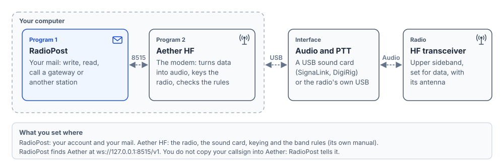

*Figure 2. Your station: what connects to what.*

- **An amateur radio licence.** Your post office checks it before it gives you an account.
- **An HF radio** that can send and receive upper sideband data, with its antenna.
- **An audio interface** between the radio and the computer: a SignaLink, a DigiRig, or the
  radio's own USB audio. It carries the sound both ways and keys the radio.
- **A computer** with Windows, macOS (Apple Silicon) or Linux.
- **Aether HF 0.2.0-beta.146 or later**, set up and working with your radio. Its
  [own manual](https://github.com/KK4ODA/aether-hf/blob/master/docs/manual/manual.md#part-1-getting-started)
  says how. Aether keys the radio, checks the band rules and sends your Morse identifier at the
  end of each session.
- **RadioPost**, the client ([next chapter](#4-installing-radiopost)).
- **The Internet, once**, to get your account and the list of gateways. After that, mail goes by
  radio.

> **Note.** Aether must key the radio **itself**. In Aether's Setup, step 2, choose CAT, serial,
> rigctld, FLRig, CM108 or VOX, not *Host*. Set to *Host*, Aether transmits only for the program
> that keys it, and RadioPost's calls never reach the air.

Aether listens on two ports. RadioPost uses only the first:

| Port | What it is | Who uses it |
|---|---|---|
| 8515 | Aether's control port | RadioPost, RadioPost Gateway, Aether's own window |
| 8300 (and 8301) | Aether's host programs port | Winlink Express, VarAC, RMS Trimode |

Leave both as they are. Never set the host programs port to 8515: Aether then stops at start.

## 4. Installing RadioPost

1. Open the project's [releases page](https://github.com/KK4ODA/RadioPost/releases). The newest
   release is at the top.
2. Under **Assets**, download the installer named **RadioPost** for your computer:
   - Windows: the file ending in `-setup.exe`.
   - macOS: the file ending in `.dmg`.
   - Linux: the `.deb` file (Debian, Ubuntu) or the `.AppImage` file (any other).
3. Run it. The installers are not signed yet, so your computer asks once:
   - Windows: SmartScreen says it protected your PC. Click **More info**, then **Run anyway**.
   - macOS: Control-click the app, then **Open**.
4. Open **RadioPost**. The first time, it opens on **Setup**: get your account next
   ([Getting an account](#5-getting-an-account)).

The same page has **RadioPost Gateway**, the program for running a gateway
([Part 3](#part-3-radiopost-gateway)), a tools archive with the command-line programs, and (after
0.1.0-beta.20) this manual as a PDF.

**Updates.** When a newer release is out, a line at the top of RadioPost's window says so. Click
**Update and restart**. RadioPost downloads it, checks that the project signed it, installs it
and opens again. On Linux with a `.deb`, it asks for your password, as installing a package does.

**Where RadioPost keeps your things.** In the folder `.radiopost` in your home folder. On
Windows that is `C:\Users\<you>\.radiopost`. It holds your key, your credential, your mail and
the log `radiopost.log`. Back it up as you would any mail.

> **Note.** Each computer needs its own enrollment. Do not copy the `.radiopost` folder to a
> second computer: two computers would then share one key.

## 5. Getting an account

You need an account at a post office before you can send mail. There are two ways to get one.
Both go over the Internet, and both end with a credential on this computer.

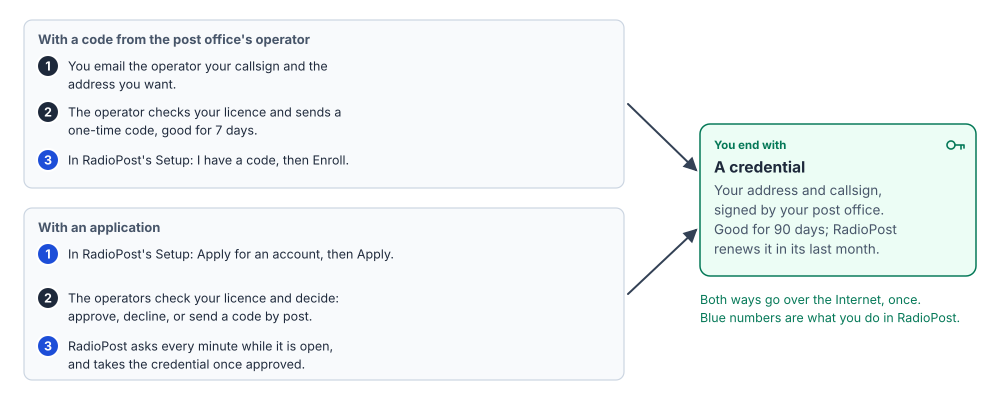

*Figure 3. Two ways to get an account.*

Ask your club whether it runs a post office. If not, use the project's, `radiopost.org`.

### 5.1 With a code from the operator

1. Email the post office's operator from the address your licence record holds. Give your
   callsign and the name you want before the `@`, such as `ana` for `ana@radiopost.org`. For
   `radiopost.org`, write to `postmaster@radiopost.org`.
2. The operator checks your licence and answers with a one-time **code**, such as `7Q4F-AZ9K`.
   It works once, for seven days.
3. Open RadioPost. On **Setup**, under *Enroll with your post office*, choose **I have a code**.
4. Fill in:
   - **Address**: the address you were given, such as `ana@radiopost.org`.
   - **Callsign**: your callsign as licensed, with no SSID (no `-1`).
   - **Code**: the code.
   - **Post office (if not in DNS)**: leave it empty, unless the operator gave you an address
     for it.
5. Click **Enroll**.


*Figure 4. Enrolling with a code.*

RadioPost makes this computer's key, finds the post office, and keeps the credential. The top of
the window now shows your address and callsign. Setup says *Enrolled as …* and when the
credential runs out.

### 5.2 By applying

Some post offices take applications from the client. You apply, the operators check your licence,
and RadioPost collects your credential once they approve.

1. On **Setup**, under *Enroll with your post office*, choose **Apply for an account**. Two
   more boxes appear.
2. Fill in:
   - **Address**: the address you want, in lowercase, such as `ana@radiopost.org`.
   - **Callsign**: your callsign as licensed, with no SSID.
   - **Name on your licence**: exactly as it is printed on the licence.
   - **Your email now**: an ordinary email address where the post office can write to you about
     the application.
   - **Post office (if not in DNS)**: leave it empty.
3. Click **Apply**.

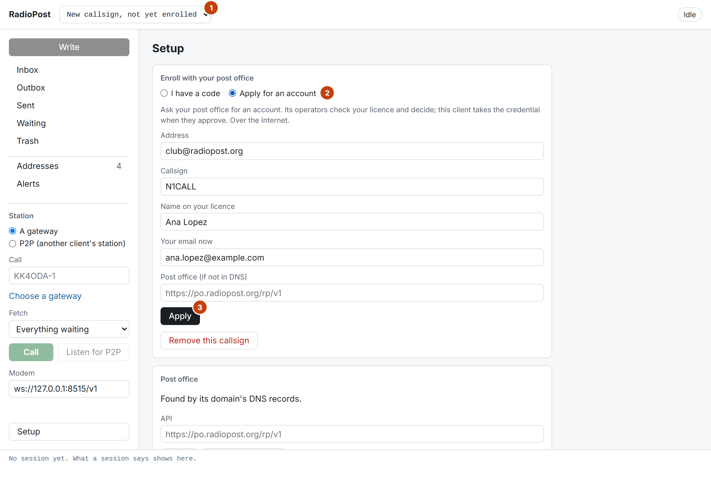

*Figure 5. Applying for an account. The marks show the list of callsigns (1), the choice (2) and
the Apply button (3).*

The form is replaced by *Applied for …*. Leave RadioPost open. It asks the post office every
minute, and takes the credential as soon as the operators approve. To ask at once, click
**Check now**.

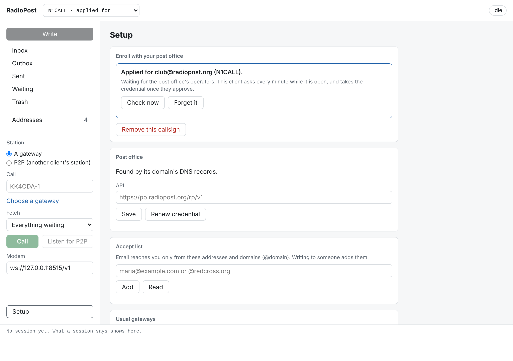

*Figure 6. An application waiting for the operators.*

What the operators can decide:

| RadioPost says | What it means | What to do |
|---|---|---|
| *Approved: … Welcome to RadioPost.* | Your account is ready. | Nothing. You can send mail. |
| *The application … was declined.* | The operators said no. Their reason is shown. | Fix what they asked for, and apply again. |
| *A code … is coming by post.* | They want proof of where you live. A card goes to the address on your licence. | When it comes, choose **I have a code** and enroll with it. |
| *The post office no longer knows the application* | Applications are kept 30 days. | Apply again. |

### 5.3 If the post office refuses

| RadioPost says | What it means | What to do |
|---|---|---|
| *it takes no applications, or not for that domain* | The post office is not taking applications now, or the address is at a domain it does not serve. | Check the part after `@`. Ask the operator for a code instead. |
| *that address is taken, or already asked for* | Someone has that address, or an application for it is waiting. | Choose another address. |
| *a field is not as it should be* | Usually an SSID on the callsign, capitals in the address, or an empty name. | Fix the field, then **Apply** again. |
| *… operates this post office, so nobody may apply with it* | That callsign runs the post office. Nobody becomes an operator by applying. | The operator makes a code for it instead ([New codes](#28-codes)). |
| *cannot reach …* | No Internet, or the post office is down. | Try again later. |

### 5.4 Your credential

Your credential lasts 90 days. In its last month RadioPost renews it by itself: over the Internet
while its window is open, or during a call to a gateway. The log at the bottom says when it did,
or why it could not. **Renew credential**, in Setup, renews it at once.

If it ever runs out, Setup says so in red. Ask your operator for a new code and click **Enroll
again with a new code**.

---

# Part 2. The RadioPost client

## 6. The RadioPost window

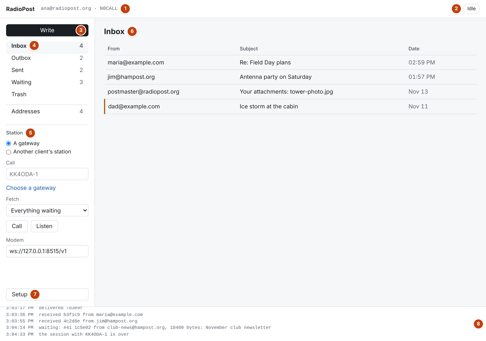

*Figure 7. The RadioPost window.*

1. **Who you are**: your address and callsign. With several callsigns, this is a list to choose
   from ([Working several callsigns](#11-working-several-callsigns)).
2. **What the station is doing**: *Idle*, *Calling …*, *Listening*, *In session with …* or
   *Renewing credential*. After a failed session it reads *Last session failed*: point at it to
   see why.
3. **Write**: a new message.
4. **The folders**, with how many messages each holds:
   - **Inbox**: messages received.
   - **Outbox**: messages waiting to go out on the next session.
   - **Sent**: messages another station has taken.
   - **Waiting**: what waited at your post office at your last call to a gateway.
   - **Trash**: messages you deleted.
   - **Addresses**: your address list.
5. **Station**: whom to call, on which channel, and the **Call** and **Listen for P2P** buttons.
   **Call** is the green one: it puts the station on the air. **Listen for P2P** answers one
   station-to-station call to your callsign, then stops. **Modem** is where RadioPost finds Aether,
   `ws://127.0.0.1:8515/v1`. Change it only if Aether's control port is not the usual one.
6. **The folder or message you are looking at.** Click a row to read it.
7. **Setup**: your account, post office, accept list, usual gateways and keys.
8. **The log**: what RadioPost did, line by line, with the time.

Every button and box has a tooltip: rest the mouse on it to read what it does.

## 7. Writing a message


*Figure 8. A message out, and the answer back.*

You write messages at any time. They wait in the outbox until a session carries them.

1. Click **Write**.
2. In **To**, type the address. Several addresses go with commas between them:
   `maria@example.com, Jim Ortega <jim@hampost.org>`. As you type, RadioPost offers addresses
   from your address list: use the arrow keys and **Enter**, or click one.
3. **Cc** takes copies the same way.
4. Type a **Subject** and the **Text**.
5. Leave **Priority** at *Routine*. *Emergency* is for emergency traffic only.
6. To attach a file, click **Attach**. Keep files small: every byte goes on the air. A file must
   fit on the air on its own (64 kB).
7. Click **Put in outbox**.


*Figure 9. Writing a message.*

RadioPost checks each address before it takes the message. If one is wrong, it says which, and
keeps what you wrote.

**Forms.** To send a form, such as an ICS-213 General Message, choose it under **Form**. Its fields
appear below. Fill in the ones marked with a star, and any others you need. The **Subject** is the
form's subject, and the date and time are the message's own. **Note** takes anything you add below
the form; it is usually empty.


*Figure 10. Writing a form.*

Only what you type goes on the air. The form's wording stays on each computer, so a form takes less
time than the same text typed out (about a fifth less for a short ICS-213). The station that
receives it shows the whole form. Someone reading it by email gets it as text, with the labels.

If a field is missing or too long, RadioPost says which, and keeps what you wrote. A form that
reaches a program without that form shows its values by field number.

**Who can write back.** Your post office lets email in only from addresses on your **accept
list**. Writing to someone adds them to it, so their answer gets through. You can add others in
Setup ([Accept list](#accept-list)).

**The outbox.** Messages wait there until a session carries them. A message a gateway took while
it could not reach the Internet carries a tag: *queued at* that gateway
([When the Internet is down](#14-when-the-internet-is-down)).

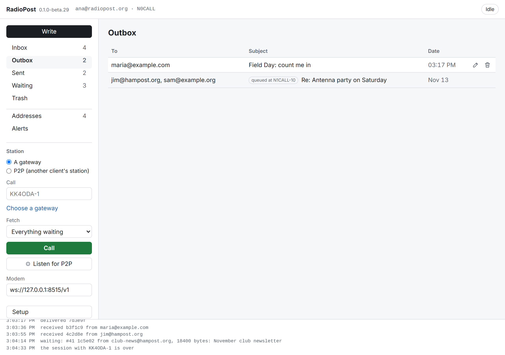

*Figure 11. The outbox.*

**Changing a message.** Until it leaves your computer, a message in the outbox can be changed, all
of it.

1. Point at its row and click the pencil, or open it and click **Edit**.
2. **Edit message** holds what you wrote: **To**, **Cc**, **Subject**, **Priority**, the text, and
   the form with its fields if it has one. Its files are listed, ticked: untick one to leave it
   out. **Attach** adds others.
3. Click **Save in outbox**. The changed message takes the old one's place in the outbox, and the
   old one is gone. **Cancel** leaves it as it was.

RadioPost does not change a message that has left, or may be leaving, and says why:

- a message tagged *queued at* a gateway: that gateway passes it on as it is;
- a message in **Sent**;
- any message while a session is under way, or while you **Listen for P2P**: it may be going out.
  Edit it when the session ends, or click **Stop** first.

To correct a message that has left, write a new one.

**Changed your mind?** The trash can at the end of a row moves the message to the **Trash**.
The note that follows has **Undo**.

## 8. Calling a gateway

A call to a gateway sends your outbox and fetches what waits for you, in one session.

### 8.1 Choose a gateway

1. Under **Station**, choose **A gateway**, then click **Choose a gateway**.
2. Click **Refresh over the Internet**. The list comes from your post office, and from the post
   offices it knows. RadioPost keeps it for when there is no Internet.
3. Type **Your grid**, your Maidenhead grid square such as `EM73`, and click **Save**. The
   nearest gateways move to the top, with their distance.
4. Each gateway shows its **Channels** (dial frequency, upper sideband, and the bandwidth Aether
   uses there) and its **Hours**. A channel marked *scanned* is one of several the gateway listens
   on in turn with one radio. Click **Choose** beside the one you want. Its callsign goes in
   **Call**, its channels in **Channel**, and the radio is tuned to the first channel at once
   ([8.2](#82-tune-and-call)).

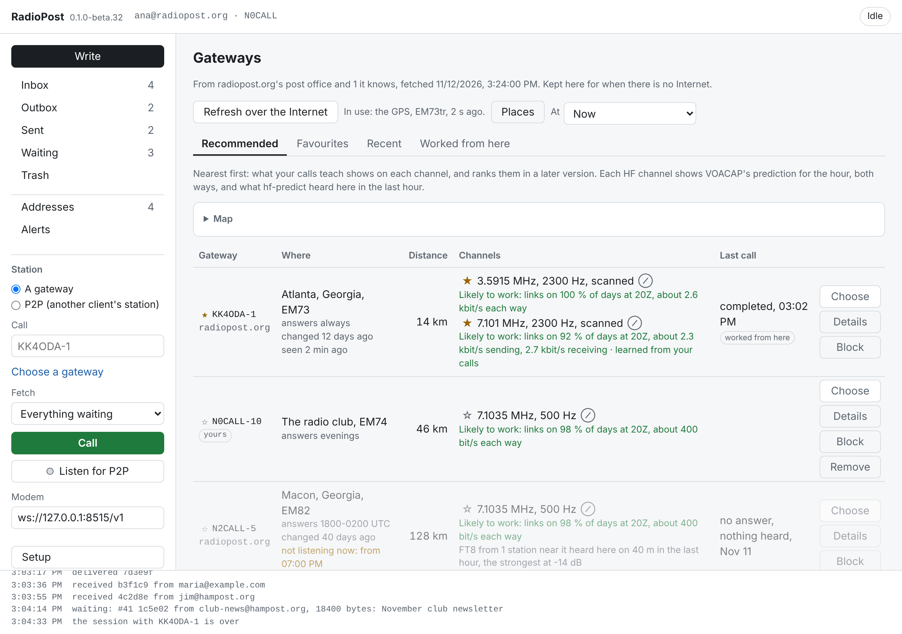

*Figure 12. Choosing a gateway.*

### 8.2 Tune and call

1. Pick the **Channel** to call on. RadioPost tunes the radio there at once, before you call, so
   you can set the radio and the antenna tuner for it. The line under it says what happened:
   - *✓ Tuned the radio to 7.101 MHz.* Aether set the radio's dial (it reaches the radio over
     CAT, rigctld or FLRig).
   - *Set the radio's dial to 7.101 MHz (USB) yourself: the modem cannot set it.* Aether keys
     this radio without CAT, so it cannot set the dial. Turn the radio to that dial yourself.
     Aether's own manual says how to let it set the dial: CAT keying in its
     [Setup step 2](https://github.com/KK4ODA/aether-hf/blob/master/docs/manual/manual.md#step-2-radio-interface).

   Set Aether's **Bandwidth** to the one listed there (500 or 2300 Hz) in its
   [Setup step 4](https://github.com/KK4ODA/aether-hf/blob/master/docs/manual/manual.md#step-4-modem-settings).
2. If your antenna needs a tuner for this channel, click **Tuner tone**. Aether keys ten seconds of
   steady carrier at its transmit level. Set the tuner while it sounds. Click **Stop tone** to stop
   it sooner. Aether keys no tone while it hears the channel in use.
3. Listen for a moment. Do not call over another station.
4. In RadioPost, set **Fetch**:
   - **Everything waiting**: all your mail comes.
   - **Up to 10 kB each** or **Up to 50 kB each**: only messages up to that size come. The rest
     wait for a later call.
   - **Only the list of what waits**: nothing comes but the list. Use it on a weak path.

   Messages of 1,000 bytes or less come anyway, whatever **Fetch** says.
5. Click **Call**. If the radio is not on the channel any more, RadioPost tunes it there first.
   After the session the radio stays on the channel: you chose it.

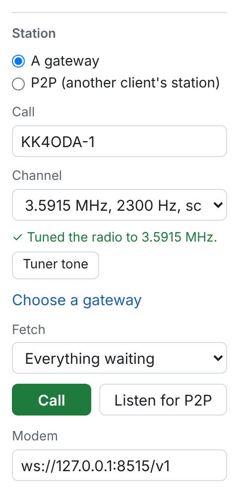

*Figure 13. The radio tuned to the channel picked.*

On a *scanned* channel the gateway may be on another channel when you call. RadioPost asks Aether
to keep calling as long as the gateway's record says it takes to come round, often a minute or
more. An Aether before 0.2.0-beta.162 cannot be asked: the log says the call may end before the
gateway comes round. Call again, or call on another of its channels.

### 8.3 During the session

The state at the top reads *Calling …*, then *In session with …*. A card at the bottom right
shows how far the mail has got:

- The **outer ring** is what you send. The **inner ring** is what comes in.
- The lines say how many messages are whole, the kilobytes, and about how long is left.
- The header shows the same as a small ring with the percentage.

A message counts as sent once Aether has put it on the air, not when RadioPost hands it over.

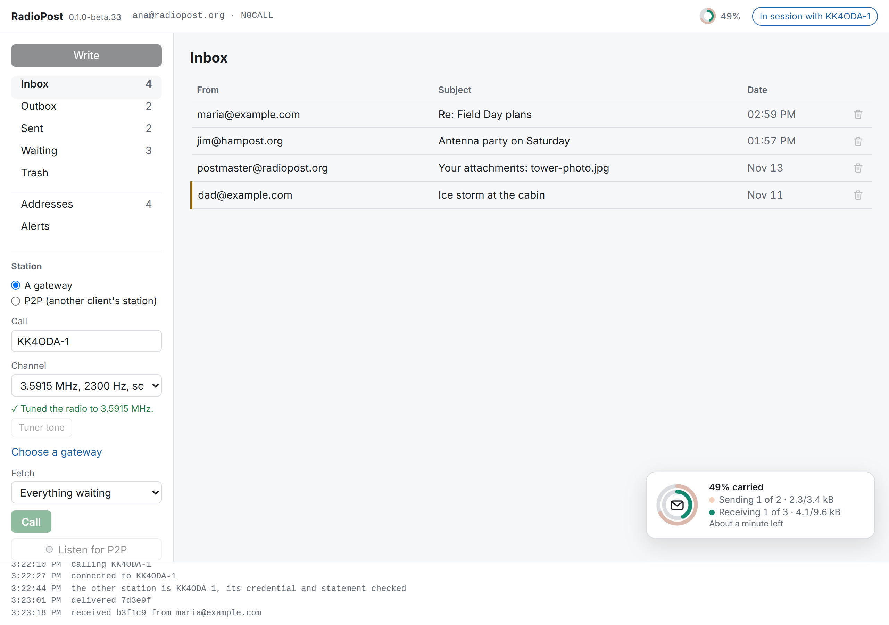

*Figure 14. A session under way.*

The log says what happens: the call, each message delivered or received, what waits, and the end.
A few short messages take a minute or two at 2300 Hz on a fair path, longer on a weak one. Your
email reaches the other end within a minute of the session, from your RadioPost address.

To stop a session, close the window. RadioPost asks first, because closing ends the session and
leaves the other station waiting. What did not cross is offered again on your next call.

## 9. Reading your mail

Click a message in the **Inbox** to read it.


*Figure 15. Reading a message.*

- **Reply** answers the sender. The other end's mail program keeps the thread. RadioPost does not
  quote the message you answer, because every byte goes on the air: it shows the original under
  your text, for you only.
- **Reply all** also copies everyone else it went to.
- **Forward** passes the message on, with its text and files. You can untick files you do not
  want to carry.
- **Delete** moves it to the Trash (or press the Delete key).
- **Edit**, on a message in the **Outbox**, changes it before it goes
  ([section 7](#7-writing-a-message)).
- **Add to addresses**, beside the sender, puts the sender on your address list.

**Attachments held at the post office.** A file too large for the radio does not come with its
message. Under it you see *held at the post office* and the button **Ask on the next call**.

1. Click **Ask on the next call**.
2. Call a gateway. It answers that your files are coming in a new message.
3. Call again. The files come in a message from `postmaster@` your post office.

**The Waiting folder** shows what waited at your post office at your last call to a gateway.
Tick a message to fetch it on the next call, whatever **Fetch** says. A message a cut-off gateway
kept for you has no tick box: it comes with what you fetch.


*Figure 16. Choosing what to fetch next.*

## 10. Station to station

Two RadioPost stations can send mail to each other directly by radio. No gateway, no post office
and no Internet are needed during the session. Each station proves who it is with its
credential.


*Figure 17. Station to station.*

Agree on a frequency and a bandwidth first.

**The station that answers:**

1. Tune the radio to the frequency, and set Aether's bandwidth. At 2300 Hz Aether also answers a
   call at 500 Hz.
2. Click **Listen for P2P**. The state reads *Listening*. RadioPost answers one P2P call, to the
   callsign at the top of the window or to any other of yours, then stops. Rest the mouse on the
   button to see the callsigns it answers as.
3. To stop waiting, click **Stop**.

**The station that calls:**

1. Under **Station**, choose **P2P (another client's station)**.
2. In **Call**, type the other station's callsign.
3. In **Dial, MHz**, type the frequency you agreed, such as `7.103`. RadioPost tunes the radio
   there at once, or says which dial to set yourself, as in [8.2](#82-tune-and-call).
   **Tuner tone** keys ten seconds of carrier for your antenna tuner.
4. Choose the **Bandwidth** you agreed: **2300 Hz** or **500 Hz**. For the call, Aether moves the
   whole station to it, and back after.
5. Click **Call**.


*Figure 18. A station call on a radio whose dial Aether cannot set.*

Mail addressed to the other station's address crosses. Each side keeps a record of the session.
When you next have the Internet, a line under the Station box says how many sessions wait to be
reported: click **Send reports**. Your post office then marks your sent mail as delivered.

**A station that also runs a gateway.** RadioPost Gateway holds the gateway's own callsign, such
as `KK4ODA-1`. A station call to that callsign reaches the gateway, not its operator, and
RadioPost hangs up and says *KK4ODA-1 is a gateway: for P2P, call the other operator's own
callsign while their client listens*. To work that operator station to station, call their own
callsign (`KK4ODA`). Their RadioPost client must be listening (**Listen for P2P**) under it, beside the
gateway on the same Aether. The gateway need not close: Aether serves both programs, each for its
own callsigns.

### 10.1 Alerts

An alert tells another station, or a group of stations, that you need them now. It is one line
of text, such as *Please call me on 146.52 now*. At the other station it sounds an alarm and
brings RadioPost's window to the front until the operator answers it.

An alert needs no call and no session. Aether sends it once, to everyone listening, as a short
broadcast: about 16 seconds on the air, and 11 for each answer. It gets through on a path too weak
for a session, and it can reach a whole group at once.

Only stations that share a **keyword** can alert each other. Stations that typed the same keyword
make a **circle**: a family, a net, a team. Every alert carries a short check that only that
keyword can make, so RadioPost sounds only for alerts from your circles. Anyone listening can
still read every alert: nothing is encrypted.

You need:

- Aether as your modem. VARA, ARDOP, Mercury and packet carry no alerts.
- RadioPost open. Alerts arrive only while its window is open (or `radiopost panel` runs).
- A clock right to a few minutes. An alert more than ten minutes from your clock is not taken.

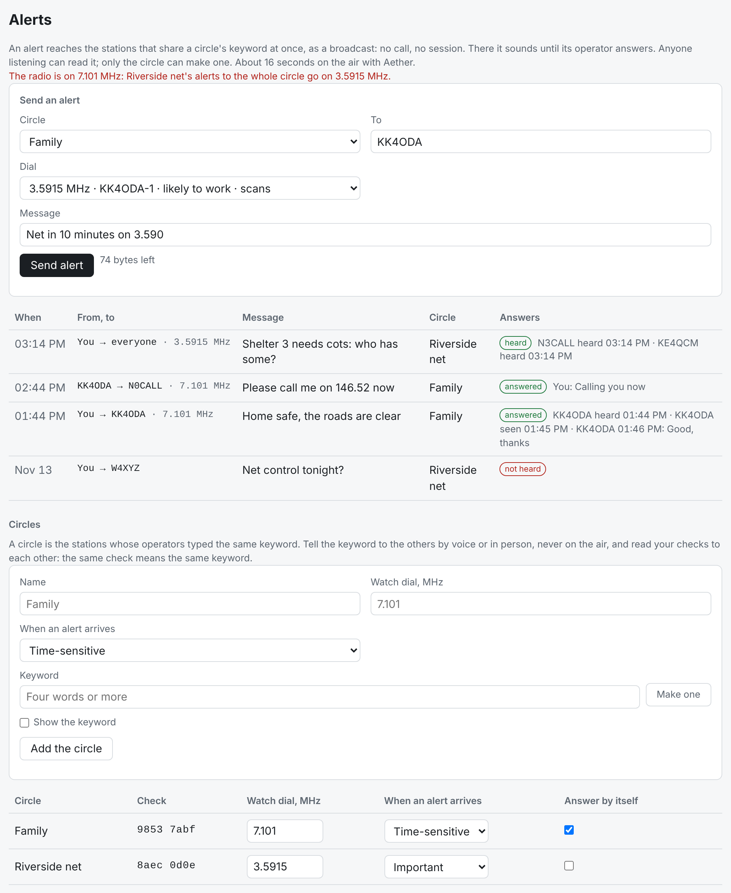

*Figure 19. Alerts.*

### 10.2 Set up a circle

Agree on a keyword with the others first, by voice or in person, never on the air. Four words or
more. RadioPost can make one for you.

1. Click **Alerts** in the left-hand column.
2. Under **Circles**, type a **Name** for it, such as `Family`. The others may name it otherwise.
3. Type the **Keyword**, or click **Make one** and tell the others the words it shows. Capitals and
   extra spaces do not count.
4. Choose **When an alert arrives**: **Time-sensitive** sounds the alarm. The others are quieter
   (see [Sounds and notifications](#sounds-and-notifications)).
5. Click **Add the circle**.
6. Read the circle's **Check**, such as `9853 7abf`, to the others. The same check at every station
   means the same keyword. A different check means a typing mistake: forget it and add it again.

RadioPost keeps the circle's key, not the keyword. Short keywords can be guessed from one alert
heard on the air, so RadioPost refuses one under 8 characters and warns under four words.

**Answer by itself**, ticked, sends *heard* as soon as an alert for you arrives, even when nobody
is at the radio. That is an automatic transmission: untick it where your rules allow those only in
some segments ([section 36](#36-the-rules)). The trash can forgets a circle.

### 10.3 Send an alert

1. Under **Send an alert**, choose the **Circle**.
2. In **To**, type the callsign of the station to alert. Leave it empty to alert everyone in the
   circle.
3. Type the **Message**: one line, up to 100 bytes. Plain words: anyone can read it.
4. Click **Send alert**. While it goes out the state reads *Sending an alert*; a call cannot start
   meanwhile.

The list shows what each alert became:

- *on the air*, then *heard* when the other station's RadioPost has it, *seen* when its operator
  has answered the alarm, and *answered* with their line;
- *not heard* when no *heard* came: RadioPost sent it a second time after a minute, then gave up;
- *not sent* when it could not go out, with the reason: the station was busy with a session for
  five minutes, or the modem carries no alerts.

### 10.4 When an alert arrives

For a time-sensitive circle, an alarm sounds every 20 seconds, RadioPost's window comes to the
front, and a red box shows the alert.

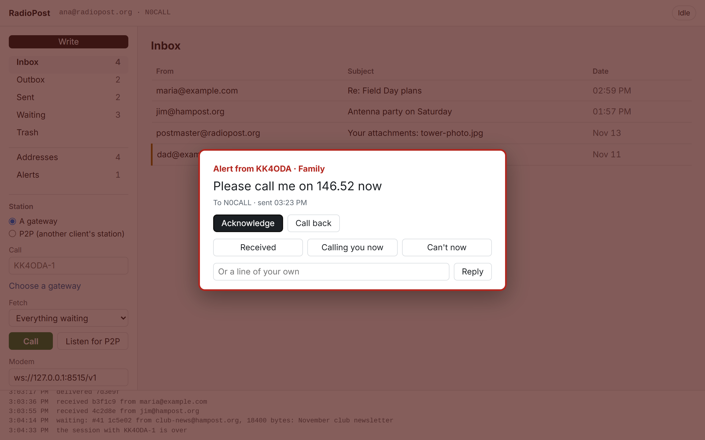

*Figure 20. An alert arriving.*

- **Acknowledge** stops the alarm. The other station sees *seen*.
- **Received**, **Calling you now** and **Can't now** answer with that line, and stop the alarm.
- Type a line of your own and click **Reply** to answer with it.
- **Call back** stops the alarm and puts the sender's callsign in **Call**, as a P2P call. Check
  the **Dial, MHz** and click **Call** ([section 10](#10-station-to-station)).

If several alerts wait, the oldest shows first. An alert from a circle at another level shows as
a banner instead, with its own sound. If one callsign sends more than five alerts in ten minutes,
the rest are shown quietly.

## 11. Working several callsigns

One RadioPost can work several callsigns, such as your own and a club callsign. Each callsign has
its own account, its own address and its own mail.


*Figure 21. Several callsigns on one computer.*

### 11.1 Add a callsign

Before you start:

- RadioPost must already work with your first callsign.
- You need RadioPost 0.1.0-beta.13 or later. If Setup has no **Add another callsign** button,
  update first.
- The computer must be on the Internet.
- Choose the new address, such as `club@radiopost.org`. Use lowercase letters, digits, dots,
  dashes or underscores before the `@`.
- Have ready the callsign exactly as licensed (no SSID), the name on that licence, and an email
  address where the post office can reach you now.

Steps:

1. Make sure the state at the top says **Idle**.
2. Click **Setup**.
3. Click **Add another callsign**, at the bottom of the first box. RadioPost switches to the new
   callsign. The list at the top reads *New callsign, not yet enrolled*.
4. If the post office's operator gave you a code for it, choose **I have a code** and enroll as
   in [section 5.1](#51-with-a-code-from-the-operator). Otherwise choose **Apply for an
   account** and apply as in [section 5.2](#52-by-applying) (Figure 5 shows this case).
5. Leave RadioPost open, with the new callsign chosen, until it says *Approved*. It only checks
   the application while that callsign is chosen.

### 11.2 Use it

- **Choose a callsign before each session**, from the list at the top of the window. A call goes
  out as the callsign shown there. **Listen for P2P** answers calls to any of your callsigns. A call
  to another than the one shown is carried by that callsign: its mail goes to that callsign's
  folders, and the log says *answering as …*.
- You can change it only while the station is idle.
- Each callsign has its own folders. The address list and the log are shared.
- Every credential renews while RadioPost is open, chosen or not.

### 11.3 Take one off

Choose it at the top, open **Setup**, and click **Remove this callsign**, then click again to
confirm. This only works once its folders and trash are empty. Its credential stays valid at the
post office until it runs out or is revoked. Your first callsign cannot be removed: the others
are kept inside its folder.

> **Note: if you run the post office yourself.** You approve the application from your own
> callsign:
>
> 1. In the list at the top, choose your own callsign. The **Post office** button appears.
> 2. Open **Post office**, then **Applications**, and click **Approve**. Tick **Role mailbox**
>    first if several licensed operators will share it, as with a club callsign.
> 3. Choose the new callsign again, open **Setup** and click **Check now**.
>
> If the application was refused with *it takes no applications*, turn applications on first:
> **Post office**, **Settings**, tick **Take applications for accounts**. It saves at once.
> Or skip the application: make a **New code** on the desk, and enroll the new callsign with it.

## 12. Setup, box by box

Click **Setup** at the bottom of the left-hand column.

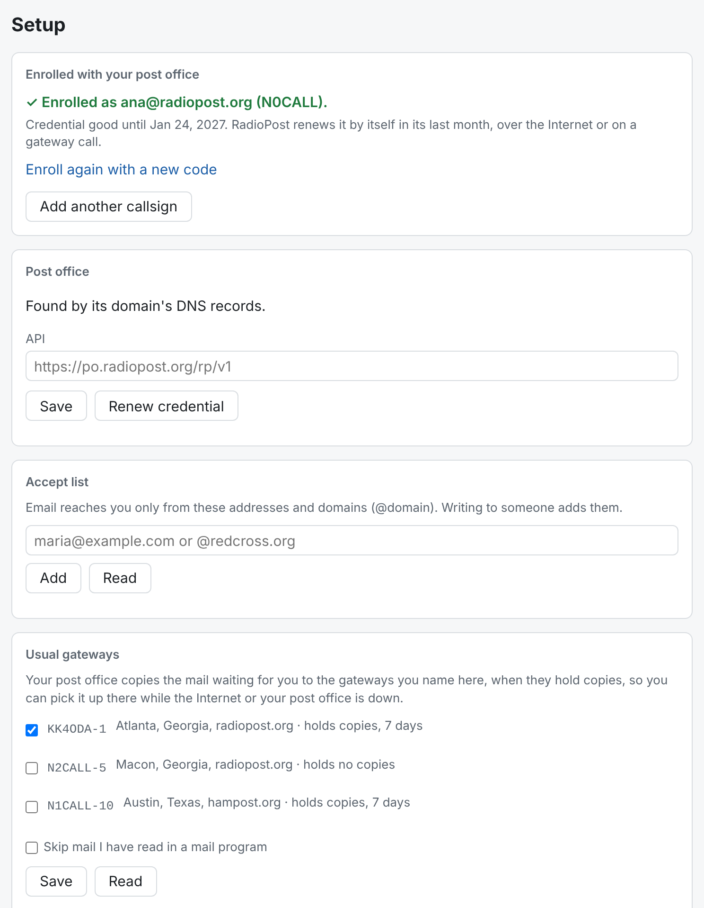

*Figure 22. Setup.*

### Enroll with your post office

Says whom this computer is enrolled as, and until when. **Enroll again with a new code** is for a
credential that ran out or was revoked. **Add another callsign** and **Remove this callsign** are
here too ([section 11](#11-working-several-callsigns)).

### Post office

Says how RadioPost reaches your post office: *Found by its domain's DNS records* is normal.
**API** is only for a post office whose records are not published yet: type the address its
operator gave you and click **Save**. **Renew credential** renews at once.

### Accept list

Email reaches you only from the addresses and domains listed here. Writing to someone adds them.
To let a whole organisation write to you, add its domain with an `@` in front, such as
`@redcross.org`. Click **Add**. **Read** fetches the list from your post office. **Remove**
takes one off.

### Usual gateways

The gateways you name here get a copy of your waiting mail ahead of time, so you can pick it up
there while the Internet or your post office is down
([section 14](#14-when-the-internet-is-down)).

1. Tick the gateways you call most. Each one says whether it *holds copies*.
2. Tick **Skip mail I have read in a mail program** if you also read your mail on the Internet:
   mail you already read there is not offered by radio.
3. Click **Save**. Your post office keeps the setting. **Read** fetches it again.

The list needs the Internet and a gateway list ([section 8.1](#81-choose-a-gateway)).

### Sounds and notifications

RadioPost plays a sound when something happens, and tells you about new mail by its sender.


*Figure 23. Sounds and notifications.*

**Mind the radio's sound card.** If this computer's sound goes to the radio's sound card (a
SignaLink, or the radio's own USB audio), these sounds go on the air, and with VOX they key the
radio. Choose your speakers in **Play them on**, or untick **Play sounds**.

- **Play sounds** turns every sound on or off.
- **Play them on** chooses the speakers. If the list shows no names, click **Name the devices**:
  the window opens the microphone for a moment to read them. Where the window cannot choose,
  sounds play on the system's default output.
- **Volume** sets every sound's loudness.
- The table gives each event its sound. **Play** plays it.
- **Quiet hours**: tick **From** and set the times. Then only time-sensitive alerts and mail
  sound; the rest is shown quietly.
- **Mail from anyone else** says how mail arrives from an address with no level of its own.
- **Notify me when this window is in the background** also shows the system's notification.

Every arrival has one of four **levels**:

| Level | What happens |
|---|---|
| **Silent** | Counted in its folder. No sound. |
| **Normal** | A soft sound and a note at the bottom right. |
| **Important** | Its own sound, and a banner at the top until you open it or dismiss it. |
| **Time-sensitive** | An alarm every 20 seconds until you answer it, through quiet hours too. |

A circle has its level ([section 10.2](#102-set-up-a-circle)). Mail takes its sender's level, set
in Addresses ([section 13](#13-addresses-and-the-trash)). Emergency mail arrives at least as
Important. Only an address or a group you set can reach Time-sensitive: anyone can choose
Emergency.

### This device's key, Credential, Post offices trusted

These three boxes are for tests and special cases. You do not need them with a normal account:
enrolling fills them in.

- **This device's key** is this computer's public key. A test post office may ask for it.
- **Credential** takes a credential issued by hand, pasted in hexadecimal.
- **Post offices trusted** lists the post offices whose keys RadioPost trusts. A test post
  office's operator may give you a domain and key to add.

## 13. Addresses and the Trash

**Addresses** is your address list. Everyone you write to is added, with the name you typed
before the address. To and Cc offer it as you type.

- **Find** shows the entries that match.
- Type `Name <address>` in the box and click **Add** to add one by hand.
- Click a row, or its pencil, to write to it. The trash can takes it off the list (with
  **Undo**).
- **Import contacts…** reads a contact file: a vCard (`.vcf`) from a phone, Google Contacts,
  Outlook or Apple Contacts, or a CSV export from Google, Outlook or Thunderbird. Its addresses
  join the list with their names. An address already on the list keeps its name. The file's
  groups, labels or categories become groups. RadioPost says what it added and what it left out.

**Groups** put several addresses under one name, for a net or a shelter team:

1. Under **Groups**, type the group's name, then its addresses with commas between them. The
   address list is offered as you type.
2. Click **Save**.
3. To write to it, type its name in **To** and pick it, or click its row or its pencil. Every
   address in it goes in To.

The people button changes a group; the trash can takes it away (with **Undo**), and its addresses
stay on the list. Every address in a group goes on the air, so a large group makes a long
header.

**Notify** says how mail from an address, or from anyone in a group, arrives: **Silent**,
**Normal**, **Important** or **Time-sensitive** ([Sounds and
notifications](#sounds-and-notifications)). **Default** follows Setup. An address in several
groups takes the highest of their levels, and its own if it has one.

The address list and the groups are this computer's own. Who may email you is the accept list,
in Setup.

**Trash** holds what you deleted, and says which folder each message came from.

- **Restore** puts a message back where it was.
- **Delete forever** removes it for good: click twice.
- **Empty trash** deletes everything in it for good.

Deleting is on this computer only. Your post office, gateways and other stations keep what they
hold.

## 14. When the Internet is down

RadioPost keeps working when the Internet fails at a gateway.

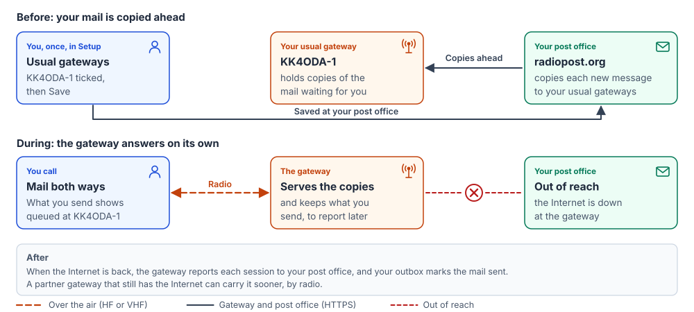

*Figure 24. When the Internet is down.*

**Before.** Name your usual gateways in Setup ([section 12](#usual-gateways)). Your post office
then copies each new message for you to them as it arrives.

**During.** Call a gateway as usual. If it cannot reach your post office, the log says so in a
notice. The gateway:

- hands you the copies it holds for you;
- keeps what you send, to pass on later;
- hands you mail from its other users at once, if it holds copies for you.

Messages you send through it stay in your outbox, tagged *queued at* that gateway. RadioPost
offers them again on later calls to other gateways, until one that reaches the Internet confirms
them. They are not offered to the same gateway while it was cut off at your last call.

**After.** When the gateway's Internet is back, it reports your session to your post office. Your
next call marks those messages sent.

> **Note.** A message queued for 30 days with no confirmation is tagged *may have been dropped*,
> in red. RadioPost still offers it on each call.

Held attachments cannot be asked for while the gateway is cut off.

## 15. If you run a post office

If your callsign is one of a post office's operators, RadioPost shows a **Post office** button in
the left-hand column. It opens the post office desk: applications, accounts, codes, the server's
health, its jobs, its backups and its settings. [Part 4](#part-4-the-post-office-desk) covers it,
tab by tab.

---

# Part 3. RadioPost Gateway

## 16. What a gateway does

A gateway is a station other amateurs call to send and fetch their mail. It answers each call,
checks who is calling, and passes the session to the caller's post office over the Internet. Any
licensed operator can run one.


*Figure 25. A gateway station.*

A gateway is usually left answering with nobody at the radio. It is then under **automatic
control**, and the rules for that apply ([The rules](#36-the-rules)).

When the Internet is down, a gateway keeps answering. It can hold copies of its users' mail, keep
what they send, and pass it to a partner gateway by radio
([section 21](#21-when-the-internet-is-down-at-the-gateway)).

## 17. Before you set up a gateway

The gateway's computer needs:

- **An HF radio and Aether HF 0.2.0-beta.146 or later**, working with the radio.
- **Aether keying the radio itself** (Aether's Setup, step 2: CAT, serial, rigctld, FLRig, CM108
  or VOX, not *Host*). If the same computer runs RMS Trimode with Aether set to *Host*, close
  Trimode and change Aether's keying. An Aether profile for each makes the switch one click.
- **Aether's ports as they are** (8515 for RadioPost; [section 3](#3-what-you-need)).
- **An Internet connection.** The gateway only connects out, so a home router needs no change.
- **RadioPost**, the client, on the same computer, **enrolled as you** with your own code. The
  gateway registers in your name through it. You can keep using RadioPost on another computer
  too, with its own code.
- **RadioPost Gateway**, from the [releases page](https://github.com/KK4ODA/RadioPost/releases):
  the installer named **RadioPost Gateway** for your computer.

You do not copy the gateway's callsign into Aether. While RadioPost Gateway runs, it tells Aether
which callsign to answer, and Aether's Setup shows it greyed, such as *KK4ODA-1 · RadioPost
Gateway*. When the gateway stops, Aether's own callsign comes back.

## 18. Setting up the gateway

Open RadioPost Gateway. Until it is set up and registered, it says what is missing.


*Figure 26. RadioPost Gateway before setup.*

Click **Set up the gateway**. Setup has three steps.

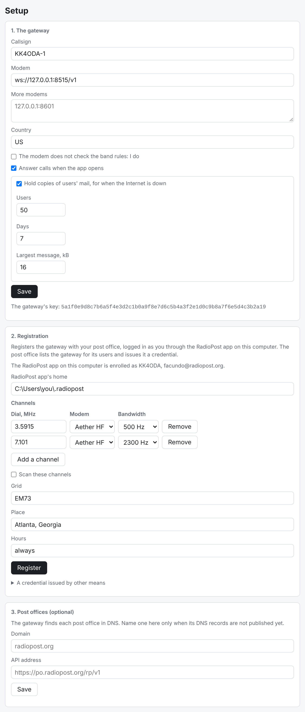

*Figure 27. Setting up the gateway.*

### Step 1. The gateway

1. **Callsign**: yours with an SSID, such as `KK4ODA-1`. Callers call this.
2. **Modem**: leave `ws://127.0.0.1:8515/v1`, where Aether listens on the same computer.
3. **More modems**: leave it empty, unless the gateway is to answer on other modems too (see
   *More than one modem* below).
4. **Country**: where the gateway operates, in two letters, such as `US`. It decides which
   third-party mail the gateway may hand over.
5. Leave **The modem does not check the band rules: I do** clear. Aether checks them.
6. Keep **Answer calls when the app opens** ticked for a gateway left on its own.
7. Tick **Hold copies of users' mail, for when the Internet is down** if the computer has room to
   spare. Set how many **Users**, how many **Days** a copy is kept, and the **Largest message**
   kept with its text.
8. Click **Save**. The gateway makes its key, shown under the form.

If you change the copies setting later, register again (step 2) so your post office knows.

#### More than one modem

A gateway can answer on several modems: Aether and Mercury on one radio, or Aether on HF and
packet on VHF. Each modem other than Aether runs with its adapter, a small program in RadioPost's
tools (`radiopost-mercury`, `radiopost-vara`). Put each adapter's address in **More modems**, one a
line, such as `127.0.0.1:8601`.

* The gateway carries **one session at a time**. While it carries one, the other modems do not
  answer. A call another modem answered just before is ended.
* Calls to partners ([section 22](#22-partners-forwarding-by-radio)) go on the first modem.
* On one radio, the modems must share its keying, through rigctld or FLRig: only one program can
  hold a radio's CAT port.
* In step 2, add a channel for each modem, with its **Modem**.

### Step 2. Registration

The form shows the account the RadioPost client on this computer is enrolled as.

1. **RadioPost app's home**: the folder where the client keeps its key and credential. Leave it.
2. Under **Channels**, add each dial frequency where callers will find the gateway, in MHz, upper
   sideband, with the **Modem** callers use there and its **Bandwidth** (for Aether, 500 or
   2300 Hz). On an FM radio the frequency is the channel's, and the bandwidth the channel's width.
   **Add a channel** adds a row.
3. Tick **Scan these channels** to listen on all of them with one radio. Aether moves the radio
   over them, a while on each, the first being home. It never leaves a channel while a call is
   arriving or a session is up. This needs Aether 0.2.0-beta.162 or later, a radio Aether can tune
   (CAT, rigctld or FLRig), and two to four channels, all for the first modem. The gateway's
   record then says how long a caller's call must keep trying to find it; the gateway adds that,
   registering again from this computer, the first time it scans.
4. **Grid** and **Place** help callers choose a gateway near them. **Hours** says when it answers:
   `always`, or in words such as `1800-0200 UTC`.
5. Click **Register**.

List only channels the gateway listens on: the ones it scans, or the one its radio sits on. A
caller on any other channel is never answered.

Your post office lists the gateway for its users and gives it a credential for 90 days. The
gateway renews it by itself in its last month, while it answers. If renewing keeps failing, the
log says why, and the **Registration** box turns red two weeks before it runs out: register again
the same way.

A post office's operator can also issue the gateway's credential by other means. Paste it under
**A credential issued by other means** and click **Keep credential**.

### Step 3. Post offices (optional)

The gateway finds each user's post office on the Internet by itself. Name one here only while its
records are not published yet: its **Domain** and its **API address** (`https://…/rp/v1`).

## 19. Running the gateway

Click **Start**, at the top. The gateway claims its callsign at Aether and listens.


*Figure 28. The RadioPost Gateway window.*

1. **The gateway's callsign**, and the account it is registered under.
2. **What it is doing** (the table below).
3. **Start** and **Stop**.
4. **Setup**. Settings change only while the gateway is stopped.
5. **Modem**: where it reaches Aether and any more modems, and since when it listens. A gateway
   that scans adds *Scanning 3 channels, on 7.101 MHz: a call must keep trying 40 s*, or why it is
   not scanning.
6. **Post offices**: whether each post office let the gateway log in at the last check. It checks
   every ten minutes while it answers. **Check now** checks at once.
7. **Registration**: the gateway's credential and when it runs out (red two weeks ahead).
8. **Held**: copies placed ahead and sessions waiting to be reported
   ([section 21](#21-when-the-internet-is-down-at-the-gateway)).
9. **Refused**: callers you refuse ([section 20](#20-refusing-a-caller)).
10. **Partners**: gateways this one forwards to by radio
    ([section 22](#22-partners-forwarding-by-radio)).
11. **Sessions**: each session carried, newest first: who called, the account, how long, the
    messages sent and picked up, and how it ended.
12. **The log**: what the gateway does, with the time.

| The badge says | Means |
|---|---|
| Stopped | Not answering. |
| Waiting for the modem | Aether is not running, is restarting (saving Aether's Setup restarts it), or cannot be reached. The gateway tries every five seconds. |
| Listening | It holds its callsign at Aether and answers calls. |
| Not answering here | The modem does not check the band rules, and the radio is outside the segments where an unattended station may answer. The gateway answers again once the radio is back in one. With Aether's rules on, you do not see this. |
| Session | A user's session is under way. |

While a session runs, a box shows who called, the account, since when, and the messages so far.

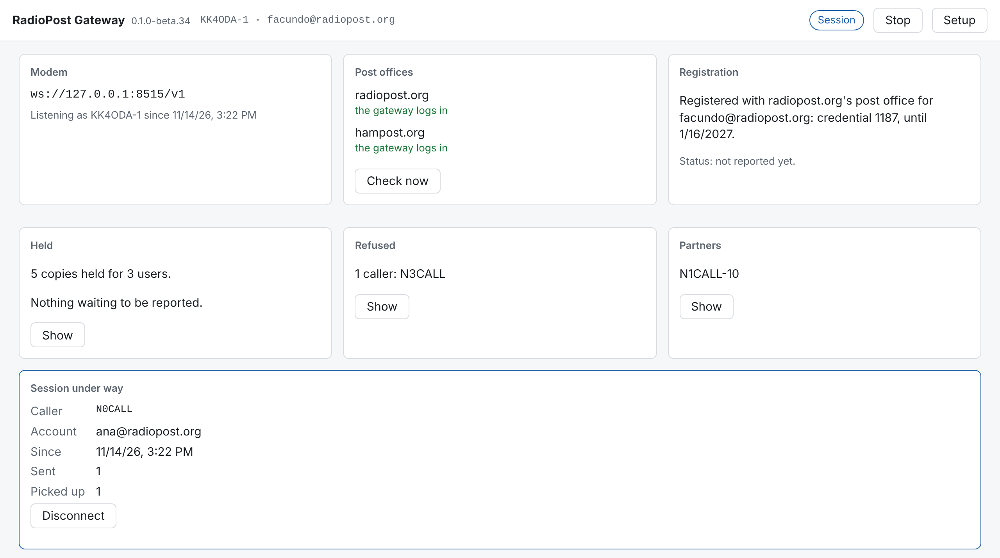

*Figure 29. A session at the gateway.*

**Stopping and closing.** **Stop** ends a session under way and lets Aether go. Closing the
window stops the gateway too. If it is answering, it asks first and says what closing stops.

**Left on its own.** With **Answer calls when the app opens** ticked, the gateway answers as soon
as it opens. To open it when you sign in:

- Windows: put a shortcut to RadioPost Gateway in the Startup folder (press Win+R, type
  `shell:startup`).
- macOS: add it to **Login Items** (System Settings, General).
- Linux: add it to your desktop's startup applications.

**Arranging the windows.** RadioPost Gateway, the RadioPost client and Aether each open where you
left them. One layout for one screen: the gateway on the left, full height; Aether in **Compact**
at the top right; the RadioPost client under Aether.

**Updates.** A line at the top says when a newer release is out (it checks when it opens and every
six hours). **Update and restart** stops the gateway, installs the update and starts it again,
answering as before.

### When a scan stops

If you tune the radio yourself, in Aether, at the radio or with **Stop** on Aether's scan line, the
scan stops and the radio stays where you put it. Aether also ends a scan when fewer than two of its
channels are left that the radio will take. The gateway says so in its log and on **Modem**, and
does not start the scan again by itself: you moved the radio for a reason. Click **Stop** and
**Start** to scan again. A call to a partner ([section 22](#22-partners-forwarding-by-radio))
stops the scan for the call and starts it again after.

When a scan ends, the gateway registers again with the one channel the radio stays on, so your
post office stops offering callers the others and a call that waits for a scan. Its log says
*listening on 7.101 MHz only, until the scan runs again*, then *registered again*. When the scan
runs again, it registers all its channels again. If the radio is on none of them, the log asks
you to register the gateway with the channel it listens on.

## 20. Refusing a caller

Refuse a station that misuses the gateway, such as one sending mail the rules do not allow on the
air. The operator who learns of it must stop it.

1. In the **Refused** box, click **Show**.
2. In the first box, type the caller:
   - an address, such as `ana@example.org`, refuses that account;
   - a callsign without an SSID, such as `N3CALL`, refuses every SSID of it;
   - a callsign with an SSID, such as `N3CALL-5`, refuses that station only.
3. In the second box, write why, for yourself. The caller never sees it.
4. Click **Refuse**.

It applies from the caller's next call, whether the gateway is answering or not. The caller is
told only that this gateway's operator does not carry its sessions. The Sessions list shows such
a call as *refused*. **Carry again** takes a caller off the list.

## 21. When the Internet is down at the gateway

**Copies placed ahead.** With **Hold copies** ticked (Setup, step 1) and the gateway registered,
the post offices of users who name this gateway as usual copy their waiting mail here as it
arrives. A message up to the size you set is kept with its text; a larger one is only listed. A
copy goes when its user picks the message up, here or anywhere, or after the days you set.

**A session while cut off.** When a caller's post office cannot be reached, the gateway answers on
its own and tells the caller so:

- it checks the caller itself, with the post office's keys and list of revoked credentials, which
  it keeps while online. A caller from a post office it never reached is refused;
- it hands the caller the copies it holds for them;
- it keeps what the caller sends, written to disk before it tells the caller it has it;
- mail between two of its own users is handed over at once, at the other's next call.

**When the Internet is back,** the gateway reports each session to the caller's post office,
oldest first. It tries every minute. A session refused by the post office is dropped, and the log
says why. One not reported in 30 days is dropped too.

The **Held** box shows it all. **Show** lists each copy (whose, from whom, until when, never the
text), each session waiting to be reported with its last try, and the last reports.

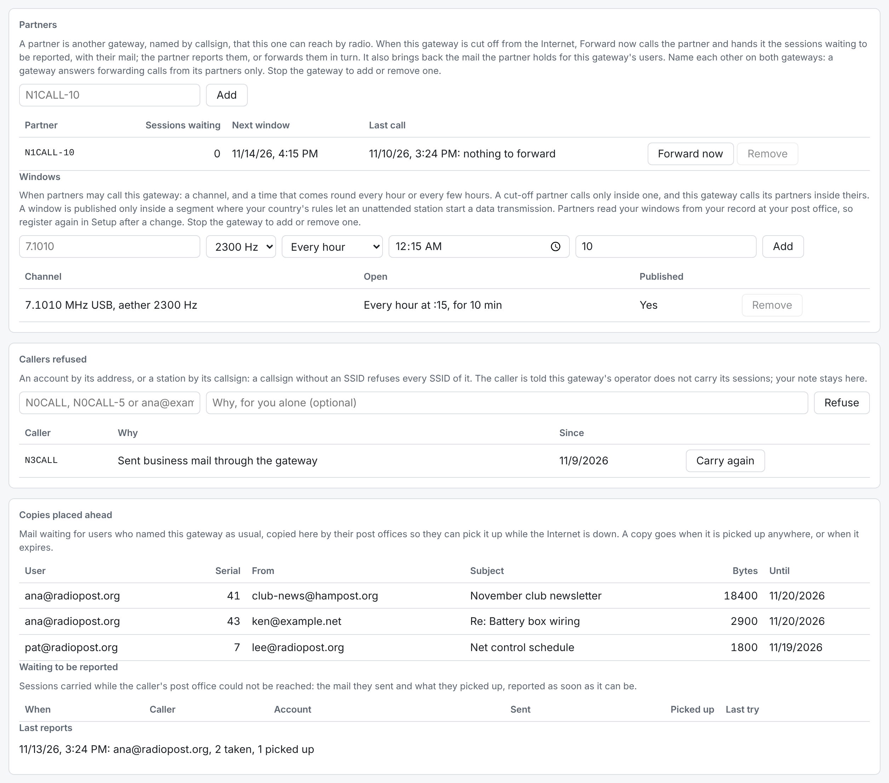

*Figure 30. What the gateway holds, its partners and the callers it refuses.*

## 22. Partners: forwarding by radio

A partner is another gateway, named by its callsign, that this one can reach by radio. While this
gateway is cut off, it can hand its waiting sessions to a partner that still has the Internet, so
the mail does not wait for the Internet to come back here.

1. **Stop** the gateway: partners change only while it is stopped.
2. In the **Partners** box, click **Show**, type the other gateway's callsign and click **Add**.
3. Ask the other gateway's operator to do the same with yours. A gateway answers forwarding calls
   from its partners only.
4. **Start** the gateway again.

While the gateway answers, **Forward now** beside a partner calls it between sessions and hands it
every session waiting to be reported. Both gateways must be on the same channel. The partner
reports them to the post offices, or forwards them on if it is cut off too. In the same call the
partner hands back mail its post office gave it for this gateway's users.

**Windows** are the times a gateway listens for its partners' calls: a channel, and a time that
comes round every hour or every few hours. To set this gateway's own:

1. **Stop** the gateway, and open the **Partners** view.
2. Under **Windows**, type the dial in MHz (upper sideband), choose Aether's bandwidth, how often
   the window opens, when (UTC; for every hour only the minutes count), and for how many minutes.
3. Click **Add**. A window is refused when Aether's signal on it would not lie inside a segment
   where the rules let an unattended station start a data transmission; the message says why.
   On 40 m, dials from 7.0998 to 7.1022 MHz fit at 2300 Hz.
4. **Register again** in Setup: partners read your windows from your record at your post office.

While it is cut off, the gateway calls each partner by itself during that partner's windows. It
tries once, then twice more a minute apart if nobody answers, then waits for the next window. It
never calls while Aether says the channel is busy. When Aether can set the radio's dial, the
gateway tunes the radio to the partner's window and back after the call, and says so in the log.
Otherwise the partner's window must be on the channel your radio is on. The **Next window** column shows when each
partner's next window opens (*None published* until the gateway has read the partner's record).
If one partner reached the Internet at its last call and opens a window within the hour, the
gateway keeps its sessions for that partner, and calls the others only to collect its users'
mail.

On the command line ([section 23](#23-a-gateway-with-no-screen)): `radiopost-gateway window
--dial 7.101 --bandwidth 2300 --every 3600 --at 900 --length 600`, `windows`, and
`window --remove 1`.

## 23. A gateway with no screen

On a computer with no screen, run the gateway from the command line with the same folder:

```
radiopost-gateway panel
```

It comes in the tools archive of the same release. It serves the gateway's window at
`http://127.0.0.1:8621/` for a browser on that computer, or through an SSH tunnel:
`ssh -L 8621:127.0.0.1:8621 the-gateway`. It answers calls when the gateway is set to answer at
start. A service manager such as systemd can run it; the
[gateway guide](../user/gateway.md#6-a-gateway-with-no-screen) has an example unit.

Useful commands:

| Command | Does |
|---|---|
| `radiopost-gateway held` | What the gateway holds. |
| `radiopost-gateway block --caller N3CALL --note "why"` | Refuse a caller. `unblock --caller N3CALL` carries it again. |
| `radiopost-gateway blocked` | The callers and post offices refused. |
| `radiopost-gateway partner --add N1CALL-10` | Name a partner (`--remove` to drop it). |
| `radiopost-gateway forward --to N1CALL-10` | Call a partner once, when the gateway is not answering. |
| `radiopost-gateway windows` | The forwarding windows, and whether each may be published. |
| `radiopost-gateway scan --dial 3.590 --dial 7.101` | Scan these channels from the next start, the first home (`--off` to stop; `scan` alone lists them). |
| `sudo radiopost-gateway update` | Install the newest release, then restart the service. |

## 24. What the gateway keeps

In the folder `.radiopost-gateway` in your home folder (Setup's last line says where):

| File | Holds |
|---|---|
| `gateway.json` | The settings. |
| `key.hex` | The gateway's key. Back it up: a new key needs a new registration. Never share it. |
| `credential.hex` | The gateway's credential. |
| `store.json` | Copies placed ahead, sessions waiting to be reported, and what it knows of partners. Keep it. |
| `sessions.json` | The last 200 sessions. |
| `refused.json` | The callers you refuse. |
| `gateway.log` | The log, with the date and time (UTC). Past 2 MB it becomes `gateway.log.old`. |

---

# Part 4. The post office desk

## 25. The desk at a glance

A post office keeps its users' mailboxes and exchanges their mail with the rest of the world. Its
operators run it from the RadioPost client, on the **post office desk**. This part is for them.
Setting up the server itself (the mail server, the web server, DNS) is in
[the post office guide](../user/post-office.md).

**Who sees it.** The desk goes by callsign. RadioPost shows a **Post office** button in the
left-hand column when the callsign chosen at the top of the window is one of the post office's
operators. The number on the button is how many applications wait. Nobody becomes an operator by
applying: the post office's settings name its operators.

**What it needs.** The Internet. The desk talks to your post office as you, with your credential.

**Opening it.** Click **Post office**. At the top:

- **Post office** and the domain it serves, such as *radiopost.org*.
- A summary line: how many accounts, applications waiting, codes not yet used, sessions open, the
  post office's version, mail waiting to go out by email, and a newer release when there is one.
- **Refresh** asks the post office again.

| Tab | What you do there | Chapter |
|---|---|---|
| **Applications** | Approve, decline or postcard the people asking for an account. | [26](#26-applications) |
| **Accounts** | See every account and its devices; rename; revoke a lost device. | [27](#27-accounts-and-devices) |
| **New code** | Make a one-time code for a new account or a new device. | [28](#28-codes) |
| **Mail out** | See mail sent by radio still waiting to go out by email. | [29](#29-mail-out) |
| **Post offices** | Know, forget or block other post offices. | [30](#30-other-post-offices) |
| **Health** | Read the hourly check of the whole post office. | [31](#31-health) |
| **Server** | Run jobs on the server, open a terminal, keep backups, rotate keys. | [32](#32-the-server-jobs-and-a-terminal) and [33](#33-backups-and-dkim-keys) |
| **Settings** | Applications, licence lookups, mailboxes. | [34](#34-settings) |

Every button and box has a tooltip that says what it does.

## 26. Applications

When applications are on ([Settings](#34-settings)), licensees can ask for an account from their
RadioPost client ([section 5.2](#52-by-applying)). You are emailed when one arrives, and it waits
on this tab.


*Figure 31. Applications.*

Each application shows the person's name, callsign and when they asked, the **Address** they
want, their **Email now**, and what the post office found of the callsign:

- a **green** bar: an active licence in the applicant's name;
- an **amber** bar: something to check, such as another name, a club callsign or an earlier
  application;
- a **red** bar: no licence, or one no longer valid; a club callsign asked for by someone who is
  neither the club nor its trustee; or an **Email now** at a domain kept for examples, such as
  `example.com`, which no email can reach.

A club callsign is never green. The post office also looks up the club's trustee, and says whether
the applicant gave the club's name or the trustee's. Get the trustee's word before you approve.

That is evidence, not proof: anyone can read who holds a callsign. To decide:

1. Read the evidence. Click **Look up again** to ask the licence databases again.
2. Choose one:
   - **Approve** makes the account and issues its credential. The applicant's RadioPost collects
     it within a minute, while it is open. Tick **Role mailbox** first for a mailbox several
     licensed operators share, such as a club's or a shelter's.
   - **Decline…** opens a box for the reason. Type a sentence the applicant will read (the list
     offers common ones) and click **Send**.
   - **Send a postcard** makes a code good for 30 days, and a card to print and post to the
     address on the licence. Whoever holds the card can read that address, so it shows the
     applicant lives there.

When you approve, the post office can also make the person's mailbox and email them a welcome with
their first password ([Settings](#mailboxes)). For a postcard it does both when the person enrolls
with the card's code, once the licence is proved.

**Decided** lists the applications decided in the last week: the decision, and after it whether
the mailbox was made (*mailbox*, or *no mailbox* in red) and the applicant emailed (*emailed* or
*not emailed*). A postcard shows its code and **Print the card**.

> **Note.** An application naming one of the post office's own operator callsigns can only be
> declined: approved, it would give its holder this desk. The card says so in red. An operator
> adds a device of their own with a code instead ([section 28](#28-codes)).

## 27. Accounts and devices


*Figure 32. Accounts.*

Every account, one a row:

- **Address**, the account.
- **Name**, the name on the email the account sends. **Rename** (or **Name it**) changes it:
  type the name and click **Save**.
- **Devices**: each computer enrolled for the account, with its callsign and until when its
  credential runs. *this computer* marks the one you are using. A revoked one is crossed out.
- **Waiting**: messages waiting for the account's next call to a gateway.
- **Mailbox**: *Yes* when the mail server has the account's mailbox, *none* in red when it does
  not. Without one, email from outside is refused for the account. Empty when the post office
  cannot ask the mail server ([Settings](#mailboxes)).

**Find** shows the accounts whose address, name or callsign contains what you type.

**A missing mailbox.** Click **Make mailbox** beside *none*. The post office makes it and shows its
password for mail programs once, with **Copy**. It keeps no copy. Give it to the person off the
air, by email, by phone or in person, never in a message by radio: nothing on the air is
encrypted.

**A lost or stolen computer.** Click **Revoke** beside its device, then again to confirm. Every
credential of that device stops working: it can no longer log in or call a gateway. Gateways
learn of it from the post office's list of revoked credentials. The account itself stays; give
its owner a code for their new computer ([section 28](#28-codes)).

Revoking the computer you are using takes the desk away from it: the button says so first.

## 28. Codes

A code lets someone enroll without applying: for a new account, or for a new device of an account
that exists. Use it for someone you know holds the callsign.

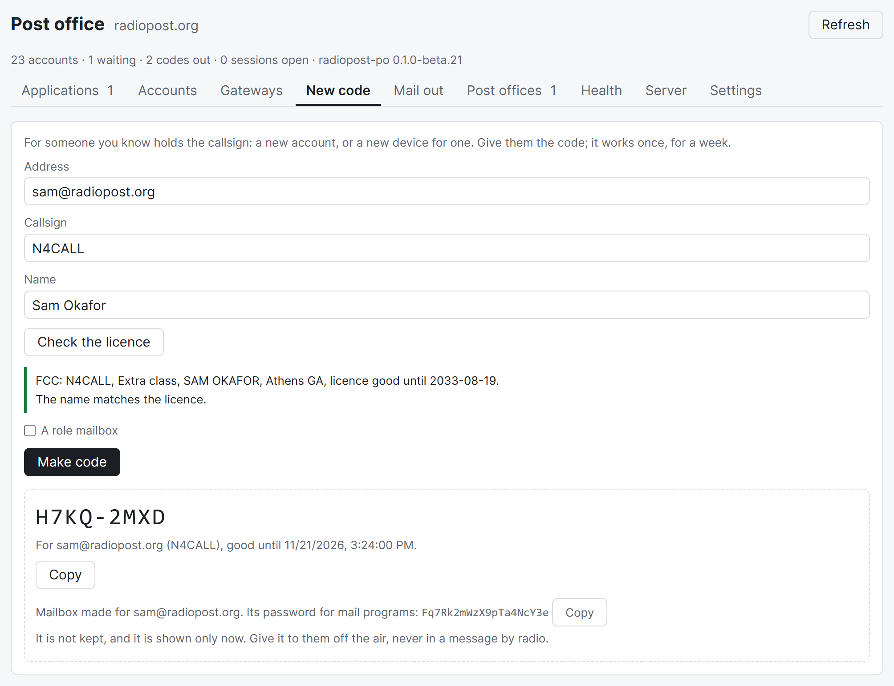

*Figure 33. Making a code.*

1. Open **New code**.
2. Fill in:
   - **Address**: the account, at your post office's domain.
   - **Callsign**: their callsign, as on the air.
   - **Name**: the name on the email the account sends. Leave it empty to keep an existing
     account's name.
3. Click **Check the licence** to see what the post office finds of that callsign and name.
4. Tick **A role mailbox** for a shared mailbox.
5. Click **Make code**.

The code shows in large letters, with whom it is for and until when. **Copy** copies it. Give it
to the person by email, by phone or on paper. It works once, for a week. They enroll with it in
their RadioPost's Setup ([section 5.1](#51-with-a-code-from-the-operator)).

For a new address, the post office also makes the account's mailbox, and shows its password for
mail programs under the code, once, with its own **Copy**. Give it with the code, off the air,
never in a message by radio. If the mailbox could not be made, a red line says why: make it from
**Accounts** ([section 27](#27-accounts-and-devices)) before mail from outside can arrive. A code
for a new device of an existing account makes no mailbox.

> **Note.** A code naming one of the post office's operator callsigns, for someone else's address,
> would give its holder this desk. The desk stops first with a red box, *This person will be able
> to run the post office*, and makes the code only if you click **Make it anyway**. A code for a
> new device of your own needs no box.

## 29. Mail out

**Mail out** lists mail your users sent by radio that waits to go out as ordinary email: the
message's ID, whom it is for, and since when. Normally it is empty: mail leaves within a minute.

Mail that stays here means the mail server is not taking it. Look at [Health](#31-health), and
run the **mail-log** job on the [Server](#32-the-server-jobs-and-a-terminal) tab to read the mail
server's log.

## 30. Other post offices

Your users' mail reaches every other post office as ordinary email, whether you know it or not. A
post office you **know** is one whose word you take that its users are licensed:

- mail from its users needs no place on your users' accept lists, and goes on the air without the
  third-party flag;
- its gateways log in here, and your users can use them;
- your post office lists its gateways for your users' clients.

Know only post offices whose operators you trust to check callsigns. At first none is known.


*Figure 34. Other post offices.*

- **Known**: the post offices you know, who runs each, when its records were last fetched, and
  whether DNSSEC signed them. They are fetched again every six hours. **Forget** stops knowing one;
  **Block** also hides it. To know a new one, type its domain and click **Know**. **Fetch now**
  fetches them all at once.
- **Seen**: post offices the service met (at the door, in mail your users sent, on a credential,
  or in a known post office's list) and that publish a RadioPost record. **Know** one, or **Block**
  it so it is not shown again.
- **Blocked**: those you blocked. **Unblock** lets one be seen again.

A known post office that cannot be fetched keeps what was last fetched. After a day, Health turns
red, because its list of revoked credentials may be out of date.

## 31. Health

The post office checks itself every hour, from outside and inside, and emails its contact address
when a check turns red, and again when all pass.


*Figure 35. Health.*

Each line is one check:

| Mark | Means |
|---|---|
| ✓ (green) | Passes. |
| ! (amber) | Worth a look soon. No email is sent for amber. |
| ✗ (red) | Something to fix. The **Health** tab shows how many. |
| • (grey) | For your information, such as a newer release. |

It checks the post office's DNS records, its certificate and its API from outside, the door
where mail comes in, the mail server, free disk space, mail stuck going out, last night's backups,
whether every account has its mailbox at the mail server, when a backup last left the server,
whether the jobs runner is installed, the DKIM keys' age and a key rotation waiting on you, and
each known post office's records.

- **Check now** runs every check at once (a few seconds).
- **DKIM selectors**: give the names of your DKIM keys once, as your mail server names them
  (such as `v1-rsa-20261110, v1-ed25519-20261110`), and click **Save**. The check then looks for
  their records in DNS.

## 32. The server: jobs and a terminal

The **Server** tab lets you look after the server without logging in to it.

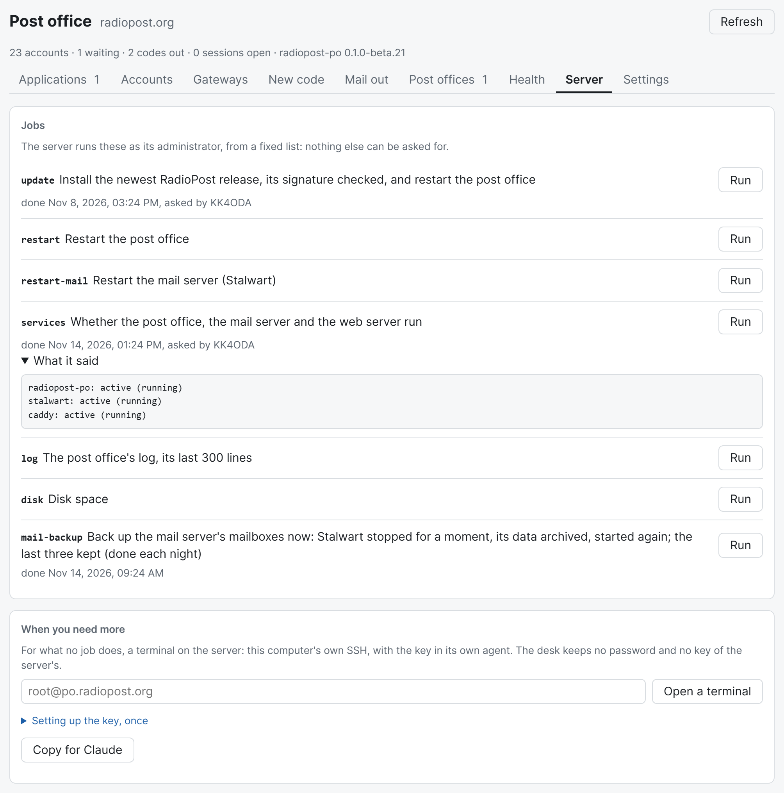

*Figure 36. Jobs and a terminal.*

**Jobs** are a fixed list of tasks the server's administrator account runs for you:

| Job | Does |
|---|---|
| **update** | Installs the newest RadioPost release, its signature checked, and restarts the post office. |
| **restart**, **restart-mail** | Restarts the post office, or the mail server. |
| **certificate** | Copies the web server's certificate to the mail server now. |
| **services** | Says whether the post office, the mail server and the web server run. |
| **log**, **mail-log** | The last lines of the post office's or the mail server's log. |
| **disk**, **firewall**, **ports**, **logins** | Disk space, the firewall's rules, what listens on which port, who logged in lately. |
| **system-updates** | Installs the operating system's security updates now rather than tonight. |
| **mail-backup** | Backs up the mailboxes now (done each night). |
| **check** | Checks the post office from outside. |

Click **Run** beside a job. **update**, **restart** and **restart-mail** ask for a second click.
The line under the job says it is waiting, running, then done or failed, when and by whom.
**What it said** shows its output.

If every job stays *asked for, waiting for the runner*, the jobs runner is not installed. The tab
says the one command to run on the server, once.

**When you need more.** For what no job does:

- **Open a terminal** opens a terminal on this computer, logged in to the server by SSH, such as
  `root@po.radiopost.org`. It uses this computer's own SSH key: the desk keeps no password and no
  key of the server's. **Setting up the key, once** says how.
- **Copy for Claude** copies the server's state (versions, checks, settings, the jobs' last output;
  no mail, no names, no keys) to paste into a Claude session that helps you.

## 33. Backups and DKIM keys


*Figure 37. Backups and DKIM keys.*

### Backups

Each night the server keeps a backup of the post office beside itself (the last seven), and one of
the mail server's mailboxes (the last three). The table lists them. A backup that stays on the
server is lost with it, so keep copies on a computer of yours. There are two ways.

**On this computer, by itself** (the better way):

1. Type a name for this computer, such as `shack-pc`, and the folder the backups go to (a drive
   of its own, or a folder another program copies elsewhere). Left empty, the folder is
   `RadioPost backups` in your home folder.
2. Click **Turn on**.

While RadioPost is open, it looks every hour and fetches each new backup, sealed to a key only
this computer holds. **Fetch now** looks at once. The last ten are kept.

> **Note.** The key that opens these backups is a file on this computer (the box names it,
> `backup.key`). Lose the computer and its key, and its backups go with them. Keep a copy of the
> key somewhere else, such as a USB stick in a drawer, or turn this on on a second computer too.

The table under it lists every computer the backups go to. **Forget** one that was lost or given
away: the post office stops sealing backups to it.

**By hand, with a passphrase.** Type a passphrase of 12 characters or more, twice, and click
**Download a backup**. The backup, with the newest mailboxes, is sealed with the passphrase and
kept on this computer in `RadioPost backups`. Without the passphrase nobody can open it, you
included.

The line at the bottom says when a copy last left the server. Health turns amber 7 days after the
last one and red after 30. Restoring a backup on a new server is in
[the server guide](../user/post-office.md#11-backups-and-restoring).

### DKIM keys

The mail server signs outgoing mail with DKIM keys, so receivers can tell it came from your
domain. Since you edit DNS yourself, the keys are rotated by hand, one checked step at a time. The
table shows the keys, their algorithm, their stage and when they were made. Health turns amber
when they are older than 180 days.

1. Click **Start a rotation**. The post office makes new keys and gives them to the mail server,
   signing nothing yet.
2. The desk shows a TXT record for each new key. Click **Copy** beside each and publish it at your
   DNS provider (most want the name without the domain, the part ending in `._domainkey`).
3. Click **Switch to the new keys**. The desk checks each record is visible in DNS, then the new
   keys sign.
4. Keep the old records for a week, for mail still on its way. The desk says until when.
5. When the desk asks, remove the old records from DNS and click **End the rotation**. It checks
   they are gone.

**Stop**, before the switch, takes the new keys back.

## 34. Settings


*Figure 38. Settings.*

### Applications

**Take applications for accounts** lets licensees apply from their RadioPost client. Each
application then waits on the Applications tab. It saves as soon as you tick it. Untick it to close
applications: only the codes you make then let anyone in, and the client tells applicants *it
takes no applications*.

### Licence lookups

What the post office finds of each callsign shows beside each application and code.

- **Look US callsigns up in a copy of the FCC's licence database** keeps a copy of the FCC's
  file on the server, fetched each week (about 200 MB to fetch, 170 MB kept). Lookups stay on the
  server: nobody learns whom you look up. **Fetch it now** fetches it at once.
- **QRZ.com**, with your own account, for callsigns of every country: type your QRZ username and
  password and click **Save**. Without an XML subscription QRZ gives only a few fields. **Clear**
  forgets the account.

### Mailboxes

The mail server refuses email for an account with no mailbox, so each account needs one. Under
**Make each mailbox**, choose:

- **By hand, in the mail server**: you make each one yourself.
- **In Stalwart, by its API**: give **Stalwart's address** as the server reaches it (such as
  `http://127.0.0.1:8080`) and an **API key** made in Stalwart's administration. The post office
  makes the mailbox wherever an account begins: when you approve (it emails the new user their
  first password), with a code for a new address (the password shows under the code), and when a
  postcard's code is used (the welcome brings it). **Accounts** and **Health** show any account
  without one.
- **By a program on the server**: name the program; it is given the address and the name.

Click **Save**, then **Check**: it asks the mail server without making anything. The line under
it says whether welcome emails can go out.

### This post office

Its domains, its operators' callsigns, its contact address and its API address, as the post office
publishes them.

---

# Part 5. Help

## 35. RadioPost and Aether HF

RadioPost is the mail program. Aether HF is the modem. Each is set up in its own window:

| To do this | Use | Where |
|---|---|---|
| Your account, your mail, whom to call | RadioPost | This manual |
| Sound card, keying, drive level | Aether | [Setup, step 2](https://github.com/KK4ODA/aether-hf/blob/master/docs/manual/manual.md#step-2-radio-interface) |
| Your licence class, control and band rules | Aether | [Setup, step 1](https://github.com/KK4ODA/aether-hf/blob/master/docs/manual/manual.md#step-1-callsign-and-rules) |
| Bandwidth (500 or 2300 Hz) | Aether; RadioPost's **Bandwidth** for a station call | [Setup, step 4](https://github.com/KK4ODA/aether-hf/blob/master/docs/manual/manual.md#step-4-modem-settings) |
| The frequency | RadioPost's **Channel** or **Dial, MHz**, which tune Aether when it can set the dial; otherwise Aether or the radio | [Radio dial](https://github.com/KK4ODA/aether-hf/blob/master/docs/manual/manual.md#radio-dial) |
| Recording a session's audio | Aether | [Recording](https://github.com/KK4ODA/aether-hf/blob/master/docs/manual/manual.md#recording-the-radios-audio) |
| Sending your logs to the project | Aether | [Send files](https://github.com/KK4ODA/aether-hf/blob/master/docs/manual/manual.md#sending-files) |

**Callsigns.** RadioPost calls and answers as the callsign it was enrolled with. You never copy it
into Aether. While a RadioPost program holds a callsign, Aether's Setup shows it greyed in place
of Aether's own.

**Aether's header.** While RadioPost is open, Aether's header shows *✓ RadioPost client* between
calls, and *✓ RadioPost client · listening* while it listens (Aether 0.2.0-beta.159 and RadioPost
0.1.0-beta.15 or later). RadioPost Gateway shows there too, *listening* while it answers.

**Other programs.** Aether can serve Winlink Express, VarAC or RMS Trimode beside RadioPost, on
its host programs port. One program at a time answers for one callsign: close a program that uses
the same callsign as RadioPost while you test. Aether's manual covers them in
[Part 4](https://github.com/KK4ODA/aether-hf/blob/master/docs/manual/manual.md#part-4-aether-with-other-programs).

## 36. The rules

These notes follow the US rules (Part 97). Check your own country's.

- **Control.** At your own station you are at the controls (local control). A gateway left
  answering with nobody at the radio is under **automatic control**. Set Aether's control to
  *Automatic* there: Aether then transmits only in the segments where automatic control is
  allowed, so register the gateway's channels in those segments.
- **Identification.** Aether sends each station's Morse identifier at the end of each session,
  and nothing in Morse during it. The rules ask for your callsign at least every ten minutes, so
  keep each session under ten minutes.
- **No encryption.** RadioPost signs messages to prove who sent them. It never encrypts them.
  Anyone can read every message. An alert's check proves it came from your circle; its text stays
  plain, and the keyword never goes on the air.
- **Alerts answered by themselves.** **Answer by itself** sends *heard* with nobody at the radio:
  automatic control. Untick it where the rules allow that only in some segments.
- **Third-party traffic.** Email between you and someone who is not a licensed amateur is
  third-party traffic. In the United States it may go between US stations. The post office marks
  such mail, and a gateway hands it over only where its country allows.
- **No business.** Do not send messages for business or pay.

## 37. Troubleshooting

### The client

| You see | Do |
|---|---|
| **Call** and **Listen for P2P** are greyed | This callsign has no credential yet: enroll it ([section 5](#5-getting-an-account)). |
| *cannot reach the modem's adapter at ws://127.0.0.1:8515/v1* | Start Aether. Check the **Modem** box. |
| The call goes out but nothing answers | Check the dial and the bandwidth against the gateway's channel. Check the gateway's hours. Try another gateway. |
| Aether refuses RadioPost's calls | Aether is keyed by a host program. In Aether's Setup, step 2, choose CAT, serial, rigctld, FLRig, CM108 or VOX. |
| Aether stops at start: *127.0.0.1:8515 is already in use* | Aether's host programs port was set to 8515. Put it back to 8300 ([Aether's ports](https://github.com/KK4ODA/aether-hf/blob/master/docs/manual/manual.md#20-the-programs-and-their-ports)). |
| *a session is under way: try again when it ends* | Wait for the session to end, or close the window to stop it. |
| *renewing the credential: try again in a moment* | Wait a few seconds. |
| *this message cannot be changed while a session is under way* (or *while listening*) | It may be going out. Edit it when the session ends, or click **Stop** first. |
| *it is queued at …, which will pass it on as it is, so it can no longer be changed* | That gateway holds it. Write a new message to correct it. |
| Setup says the credential ran out | Ask your operator for a new code, then **Enroll again with a new code**. |
| *Your settings could not be read* | Usual gateways need the Internet. Try **Read** again when you have it. |
| *No gateway list yet* | Open **Choose a gateway** and **Refresh over the Internet** while you have the Internet. |
| A message tagged *queued at …* | A gateway took it while cut off. It is offered again until a gateway that reaches the Internet confirms it. |
| A message tagged *may have been dropped* | Queued for 30 days with no word. It is still offered on each call. |
| *the other station sent ERROR …* | The other station refused something. The text says what. |
| *Set the radio's dial to … MHz (USB) yourself: the modem cannot set it* | Aether keys this radio without CAT and cannot set its dial. Turn the radio to that dial. To let Aether set it, key the radio by CAT in Aether's Setup, step 2. |
| *Not tuned: … busy …* | A session is up on the station, yours or another program's. Pick the channel again when it has ended. |
| **Tuner tone** refused | Aether keys no tone while the channel is in use, or while its rules forbid it there. Wait, or check the dial. |
| *… is a gateway: for P2P, call the other operator's own callsign while their client listens* | You called a gateway's callsign as **P2P (another client's station)**. Call its operator's own callsign, and ask them to click **Listen for P2P** ([section 10](#10-station-to-station)). |
| An application refused | See [section 5.3](#53-if-the-post-office-refuses). |
| An alert stays *not heard* | The other station's RadioPost was closed, its circle's check differs from yours, its clock is more than ten minutes off, or the path failed. Read your checks to each other. |
| An alert is *not sent* | The station was in a session for five minutes, or the **Modem** is not Aether. |
| *an alert is going out: try again in a moment* | Wait for the alert to go out: about 16 seconds once the channel is clear. |
| No sound | Click anywhere in the window once after it opens: windows play nothing before. Check **Play sounds**, the volume, **Play them on** and quiet hours. |
| A sound keyed the radio | The sounds play on the radio's sound card. Choose your speakers in **Play them on**, or set the computer's default output to them. |

### The gateway

| You see | Do |
|---|---|
| *Waiting for the modem: cannot reach the modem* | Start Aether. Check the **Modem** address in Setup. |
| *Waiting for the modem: the modem refused* | Another program holds the callsign at Aether, or Aether refused it: Aether's log says why. |
| **Start** is greyed | The gateway is not set up or not registered: follow the notice. |
| Register: *… holds no device key* | The RadioPost client on this computer is not enrolled. Enroll it first, with its own code. |
| *This modem neither checks the band rules nor says where the radio's dial is* | Aether's rules are off, as they are when a host program keys the radio, and it cannot read the dial. Set Aether's keying and rules (its Setup, steps 1 and 2). |
| *The radio is at … MHz: … outside the segments*, badge **Not answering here** | Aether's rules are off, so the gateway judges the dial itself. Turn the radio to the gateway's channel. |
| *could not tune the radio back* | The radio stayed on the partner's or gateway's channel after a call. Tune it back in Aether. |
| *listening on … MHz only, until the scan runs again* | The scan ended ([When a scan stops](#when-a-scan-stops)); the gateway registered again with that channel alone. Click **Stop** and **Start** to scan again. |
| *… sent ERROR not-authorized: called for station-to-station mail, and a gateway answered* | A RadioPost client called the gateway's callsign for station-to-station mail. Nothing to do. To work you station to station, it calls your own callsign while your client listens. |
| A post office *not found* | Its records are not published: name it in Setup, step 3. |
| A post office *refused the gateway* | The credential ran out or was revoked: register again (Setup, step 2). |
| A session ended *nothing heard for 300 seconds* | The path faded or the caller left. The caller's mail resumes on its next call. |
| *polling … for copies: post-office-unreachable* | The Internet or the post office is down. The gateway answers from what it holds. |
| Held: sessions waiting, last try *not reached* | They are reported when the post office can be reached. |

### The post office desk

| You see | Do |
|---|---|
| No **Post office** button | The callsign chosen at the top is not one of the post office's operators: choose yours. The desk also needs the Internet. |
| Applicants are told *it takes no applications* | Tick **Take applications for accounts** in **Settings**. |
| *no mailbox* beside an approved account, or *none* under **Mailbox** in **Accounts** | The mail server has no mailbox for it, so email from outside is refused (the sender gets *Mailbox does not exist*). Click **Make mailbox** in **Accounts**; if it fails, check **Settings**, **Mailboxes**, with **Check**, or make it in the mail server by hand. |
| *not emailed* beside a decision | The email to the applicant did not go. **Settings**, **Mailboxes** says whether the post office can send email. |
| A red line in **Health** | Fix what it says. You are emailed when a line turns red, and again when all pass. |
| Mail waits in **Mail out** | The mail server is not taking it: run the **mail-log** job and read it. |
| Jobs stay *asked for, waiting for the runner* | The jobs runner is not installed. Run the command the **Server** tab gives, once, on the server. |
| *The last copy off the server* is old | Open RadioPost on the computer that fetches backups, or **Download a backup**. |

## 38. Reporting a problem

Open an issue on [RadioPost's repository](https://github.com/KK4ODA/RadioPost/issues). Say:

- the date and time (UTC), the band, frequency and bandwidth, and your grid square;
- what you did, what you expected, and what happened;
- which versions of RadioPost and Aether you run.

Attach the log:

- the client's `radiopost.log`, in the `.radiopost` folder (it keeps no addresses or subjects of
  your mail);
- the gateway's `gateway.log`, in the `.radiopost-gateway` folder.

For a session that failed or was slow, turn on Aether's **Record** before you try again, then use
Aether's **Send files…** on its Log tab. It sends Aether's recording with both RadioPost logs.

## 39. Glossary

| Word | Means |
|---|---|
| Accept list | The addresses and domains allowed to email you. Writing to someone adds them. |
| Alert | One line that sounds an alarm at another station in your circle until its operator answers. |
| Account | Your mailbox at a post office, with one address. |
| Aether HF | The open-source HF modem RadioPost uses. It has its own program and manual. |
| Automatic control | Operating with nobody at the radio, as a gateway left answering does. |
| Bandwidth | How wide Aether's signal is: 500 or 2300 Hz. Both stations of a session use the same. |
| Channel | A gateway's dial frequency, with the bandwidth it uses there. Picking one tunes the radio. |
| Check (of a circle) | Eight characters made from a circle's keyword. The same check means the same keyword. |
| Circle | The stations whose operators typed the same keyword, and so can alert each other. |
| Client | RadioPost, the program you send and read mail with. |
| Credential | A signed file that proves your address and callsign belong together. Lasts 90 days and renews itself. |
| Cut off | A gateway that cannot reach the Internet. It goes on answering. |
| Desk | The post office desk: the client's **Post office** view, for a post office's operators. |
| DKIM key | A key the mail server signs outgoing mail with, so receivers can tell it came from your domain. |
| Device key | This computer's own key. It never leaves the computer. |
| Enroll | Get a credential for this computer with a one-time code. |
| Fetch | What a call to a gateway brings back of the mail waiting for you. |
| Gateway | A station that passes sessions between radio and post offices. |
| Held attachment | A file too large for the radio, kept at your post office until you ask for it. |
| Job | A task on the post office's server that the desk asks for, from a fixed list. |
| Level | How something arrives: Silent, Normal, Important or Time-sensitive. |
| Known post office | Another post office whose word your post office takes that its users are licensed. |
| Listen for P2P | Wait for one other client to call you directly, station to station, then stop. A gateway on your station goes on answering its own callsign. |
| Operator (of a post office) | Someone who runs a post office: approves accounts and gives codes. |
| Partner | Another gateway this one forwards mail to by radio when cut off. |
| Post office | The server that keeps your mailbox and exchanges email with the world. |
| Queued | Sent through a cut-off gateway and not yet confirmed by your post office. |
| Role mailbox | An account several licensed operators share, such as a club's. |
| Session | One radio contact between two stations. |
| Station to station | Mail sent directly between two RadioPost stations, with no gateway. Also called P2P. |
| Tuner tone | Ten seconds of steady carrier, for setting an antenna tuner on the channel picked. |
| Usual gateway | A gateway you named in Setup, which gets copies of your mail ahead of time. |
| Waiting | What waited at your post office at your last call to a gateway. |

## 40. Quick reference

**Send and fetch mail**

1. **Write**, fill in **To**, **Subject** and **Text**, **Put in outbox**.
2. **Choose a gateway**, **Choose** one.
3. Pick its **Channel**: the radio is tuned there at once if Aether can. **Tuner tone** if needed.
   Set Aether's bandwidth.
4. Set **Fetch**. Listen that the frequency is clear.
5. **Call**. Watch the card at the bottom right.
6. Read your new mail in the **Inbox**.

**Station to station**

1. Agree on a frequency and bandwidth. The one who answers tunes to them and clicks
   **Listen for P2P**.
2. The other chooses **P2P (another client's station)**, types the callsign, the **Dial, MHz** and the
   **Bandwidth**, then **Call**.
3. With a station that runs a gateway, call its operator's own callsign, not the gateway's.
4. Later, with the Internet: **Send reports**.

**Alert a station**

1. Once: **Alerts**, add a circle with the keyword you agreed, and read your checks to each other.
2. **Send an alert**: the **Circle**, the callsign in **To** (empty for everyone), one line,
   **Send alert**.
3. Watch it become *heard*, *seen* and *answered*.

**Add a callsign**

1. **Setup**, **Add another callsign**.
2. **I have a code** and **Enroll**, or **Apply for an account** and **Apply**.
3. Keep RadioPost open with that callsign chosen until it says *Approved*.
4. Choose the callsign at the top before each session.

**Approve an applicant** (post office operators)

1. Choose your own callsign at the top. Click **Post office**.
2. **Applications**: read the licence check.
3. **Approve** (tick **Role mailbox** first for a shared one), or **Decline…** with a reason.

**Start a gateway**

1. Aether running and keying the radio itself.
2. The RadioPost client on the same computer enrolled as you.
3. RadioPost Gateway: **Setup**, steps 1 and 2, **Register**.
4. **Start**. The badge says *Listening*.

---

# Appendix

## Where to read more

| Subject | Document |
|---|---|
| Aether HF, the modem | [The Aether operator's manual](https://github.com/KK4ODA/aether-hf/blob/master/docs/manual/manual.md) |
| Running a gateway, in more depth | [The gateway guide](../user/gateway.md) |
| Running a post office | [The post office guide](../user/post-office.md) |
| On-air tests through a gateway | [Email through a gateway](../user/on-air-gateway.md) |
| On-air tests between two stations | [Station to station](../user/on-air-tests.md) |
| How RadioPost works | [The concept](../concept/00-concept.md) |
| The protocols | [The specifications](../../spec/README.md) |
| Releases | [github.com/KK4ODA/RadioPost/releases](https://github.com/KK4ODA/RadioPost/releases) |
| Bugs and ideas | [github.com/KK4ODA/RadioPost/issues](https://github.com/KK4ODA/RadioPost/issues) |

## Keeping this manual current

This manual is part of the programs. A change to anything a user or a gateway operator sees or
sets (a window, a box, a button, a setting or its default, a message, a file kept) updates the
manual in the same commit. The rule is in `CONTRIBUTING.md`.

- **Versions.** The manual's **Version** goes up with each change, by the same rule as the
  specifications: the last number for a correction, the middle one for something added or
  changed, the first one for a reorganisation. Each change adds a row to the change log below,
  and the header's **Version** and **Updated** match its last row. `tools/check_docs.py` (CI)
  holds them to that. **Describes** is the release version: `tools/release.py bump` moves it with
  every other version in the repository, and `tools/release.py check` (CI) holds it.
- **The contents** are made from the headings: `python tools/manual/build.py toc` rewrites them,
  and `python tools/manual/build.py check` (CI) fails when they are stale, when a figure number is
  out of order, or when a picture is missing.
- **The schematics** are drawn by `tools/figures/manual.py`, with the same drawing kit as the
  concept's figures. Edit the script and run it; CI checks the SVGs match it.
- **The screenshots** are taken of the real windows with made-up data by
  `node tools/manual/screens.mjs`. Run it after changing what a window shows, look at each
  picture, and commit them with the manual.
- **The PDF** is built by `python tools/manual/build.py pdf` and attached to every release.

## Change log

| Version | Date | Changes |
|---|---|---|
| 1.0.0 | 2026-11-15 | First edition: the client, RadioPost Gateway, and how they work with Aether HF. |
| 1.1.0 | 2026-11-15 | §22: a gateway's own windows set in the Partners view, calls by itself in a partner's windows, the Next window column, and which partner gets the sessions. |
| 1.2.0 | 2026-11-15 | §13: groups of addresses, and contact files imported. |
| 1.3.0 | 2026-11-15 | §11.2, §12: **Listen** answers calls to any of your callsigns. |
| 1.4.0 | 2026-11-15 | Part 4, the post office desk: one chapter for each tab (applications, accounts, codes, mail out, other post offices, health, the server's jobs, backups and DKIM keys, settings), with screenshots. §15 points to it; Help becomes Part 5 (§35–§40), with the desk's troubleshooting, glossary words and an approval card. Figure 16 says **Listen** answers any of your callsigns. |
| 1.4.1 | 2026-11-15 | §33: restoring a backup points to the server guide's chapter 11, rewritten. |
| 1.4.2 | 2026-11-15 | Links to Aether's manual go to its new home, `docs/manual/manual.md`, and its chapters there. |
| 1.5.0 | 2026-11-15 | §8: the call box's **Channel**, and **Call** tuning the radio there and back when Aether can set the dial. §19: the badge **Not answering here**. §22: a gateway tunes to its partner's window and back. §39: three new messages. §40: the quick reference tunes by **Channel**. |
| 1.6.0 | 2026-11-15 | §18: **More modems**, and *More than one modem*: a gateway answering on several modems, one session at a time. §18 step 2: each channel's **Modem**. §19: **Modem** names them all. |
| 1.7.0 | 2026-11-15 | §7: **Form**, and sending an ICS-213 as its values alone; a form message reads as the form. |
| 1.8.0 | 2026-11-17 | Gateways that scan (W50): §8 a *scanned* channel and the call that keeps trying; §18 **Scan these channels**, and listing only channels the gateway listens on; §19 the scan on **Modem** and *When a scan stops*; §23 `scan`. |
| 1.9.0 | 2026-11-17 | From the 40 m RadioPost mail of 2026-11-17. §6, §8: **Call** is green; a channel is tuned as it is picked, the line under it says where the radio is or which dial to set by hand, **Tuner tone**, and the radio stays on the channel after the call (new Figure 13). §10: a station call's **Dial, MHz** and **Bandwidth** (new Figure 18), and P2P with a station that also runs a gateway. §19: a gateway whose scan ends registers again with the channel it stays on. §35, §37, §39, §40 to match. |
| 1.10.0 | 2026-11-17 | P2P named plainly in the call box: **Listen** is **Listen for P2P**, whose tooltip names the callsigns it answers as, and **Another client's station** is **P2P (another client's station)** (§6, §10, §11.2, §37, §39, §40; the client's screenshots retaken). |
| 1.11.0 | 2026-11-18 | Alerts and sounds (wishlist W51, W52; RP-8). §10.1 to §10.4: alerts between stations that share a keyword, circles and their checks, sending one and what it becomes, the alarm and its answers (new Figures 19 and 20). §12: *Sounds and notifications*, the levels, quiet hours, and the radio's sound card (new Figure 23). §13: **Notify** for addresses and groups. §36, §37, §39, §40 to match; the client's screenshots retaken with **Alerts** in the left-hand column. |
| 1.12.0 | 2026-11-18 | Every account gets its mailbox. §26: a postcard's mailbox and welcome come when its code is used. §27: the **Mailbox** column and **Make mailbox**, its password shown once and given off the air. §28: a code for a new address makes the mailbox and shows its password under the code. §31: Health checks that every account has its mailbox. §34, §37 to match; the desk's Accounts and New code screenshots retaken. |
| 1.13.0 | 2026-11-18 | From the 40 m sessions of 2026-11-18. §7 *Changing a message*: a message in the outbox is changed with its pencil or **Edit**, and saved in the old one's place with **Save in outbox**; what cannot be changed, and why (Figure 11 retaken with a row's pencil and trash can). §9 **Edit**; §37 its two refusals. |
| 1.14.0 | 2026-11-18 | §26: what turns an application red: a club callsign asked for by someone who is neither the club nor its trustee (the trustee is looked up too), and an **Email now** at a domain kept for examples. |
