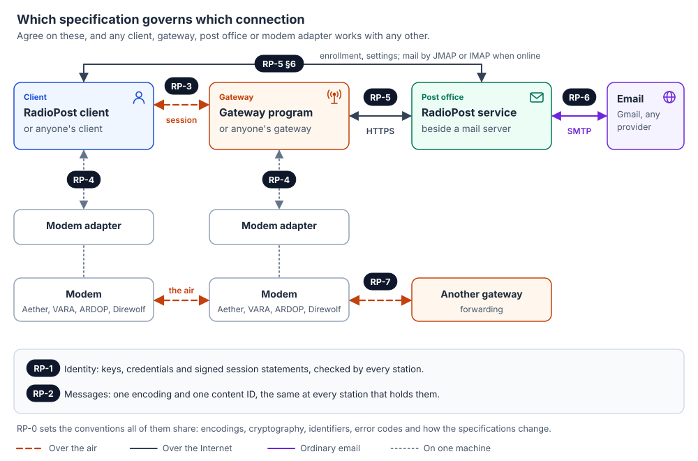

# RadioPost specifications

These documents define the RadioPost protocols. Anyone may build a client, a gateway, a post
office or a modem adapter from them; the RadioPost programs are one implementation each, with no
special standing (RP-0 §3).

They are **living documents**: each carries a status, a version and a change log, and changes are
proposed as pull requests (`CONTRIBUTING.md`, RP-0 §8).

They are published under [CC BY 4.0](https://creativecommons.org/licenses/by/4.0/)
(`LICENSE-CC-BY-4.0`): anyone may implement, copy and adapt them, for any purpose, crediting the
RadioPost project. No permission or fee is needed to build a client, gateway, post office or
adapter from them.

| Spec | Title | Status | Version | Governs |
|---|---|---|---|---|
| [RP-0](rp-0000-conventions.md) | Conventions | Draft | 0.5.1 | Requirement words, encodings, cryptography, identifiers, roles, how specs change, registries |
| [RP-1](rp-0001-identity.md) | Identity | Draft | 0.5.0 | Keys, credentials, session statements, published keys, revocation |
| [RP-2](rp-0002-messages.md) | Messages | Draft | 0.2.0 | The message, its air form, its content ID |
| [RP-3](rp-0003-session.md) | Session protocol | Draft | 0.9.0 | Client ↔ gateway over the radio |
| [RP-4](rp-0004-modem-interface.md) | Modem interface | Draft | 0.4.1 | Client or gateway ↔ modem adapter |
| [RP-5](rp-0005-post-office-api.md) | Post office API | Draft | 0.11.2 | Gateway or client ↔ post office over HTTPS |
| [RP-6](rp-0006-email.md) | Email interoperation | Draft | 0.3.1 | Post office ↔ ordinary email |
| [RP-7](rp-0007-forwarding.md) | Forwarding | Draft | 0.8.0 | Gateway ↔ gateway by radio |

## What to implement

| You are building | Read |
|---|---|
| A client | RP-0, RP-1, RP-2, RP-3 (client side); RP-4 if it drives a modem; RP-5 §6 for enrollment and settings |
| A gateway | RP-0, RP-1, RP-2, RP-3 (gateway side), RP-5 §5; RP-4 to drive modems; RP-7 to forward when cut off |
| A post office | RP-0, RP-1 (issuing), RP-2, RP-5 (serving), RP-6 |
| A modem adapter | RP-0 §4, RP-4 |

## Test vectors

`../vectors/` holds exact inputs and outputs for RP-1 to RP-7: keys, credentials and their
verification, session statements, messages and their content IDs, every PDU, sessions byte for
byte (ordinary, resumed, station to station), modem interface lines and conversations, DNS
records, signed documents, the post office API's requests and answers, email at the door, coming
in and going out, and forwarding between gateways. Check an implementation
against them before it goes on the air (`../vectors/README.md`).

The detailed design (`docs/design/`) explains how the pieces fit and why the protocols are as they
are. The concept (`docs/concept/`) is the plain-language overview.

