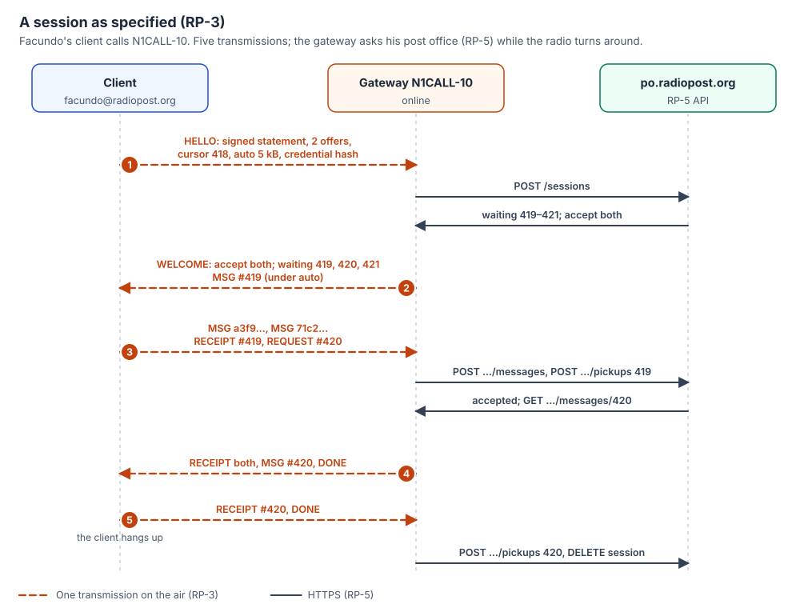

# RP-3: Session protocol

| | |
|---|---|
| **Status** | Draft |
| **Version** | 0.3.0 |
| **Updated** | 2026-11-09 |
| **Editor** | KK4ODA |
| **Licence** | [CC BY 4.0](https://creativecommons.org/licenses/by/4.0/) |
| **Depends on** | RP-0, RP-1, RP-2; carried by RP-4 |
| **Protocol version** | 1 |

What a **client** and a **gateway** say to each other over a radio link: who is calling, what each
side has to send, the messages themselves, and when they are done. Gateway-to-gateway forwarding
(RP-7) uses the same protocol with the calling gateway in the client's place.

The protocol is designed for slow, half-duplex links where every change of direction costs seconds:
a session that sends and picks up mail takes **five transmissions** in the usual case.



---

## 1. What the protocol needs from the link

The session runs over one **link**: a reliable, ordered, two-way byte stream between two stations,
set up when one station calls the other. RP-4 defines how a RadioPost program gets such a link from
a modem.

The protocol does not depend on the modem's frame sizes, data rates or turnaround rules. It needs
only that bytes arrive in order and complete, or that the link is reported broken.

**The station that called is the *caller*; the other is the *called* station.** In a user's session
the caller is the client and the called station is the gateway.

---

## 2. Framing

The byte stream carries a sequence of **PDUs**. Each is written as:

```
pdu_frame = length (2 bytes, big-endian, 1..65535) || pdu (that many bytes)
```

`pdu` is a CBOR map (RP-0 §4.1) whose key `0` is the PDU type (§4).

A station MUST NOT send a PDU larger than the other station's `max_pdu` (§5.1, `caps`). Until it
knows it, it MUST NOT send a PDU larger than **1 024 bytes**. Every station MUST accept PDUs of at
least 1 024 bytes.

A PDU that does not decode, or whose type is unknown, is answered with `ERROR` `malformed` and the
session ends.

**Why small PDUs:** a link that breaks loses at most the PDU in flight; everything received in
complete PDUs counts toward resuming next time (§7).

---

## 3. A session in brief *(informative)*

| # | Who | Says |
|---|---|---|
| 1 | Client | `HELLO`: who I am (signed), what I want to send, where my last pickup ended. |
| 2 | Gateway | `WELCOME`: what I will take, what is waiting for you. Then the first small messages, as `MSG`. |
| 3 | Client | My messages as `MSG`. `RECEIPT` for what I got. `REQUEST` for more, or `DONE`. |
| 4 | Gateway | `RECEIPT` for your messages. What you asked for, as `MSG`. `DONE`. |
| 5 | Client | `RECEIPT`, `DONE`. Then the client hangs up. |

Each row is one transmission when the modem is half-duplex: a station writes everything it has
for that turn at once, and the modem sends it in one go.

---

## 4. PDU types

| Type | Name | Sent by | Section |
|---|---|---|---|
| 1 | `HELLO` | Caller | §5.1 |
| 2 | `WELCOME` | Called | §5.2 |
| 3 | `AUTH` | Caller | §5.3 |
| 4 | `MSG` | Both | §5.4 |
| 5 | `RECEIPT` | Both | §5.5 |
| 6 | `REQUEST` | Caller | §5.6 |
| 7 | `DONE` | Both | §5.7 |
| 8 | `ERROR` | Both | §5.9 |
| 9 | `CREDENTIAL` | Both | §5.8 |
| 10 | `NOTICE` | Called | §5.10 |
| 11 | `PROOF` | Caller, when forwarding | RP-7 §3.2 |

Types 12–63 are reserved for this specification; 64 and up for experiments (RP-0 §4.1).

---

## 5. The PDUs

Each table lists the keys besides `0` (the type). "Req." says whether the key MUST be present.

### 5.1 HELLO

The caller's first PDU, sent as soon as the link is up.

| Key | Name | Type | Req. | Meaning |
|---|---|---|---|---|
| 1 | `versions` | [uint, uint] | yes | Lowest and highest protocol version supported. This document is version 1. |
| 2 | `role` | uint | yes | 0 client; 1 gateway forwarding (RP-7 §2). |
| 3 | `address` | text | yes | The account (RP-1 §1). |
| 4 | `operator` | text | yes | The operator's callsign, as on the air. |
| 5 | `gateway` | text | yes | The callsign of the station called. |
| 6 | `time` | uint | yes | The caller's clock. |
| 7 | `nonce` | bstr .size 8 | yes | Random, new for each session. |
| 8 | `offers` | array of offer | yes | The messages the caller wants to send, in the order it would send them. May be empty. An offer is `[id, size, priority]`: content ID (bstr .size 12), air-form size in bytes, priority (RP-2 §2). |
| 9 | `cursor` | uint | yes | The highest mailbox serial the caller has picked up (§6.2); 0 if none. |
| 10 | `auto` | uint | yes | Send me waiting messages up to this air-form size without asking (bytes). 0: list only. |
| 11 | `partials` | array of [id, offset] | no | Messages the caller has partly received in an earlier session, and how many bytes of each it holds. |
| 12 | `caps` | caps | no | Capabilities, below. |
| 13 | `credential` | bstr | one of 13, 14 | The caller's credential (RP-1 §4). |
| 14 | `credential_hash` | bstr .size 8 | one of 13, 14 | The credential's hash (RP-1 §4.3), when the caller believes the gateway holds it (§5.2, `cached`). |
| 15 | `signature` | bstr .size 64 | no | The caller's signature over its session statement in time form (RP-1 §6). |

**caps** is a map:

| Key | Name | Type | Meaning |
|---|---|---|---|
| 1 | `compression` | array of uint | Air-form compressions the sender accepts (RP-2 §4). 0 and 1 are always accepted. |
| 2 | `max_pdu` | uint | The largest PDU the sender accepts; at least 1 024. |
| 3 | `renew` | bool | The caller would like a new credential (§5.8). |

**The statement.** The called station rebuilds the caller's statement (RP-1 §6.1) from `address`,
`operator`, `gateway`, `time`, `nonce`, and the content IDs of `offers` in order, and checks
`signature` against it (RP-1 §6.3).

A caller SHOULD always sign `HELLO`. It MAY leave `signature` out when it knows its clock is wrong;
the gateway then asks it to sign a challenge.

### 5.2 WELCOME

The called station's answer to `HELLO`, and to `AUTH` or a client `CREDENTIAL`.

| Key | Name | Type | Req. | Meaning |
|---|---|---|---|---|
| 1 | `version` | uint | yes | The protocol version chosen. |
| 2 | `session` | bstr .size 8 | yes | The gateway's ID for this session, random. |
| 3 | `status` | uint | yes | 0 `ready`: the caller is authenticated. 1 `sign`: sign the challenge in key 4 (§5.3). 2 `credential`: send your credential (§5.8). |
| 4 | `challenge` | bstr .size 16 | when `status` is 1 | Random. |
| 5 | `accept` | array of [id, offset] | when `ready` | The offers the gateway will take, each with the number of bytes it already holds (0, or more to resume, §7). |
| 6 | `decline` | array of [id, code] | when `ready` | Offers it will not take, with an RP-0 §9.3 code (`already-have`, `too-large`, `refused-by-policy`, …). Every offer is in `accept` or `decline`. |
| 7 | `waiting` | array of entry | when `ready` | Mail waiting for the caller, in the order the gateway will send it (§6.1). |
| 8 | `more` | uint | when `ready` | How many further waiting messages are not listed. |
| 9 | `caps` | caps | no | As in `HELLO`. |
| 10 | `time` | uint | yes | The gateway's clock. |
| 11 | `online` | bool | yes | The gateway can reach the caller's post office now. When false, `waiting` lists only copies the gateway holds, and what it accepts waits in its queue. |
| 12 | `cached` | bool | yes | The gateway now holds the caller's credential, so the caller may send only its hash next time. |
| 13 | `credential` | bstr | from a client called directly, when `ready` | Its credential (§10). |
| 15 | `signature` | bstr .size 64 | with 13 | Its signature over its statement as the station called (RP-1 §6.5). |

Keys 13 and 15 are absent from a gateway's `WELCOME`. Key 14 is not used in `WELCOME`.

A waiting **entry** is
`[serial, id, from, subject, size, priority, flags]`: the mailbox serial (uint, §6.2), the content
ID, the sender's address (text), the subject cut to at most 40 bytes of UTF-8 on a character
boundary (text), the air-form size (uint), the priority (uint), and flags (uint): 1 `held`
(attachments held at the post office), 2 `copy` (a copy placed ahead, served while offline).

When `status` is `ready`, the gateway follows `WELCOME`, in the same transmission, with `MSG` PDUs
for the waiting messages whose size is at most the caller's `auto` and for the rest of each waiting
message the caller listed in `partials` (§7), in the order of `waiting`, and with `DONE` if it then
has nothing more to send.

When `status` is `sign` or `credential`, `WELCOME` carries no `accept`, `decline` or `waiting`, and
the gateway sends nothing of the caller's mail until the caller is authenticated.

### 5.3 AUTH

Sent by the caller after `WELCOME` with `status` `sign`.

| Key | Name | Type | Req. | Meaning |
|---|---|---|---|---|
| 1 | `signature` | bstr .size 64 | yes | The caller's signature over its statement in challenge form (RP-1 §6.1): `address`, `operator`, `gateway`, the offered content IDs, and the challenge. |

The gateway answers with a new `WELCOME` (`status` `ready`) or `ERROR`.

### 5.4 MSG

A message, or a piece of one.

| Key | Name | Type | Req. | Meaning |
|---|---|---|---|---|
| 1 | `id` | bstr .size 12 | yes | Content ID (RP-2 §3). |
| 2 | `offset` | uint | yes | Where in the air form this piece starts. |
| 3 | `total` | uint | yes | The air form's whole length. |
| 4 | `data` | bstr | yes | The bytes from `offset`. |
| 5 | `serial` | uint | from the gateway | The mailbox serial of a waiting message (a forwarding serial between gateways, RP-7 §4.3). |
| 6 | `placement` | bstr | when forwarding inward | The post office's placement of the message (RP-7 §4.2, §4.3). |

A station sends a message's pieces in order, without gaps. When it has all `total` bytes, the
receiver decompresses the air form, checks the canonical encoding and the content ID (RP-2 §3), and
stores the message **durably** before listing it as complete in a `RECEIPT`. A message that fails
the check is listed as failed with `malformed`.

A caller MUST NOT send a message the gateway did not `accept`, and starts it at the offset the
gateway gave.

### 5.5 RECEIPT

What the sender of the `RECEIPT` now holds.

| Key | Name | Type | Meaning |
|---|---|---|---|
| 1 | `complete` | array of id | Received whole, checked and stored. |
| 2 | `partial` | array of [id, offset] | Received in part; this many bytes held. |
| 3 | `failed` | array of [id, code] | Could not be taken, and why. |
| 4 | `records` | array of bstr .size 12 | When forwarding: the session records taken (RP-7 §3.3). |

A station SHOULD send a `RECEIPT` in each transmission in which it has received `MSG` pieces since
its last one. A message counts as **delivered** only when listed `complete`: for mail picked up,
that is when the gateway may report the pickup to the post office (RP-5 §5.5); for mail sent, that
is when the client may mark it sent.

### 5.6 REQUEST

The caller asks for more.

| Key | Name | Type | Meaning |
|---|---|---|---|
| 1 | `send` | array of uint | Send these waiting messages (serials). |
| 2 | `files` | array of [serial, ref] | Ask the post office for these held attachments (RP-2 §2, `held`). They arrive later as a new waiting message from the post office. |
| 3 | `more` | bool | List the waiting messages not yet listed (`WELCOME` `more`). The gateway answers with another `WELCOME`. |

Waiting messages that are neither sent nor requested stay waiting.

### 5.7 DONE

"I have nothing more to send unless you ask." No keys.

A station may send `DONE` more than once: after a `REQUEST`, the gateway sends what was asked for
and `DONE` again.

### 5.8 CREDENTIAL

| Key | Name | Type | Meaning |
|---|---|---|---|
| 1 | `credential` | bstr | A credential (RP-1 §4). |

* **From the caller**, in answer to `WELCOME` `status` `credential`: the caller's credential. The
  gateway answers with a new `WELCOME`.
* **From the gateway**, after `HELLO` asked to `renew` and the gateway obtained a new credential
  from the caller's post office (RP-5 §5.2): the caller's new credential. The caller stores it and
  uses it from its next session.

### 5.9 ERROR

| Key | Name | Type | Req. | Meaning |
|---|---|---|---|---|
| 1 | `code` | uint | yes | From RP-0 §9.3. |
| 2 | `text` | text | no | For the operator, in plain words. |
| 3 | `id` | bstr .size 12 | no | The message concerned. |
| 4 | `fatal` | bool | no | The session cannot go on. Default true. |

After a fatal `ERROR` the caller hangs up (§8).

### 5.10 NOTICE

| Key | Name | Type | Meaning |
|---|---|---|---|
| 1 | `text` | text | A message from the gateway to the operator, shown as is ("Internet down here since 14:10; your mail waits in my queue"). |

---

## 6. Order and numbering

### 6.1 What is sent first

Each station sends messages in this order: priority 2, then 1, then 0; within a priority, the
oldest first (by `date` for mail sent, by serial for mail waiting).

### 6.2 Mailbox serials and the cursor

The post office numbers each account's incoming messages with **serials**: increasing integers, one
per message, never reused. A caller's `cursor` is the highest serial it has picked up; the gateway
lists waiting messages with higher serials, and also any lower serials not yet picked up.

Copies placed ahead (RP-5 §5.8) carry the serial the post office gave them, so a pickup from a copy
and a pickup from the post office count the same way.

---

## 7. Resuming

A link that breaks mid-message loses only the PDU in flight. The receiver keeps every complete
piece before it.

* **Downloads:** the caller keeps the pieces it received, and lists each such message in its next
  `HELLO` under `partials`, with the number of bytes it holds, through the same gateway or any
  other. A message in `partials` counts as asked for: the gateway sends the rest of it from that
  offset, after `WELCOME` and whatever its size (§5.2). A gateway that does not list the message as
  waiting ignores the entry, and the caller keeps its pieces for another session.
* **Uploads:** a gateway keeps the pieces of a message it accepted for at least **24 hours**, keyed
  by address and content ID, and offers to resume through `accept` offsets. The caller sends the
  rest from the offset given.
* **The same bytes.** Pieces join only if they come from the same air form, and two compressors can
  make different air forms of one message (RP-2 §4). So a sender keeps the air form of a message it
  has begun to send, and resumes with it. A gateway sends a waiting message's air form exactly as
  the post office gave it, and the post office gives the same air form every time (RP-5 §5.3), so
  a download resumes through any gateway. If a resumed message fails its check (RP-2 §3), the
  receiver lists it as failed (`malformed`) and drops its pieces, and the message is sent again from
  the start.

Because messages are named by their content, a message already complete at the receiver is never
sent again: it is declined (`already-have`) or, when waiting, receipted at once by the caller
without asking for it.

Test vectors: `vectors/session-02.json` is an upload resumed through the same gateway and a
download resumed through another, byte for byte, with the breaks.

---

## 8. Ending

The session ends when both stations have sent `DONE`, and each holds `RECEIPT`s for everything it
sent that it still cares about. Then **the caller hangs up** (asks the modem to disconnect).

If nothing arrives for **300 seconds** while the modem reports nothing being received (RP-4,
`quality`), the station waiting ends the session: the caller hangs up, the called station asks the
modem to disconnect. A link broken by the modem ends the session at once.

**Why the caller hangs up:** someone has to, and the end must not depend on either station
guessing. The caller knows when it has what it came for. On a link where the caller also runs the
link's timing (as on Aether), its disconnect is also the fastest.

A session's end changes nothing that was not receipted: mail not receipted stays waiting at the
gateway, and mail sent but not receipted stays in the client's outbox, to be offered again.

---

## 9. What the gateway does meanwhile *(informative)*

When `HELLO` arrives, a gateway that is online asks the caller's post office for the waiting list
and checks the statement there too (RP-5 §5.2), while the link turns around. Offline, it checks the
credential and statement itself (RP-1 §5, §6.3) and lists the copies it holds. Either way, the
caller sees the same protocol; `online` and `NOTICE` tell it what happened.

A gateway SHOULD have its `WELCOME` ready within one second of `HELLO`'s last byte, so the modem can
answer in its next turn.

---

## 10. Station to station

Two users can exchange mail directly, with no gateway and no post office: one **client answers the
call** and takes the called station's part.

* The answering client verifies the caller as a gateway would offline (RP-1 §5, §6.3), with the
  post office keys it holds.
* **It proves itself in turn**, since anyone can transmit any callsign. Its `WELCOME` with `status`
  `ready` carries its credential (key 13) and its signature (key 15) over a statement as the station
  called (RP-1 §6.5), which lists the messages in `waiting` and carries the caller's nonce. The
  caller verifies it before it takes any message. If it fails, the caller sends `ERROR` with the
  code and hangs up.
* It accepts only offered messages addressed to its own account (others: `refused-by-policy`).
* Its `waiting` list holds only messages its own user addressed to the caller's account, all of
  them (`more` 0, so that one signature covers them), numbered with serials of its own; `online` is
  false. The caller sends `cursor` 0, since those serials are not its post office's, and the
  answering client lists every such message not yet receipted, whatever `cursor` says.
* Messages received this way, in either direction, keep their proof (RP-1 §6.4): the other
  station's credential, statement and signature. With it, each user's post office can be told of
  them once there is Internet, and both mailboxes agree. *(How a client reports them is to be
  added to RP-5.)*

Test vectors: `vectors/session-03.json` is a station-to-station session byte for byte, and
`vectors/statements.json` has the called station's statement and how it verifies.

---

## 11. Sizes *(informative)*

| PDU | Typical size |
|---|---|
| `HELLO`, two offers, signed, credential hash | 201 bytes |
| `HELLO`, the same with the full credential | 356 bytes |
| `WELCOME` with three waiting entries | 232 bytes |
| `WELCOME` from a station called directly, one waiting entry, with its credential and signature | 351 bytes |
| `MSG` carrying 960 bytes of a message | 991 to 995 bytes |
| `RECEIPT` for two messages | 33 bytes |
| `DONE` | 5 bytes |

All with framing, from `vectors/pdus.json` and the session vectors. At 36 bit/s, Aether's
slowest rung, 200 bytes take 45 seconds; at 2 kbit/s, under a second.

---

## 12. Example *(informative)*

Facundo's session through N1CALL-10 (concept, Figure 4), in CBOR diagnostic notation, framing
left out, byte strings shortened to their first two bytes. His `auto` is 1 000 bytes, so the gateway
sends #419 (277 bytes) unasked; he asks for #420 (1 298) and leaves #421 (6 122, a photo) waiting.
Sizes are air forms (RP-2 §4).

```
→ HELLO     {0:1, 1:[1, 1], 2:0, 3:"facundo@radiopost.org", 4:"KK4ODA", 5:"N1CALL-10",
             6:1794235200, 7:h'f3e4…', 8:[[h'50d3…', 137, 0], [h'ab9d…', 142, 0]], 9:418,
             10:1000, 12:{1:[0, 1, 2], 2:4096}, 14:h'ca61…', 15:h'943c…'}
← WELCOME   {0:2, 1:1, 2:h'ec7b…', 3:0, 5:[[h'50d3…', 0], [h'ab9d…', 0]], 6:[],
             7:[[419, h'4734…', "maria@example.com", "Are you safe?", 277, 0, 0],
                [420, h'3cde…', "eoc@radiopost.org", "Shelter roster", 1298, 0, 0],
                [421, h'13ec…', "maria@example.com", "Photo", 6122, 0, 0]],
             8:0, 9:{1:[0, 1], 2:4096}, 10:1794235241, 11:true, 12:true}
← MSG       {0:4, 1:h'4734…', 2:0, 3:277, 4:h'00a6…', 5:419}
→ MSG       {0:4, 1:h'50d3…', 2:0, 3:137, 4:h'00a7…'}
→ MSG       {0:4, 1:h'ab9d…', 2:0, 3:142, 4:h'00a6…'}
→ RECEIPT   {0:5, 1:[h'4734…']}
→ REQUEST   {0:6, 1:[420]}
← RECEIPT   {0:5, 1:[h'50d3…', h'ab9d…']}
← MSG       {0:4, 1:h'3cde…', 2:0, 3:1298, 4:h'00a7…', 5:420}
← DONE      {0:7}
→ RECEIPT   {0:5, 1:[h'3cde…']}
→ DONE      {0:7}
  (Facundo's client hangs up)
```

Test vectors: `vectors/session-01.json` is this session byte for byte, and `vectors/pdus.json`
has one example of each PDU, and frames that must be refused.

---

## Change log

| Version | Date | Change |
|---|---|---|
| 0.1.0 | 2026-11-09 | First draft. |
| 0.1.1 | 2026-11-09 | Licence stated: CC BY 4.0. |
| 0.1.2 | 2026-11-09 | The example is the test vector's session, its `auto` and sizes made consistent with §5.2; test vectors. |
| 0.2.0 | 2026-11-09 | Resuming (§7): a message in `partials` is sent unasked; a resumed air form is the same bytes; a message that fails after resuming starts over. Station to station (§10): the station called proves itself (`WELCOME` keys 13 and 15, RP-1 §6.5), and the caller sends `cursor` 0. Test vectors `session-02.json` and `session-03.json`. |
| 0.3.0 | 2026-11-09 | Forwarding (RP-7): `PROOF` defined there (§4), `role` 1, `MSG` key 6 `placement`, `RECEIPT` key 4 `records`. |
