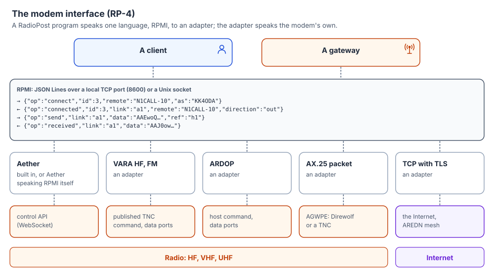

# RP-4: Modem interface

| | |
|---|---|
| **Status** | Stable |
| **Version** | 1.7.0 |
| **Updated** | 2026-11-28 |
| **Editor** | KK4ODA |
| **Licence** | [CC BY 4.0](https://creativecommons.org/licenses/by/4.0/) |
| **Depends on** | RP-0 |
| **Protocol version** | 1 |

How a RadioPost program (a client or a gateway, here the **host**) drives a modem: calling,
answering, sending and receiving bytes, hanging up, and hearing what the modem reports. The host
never talks to a modem's own interface; it talks to an **adapter** in one common language, the
**RadioPost Modem Interface** (RPMI), so that any modem can carry RadioPost once someone writes an
adapter for it, and a modem may speak RPMI itself.



---

## 1. Model

* An **adapter** is a program, or a part of one, that speaks RPMI on one side and a particular
  modem's interface on the other. It MAY run as its own process, be built into the host, or be the
  modem itself. One built into the host may hand the host RPMI's requests and events as the
  program's own values rather than as lines: §2's transport and framing are then not used, and
  every request and event keeps its meaning.
* A **link** is one connection to one remote station: a reliable, ordered, two-way byte stream, as
  RP-3 §1 needs. The adapter names each link with a string ID.
* A modem that carries datagrams (one-to-many frames, no connection) MAY offer **broadcasts**.
* A modem MAY send **beacons** (one frame carrying a callsign, addressed to nobody) and report the
  **stations it hears** (§4.4).
* A modem MAY be **shared**: several programs, each through its own connection, use one modem
  and one radio. An example is a gateway that carries RadioPost and another system's mail on the
  same station. §1.1 says what each host can rely on.

What the host is told about the radio, and when it is told, is all in RPMI. Keying the radio,
modulation, retransmission and turnaround are the modem's business. So is the dial, unless the
adapter offers it (§4.1): then a host may read it and set it, so that a client tunes to the
gateway it calls and a gateway to a partner's window. An adapter may also key a steady tone for an
antenna tuner on the host's word (§4.3).

### 1.1 A shared modem

A modem may serve other programs besides this host: another RadioPost program, or a program of
another system on the same station. Callsigns decide whose call is whose, because a call names a
callsign. The adapter keeps each host to its own business:

* **The host's callsigns are its own.** `callsigns` (§4) names the callsigns *this host* answers
  to and calls as. No two programs hold the same callsign; callsigns are compared exactly, so
  `N1CALL-1` and `N1CALL-10` are different. If another program holds one of the callsigns asked
  for, the adapter answers `error` `claimed` naming it, and the host's callsigns stay as they
  were.
* **Answering is the host's.** A call is answered for this host only when it is addressed to one
  of the host's callsigns and the host's `listen` is on. Calls to other programs' callsigns are
  never this host's, whatever its `listen` says.
* **Links are the host's.** The adapter reports `incoming`, `connected`, `received`, `queued`,
  `delivered` and `disconnected` only for this host's links: calls to its callsigns, and calls it
  placed. `status` lists only these links. `send`, `disconnect` and `abort` act only on them, and
  answer `not-connected` for any other.
* **Other programs' traffic reads as busy.** While the modem carries another program's link, or
  transmits for it, an adapter with `caps.busy` reports `busy` true. A `connect` made then fails
  `busy` (§7).
* **The dial is the station's.** One radio has one dial, so a `tune` (§4.1) moves every host's
  station. The adapter refuses it (`busy`) while any link or call is up on the station, the
  host's or another program's, and tells every host the new dial (`dial`, §5). A scan (§4.2) is
  the host's that asked; one host scans at a time, and a `tune` from another host ends it.
* **So are the bandwidth and the transmitter.** A `connect` in a bandwidth the modem is not running
  moves the whole station for that call, and back once it has ended; the adapter refuses it `busy`
  while another program's link or call is up. A tuner tone (§4.3) keys the station's transmitter,
  so it too is refused `busy` while any link or call is up on the station.
* **A host listening is called in any bandwidth.** The other station chooses a call's bandwidth.
  While a host listens, an adapter whose modem answers narrower calls in its widest bandwidth runs
  that one, once the station is idle, and goes back when the host stops listening or leaves. A
  bandwidth another program chose for the station outranks it. `status` (§4) says which bandwidths
  a call is answered in now.
* **A host that leaves takes its callsigns, its call and its links with it.** When the host's
  connection to the adapter closes, calls to its callsigns are no longer answered for it, and the
  adapter ends its call under way and its links as `abort` would, so the station is not left in a
  session nobody holds: the other station hears `disconnected`.

An adapter that cannot keep these rules reports `caps.shared` false and serves one host with the
modem to itself: while that host is connected, a second host is turned away at its `hello` (§3).
The rules above then hold trivially: everything the modem does is this host's.

---

## 2. Transport and framing

The adapter listens; the host connects to it, over **TCP on the loopback interface** (default port
**8600**) or a **Unix domain socket**. Each host keeps one connection. Nothing authenticates the
host, so an adapter never listens beyond its own machine; a transport between machines, with its
own authentication, would be a later MINOR addition (gap G4).

Messages are **JSON Lines**: one JSON object (RP-0 §4.2) per line, UTF-8, ended by LF. Each line is
I-JSON (RFC 7493): a line holding a lone surrogate, a member named twice in one object, or a number
outside IEEE 754 double precision is not one. An **integer** here (an `id`, a `ref`, and the
members §4 types as integers) is a number written with no fraction and no exponent, from
−(2^53−1) to 2^53−1. Every object has an `op` member naming it. Byte data is in a `data` member in
**standard base64** (RFC 4648 §4, with padding), because adapters are often small scripts and every
language has it. A writer sets the bits a final group pads with to zero (RFC 4648 §3.5); a reader
takes the bytes and need not check those bits. A `data` member is its bytes, however it is spelt.

Requests from the host MAY carry an `id` (a string or integer). The adapter answers each request
that has an `id` with `ok` or `error` carrying the same `id`. A request without one gets no `ok`;
an `error` answering it, or its `status` or `dial` answer, comes without an `id`. Events from the
adapter carry no `id` unless they answer a request.

An adapter MUST ignore members it does not know, and answer an unknown `op` with `error`
`unsupported`. It answers `error` `malformed` (RP-0 §9.3) to a line that is not an I-JSON object
with a string `op`, whose `id` is neither a string nor an integer, or whose `data` is not standard
base64 with padding, and to a request that lacks a member §4 gives it without a `?` or has one of
the wrong type (§4, *Types*); the `error` carries the request's `id` when it could be read. It
checks a request in that order: the line, then `hello` first (§3), then the `op`, then the
members. A host MUST ignore events and members it does not know, so that adapters can add them.

Test vectors: `vectors/rpmi-lines.json`: lines an adapter reads, and lines it answers with an
error.

### 2.1 When the modem goes away

An adapter that loses its modem while a host is connected (the modem stopped, restarted, or can no
longer be reached) tells the host what that ended, `failed` for its call under way and
`disconnected` with `reason` `failure` for its links, and then closes the host's connection. It
MUST NOT keep the connection open with no modem behind it: a host waiting for calls would wait for
ever, and on a shared modem (§1.1) its callsigns would no longer be its own. A host whose
connection closes connects again and starts from `hello` (§3); nothing it set (`callsigns`,
`listen`) is kept for it. A host that connects while the modem cannot be reached gets `error`
`no-modem` (§7) to its requests.

**Why close:** the host cannot tell a quiet modem from a missing one, and a gateway is quiet for
hours. Closing is the one signal every host already acts on.

---

## 3. Opening

The host speaks first:

```json
{"op": "hello", "id": 1, "version": [1, 1], "app": "RadioPost gateway 0.1.0"}
```

The adapter answers:

```json
{"op": "hello", "id": 1, "version": 1, "modem": "Aether HF 0.2.0",
 "caps": {"bandwidths": [500, 2300], "max_links": 1, "delivery": true, "broadcast": true,
          "quality": true, "busy": true, "regulatory": true, "max_queue": 65536}}
```

| `caps` member | Meaning |
|---|---|
| `bandwidths` | Bandwidths in Hz the host may ask for in `connect`, if the modem has a choice. |
| `max_links` | How many links may be up at once (HF modems: 1). |
| `delivery` | The adapter reports `delivered` (§5): when the other station holds the bytes. |
| `broadcast` | The adapter carries broadcasts (§6). |
| `quality` | The adapter reports `quality` (§5). |
| `busy` | The adapter reports `busy` (§5). |
| `regulatory` | The modem checks the station's band rules before every transmission (§8). |
| `max_queue` | The most bytes the host should have queued on a link at once (§4, `send`). |
| `shared` | Other programs may use the modem at the same time, under §1.1's rules. Absent means false: this host has the modem to itself. |
| `dial` | The adapter reads and sets the radio's dial (§4.1). Absent means false. |
| `scan` | The adapter scans the radio over a list of dials (§4.2). Absent means false. Only with `dial`. |
| `call_s` | The adapter keeps a call going as long as `connect`'s `call_s` asks (§4). Absent means false. |
| `tone` | The adapter keys a tuner tone (§4.3). Absent means false. |
| `heard` | The adapter reports the stations the modem hears with `heard` (§5) and answers `stations` (§4.4). Absent means false. |
| `beacon` | The adapter sends beacons (§4.4). Absent means false. |
| `position` | A beacon may carry the station's position, and a station heard may say where it is (§4.4). Absent means false. Only with `beacon` or `heard`. |

If no version is in common the adapter answers `error` `unsupported-version` and closes. An adapter
that is not shared (§1.1) answers the `hello` of a second host, while a host that has said `hello`
is still connected, with `error` `busy` and closes that connection. Until it has answered `hello`,
it answers any other request with `error` `refused`.

**A host between calls.** A host MAY keep a connection open with `hello` alone, so that a modem
that shows the programs using it shows this one between its calls too (§9.1). With no callsigns
it answers nothing and calls nothing, so it changes nothing the station does; its calls and its
listening go on connections of their own. It does so only when `caps.shared` is true: an adapter
that is not shared would turn its other connections away (above). It reads and ignores the events
it is sent, such as `busy`.

---

## 4. Requests from the host

| `op` | Members | What the adapter does |
|---|---|---|
| `hello` | `version`, `app` | §3. |
| `callsigns` | `callsigns` (list) | The callsigns this host answers to and may call as; the first is the default. They replace the host's earlier list. `error` `claimed` if another program holds one (§1.1). |
| `listen` | `on` (bool) | Whether calls to this host's callsigns are answered. Off until the host turns it on. |
| `connect` | `remote`, `as`?, `bandwidth`?, `call_s`?, `id` | Calls `remote` as `as`, one of this host's callsigns (default: the first). `ok` means the call is under way; `connected` or `failed` follows. With `call_s` and `caps.call_s`, the call's tries keep starting for at least `call_s` seconds: a call to a gateway that scans (RP-5 §4.4). |
| `send` | `link`, `data`, `ref`? | Queues bytes on one of this host's links. With `ref`, the adapter later reports `delivered` (if it can) for the last byte of this send. |
| `disconnect` | `link` | Closes this host's link in order: what is queued goes first, then the modem disconnects. |
| `abort` | `link`? | Ends this host's link, or its call under way, now. Queued bytes are dropped. A call ended this way ends with `failed` `aborted`; with no call under way, `error` `not-connected`. |
| `broadcast` | `data`, `ref`?, `dial_hz`? | §6. |
| `status` | — | The adapter answers `status` (below). |
| `dial` | — | The adapter answers `dial` with the radio's dial (§4.1). |
| `tune` | `dial_hz` | Sets the radio's dial (§4.1). `ok` once the radio is there. |
| `scan` | `dials` (list), `id` | Listens on each dial in turn (§4.2); an empty list stops it. Answered with `scan`. |
| `tone` | `seconds` | Keys a steady tone for an antenna tuner for `seconds`; 0 stops it (§4.3). |
| `stations` | — | The adapter answers `stations` with the stations the modem has heard (§4.4). |
| `beacon` | `as`?, `ref`?, `within_s`?, `dial_hz`?, `position`? | Sends one beacon (§4.4); `beacon-sent` follows. |

**Types.** `version` is a list of two integers, the lowest and the highest version the host
speaks; `callsigns` is a list of strings; `on` is true or false; `bandwidth` and `dial_hz` are
integers, `dial_hz` above 0; `dials` is a list of integers, each above 0; `call_s` is an
integer, 0 or above; `seconds` is an integer from 0 to 10; `within_s` is an integer from 1 to
600; `position` is an object (§4.4); `app`,
`remote`, `as` and `link` are strings. `ref`, like `id`, is a string or an integer, and the adapter
copies it unchanged into `delivered` or `broadcast-sent`. A `connect` needs its `id`, which its
`connected` or `failed` carries: one without is `malformed`.

**Answers.** `ok` carries only `op` and the request's `id`. A request the adapter turns down at once
is answered with `error` instead, and nothing more follows from it. For `connect` these are: no
callsigns yet (`refused`); an `as` that is not one of the host's callsigns (`not-authorized`); a
`bandwidth` not in `caps.bandwidths` (`unsupported`); a link or a call of the host's already up,
`max_links` links up, or another program's link on the channel (`busy`). An `error` answering a
request with no `id` carries no `id`.

**Callsigns first.** A host has no callsigns until it sends `callsigns`. Until then nothing is
answered for it, and the adapter answers its `listen`, `connect` and `broadcast` with `error` `refused`. On a
shared modem the adapter cannot lend the host the station's callsign, because another program may
hold it.

**Flow control.** The host SHOULD keep no more than `max_queue` bytes queued on a link; the adapter
reports `queued` (§5) as the queue drains. RP-3 sessions are small enough that this rarely binds.

`status` answer. On a shared modem, `callsigns`, `listening` and `links` are this host's:

```json
{"op": "status", "id": 7, "listening": true, "callsigns": ["N1CALL-10"], "busy": false,
 "links": [{"link": "a1", "remote": "KK4ODA", "direction": "in", "queued": 0}],
 "dial_hz": 7082000, "answers": [500, 2300]}
```

Three more members are the station's, and each is left out when the adapter cannot say:

| Member | Meaning |
|---|---|
| `dial_hz` | The radio's dial, with `caps.dial` (§4.1). |
| `answers` | The bandwidths, in Hz, a call to this host is answered in now (§1.1). |
| `scanning` | The dials the station scans, whichever host asked (§4.2). A host that tunes the radio to listen leaves it alone while this is there: a `tune` ends the scan. |
| `beaconing` | The interval, in whole seconds, of a beacon the modem repeats by itself, whichever program or operator set it going (§4.4). A host that repeats its own beacons does not double it. |

These are what a host shows its operator while it listens: where to call it and in which
bandwidths.

### 4.1 The dial

An adapter with `caps.dial` reads and sets the radio's dial: the frequency the radio shows, in
hertz, which on HF single sideband is the suppressed carrier's, the number a radio shows in USB.
`dial` is answered with the dial and the request's `id`:

```json
{"op": "dial", "id": 8, "dial_hz": 7101000}
```

`tune` is answered with `ok` once the radio is there. An adapter without the dial answers both
with `error` `unsupported`; one that cannot read the dial just now (the radio has not said)
answers `dial` with `refused`.

`tune` is refused with `busy` while any link or call is up on the station, the host's or another
program's (§1.1), and with `refused` when the modem will not go there: a rule it checks (§8), or a
radio that cannot be tuned now; `text` says why. After every change of the dial, whether a host
asked or the radio's own knob was turned, the adapter sends each host that has said `hello` a
`dial` event without an `id`.

A host that moved the station from the dial its operator chose tunes back when it has finished:
a client after its call to a gateway on another channel, a gateway after its call in a partner's
window (RP-7 §5). Stations listening on their channel are found there. A channel the operator
picks in the host, tuned as it is picked, is the operator's own choice: the host leaves the radio
there.

### 4.2 Scanning

An adapter with `caps.scan` listens on several dials with one radio, a while on each. The host
asks:

```json
{"op": "scan", "id": 9, "dials": [3590000, 7101000, 10145000]}
```

and is answered with the scan as it runs:

```json
{"op": "scan", "id": 9, "dials": [3590000, 7101000, 10145000], "scan_s": 27}
```

The first dial is the **home** dial. `scan_s` is how long, in whole seconds, a call's tries must
keep starting for one of them to be heard, whichever of these dials it is on. A gateway publishes
it (RP-5 §4.4).

The modem chooses how long it stays on each dial, from its own calls. It never leaves a dial while
a frame is arriving, while an answer, a link or a call is up, or while something owed on that dial
has not gone, such as the station's identification. Answering is still each host's `listen`:
scanning changes nothing about it.

A `scan` is refused with `unsupported` without `caps.scan`, and with `busy` while another host's
scan runs. It is refused with `refused` when a dial is outside rules the modem checks (§8), or the
radio cannot be tuned there, or the list is longer than the modem scans; `text` names the dial or
the limit.

A `scan` with no dials stops the host's scan, and the radio goes to the home dial once nothing
holds it. A scan also ends:

* when the host leaves (§1.1);
* when another host's `tune`, the radio's own knob, or the modem's own operator moves the radio or
  stops the scan: the operator always wins, and the host does not start the scan again by itself;
* when fewer than two of its dials are left that the radio will take.

Each end is a `scan` event without an `id`, with no dials and a `why`: `asked`, `left`, `tuned`,
`knob`, `operator` or `radio`. A dial the radio will not take is dropped from the scan; a `scan`
event without an `id` then carries the dials left and the new `scan_s`. Every move is a `dial`
event (§4.1) to every host.

A host that judges the dial itself, because the modem checks no rules (§8), judges every dial before
it asks. It does not change `listen` on the scan's `dial` events.

### 4.3 The tuner tone

An adapter with `caps.tone` keys the radio with a steady tone, at the level the modem transmits,
so that its operator can set an antenna tuner on the channel picked before a call. The host asks:

```json
{"op": "tone", "id": 10, "seconds": 10}
```

and is answered `ok` once the tone is on, or `error`. The tone ends by itself after `seconds`; a
`tone` with `seconds` 0 stops one under way, and is answered `ok` whether a tone was on or not. A
host need not keep its connection open while the tone sounds, and its leaving does not stop it.

A tone is refused with `unsupported` without `caps.tone`, with `busy` while any link or call is up
on the station (§1.1), and with `refused` when the modem will not key now (the channel in use, a
rule it checks, §8); `text` says why. A stop is never refused for being busy.

### 4.4 Beacons and the stations heard

A **beacon** is one frame that carries a callsign and is addressed to nobody: it tells whoever
listens that the station is there, and how strongly it is heard. An adapter with `caps.beacon`
sends one when the host asks:

```json
{"op": "beacon", "id": 11, "ref": "k1", "within_s": 120,
 "position": {"lat": 33.78123, "lon": -84.38765, "precision": "exact"}}
```

* `as` is the callsign the beacon carries, one of this host's (its first by default).
* The modem sends it in the mode its weakest listeners hear, when the channel is clear and nothing
  else of the station's is on the air, within `within_s` seconds of the request (120 when not
  given), or not at all. The modem never repeats a beacon on its own: a host that wants one every
  so often asks each time.
* With `dial_hz` and `caps.dial`, the beacon goes on that dial: the radio's dial, or a dial of a
  scan that runs, the modem taking its scan there as it does for a broadcast (§6). On any other
  dial it is refused. A modem without `caps.dial` ignores the member.
* With `position` and `caps.position`, the beacon carries where the station is: `lat` and `lon` in
  degrees (north and east positive, from −90 to 90 and from −180 to 180), and `precision`, one of
  `grid4` (the 4-character Maidenhead square), `grid6` (the 6-character one) or `exact`. The
  modem sends as much as `precision` says, never more. A modem without `caps.position` ignores
  the member.

The adapter answers `ok` once the modem has taken the beacon, and `beacon-sent` (§5) once it has
gone or will not: `sent` true with the dial it went on, or false with `text` saying why (the
channel stayed busy, a session started, a rule refused it at keying). It answers at once with
`error` `unsupported` without `caps.beacon`; `refused` before callsigns (§4), on a dial it will
not go to, or under rules it checks (a station under automatic control, the band, §8);
`not-authorized` for an `as` that is not the host's; and `busy` while any link or call is up on
the station, the host's or another program's (§1.1), or while another beacon waits.

An adapter with `caps.heard` reports the **stations the modem hears**: each frame that carries
another station's callsign (a beacon, a call to someone, an answer, an identifier) is a `heard`
event (§5) to every host that has said `hello`, whether or not it has callsigns, as a broadcast is
(§6). A frame of a link that is another program's is not reported: that would report the
program's link (§1.1). `stations` asks for the modem's own list of the stations heard, the most
recently heard first, each once:

```json
{"op": "stations", "id": 12, "stations": [
  {"callsign": "N2CALL", "at": 1795213320, "kind": "beacon", "answers": true,
   "dial_hz": 7101000, "snr_db": 8, "bandwidth": 2300,
   "position": {"lat": 34.47916666666667, "lon": -83.79166666666667, "precision": "grid6",
                "grid": "EM84cl"}}]}
```

Each entry has `heard`'s members, the last the modem has of the station, `at` always given. A modem
that keeps no list answers with the stations heard since the host's `hello`.

A position heard is the one the beacon carried: for `exact`, the latitude and longitude the modem
decoded; for a grid, the square's centre and `grid`, its locator. What a host does with a position
is its own; the modem tells everyone listening, so a host lets its operator choose what goes.

---

## 5. Events from the adapter

| `op` | Members | When |
|---|---|---|
| `incoming` | `remote`, `local` | A call to one of this host's callsigns is being answered (optional; for display). |
| `connected` | `link`, `remote`, `local`, `direction` (`in` or `out`), `bandwidth`? | A link is up. For an outgoing call, it answers the `connect` (and carries its `id`). |
| `failed` | `id`, `code`, `text`?, `heard`?, `snr_db`? | An outgoing call ended without a link: `timeout` (no answer), `refused` (the modem or the other station refused), `busy`, or `aborted` (the host's `abort`). `heard` (bool) says whether anything the station called sent was heard during the call, and `snr_db` the strongest it was heard at: "nothing heard" and "heard, but no link" point to different causes. An adapter that cannot tell leaves both out. |
| `received` | `link`, `data` | Bytes arrived on a link, in order. A `received` may hold any part of the stream: it keeps no `send` boundaries, and the host joins them. |
| `queued` | `link`, `bytes` | Bytes still queued on the link, when it changes. `0` means everything sent has been handed over (and, with `delivery`, acknowledged). |
| `delivered` | `link`, `ref` | The other station holds every byte up to the end of the send with this `ref`. Only with `delivery`. |
| `disconnected` | `link`, `reason`, `text`? | The link is gone. `reason`: `local` (the host asked), `remote` (the other station hung up), `timeout`, `failure`. |
| `quality` | `link`?, `snr_db`?, `rate_bps`?, `receiving`?, `peer_snr_db`? | What the modem knows about the path: the last SNR heard, the data rate it is using, whether it is receiving right now (RP-3 §8 uses this to tell a slow link from a dead one), and the SNR the other station reports hearing this one at, where the modem learns it: a link is two paths, and `snr_db` is only the one this station hears. Only with `quality`. |
| `busy` | `busy` (bool) | Whether the channel is in use by others, including other programs on a shared modem (§1.1). Only with `busy`. |
| `heard` | `callsign`, `snr_db`?, `bandwidth`?, `kind`?, `to`?, `answers`?, `dial_hz`?, `position`?, `at`? | A station was heard (§4.4). `kind` says what: `beacon`, `call` (to `to`), `answer` (to `to`), `probe` (to `to`), `session` (a frame of this host's own link), `datagram` or `id` (its identification). `answers`, for a beacon, says whether calls to its callsign are answered now, when the beacon says. `dial_hz` is the radio's dial when it was heard, with `caps.dial`; `position` where the beacon says its station is, with `caps.position`; `at` when, in Unix seconds. An adapter without `caps.heard` may still send the first three. |
| `stations` | `id`, `stations` | The answer to `stations` (§4.4). |
| `beacon-sent` | `ref`?, `sent` (bool), `dial_hz`?, `text`? | A beacon went (`sent` true, on `dial_hz` with `caps.dial`), or will not (`text` says why). It carries the `beacon`'s `ref` when it had one (§4.4). |
| `dial` | `dial_hz`, `id`? | The radio's dial: the answer to `dial`, with its `id`, and, without one, each time the dial changes (§4.1). Only with `caps.dial`. |
| `scan` | `dials`, `scan_s`?, `why`?, `id`? | The answer to `scan`; and, without an `id`, when the scan's dials change or it ends (no dials, and `why`). Only with `caps.scan` (§4.2). |
| `broadcast` | `source`, `data`, `snr_db`?, `dial_hz`? | §6. |
| `broadcast-sent` | `ref`, `sent` (bool), `text`? | §6. |
| `error` | `id`?, `code`, `text`? | A request failed, or something went wrong. `code` is from §7. |

The adapter MUST report every link it brings up for the host with `connected` and every such link
it loses with `disconnected`, so the host never has to guess. On a shared modem it MUST NOT report
another program's links to this host (§1.1).

Test vectors: `vectors/rpmi-conversations.json`: session-01 (RP-3 §12) carried over RPMI on both
stations, every error a host can meet, a shared modem, a broadcast, the dial and the tuner tone.

---

## 6. Broadcasts

A modem that can send a frame to everyone listening (Aether's datagrams, AX.25 UI frames) MAY offer
`broadcast`. The host sends `{"op": "broadcast", "data": "…", "ref": "b7"}`; the adapter answers
`broadcast-sent` when the frame has gone out or will not. Broadcasts heard arrive as `broadcast`.

An adapter sends each broadcast heard to every host that has said `hello`, whether or not the host
has callsigns, and on a shared modem whichever program's callsigns it names: a broadcast is for
everyone listening. Sending one needs callsigns, as a call does (§4). `source` is the callsign the
modem heard the sender's station by, which on a shared modem may be the station's own rather than
the sending host's.

**The dial.** With `caps.dial`, a broadcast heard carries `dial_hz`, the radio's dial when the
modem heard it whole: where an answer to it belongs. A host answering one names that dial in its
`broadcast`'s `dial_hz`. With `caps.scan`, while a scan runs and the dial is one of its dials, the
modem takes the scan there to send it, once nothing holds the radio where it is, and goes on
scanning from there: the answer goes where the frame it answers was heard, though the scan has
moved on since. A dial the scan has not, or no scan, and the broadcast goes where the radio is: the
modem never tunes for a broadcast otherwise. A `dial_hz` that is not an integer above 0 is
`malformed` (§4); a modem without `caps.dial` ignores the member.

RadioPost's broadcasts are CBOR maps whose key 0 says their kind (RP-0 §9.5): alerts and reports,
position reports among them (RP-8). Bulletins would follow in a later specification.

---

## 7. Error codes

Adapters use RP-0 §9.3's codes where one fits, and these words in `code` otherwise:

| `code` | Meaning |
|---|---|
| `unsupported` | The request is not known, or the modem cannot do it. |
| `unsupported-version` | No RPMI version in common. |
| `no-modem` | The adapter cannot reach its modem. |
| `not-connected` | No such link of this host's. |
| `refused` | The modem refused (a rule, a setting, the band, no callsigns yet). `text` says why. |
| `busy` | The modem is doing something else: a call or a link already up, another program's link, or another host on a modem that is not shared. |
| `claimed` | Another program on a shared modem holds the callsign (§1.1). `text` names it. |
| `aborted` | The host's `abort` ended its call under way (in `failed`). |

---

## 8. The rules on the air

An adapter MUST NOT make the modem transmit except to carry out its host's requests (calls,
answers when `listen` is on, data, disconnects, broadcasts, beacons, a tuner tone) and what the
modem itself needs for them (acknowledgements, identification). It never repeats a beacon by
itself (§4.4). On a shared modem, another program's transmissions are
that program's business; this host hears of them only as `busy`.

Whether a transmission is allowed on this band, at this time, under this kind of control, is the
station's responsibility. When the modem checks it (`caps.regulatory`, as Aether does), a refusal
arrives as `error` or `failed` with `refused`. When it does not, the host (the gateway program)
MUST check it, or its operator must, before turning on `listen` or calling (RP-0 §7). With
`caps.dial` the host reads the dial it judges, rather than trusting one set in its settings.

---

## 9. Mapping to modems *(informative)*

How an adapter can carry RPMI on today's modems. These notes guide adapter writers; each modem's
own documentation is the authority on its interface. One part is normative: §9.5's opening lines,
on which TCP adapters of different programs meet each other.

### 9.1 Aether

Aether's control API (JSON over WebSocket, `ws://127.0.0.1:8515/v1`) carries RPMI one to one. From
0.2.0-beta.146 Aether can be shared (its
[ADR-0106](https://github.com/KK4ODA/aether-hf/blob/master/docs/adr/0106-each-program-answers-for-its-own-callsigns.md)):

* Each program **claims** the callsigns it answers for, and the first claim on a callsign holds it.
* A claim starts with answering off, and lasts as long as the WebSocket connection that made it.
* Every `state` event says whose call or session it is (`owner`, the claim's `id`).
* From 0.2.0-beta.149 (its
  [ADR-0108](https://github.com/KK4ODA/aether-hf/blob/master/docs/adr/0108-every-program-speaks-for-the-station-and-setup-says-whose-callsign-it-is.md)),
  while any claim stands, its program speaks for the station. Aether's own callsigns that no
  program holds are not answered, and Aether's Setup shows the program's callsign in their
  place. A host's callsigns are set in the host. Its operator need not set Aether's own callsign
  to match, and a guide should not ask them to.

The adapter opens **one WebSocket connection to Aether for each RPMI host**, and closes it when the
host's connection closes; Aether then lets that host's claim go. Aether restarts when its settings
are saved, which closes every WebSocket and ends every claim: the adapter then closes the host's
connection (§2.1), and the host claims again on the next. From 0.2.0-beta.147 (its
[ADR-0107](https://github.com/KK4ODA/aether-hf/blob/master/docs/adr/0107-under-automatic-control-only-a-program-answers-and-its-session-goes-with-it.md))
Aether ends a host's call or session itself when the host's WebSocket closes (a call stops, a
session closes as `disconnect` does), whether or not the adapter's `abort` reached it, and under
automatic control it answers a call only for a claim that is listening: a gateway whose program
is down answers nobody, though probes are still answered. A one-shot `POST /v1/<method>`
holds no claim. Aether says it has claims by `status.claims`; for an Aether without them, see the
end of this section.

| RPMI | Aether control API |
|---|---|
| `hello` | `status` and `capabilities`: `caps.shared` is true when `status.claims` is present, and `caps.bandwidths` are the ones Aether runs (`capabilities.bandwidths_hz`, or `bandwidth_hz` alone where an Aether lists none). `delivery`, `broadcast`, `quality`, `busy`, `regulatory` and `tone` are true, and `max_links` is 1. `modem` is `Aether HF` and `status.version`. Then, when shared, `hello {app}` with the host's `app` (below, *A host between calls*). |
| `callsigns` | `claim {callsigns, app}`, with the host's `app`. Aether takes the callsigns it can and lists each one another program holds in `refused`. RPMI keeps the host's list whole, so on a refusal the adapter claims the host's earlier list again and answers `error` `claimed` naming the refused callsigns. |
| `listen` | `listen {enabled}` on that claim. A claim starts with it off, as RPMI's does. From 0.2.0-beta.174 (`status.bandwidth` has `listening`), the adapter then asks `bandwidth.set {hz, listening: true}` with the widest of `caps.bandwidths` while the host listens, and `bandwidth.set {hz: null}` once it stops (§1.1). Aether holds each connection's request apart, in force only while no program has asked for a bandwidth of its own (a host program's `BW500` on its VARA port outranks it), moves once the station is idle, and drops the request when the connection closes. A 2300 Hz Aether answers a 500 Hz call by moving to 500 Hz for the session (its ADR-0026). |
| `status` | The host's `callsigns`, `listening` and `links`, with the station's from Aether's `status`: `dial_hz` is `frequency_hz`; `answers` are the bandwidths Aether runs at or under `bandwidth.bandwidth_hz`; `scanning` is `scan.dials`, whichever program's scan it is. |
| `connect` | `connect {remote, callsign}`, with `callsign` set to `as`. The call and its session are the host's. Aether's `claimed`, and `bad_params` for a callsign the claim does not hold, are RPMI's `not-authorized`. `already_connected` is `busy`. `refused` (an answer-only station) and `regulatory` are `refused`. |
| `connected` | A `state` event `connected` whose `owner` is the claim's `id`. A `detail` of `<remote> (master)` is a call the host placed (`direction` `out`), and `<remote> (slave)` one it answered (`in`). The event's `callsign` is `local`. |
| `failed` | A `state` event `disconnected` with the claim's `owner` before any `connected`: `no answer` is `timeout`, `aborted` after the host's `abort` is `aborted`, and anything else `refused`. `heard` is whether a `frame` event decoded `from` the station called (whatever its case) arrived during the call, and `snr_db` the strongest of their `snr_db`. |
| `disconnected` | The same event after `connected`. `peer disconnected` is `remote`. The end of the host's own `disconnect` or `abort` (`closed`, `aborted`, `closed (no DISC_ACK)`) is `local`. `link timeout` and `no response` are `timeout`, and anything else is `failure`. |
| `send` with `ref` | `send {data, ref}`. The `sent` event with `delivered: true` and the same `ref` is RPMI's `delivered`. Aether's `ref` is 1 to 64 printable ASCII characters with no spaces, and RPMI's a string or an integer (§4), so the adapter gives Aether a reference of its own and remembers which `ref` it stands for. Aether's `not_owner` and `not_connected` are `not-connected`. |
| `disconnect` / `abort` | `disconnect` / `abort`. Aether refuses either `not_owner` on another program's session (RPMI's `not-connected`). It answers an `abort` with nothing under way as done, so the adapter answers RPMI's `not-connected` itself. |
| `received` | The `data` events while the host's session is up. Aether runs one session at a time, so they are the host's link. |
| `queued` | `metrics.queued_bytes` while the host's session is up: the host's own bytes not yet acknowledged, counted before compression. |
| `quality` | `metrics` (`snr_db`, `peer_snr_db`, `throughput_bps`, `receiving`). |
| `busy` | `metrics.channel_busy`, and true while a session whose `owner` is not the host's is up (`status.owner`, or a `metrics.link` during another's session). While the host's own link is up, `channel_busy` is mostly the other station's signal and is not reported; when that link ends, the readings taken during it are dropped and the next `metrics` says how the channel stands. |
| `broadcast` | `datagram.send` with `frame_type` 2, Aether's unformatted datagram, and `dial_hz` as given; the `datagram` event (its `dial_hz`, when Aether reads the dial) and `datagram-sent`. Aether takes its scan to the dial a datagram names (its ADR-0129 §15). |
| `dial` | `status.frequency_hz`, the dial Aether reads from the radio over CAT, `rigctld` or FLRig; `refused` while it is null. `caps.dial` is `status.can_tune` at `hello`. Aether's `dial` event (`frequency_hz`) is RPMI's `dial` event. |
| `tune` | `busy` at once while the host has a call or link, or another program's session is up (its `state` events); otherwise `status`, `busy` unless `state` is `idle` (another program's call is no event of Aether's), then `frequency.set {hz}`. Aether's refusals of it (a probe or a Test under way, something queued for this dial, a radio that did not answer) are `refused`, with Aether's message. |
| `scan` | `scan.start {dials}`, or `scan.stop` for no dials, on the host's own connection to Aether, which the scan belongs to (its ADR-0129). Aether scans two to four dials (its ADR-0129 §11): about 4 s on a dial where it hears nothing, and a caller's gap between tries where it hears a call under way. `scan_s` is the answer's, rounded up to whole seconds. `caps.call_s` is true when `status` has `scan` (Aether 0.2.0-beta.162 and later), and `caps.scan` when it also has `can_tune`. Aether's `claimed` is `busy`; its `regulatory` and `bad_params` are `refused`, its `unsupported` `unsupported`. With no scan of its own the host's empty `scan` is answered without asking Aether: a `scan.stop` from a connection that holds no claim stops another program's scan as the operator's. |
| `scan` event | Aether's `scan` event, with its `why`: `connection closed` is `left`, `tuned by another program` is `tuned`, and `asked`, `knob`, `operator` and `radio` are themselves. |
| `call_s` (in `connect`) | `connect {…, call_s}` with `caps.call_s`; Aether makes the fewest tries that keep starting that long, and answers how many. Without it, the call is Aether's own length. |
| `bandwidth` (in `connect`) | A `connect` that names a bandwidth is sent with `keep_bandwidth`, so Aether does not move for the call by itself (its ADR-0102). One that names a bandwidth Aether runs but is not running now moves the station first, as §1.1 says: `status` (`busy` unless `state` is `idle`; `bandwidth.host_hz` is kept), then `bandwidth.set {hz}` (Aether's refusal, something under way on the air, is `busy`), then `connect`. When the call fails, its link ends or the host leaves, `bandwidth.set` puts back the `host_hz` kept, `null` for the station's own; withdrawing always succeeds, and Aether goes back once it is idle. From 0.2.0-beta.174 the call's request is this connection's alone, so the adapter puts back this connection's own instead: the request for listening while the host listens, `null` otherwise. Aether may move between calls (a `bandwidth` event): `connected` carries the bandwidth in use. |
| `heard` | Aether's `heard` events, each the entry its stations heard keep: `activity` as `kind` (`beacon`; `calling` is `call`, `answering` is `answer`, `probing` is `probe`, `connected` is `session`, `identified` is `id`, `datagram`), `detail` as `to`, `frequency_hz` as `dial_hz`, `last_heard_ms` as `at` (whole seconds), `snr_db`, `bandwidth_hz` as `bandwidth`, and, from the Aether whose beacons carry them (its ADR-0140 and ADR-0142), `answering` as `answers` and `position`. An entry whose activity is `connected` is passed only while the host's own link with that station is up. `caps.heard` is true when Aether answers `heard.list`. |
| `stations` | `heard.list`, each entry as `heard` above; one whose last activity was another program's session is listed without `kind`. |
| `beacon` | `beacon {callsign, ref, within_s, dial_hz, position}` on the host's connection, `callsign` set to `as` (from Aether's ADR-0139, which `capabilities.beacon` announces; `capabilities.beacon.position` is `caps.position`). Aether's `beacon-sent` event, with the same `ref`, is RPMI's. Its refusals: `not_idle` is `busy`, `claimed` and `bad_params` for a callsign are `not-authorized`, `refused` and `regulatory` are `refused`. An earlier Aether has no `capabilities.beacon`, and `caps.beacon` is false. |
| `beaconing` (in `status`) | `status.beacon.every_s`, Aether's own repeating beacon (its panel's **Repeat**). |
| `tone` | `tune {duration_s}`, the seconds as `duration_s`, 0 to stop it: `busy` at once while the host has a call or link, or another program's session is up, unless it stops one; Aether's refusals (the channel busy, the rules, a radio keyed by a host program with none attached) are `refused`, with Aether's message. |

Aether checks the band rules before every transmission, and ends each session with the Morse
identifier itself. A future Aether may speak RPMI natively.

**The program's log.** When a program built around the adapter keeps a log file, the adapter
offers it to Aether once the host's `hello` is answered: `share.include {path, app}`, `app` the
`hello`'s. From 0.2.0-beta.150 Aether remembers the file and puts it in the files a station shares
(its *Send files*, and debug mode's uploads), after the program has gone too: a fault between a
program and its modem shows on both sides, and the operator sends both at once. Aether takes only
a file named `*.log`; an earlier Aether refuses the method, and the adapter does not wait for the
answer. The log is shared with others, so it says what happened and never what was said: no
correspondent's address and no subject.

**A host between calls.** From 0.2.0-beta.159 (its
[ADR-0114](https://github.com/KK4ODA/aether-hf/blob/master/docs/adr/0114-a-program-may-say-who-it-is-without-claiming-a-callsign.md))
a program says who it is with `hello {app}` on its WebSocket connection, and Aether names it among
the programs using the station (`status.programs`, and its header) while the connection lasts. A
`hello` claims no callsign, so it changes nothing the station answers; a claim, by contrast, makes
its program speak for the station (ADR-0108), and Aether's own callsigns would rest. So the adapter
says `hello` with the host's `app` once the host's `hello` is answered, on a shared Aether, and a
host that keeps its connection open with no callsigns (§3) is named all the same. Aether shows two
connections whose names match, less a version at the end, as one program: a host's calls and its
connection between calls say the same `app`. An earlier Aether answers `unknown_method`, and the
adapter does not wait for the answer.

**Beside a program on Aether's VARA-compatible port.** RMS Trimode, Winlink Express or VarAC on
Aether's VARA-compatible host port holds the callsigns its `MYCALL` names. While such a program is
attached, Aether answers none of its own callsigns that the program does not hold (from
0.2.0-beta.149, the same holds while an RPMI host's claim stands). Give the
RadioPost host callsigns of its own: `N1CALL-10` beside Trimode's `N1CALL-1`, for example. Each
program then answers only for its own callsigns, is told nothing of the other's sessions, and
sees them as `busy`.

**Before 0.2.0-beta.146** Aether has no claims (`status.claims` is absent). The adapter has the
modem to itself and reports `shared` false. `callsigns` is `callsigns.set {callsigns}`, which
replaces the station's whole list. Aether answers calls to its callsigns whatever the host says,
so the adapter answers `listen` off with `error` `unsupported`.

### 9.2 VARA HF and VARA FM

VARA's published TNC command list (EA5HVK, *VARA Protocol Native TNC Commands*) uses a command port
(text lines ended by CR, **8300** by default) and a data port (raw bytes, the next port). VARA is
proprietary: an adapter uses only its published commands, and assumes nothing else about it.
Mercury (§9.6) copies this interface, so RadioPost's VARA adapter is its Mercury adapter speaking
VARA's commands, and this table gives what differs:

| RPMI | VARA |
|---|---|
| `hello` | `CHAT OFF`, a published command a mail program wants (VARA's chat mode off), which a modem that does not speak VARA's commands answers `WRONG`: anything but `OK` gives the host `no-modem`. `modem` is `VARA HF` or `VARA FM`, as the adapter's operator says which runs; `caps.bandwidths` is 500, 2300 and 2750 for VARA HF and none for VARA FM, which has no bandwidth commands; `busy` and `quality` are true; `delivery`, `broadcast`, `regulatory`, `shared` and `dial` are false. |
| `callsigns` | `MYCALL <call> [<call>…]`. The published grammar is 3 to 7 capitals and digits, then `-1` to `-15`, `-T` or `-R`; the adapter refuses other callsigns (`refused`), so a callsign with `/` (RP-0 §6.1) cannot be used. |
| `listen` | `LISTEN ON` / `LISTEN OFF`. `LISTEN OFF` is VARA's default, and ends a call or a session under way, so the adapter holds it as it does Mercury's (§9.6, *Answering*). |
| `connect` | `CONNECT <as> <remote>`, after `MYCALL` with `as` first when it is not, and after `BW500`, `BW2300` or `BW2750` when the call names a bandwidth; `CONNECTED <caller> <called> [<bandwidth>]` or `DISCONNECTED` follows. `remote` keeps to the same grammar. |
| `send` / `received` | The data port. `BUFFER <n>` gives `queued`. |
| `disconnect` / `abort` | `DISCONNECT` / `ABORT`. |
| `busy` | `BUSY ON` / `BUSY OFF`. |
| `quality` | `SN <dB>` and `BITRATE` lines, where sent. |
| `incoming` | `CONNECTED` for a call VARA answered; `PENDING` and `CANCELPENDING` say one is being answered. |

**Delivery.** VARA's `BUFFER <n>` counts the bytes not yet sent: `BUFFER 0` means sent, not
acknowledged, so the adapter reports no `delivered` (`delivery` false). A message still counts as
delivered only when the other side's `RECEIPT` lists it (RP-3 §5.5).

**One program at a time.** VARA's command port has one `MYCALL` list and one `LISTEN` for the
program that holds it, so the adapter has the modem to itself (`shared` false), as with Mercury.

**Identification.** The published commands have nothing for it: the station identifies as its
operator sets VARA up, and the adapter sends nothing for it (Mercury's adapter sends `CQFRAME`,
§9.6, because Mercury does not identify the station).

**Beacons and the stations heard.** VARA's `CQFRAME <callsign> <bandwidth>` would carry `beacon`
and `heard` as Mercury's does (§9.6). The adapter does not use it, and says neither `caps.beacon`
nor `caps.heard`, until `CQFRAME` has been read in VARA's published command list itself.

### 9.3 ARDOP

An ARDOP TNC (ardopcf, and the others with its host interface: ardopcf's *TCP Host Interface
Commands*) takes commands as lines ended by CR on a command port (**8515** by default, as Aether's
control API: one of the two moves on a computer that runs both) and the session's bytes on the next
port. A command is answered by its echo (`MYCALL now …`, `LISTEN now TRUE`, `ARQCALL <call> <n>`,
`DISCONNECT NOW TRUE`, `ABORT`) or by `FAULT`; other lines come of the TNC's own accord. On the data
port the host writes blocks of a two-byte big-endian length and the data, and reads blocks of a
two-byte length, a three-letter tag (`ARQ` for a session's bytes, `IDF`, `FEC`, `ERR`) and the data.

| RPMI | ARDOP |
|---|---|
| `hello` | `VERSION`: anything but its echo is not this modem, and the host gets `no-modem`. Then `PROTOCOLMODE ARQ` and `LISTEN FALSE`. `modem` is `ARDOP`; `caps.bandwidths` is 200, 500, 1000 and 2000; `busy` true; `delivery`, `broadcast`, `quality`, `regulatory`, `shared` and `dial` false. |
| `callsigns` | `MYCALL <first>`, and `MYAUX <second>,<third>…` for the others (`MYAUX -`, which ARDOP refuses and so clears the list, when there are none). A station ID is 3 to 7 capitals and digits, then `-1` to `-15` or a letter; the adapter refuses others, so a callsign with `/` (RP-0 §6.1) cannot be used. |
| `listen` | `LISTEN TRUE` / `LISTEN FALSE`. ARDOP's `LISTEN FALSE` ends nothing under way. |
| `connect` | `MYCALL` with `as` first when it is not, `ARQBW <bandwidth>MAX` when the call names one, then `ARQCALL <remote> 5`. `CONNECTED <remote> <bandwidth>` gives `connected`; `STATUS CONNECT TO <remote> FAILED!` or `STATUS END ARQ CALL` gives `failed` `timeout`, `REJECTEDBW` `refused` and `REJECTEDBUSY` `busy`. |
| `incoming` | `PENDING`, `TARGET <callsign called>`, then `CONNECTED <caller> <bandwidth>` with no call of the host's to that station. A call answered for nobody is ended with `ABORT`. |
| `send` | Blocks of 1024 bytes at most on the data port, no more than 8 KiB with the TNC unsent. `BUFFER <n>`, which ARDOP says when it takes bytes in and when asked, gives `queued`. |
| `received` | Blocks tagged `ARQ`. |
| `disconnect` | `DISCONNECT` once the adapter holds nothing and `BUFFER` is 0 (asked every second), or after two minutes. `DISCONNECTED` gives `disconnected` `local`. |
| `abort` | `ABORT`. ARDOP says nothing more to the host, so the adapter reports `disconnected` `local` at once; the other station hears nothing and times out. A call under way ends `failed` `aborted`. |
| `disconnected` | `DISCONNECTED` unasked: `remote`. |
| `busy` | `BUSY TRUE` / `BUSY FALSE`, outside a session. |

**After an end.** `DISCONNECTED` carries no session, so the adapter sends no `ARQCALL` for a second
after `DISCONNECT` or `ABORT`.

**Delivery.** Whether `BUFFER` counts what the other station has acknowledged is not published, so
the adapter reports no `delivered`.

**One program at a time.** ARDOP serves one host, with one `MYCALL` and one `LISTEN`: the adapter
has the TNC to itself (`shared` false). ARDOP identifies the station itself (its ID frames); it
checks no band rules (§8).

### 9.4 AX.25 packet (VHF and UHF)

Connected-mode AX.25 gives the link RP-3 needs. Dire Wolf, and many programs that sit on a KISS
TNC, offer it through the **AGWPE** port (SV2AGW, *AGWPE TCP/IP API*; **8000** by default): frames
of a 36-byte header (the TNC's port, a kind given as a letter, the PID, `call_from` and `call_to`
of 10 bytes each, the data's length little-endian) and their data. RadioPost's packet adapter maps
RPMI onto it:

| RPMI | AGWPE |
|---|---|
| `hello` | `R`, the version: anything that answers it speaks AGWPE; then `G`, the ports, the adapter's among them, or the host gets `no-modem`. `modem` is `AX.25 packet`; `caps.bandwidths` is empty (the link's speed is the TNC's setting); `max_links` 1; `delivery`, `broadcast`, `quality`, `busy`, `regulatory`, `shared` and `dial` false. |
| `callsigns` | Kept. An AX.25 address is 1 to 6 capitals and digits, then `-1` to `-15`; the adapter refuses others, so a callsign with `/` (RP-0 §6.1) cannot be used. |
| `listen` | `X` registers each callsign, `x` lets it go: a TNC answers every connection to a registered callsign, so callsigns are registered only while the host listens. `ok` waits for the TNC's replies to `X`; one refused gives `refused`. |
| `connect` | `C` from `as` to `remote`, the caller's callsign registered for the call when the host does not listen. `C` `*** CONNECTED With Station <remote>` gives `connected`; `d` `*** DISCONNECTED RETRYOUT …` gives `failed` `timeout`, any other `d` `failed` `refused`. |
| `incoming` | `C` `*** CONNECTED To Station <caller>`, to a callsign the host holds and listens on. One the host cannot have (a link or a call already up) is ended at once with `d`. |
| `send` | `D` frames of 256 bytes at most (AX.25's default N1), no more than 7 with the TNC at once; `Y`, the frames outstanding on the link, paces them and gives `queued`. |
| `received` | `D` from the link's other station. |
| `disconnect` | `d`, once `Y` says nothing is outstanding (or after two minutes): AGWPE's `d` drops what the TNC still holds. The TNC's `d` gives `disconnected` `local`. |
| `abort` | `d` at once; a call under way ends `failed` `aborted`, and its late `C` is ended. |
| `disconnected` | `d` unasked: `remote`, or `timeout` for `RETRYOUT`. |

**Delivery.** Whether `Y` counts frames sent but not yet acknowledged differs between TNCs (Dire
Wolf's does), so the adapter reports no `delivered`.

**One host at a time.** AGWPE serves several programs, each registering its own callsigns, and a
connection to a callsign goes to the program that registered it, the model §1.1 describes. Dire
Wolf does not refuse a callsign registered twice, so the adapter cannot tell a host that another
program holds it: it serves one host at a time (`shared` false), with an AGWPE connection of its
own for it, which it closes when the host leaves, letting its callsigns go.

**What it does not do.** UI frames (AGWPE's `M`) are not carried yet, so no broadcasts; the TNC
checks no band rules (§8).

### 9.5 TCP

For the Internet, amateur mesh networks (AREDN), and tests. The adapter takes calls from other
adapters on a TCP port (**8774** by default). `remote` is one of:

* `CALLSIGN@host:port`: that callsign, at that address;
* `host:port`: whoever answers there, called as `*` (`*@host:port` is the same);
* a name the adapter's operator maps to an address. A name mapped to `CALLSIGN@host:port` calls
  that callsign; one mapped to a bare `host:port` calls the name itself as the callsign, so that
  one address may serve several callsigns (`RPTEST-1` and `RPTEST-2` at the same `host:port`).

`host` is written as in a URL (RFC 3986): a name, an IPv4 address, or an IPv6 address in brackets
(`[2001:db8::1]:8774`). A `remote` that is none of these fails `refused`. No callsign is keyed and
no band rules apply: `regulatory` is false. There is no radio, so no `dial` (§4.1).

* **On the Internet the link is TLS**, version 1.2 or later. The caller checks the certificate of
  the adapter it calls, by the usual roots of the web or by the certificate's SHA-256 fingerprint,
  which the two operators exchange: SHA-256 of the DER of the certificate the adapter called
  presents (its leaf), written as 64 hexadecimal digits. An adapter that takes calls from the
  Internet has a certificate, one its operator gives it or one it makes for itself; plain TCP is
  its operator's choice for a mesh, never what happens for want of a certificate.
* **On an amateur mesh network the link is plain TCP.** The mesh is on the air, and nothing on the
  air is encrypted (RP-0 §5).

Before any of the hosts' bytes, the two adapters agree to the link in one line each, ASCII ended by
LF:

| From | Line | Meaning |
|---|---|---|
| The caller | `RPTCP 1 <as> <called>` | Version 1; the callsign the caller calls as; the callsign called, or `*` when `remote` named only an address. |
| The adapter called | `OK <callsign>` | The link is up. Its host listens and holds `<called>`; for `*`, the callsign is the host's first. |
| The adapter called | `NO <code>` | No link: `refused` (no host, not listening, or not its callsign) or `busy` (a link or a call of its host's is up). It then closes the connection. |

A line is ASCII. One of more than 200 bytes before its LF, or one that does not read as above, ends
the connection. The caller's host hears `connected` with `remote` the callsign `OK` named, or
`failed` with `NO`'s code; `failed` `timeout` when the line has not come whole within 30 seconds of
the TCP connection being made (TLS's handshake included), and `refused` when the connection is
refused, or closed before the line comes. The adapter called closes a connection whose line has
not come whole within 30 seconds of it. Bytes after a line's LF are the link's. After the lines the link carries the hosts' bytes as they are, both ways. Either side
closing it is the other's `disconnected` `remote`. `delivery` is false: TCP says when bytes have
left, not when the other host holds them.

### 9.6 Mercury

Mercury, Rhizomatica's open HF modem (GPL-3.0), offers a VARA-style TNC interface (its
`docs/TNC.md`): commands and events as lines ended by CR on a control port (**8300** by default),
the session's bytes on a data port, the next one. The adapter talks to it over TCP only. Mercury
1.9.20 and later connect to each other on the air, and not to earlier ones.

| RPMI | Mercury |
|---|---|
| `hello` | `BUSYDETECT`, which only Mercury 1.9.23 and later answer with `BUSYDETECT ON` or `OFF`: anything else is not this modem, and the host gets `no-modem`. `caps.bandwidths` is 500, 2300 and 2750; `busy` is the answer's `ON`; `delivery` and `quality` are true; `broadcast`, `regulatory`, `shared` and `dial` are false (Mercury's commands have none for the radio's dial). `modem` is `Mercury`: its `VERSION` answers as VARA does. |
| `callsigns` | `MYCALL <first> <more>…`. Mercury answers for five callsigns at most, of 1 to 15 characters, and its CALL carries only capitals, digits and `-`. The adapter refuses others (`refused`) rather than let Mercury drop or change them, so a callsign with `/` (RP-0 §6.1) cannot be used. An empty list keeps Mercury from answering, as `listen` off does. |
| `listen` | `LISTEN ON` / `LISTEN OFF`, but see *Answering* below. |
| `connect` | `CONNECT <as> <remote>`, after `MYCALL` with `as` first when it is not, and after `BW<bandwidth>` when the call names a bandwidth Mercury is not on. `ok` comes at once: the call is under way, though `CONNECT` may wait for the station to identify (below) or for a quiet second. `CONNECTED <caller> <called> <bandwidth>` gives `connected` with the bandwidth the two stations agreed on. A caller's callsign is at most 14 characters. |
| `failed` | `DISCONNECTED` before `CONNECTED`: `timeout`, or `aborted` after the host's `abort`; `refused` when Mercury answers `CONNECT` with `WRONG`. A call that Mercury answered first, from another station, ends the host's own with `busy`. |
| `disconnected` | `DISCONNECTED` once the link is up: `local` when the host ended it, and `remote` otherwise, since Mercury says neither which session ended nor why. |
| `send` | Bytes to the data port; see *Delivery*. |
| `received` | Bytes from the data port, while the link is up. |
| `disconnect` | `DISCONNECT`, once the bytes the adapter holds have gone to Mercury. Mercury delivers what it holds before its DISCONNECT frame, and says `DISCONNECTED` when the session has closed. |
| `abort` | `ABORT`. Mercury says `DISCONNECTED` at once, and its DISCONNECT frame goes out after. |
| `quality` | `SN <dB>` and `BITRATE (<mode>) <bps> BPS`. |
| `busy` | `BUSY ON` / `BUSY OFF`, from Mercury's busy detector, which is off unless its operator turns it on. Not reported while the host's own link is up. |
| `incoming` | `CONNECTED` for a call Mercury answered, to the callsign it names. `PENDING` and `CANCELPENDING` say a call is being answered; no `connect` is placed meanwhile (`busy`). |
| `heard` | `CQFRAME <callsign> <bandwidth>` heard: `kind` `beacon`, the `SN` before it as `snr_db`, the bandwidth, `at`. Mercury cannot tell a beacon from another station's identification (below): both are `beacon`. `caps.heard` is true. |
| `stations` | Mercury keeps no list: the CQ frames heard since the host's `hello`, each callsign's last. |
| `beacon` | `CQFRAME <as> <bandwidth>` at the bandwidth Mercury is on, under the same rule as the adapter's own identification (below): only when nothing of the station's is under way, Mercury is answering no call, and its busy detector says `BUSY OFF`; within `within_s`, or `beacon-sent` false. `beacon-sent` true when Mercury's `CANCELPENDING` ends the frame's transmission. Mercury keys a CQ frame whatever is on the air, so `caps.beacon` is true only when `BUSYDETECT` answered `ON`. No `dial_hz` and no position: Mercury has neither. |

**One program at a time.** Mercury serves one program, and gives its control port to the newest
that connects, ending the session of the one before. The adapter connects to Mercury when a host
says `hello`, has the modem to itself (`shared` false), and closes its connections once the host
has left and what it left on the air has ended (§1.1), so that another program, a Winlink client
or BPQ32, may have Mercury between RadioPost's sessions.

**Answering.** Mercury's `LISTEN OFF` ends a call or a session under way without a word to the
other station, as VARA's does for scanning programs; RPMI's `listen` off only stops answering. The
adapter sends `LISTEN OFF` only when nothing of the host's is up: after the link has ended, and
after an `ABORT` once its DISCONNECT frame is out (the transmission keyed after it has ended, or a
minute). A call Mercury answers meanwhile, for a host that does not listen, or to a callsign that
is not the host's, is ended with `ABORT` and never told.

**After an end.** `DISCONNECTED` carries no session, and Mercury also says it to a `DISCONNECT`, an
`ABORT` or a `LISTEN OFF` that finds no session up, within a pass of its loop. The adapter sends no
`CONNECT` for a second after any of these, so that such a line is not read as the call's end.

**Delivery.** Mercury's `BUFFER <n>` counts the bytes it has taken in that the other station has
not confirmed, Mercury's carousel being acknowledged by the receiver. So `BUFFER 0` means
delivered, unlike VARA's (§9.2), and the adapter reports `delivered` and `queued` from it. Two
details of Mercury's count shape how:

* Mercury counts once on every write to the data port, before the bytes written are in the count,
  and then every second. A `BUFFER 0` is believed only 2.5 seconds after the last bytes went to
  Mercury, or after a count above 0 has come for them.
* Mercury's own queue holds 64 KiB and drops what does not fit. The adapter keeps no more than 32
  KiB with Mercury unconfirmed, and holds the rest until Mercury has confirmed more.

**Identification.** Mercury does not identify the station by itself: a CALL carries the caller's
callsign, an ACCEPT only a CRC of the called station's, and the session's frames none. The adapter
identifies with `CQFRAME <callsign> <bandwidth>`: one frame on Mercury's control mode, the size of
a CALL (3.74 s; on the MFSK floor, 13.5 s or 27 s, from a station that sends only MFSK), which
carries the callsign and which every Mercury decodes and reports as `CQFRAME <callsign> <bandwidth>`:

* after each session, with the callsign the host had on it (`local`), at the session's bandwidth;
* after a session Mercury answered and the adapter ended (*Answering*), with the callsign called;
* after a call Mercury answered with ACCEPTs that never came to a session, with the host's first
  callsign. A call the host placed is not followed by one: its CALLs carried its callsign.

Mercury keys a CQ frame at once, whatever is on the air, so the adapter chooses the moment. It sends
one only when no call, link or `ABORT`'s DISCONNECT frame of the station's is under way and Mercury
is not answering a call. The station called identifies first, two seconds after the session's end,
clear of the other station's last answer. The caller waits until it hears that `CQFRAME`, and then
0.7 s more, or 35 seconds, and then identifies, so the two do not key at once. A frame decodes about
0.2 s before its sender unkeys, and a radio takes about 0.34 s to turn from sending to hearing:
Mercury waits the same 0.7 s before it answers a frame (its `ARQ_CHANNEL_GUARD_MS`). A `connect` waits until the station has
identified. Mercury reports the CQ frame's transmission with `PENDING` and `CANCELPENDING`, which
the adapter does not take for a call. A station still identifies after its host has gone.

Whether a CQ frame, Mercury's published coding of a callsign in a published modulation, is the
identification a station's rules ask for is its operator's reading of them. Within a session longer
than ten minutes the adapter sends none: a CQ frame keyed then would land on the session's own.

**What Mercury does not do.** It checks no band rules (§8): a gateway's operator, or the gateway,
must. Mercury's broadcasts, KISS frames on a port of their own, are not carried by the adapter yet.

---

## Change log

| Version | Date | Change |
|---|---|---|
| 0.1.0 | 2026-11-09 | First draft. |
| 0.1.1 | 2026-11-09 | Licence stated: CC BY 4.0. |
| 0.2.0 | 2026-11-09 | A shared modem (§1.1): callsigns, answering and links are each host's; `caps.shared`; error `claimed`; `callsigns` before `listen` and `connect` (§4); §9 says which modems can be shared, and how Aether would be (its ADR-0106). |
| 0.3.0 | 2026-11-09 | What a bad line gets (`malformed`), and that a host ignores what it does not know (§2); `refused` before `hello` (§3); which `connect` errors come at once and what `ok` carries (§4); `failed`'s codes and `aborted` (§5, §7); `received` keeps no `send` boundaries (§5); test vectors. |
| 0.3.1 | 2026-11-09 | §9.1: Aether shareable from 0.2.0-beta.146 (its ADR-0106): claims, `listen` on the claim, links by `owner`, and how Aether's answers and end reasons map to RPMI's; the WebSocket path is `/v1`. |
| 0.4.0 | 2026-11-09 | Found by writing the Rust adapter and host: a request missing a member it needs, or with one of the wrong type, is `malformed`, and the order of the checks (§2); the members' types, `ref` a string or an integer, and a `connect` needs its `id` (§4); an adapter that is not shared turns a second host away `busy` (§1.1, §3, §7). Test vectors for each. |
| 0.4.1 | 2026-11-09 | §9.1, found by writing the Aether adapter and running it against Aether 0.2.0-beta.146: `modem`'s name; the adapter's own references for `send`; `busy` while the host's own link is up; broadcasts as unformatted datagrams; a named bandwidth kept with `keep_bandwidth`, and `connected` carrying the one in use. |
| 0.5.0 | 2026-11-09 | A host that leaves ends its call and its links (§1.1): the Aether adapter had let its callsigns go and left the session up, found by running the conformance tester's A-02 over two Aether daemons. §9.5, found by writing the TCP adapter: the link on an amateur mesh is plain TCP, since a mesh is on the air (RP-0 §5), and TLS only on the Internet; the opening lines two TCP adapters agree a link with (normative), the port, what `remote` may be, and what the caller's host hears. |
| 0.6.0 | 2026-11-12 | An adapter that loses its modem tells the host what that ended and closes its connection (§2.1, §9.1): two Setup saves restarted a gateway's Aether on the air, the Aether adapter kept RadioPost Gateway's connection open, and the gateway listened for an hour and a half while Aether, its claim gone, answered the gateway's callsign for nobody. |
| 0.6.1 | 2026-11-12 | §9.1: what Aether 0.2.0-beta.147 does itself when a host's WebSocket closes (ends its call or session), and that under automatic control it answers calls only for a listening claim (its ADR-0107). |
| 0.6.2 | 2026-11-12 | §9.1: from Aether 0.2.0-beta.149 (its ADR-0108) a claim speaks for the station. Aether's own callsigns are not answered while one stands, and its Setup shows the program's callsign; nothing asks the operator to copy a host's callsign into Aether. |
| 0.6.3 | 2026-11-12 | §9.1: the adapter offers the program's log to Aether (`share.include`, Aether 0.2.0-beta.150), which puts it in the files a station shares; the log names no correspondent and no subject. |
| 0.6.4 | 2026-11-12 | §9.6, Mercury, found by writing its adapter from Mercury's `docs/TNC.md` and its source: the mapping; one program at a time; `LISTEN OFF` held until nothing of the host's is up, since Mercury's ends a session unsaid; no `CONNECT` for a second after a command that Mercury may answer with a `DISCONNECTED` of no session; `BUFFER` as delivery, and when its 0 is believed; the callsigns Mercury can carry; and that Mercury neither checks band rules nor identifies the station. |
| 0.6.5 | 2026-11-12 | §9.6: the Mercury adapter identifies the station with `CQFRAME` after each session, and after answers that came to none; the station called first, the caller once it has heard it; a `connect` waits for it, and so its `ok` comes at once and Mercury's refusal is `failed` `refused`. |
| 0.6.6 | 2026-11-12 | §9.6, found by running the adapter on two Mercury 1.9.23 processes: the caller waits 0.7 s after it has heard the called station's `CQFRAME`, as Mercury waits before it answers a frame; without it the caller keyed 0.13 s before the called station had unkeyed. |
| 0.7.0 | 2026-11-14 | A host between calls (§3): a connection with `hello` alone, on a shared adapter only, so a modem that shows the programs using it shows the host when no call is up. §9.1: the adapter says `hello {app}` to a shared Aether (its ADR-0114, 0.2.0-beta.159), which names the program without a claim; asked for when Aether's header said "calls to KK4ODA-1 not answered" with the RadioPost app open and idle. |
| 0.8.0 | 2026-11-15 | The dial (§4.1, wishlist W14, W40; gaps G3, G8): `caps.dial`, `dial` and `tune`, the `dial` event to every host, `tune` refused `busy` while any link or call is up on the station since the dial is the whole station's (§1.1), a host that moved the station tuning back, and the host's own rules check reading the dial (§8). An adapter that cannot read the dial just now answers `dial` `refused`. §9.1: Aether's `status.frequency_hz`, `can_tune`, `frequency.set` and `dial` event, the station's state checked before `frequency.set`; §9.5 and §9.6 have no dial. Test vectors: the dial conversation, and the simulated modem's starting dial (`modem.dial_hz`). |
| 1.0.0 | 2026-11-15 | Stable (D41). §2: an adapter never listens beyond its own machine; a transport between machines is left for a later addition (gap G4). |
| 1.0.1 | 2026-11-15 | §9.2 (informative), found by writing the VARA adapter: how `hello` tells VARA's interface from another (`CHAT OFF`), its caps for VARA HF and VARA FM, the published callsign grammar, `LISTEN OFF` held as Mercury's is, `BUFFER` as sent and not delivered, and that the adapter sends nothing to identify the station. Nothing for an implementation to do. |
| 1.0.2 | 2026-11-15 | §9.4 (informative), found by writing the packet adapter against AGWPE: the frame, the mapping, callsigns registered only while the host listens, `d` only once nothing is outstanding, no `delivered`, one host at a time. Nothing for an implementation to do. |
| 1.0.3 | 2026-11-15 | §9.3 (informative), checked against ardopcf's host interface and written from the ARDOP adapter: the echoes and `FAULT`, the data port's blocks and tags, `MYCALL` and `MYAUX`, the call's end by `STATUS`, `REJECTEDBW` and `REJECTEDBUSY`, `DISCONNECT` once `BUFFER` is 0, `ABORT` reported by the adapter, no `delivered`. Nothing for an implementation to do. |
| 1.1.0 | 2026-11-17 | Scanning (§4.2, wishlist W50): `caps.scan`, the `scan` request and event, a scan the host's that asked and ended by another host's `tune` (§1.1); `connect`'s `call_s` and `caps.call_s`; §9.1, Aether's scan (its ADR-0129). MINOR, announced (RP-0 §8.4): nothing for an implementation to do. |
| 1.2.0 | 2026-11-17 | The tuner tone (§4.3): `caps.tone` and the `tone` request, refused `busy` while any link or call is up on the station, a stop always taken (§1.1, §8). §1.1: a `connect` in another bandwidth moves the whole station for the call and back, refused `busy` while another program's is up. §4.1: a channel the operator picks in the host is the operator's choice, and the radio stays. §9.1: Aether's bandwidths and a call's move (`bandwidth.set`), and the tone as Aether's `tune`. From the RadioPost mail of 2026-11-17, whose mobile could not be told to set its tuner before a call. Test vectors: the tone in the dial conversation and in `rpmi-lines.json`. MINOR, announced (RP-0 §8.4): nothing for an implementation to do. |
| 1.3.0 | 2026-11-18 | §6: every host that has said `hello` hears each broadcast, callsigns or none; sending one needs callsigns; what `source` names; RadioPost's broadcasts are RP-8's alerts. MINOR, announced (RP-0 §8.4): nothing for an implementation to do, since the reference's simulated modem and the Aether adapter already pass broadcasts to every host. |
| 1.3.1 | 2026-11-19 | From RadioPostKit, a second implementation (GitHub issue 7; D43). §1: an adapter built into the host may skip §2's transport and framing. §2: lines are I-JSON, and an integer has no fraction or exponent and fits in ±(2^53−1) (the reference and the Rust adapter had parted on `NaN`, lone surrogates and large integers); a request without `id` gets no `ok` but does get an `error`, `status` or `dial` without one; a `data` member is its bytes, its pad bits written as zero. §9.5: what each form of `remote` calls, a name mapped to a bare address calling the name, IPv6 in brackets; the opening line ASCII, its 200 bytes before the LF, its 30 seconds from the connection; the fingerprint is the leaf certificate's; plain TCP only by choice. Test vectors (`rpmi-lines.json`; `rpmi-conversations.json`'s rule: a host's ids and refs are its own, and `data` compares as bytes). PATCH, announced (RP-0 §8.4): nothing for an implementation to do. |
| 1.4.0 | 2026-11-21 | §5: `failed`'s `heard` and `snr_db`, whether the station called was heard during a call that brought no link and how strongly; `quality`'s `peer_snr_db`, what the other station reports hearing this one at. §9.1: Aether's sources for both (its `frame` events during the call, `metrics.peer_snr_db`). From choosing a gateway (the design's §12.2, Phase 4), which learns each direction of a path and tells "nothing heard" from "heard, but no link". Test vectors: the simulated modem's `failed` `timeout` says `heard` false. MINOR, announced (RP-0 §8.4): nothing for an implementation to do; an adapter that says neither and a host that ignores both lose nothing they had. |
| 1.5.0 | 2026-11-21 | §6, the dial: a broadcast heard carries `dial_hz`, where it was heard, and a `broadcast` may name a `dial_hz`; a scanning modem takes its scan there to send it, so an answer goes where the frame it answers was heard (RP-8 0.2.0, an alert to a station whose gateway scans). §9.1: Aether's `datagram.send` and `datagram` carry the dial (its ADR-0129 §15). Test vectors (`rpmi-conversations.json`, the scan conversation). MINOR, announced (RP-0 §8.4): two optional members; a modem or host that ignores them works as before, and its answers go where the radio is. |
| 1.6.0 | 2026-11-24 | §1.1: a host listening is called in any bandwidth: an adapter whose modem answers narrower calls in its widest bandwidth runs that one while a host listens, below a bandwidth another program chose. §4: `status` carries the station's `dial_hz`, `answers` (the bandwidths a call is answered in now) and `scanning` (the dials the station scans, whichever host asked), each left out when the adapter cannot say. §9.1: Aether's `bandwidth.set` with `listening` and `status` (its 0.2.0-beta.174). From the portable's sessions of 2026-11-23: a 2300 Hz P2P call to a home station a profile had left at 500 Hz went unanswered, and nothing in the listening client said where or how it listened. MINOR, announced (RP-0 §8.4): nothing for an implementation to do; an adapter that says none of the three, and a host that ignores them, work as before. |
| 1.6.1 | 2026-11-24 | §6: position reports are RP-8's reports (RP-8 0.3.0), no longer a later specification's. PATCH, announced (RP-0 §8.4): nothing for an implementation to do. |
| 1.7.0 | 2026-11-28 | Beacons and the stations heard (§4.4; [finding, beaconing and calling P2P stations](../docs/design/07-p2p-stations.md), D51, wishlist W59): `caps.heard`, `caps.beacon` and `caps.position` (§3); the `stations` and `beacon` requests and their members (§4); `heard`'s `kind`, `to`, `answers`, `dial_hz`, `position` and `at`, and the `stations` and `beacon-sent` events (§5); `status`'s `beaconing` (§4); beacons among what a host may make the modem transmit, never repeated by the adapter (§8). §9.1, Aether's heard list and beacons; §9.2, VARA's `CQFRAME` not used until checked; §9.6, Mercury's `CQFRAME`. Test vectors: `rpmi-conversations.json`'s *beacons and the stations heard*, `rpmi-lines.json`'s malformed `beacon` members. MINOR, announced (RP-0 §8.4): nothing for an implementation to do; an adapter that says none of the three caps and a host that ignores them work as before. |
