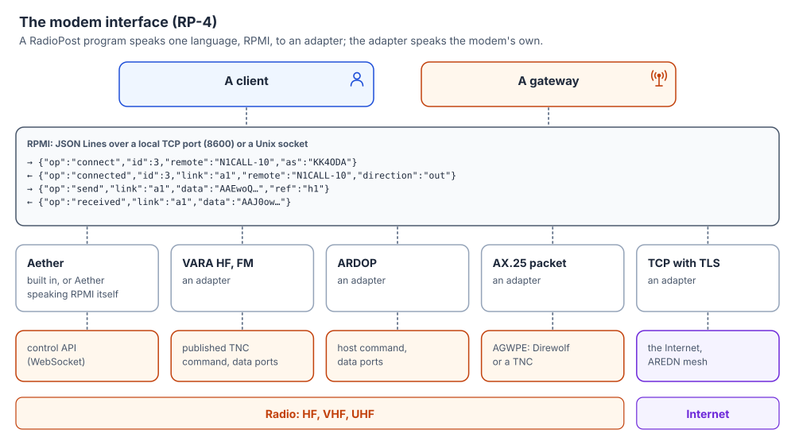

# RP-4: Modem interface

| | |
|---|---|
| **Status** | Draft |
| **Version** | 0.7.0 |
| **Updated** | 2026-11-14 |
| **Editor** | KK4ODA |
| **Licence** | [CC BY 4.0](https://creativecommons.org/licenses/by/4.0/) |
| **Depends on** | RP-0 |
| **Protocol version** | 1 |

How a RadioPost program (a client or a gateway, here the **host**) drives a modem: calling,
answering, sending and receiving bytes, hanging up, and hearing what the modem reports. The host
never talks to a modem's own interface; it talks to an **adapter** in one common language, the
**RadioPost Modem Interface** (RPMI), so that any modem can carry RadioPost once someone writes an
adapter for it, and a modem may speak RPMI itself.



---

## 1. Model

* An **adapter** is a program, or a part of one, that speaks RPMI on one side and a particular
  modem's interface on the other. It MAY run as its own process, be built into the host, or be the
  modem itself.
* A **link** is one connection to one remote station: a reliable, ordered, two-way byte stream, as
  RP-3 §1 needs. The adapter names each link with a string ID.
* A modem that carries datagrams (one-to-many frames, no connection) MAY offer **broadcasts**.
* A modem MAY be **shared**: several programs, each through its own connection, use one modem
  and one radio. An example is a gateway that carries RadioPost and another system's mail on the
  same station. §1.1 says what each host can rely on.

What the host is told about the radio, and when it is told, is all in RPMI. Keying the radio,
choosing frequencies and modulation, retransmission and turnaround are the modem's business.

### 1.1 A shared modem

A modem may serve other programs besides this host: another RadioPost program, or a program of
another system on the same station. Callsigns decide whose call is whose, because a call names a
callsign. The adapter keeps each host to its own business:

* **The host's callsigns are its own.** `callsigns` (§4) names the callsigns *this host* answers
  to and calls as. No two programs hold the same callsign; callsigns are compared exactly, so
  `N1CALL-1` and `N1CALL-10` are different. If another program holds one of the callsigns asked
  for, the adapter answers `error` `claimed` naming it, and the host's callsigns stay as they
  were.
* **Answering is the host's.** A call is answered for this host only when it is addressed to one
  of the host's callsigns and the host's `listen` is on. Calls to other programs' callsigns are
  never this host's, whatever its `listen` says.
* **Links are the host's.** The adapter reports `incoming`, `connected`, `received`, `queued`,
  `delivered` and `disconnected` only for this host's links: calls to its callsigns, and calls it
  placed. `status` lists only these links. `send`, `disconnect` and `abort` act only on them, and
  answer `not-connected` for any other.
* **Other programs' traffic reads as busy.** While the modem carries another program's link, or
  transmits for it, an adapter with `caps.busy` reports `busy` true. A `connect` made then fails
  `busy` (§7).
* **A host that leaves takes its callsigns, its call and its links with it.** When the host's
  connection to the adapter closes, calls to its callsigns are no longer answered for it, and the
  adapter ends its call under way and its links as `abort` would, so the station is not left in a
  session nobody holds: the other station hears `disconnected`.

An adapter that cannot keep these rules reports `caps.shared` false and serves one host with the
modem to itself: while that host is connected, a second host is turned away at its `hello` (§3).
The rules above then hold trivially: everything the modem does is this host's.

---

## 2. Transport and framing

The adapter listens; the host connects to it, over **TCP on the loopback interface** (default port
**8600**) or a **Unix domain socket**. Each host keeps one connection.

Messages are **JSON Lines**: one JSON object (RP-0 §4.2) per line, UTF-8, ended by LF. Every object
has an `op` member naming it. Byte data is in a `data` member in **standard base64** (RFC 4648 §4,
with padding), because adapters are often small scripts and every language has it.

Requests from the host MAY carry an `id` (a string or integer). The adapter answers each request
that has an `id` with `ok` or `error` carrying the same `id`. Events from the adapter carry no `id`
unless they answer a request.

An adapter MUST ignore members it does not know, and answer an unknown `op` with `error`
`unsupported`. It answers `error` `malformed` (RP-0 §9.3) to a line that is not a JSON object with
a string `op`, whose `id` is neither a string nor an integer, or whose `data` is not standard
base64 with padding, and to a request that lacks a member §4 gives it without a `?` or has one of
the wrong type (§4, *Types*); the `error` carries the request's `id` when it could be read. It
checks a request in that order: the line, then `hello` first (§3), then the `op`, then the
members. A host MUST ignore events and members it does not know, so that adapters can add them.

Test vectors: `vectors/rpmi-lines.json`: lines an adapter reads, and lines it answers with an
error.

### 2.1 When the modem goes away

An adapter that loses its modem while a host is connected (the modem stopped, restarted, or can no
longer be reached) tells the host what that ended, `failed` for its call under way and
`disconnected` with `reason` `failure` for its links, and then closes the host's connection. It
MUST NOT keep the connection open with no modem behind it: a host waiting for calls would wait for
ever, and on a shared modem (§1.1) its callsigns would no longer be its own. A host whose
connection closes connects again and starts from `hello` (§3); nothing it set (`callsigns`,
`listen`) is kept for it. A host that connects while the modem cannot be reached gets `error`
`no-modem` (§7) to its requests.

**Why close:** the host cannot tell a quiet modem from a missing one, and a gateway is quiet for
hours. Closing is the one signal every host already acts on.

---

## 3. Opening

The host speaks first:

```json
{"op": "hello", "id": 1, "version": [1, 1], "app": "RadioPost gateway 0.1.0"}
```

The adapter answers:

```json
{"op": "hello", "id": 1, "version": 1, "modem": "Aether HF 0.2.0",
 "caps": {"bandwidths": [500, 2300], "max_links": 1, "delivery": true, "broadcast": true,
          "quality": true, "busy": true, "regulatory": true, "max_queue": 65536}}
```

| `caps` member | Meaning |
|---|---|
| `bandwidths` | Bandwidths in Hz the host may ask for in `connect`, if the modem has a choice. |
| `max_links` | How many links may be up at once (HF modems: 1). |
| `delivery` | The adapter reports `delivered` (§5): when the other station holds the bytes. |
| `broadcast` | The adapter carries broadcasts (§6). |
| `quality` | The adapter reports `quality` (§5). |
| `busy` | The adapter reports `busy` (§5). |
| `regulatory` | The modem checks the station's band rules before every transmission (§8). |
| `max_queue` | The most bytes the host should have queued on a link at once (§4, `send`). |
| `shared` | Other programs may use the modem at the same time, under §1.1's rules. Absent means false: this host has the modem to itself. |

If no version is in common the adapter answers `error` `unsupported-version` and closes. An adapter
that is not shared (§1.1) answers the `hello` of a second host, while a host that has said `hello`
is still connected, with `error` `busy` and closes that connection. Until it has answered `hello`,
it answers any other request with `error` `refused`.

**A host between calls.** A host MAY keep a connection open with `hello` alone, so that a modem
that shows the programs using it shows this one between its calls too (§9.1). With no callsigns
it answers nothing and calls nothing, so it changes nothing the station does; its calls and its
listening go on connections of their own. It does so only when `caps.shared` is true: an adapter
that is not shared would turn its other connections away (above). It reads and ignores the events
it is sent, such as `busy`.

---

## 4. Requests from the host

| `op` | Members | What the adapter does |
|---|---|---|
| `hello` | `version`, `app` | §3. |
| `callsigns` | `callsigns` (list) | The callsigns this host answers to and may call as; the first is the default. They replace the host's earlier list. `error` `claimed` if another program holds one (§1.1). |
| `listen` | `on` (bool) | Whether calls to this host's callsigns are answered. Off until the host turns it on. |
| `connect` | `remote`, `as`?, `bandwidth`?, `id` | Calls `remote` as `as`, one of this host's callsigns (default: the first). `ok` means the call is under way; `connected` or `failed` follows. |
| `send` | `link`, `data`, `ref`? | Queues bytes on one of this host's links. With `ref`, the adapter later reports `delivered` (if it can) for the last byte of this send. |
| `disconnect` | `link` | Closes this host's link in order: what is queued goes first, then the modem disconnects. |
| `abort` | `link`? | Ends this host's link, or its call under way, now. Queued bytes are dropped. A call ended this way ends with `failed` `aborted`; with no call under way, `error` `not-connected`. |
| `broadcast` | `data`, `ref`? | §6. |
| `status` | — | The adapter answers `status` (below). |

**Types.** `version` is a list of two integers, the lowest and the highest version the host
speaks; `callsigns` is a list of strings; `on` is true or false; `bandwidth` is an integer; `app`,
`remote`, `as` and `link` are strings. `ref`, like `id`, is a string or an integer, and the adapter
copies it unchanged into `delivered` or `broadcast-sent`. A `connect` needs its `id`, which its
`connected` or `failed` carries: one without is `malformed`.

**Answers.** `ok` carries only `op` and the request's `id`. A request the adapter turns down at once
is answered with `error` instead, and nothing more follows from it. For `connect` these are: no
callsigns yet (`refused`); an `as` that is not one of the host's callsigns (`not-authorized`); a
`bandwidth` not in `caps.bandwidths` (`unsupported`); a link or a call of the host's already up,
`max_links` links up, or another program's link on the channel (`busy`). An `error` answering a
request with no `id` carries no `id`.

**Callsigns first.** A host has no callsigns until it sends `callsigns`. Until then nothing is
answered for it, and the adapter answers its `listen` and `connect` with `error` `refused`. On a
shared modem the adapter cannot lend the host the station's callsign, because another program may
hold it.

**Flow control.** The host SHOULD keep no more than `max_queue` bytes queued on a link; the adapter
reports `queued` (§5) as the queue drains. RP-3 sessions are small enough that this rarely binds.

`status` answer. On a shared modem, `callsigns`, `listening` and `links` are this host's:

```json
{"op": "status", "id": 7, "listening": true, "callsigns": ["N1CALL-10"], "busy": false,
 "links": [{"link": "a1", "remote": "KK4ODA", "direction": "in", "queued": 0}]}
```

---

## 5. Events from the adapter

| `op` | Members | When |
|---|---|---|
| `incoming` | `remote`, `local` | A call to one of this host's callsigns is being answered (optional; for display). |
| `connected` | `link`, `remote`, `local`, `direction` (`in` or `out`), `bandwidth`? | A link is up. For an outgoing call, it answers the `connect` (and carries its `id`). |
| `failed` | `id`, `code`, `text`? | An outgoing call ended without a link: `timeout` (no answer), `refused` (the modem or the other station refused), `busy`, or `aborted` (the host's `abort`). |
| `received` | `link`, `data` | Bytes arrived on a link, in order. A `received` may hold any part of the stream: it keeps no `send` boundaries, and the host joins them. |
| `queued` | `link`, `bytes` | Bytes still queued on the link, when it changes. `0` means everything sent has been handed over (and, with `delivery`, acknowledged). |
| `delivered` | `link`, `ref` | The other station holds every byte up to the end of the send with this `ref`. Only with `delivery`. |
| `disconnected` | `link`, `reason`, `text`? | The link is gone. `reason`: `local` (the host asked), `remote` (the other station hung up), `timeout`, `failure`. |
| `quality` | `link`?, `snr_db`?, `rate_bps`?, `receiving`? | What the modem knows about the path: the last SNR heard, the data rate it is using, and whether it is receiving right now (RP-3 §8 uses this to tell a slow link from a dead one). Only with `quality`. |
| `busy` | `busy` (bool) | Whether the channel is in use by others, including other programs on a shared modem (§1.1). Only with `busy`. |
| `heard` | `callsign`, `snr_db`?, `bandwidth`? | A station was heard (a beacon, a call to someone else). Optional. |
| `broadcast` | `source`, `data`, `snr_db`? | §6. |
| `broadcast-sent` | `ref`, `sent` (bool), `text`? | §6. |
| `error` | `id`?, `code`, `text`? | A request failed, or something went wrong. `code` is from §7. |

The adapter MUST report every link it brings up for the host with `connected` and every such link
it loses with `disconnected`, so the host never has to guess. On a shared modem it MUST NOT report
another program's links to this host (§1.1).

Test vectors: `vectors/rpmi-conversations.json`: session-01 (RP-3 §12) carried over RPMI on both
stations, every error a host can meet, a shared modem, and a broadcast.

---

## 6. Broadcasts

A modem that can send a frame to everyone listening (Aether's datagrams, AX.25 UI frames) MAY offer
`broadcast`. The host sends `{"op": "broadcast", "data": "…", "ref": "b7"}`; the adapter answers
`broadcast-sent` when the frame has gone out or will not. Broadcasts heard arrive as `broadcast`.

RadioPost does not use broadcasts yet. They are reserved for bulletins and position reports in a
later specification.

---

## 7. Error codes

Adapters use RP-0 §9.3's codes where one fits, and these words in `code` otherwise:

| `code` | Meaning |
|---|---|
| `unsupported` | The request is not known, or the modem cannot do it. |
| `unsupported-version` | No RPMI version in common. |
| `no-modem` | The adapter cannot reach its modem. |
| `not-connected` | No such link of this host's. |
| `refused` | The modem refused (a rule, a setting, the band, no callsigns yet). `text` says why. |
| `busy` | The modem is doing something else: a call or a link already up, another program's link, or another host on a modem that is not shared. |
| `claimed` | Another program on a shared modem holds the callsign (§1.1). `text` names it. |
| `aborted` | The host's `abort` ended its call under way (in `failed`). |

---

## 8. The rules on the air

An adapter MUST NOT make the modem transmit except to carry out its host's requests (calls,
answers when `listen` is on, data, disconnects, broadcasts) and what the modem itself needs for
them (acknowledgements, identification). On a shared modem, another program's transmissions are
that program's business; this host hears of them only as `busy`.

Whether a transmission is allowed on this band, at this time, under this kind of control, is the
station's responsibility. When the modem checks it (`caps.regulatory`, as Aether does), a refusal
arrives as `error` or `failed` with `refused`. When it does not, the host (the gateway program)
MUST check it, or its operator must, before turning on `listen` or calling (RP-0 §7).

---

## 9. Mapping to modems *(informative)*

How an adapter can carry RPMI on today's modems. These notes guide adapter writers; each modem's
own documentation is the authority on its interface. One part is normative: §9.5's opening lines,
on which TCP adapters of different programs meet each other.

### 9.1 Aether

Aether's control API (JSON over WebSocket, `ws://127.0.0.1:8515/v1`) carries RPMI one to one. From
0.2.0-beta.146 Aether can be shared (its
[ADR-0106](https://github.com/KK4ODA/aether-hf/blob/master/docs/adr/0106-each-program-answers-for-its-own-callsigns.md)):

* Each program **claims** the callsigns it answers for, and the first claim on a callsign holds it.
* A claim starts with answering off, and lasts as long as the WebSocket connection that made it.
* Every `state` event says whose call or session it is (`owner`, the claim's `id`).
* From 0.2.0-beta.149 (its
  [ADR-0108](https://github.com/KK4ODA/aether-hf/blob/master/docs/adr/0108-every-program-speaks-for-the-station-and-setup-says-whose-callsign-it-is.md)),
  while any claim stands, its program speaks for the station. Aether's own callsigns that no
  program holds are not answered, and Aether's Setup shows the program's callsign in their
  place. A host's callsigns are set in the host. Its operator need not set Aether's own callsign
  to match, and a guide should not ask them to.

The adapter opens **one WebSocket connection to Aether for each RPMI host**, and closes it when the
host's connection closes; Aether then lets that host's claim go. Aether restarts when its settings
are saved, which closes every WebSocket and ends every claim: the adapter then closes the host's
connection (§2.1), and the host claims again on the next. From 0.2.0-beta.147 (its
[ADR-0107](https://github.com/KK4ODA/aether-hf/blob/master/docs/adr/0107-under-automatic-control-only-a-program-answers-and-its-session-goes-with-it.md))
Aether ends a host's call or session itself when the host's WebSocket closes (a call stops, a
session closes as `disconnect` does), whether or not the adapter's `abort` reached it, and under
automatic control it answers a call only for a claim that is listening: a gateway whose program
is down answers nobody, though probes are still answered. A one-shot `POST /v1/<method>`
holds no claim. Aether says it has claims by `status.claims`; for an Aether without them, see the
end of this section.

| RPMI | Aether control API |
|---|---|
| `hello` | `status` and `capabilities`: `caps.shared` is true when `status.claims` is present, and `caps.bandwidths` is the one Aether runs (`capabilities.bandwidth_hz`). `delivery`, `broadcast`, `quality`, `busy` and `regulatory` are true, and `max_links` is 1. `modem` is `Aether HF` and `status.version`. Then, when shared, `hello {app}` with the host's `app` (below, *A host between calls*). |
| `callsigns` | `claim {callsigns, app}`, with the host's `app`. Aether takes the callsigns it can and lists each one another program holds in `refused`. RPMI keeps the host's list whole, so on a refusal the adapter claims the host's earlier list again and answers `error` `claimed` naming the refused callsigns. |
| `listen` | `listen {enabled}` on that claim. A claim starts with it off, as RPMI's does. |
| `connect` | `connect {remote, callsign}`, with `callsign` set to `as`. The call and its session are the host's. Aether's `claimed`, and `bad_params` for a callsign the claim does not hold, are RPMI's `not-authorized`. `already_connected` is `busy`. `refused` (an answer-only station) and `regulatory` are `refused`. |
| `connected` | A `state` event `connected` whose `owner` is the claim's `id`. A `detail` of `<remote> (master)` is a call the host placed (`direction` `out`), and `<remote> (slave)` one it answered (`in`). The event's `callsign` is `local`. |
| `failed` | A `state` event `disconnected` with the claim's `owner` before any `connected`: `no answer` is `timeout`, `aborted` after the host's `abort` is `aborted`, and anything else `refused`. |
| `disconnected` | The same event after `connected`. `peer disconnected` is `remote`. The end of the host's own `disconnect` or `abort` (`closed`, `aborted`, `closed (no DISC_ACK)`) is `local`. `link timeout` and `no response` are `timeout`, and anything else is `failure`. |
| `send` with `ref` | `send {data, ref}`. The `sent` event with `delivered: true` and the same `ref` is RPMI's `delivered`. Aether's `ref` is 1 to 64 printable ASCII characters with no spaces, and RPMI's a string or an integer (§4), so the adapter gives Aether a reference of its own and remembers which `ref` it stands for. Aether's `not_owner` and `not_connected` are `not-connected`. |
| `disconnect` / `abort` | `disconnect` / `abort`. Aether refuses either `not_owner` on another program's session (RPMI's `not-connected`). It answers an `abort` with nothing under way as done, so the adapter answers RPMI's `not-connected` itself. |
| `received` | The `data` events while the host's session is up. Aether runs one session at a time, so they are the host's link. |
| `queued` | `metrics.queued_bytes` while the host's session is up: the host's own bytes not yet acknowledged, counted before compression. |
| `quality` | `metrics` (`snr_db`, `throughput_bps`, `receiving`). |
| `busy` | `metrics.channel_busy`, and true while a session whose `owner` is not the host's is up (`status.owner`, or a `metrics.link` during another's session). While the host's own link is up, `channel_busy` is mostly the other station's signal and is not reported; when that link ends, the readings taken during it are dropped and the next `metrics` says how the channel stands. |
| `broadcast` | `datagram.send` with `frame_type` 2, Aether's unformatted datagram; the `datagram` and `datagram-sent` events. |
| `bandwidth` (in `connect`) | Not mapped yet. How programs sharing a station choose its bandwidth is open (ADR-0106 §5). The adapter offers the bandwidth Aether runs and refuses another with `unsupported`, as §4 says. A `connect` that names that bandwidth is sent with `keep_bandwidth`, so Aether does not move for the call (its ADR-0102). Aether may move between calls (a `bandwidth` event): `caps.bandwidths` is the bandwidth at `hello`, and `connected` carries the one in use. |

Aether checks the band rules before every transmission, and ends each session with the Morse
identifier itself. A future Aether may speak RPMI natively.

**The program's log.** When a program built around the adapter keeps a log file, the adapter
offers it to Aether once the host's `hello` is answered: `share.include {path, app}`, `app` the
`hello`'s. From 0.2.0-beta.150 Aether remembers the file and puts it in the files a station shares
(its *Send files*, and debug mode's uploads), after the program has gone too: a fault between a
program and its modem shows on both sides, and the operator sends both at once. Aether takes only
a file named `*.log`; an earlier Aether refuses the method, and the adapter does not wait for the
answer. The log is shared with others, so it says what happened and never what was said: no
correspondent's address and no subject.

**A host between calls.** From 0.2.0-beta.159 (its
[ADR-0114](https://github.com/KK4ODA/aether-hf/blob/master/docs/adr/0114-a-program-may-say-who-it-is-without-claiming-a-callsign.md))
a program says who it is with `hello {app}` on its WebSocket connection, and Aether names it among
the programs using the station (`status.programs`, and its header) while the connection lasts. A
`hello` claims no callsign, so it changes nothing the station answers; a claim, by contrast, makes
its program speak for the station (ADR-0108), and Aether's own callsigns would rest. So the adapter
says `hello` with the host's `app` once the host's `hello` is answered, on a shared Aether, and a
host that keeps its connection open with no callsigns (§3) is named all the same. Aether shows two
connections whose names match, less a version at the end, as one program: a host's calls and its
connection between calls say the same `app`. An earlier Aether answers `unknown_method`, and the
adapter does not wait for the answer.

**Beside a program on Aether's VARA-compatible port.** RMS Trimode, Winlink Express or VarAC on
Aether's VARA-compatible host port holds the callsigns its `MYCALL` names. While such a program is
attached, Aether answers none of its own callsigns that the program does not hold (from
0.2.0-beta.149, the same holds while an RPMI host's claim stands). Give the
RadioPost host callsigns of its own: `N1CALL-10` beside Trimode's `N1CALL-1`, for example. Each
program then answers only for its own callsigns, is told nothing of the other's sessions, and
sees them as `busy`.

**Before 0.2.0-beta.146** Aether has no claims (`status.claims` is absent). The adapter has the
modem to itself and reports `shared` false. `callsigns` is `callsigns.set {callsigns}`, which
replaces the station's whole list. Aether answers calls to its callsigns whatever the host says,
so the adapter answers `listen` off with `error` `unsupported`.

### 9.2 VARA HF and VARA FM

VARA's published TNC command list (EA5HVK, *VARA Protocol Native TNC Commands*) uses a command port
(text lines) and a data port (raw bytes), on two TCP ports:

| RPMI | VARA |
|---|---|
| `callsigns` | `MYCALL <call> [<call>…]` |
| `listen` | `LISTEN ON` / `LISTEN OFF` |
| `connect` | `CONNECT <as> <remote>`; `CONNECTED …` or `DISCONNECTED` follows |
| `send` | write to the data port; `BUFFER <n>` gives `queued` |
| `received` | read from the data port |
| `disconnect` / `abort` | `DISCONNECT` / `ABORT` |
| `bandwidth` | `BW500`, `BW2300`, `BW2750` before the call |
| `busy` | `BUSY ON` / `BUSY OFF` |
| `quality` | `SN <dB>` lines, where sent |

VARA reports no delivery: `BUFFER 0` means sent, not acknowledged. Its command port has one
`MYCALL` list and one `LISTEN` for the program that holds it, so an adapter for VARA has the modem
to itself (`shared` false). VARA itself is proprietary; the adapter only uses its published
commands.

### 9.3 ARDOP

ARDOP's host interface also has a command port and a data port. Calls are `ARQCALL <remote>
<repeats>`, listening is `LISTEN TRUE|FALSE`, the bandwidth is `ARQBW`, and the data port carries
length-prefixed blocks. *To be checked against the ARDOP specification before an adapter is
written.*

### 9.4 AX.25 packet (VHF and UHF)

Connected-mode AX.25 gives the link RP-3 needs. Direwolf, and many packages that sit on a KISS TNC,
offer it through the **AGWPE** protocol: register a callsign (`X`), connect (`C`), send connected
data (`D`), disconnect (`d`), with `Y` reporting frames still outstanding. UI frames carry
broadcasts. AGWPE is already built for several programs: each registers its own callsigns, and
connections to a callsign go to the program that registered it, the model §1.1 describes. *Check
how the TNC software handles a callsign two programs register before an adapter reports `shared`
true.*

### 9.5 TCP

For the Internet, amateur mesh networks (AREDN), and tests. The adapter takes calls from other
adapters on a TCP port (**8774** by default). `remote` is `CALLSIGN@host:port`, or `host:port`
(whoever answers there), or a name the adapter's operator maps to one of these. No callsign is
keyed and no band rules apply: `regulatory` is false.

* **On the Internet the link is TLS**, version 1.2 or later. The caller checks the certificate of
  the adapter it calls, by the usual roots of the web or by the certificate's SHA-256 fingerprint,
  which the two operators exchange.
* **On an amateur mesh network the link is plain TCP.** The mesh is on the air, and nothing on the
  air is encrypted (RP-0 §5).

Before any of the hosts' bytes, the two adapters agree to the link in one line each, ASCII ended by
LF:

| From | Line | Meaning |
|---|---|---|
| The caller | `RPTCP 1 <as> <called>` | Version 1; the callsign the caller calls as; the callsign called, or `*` when `remote` named only an address. |
| The adapter called | `OK <callsign>` | The link is up. Its host listens and holds `<called>`; for `*`, the callsign is the host's first. |
| The adapter called | `NO <code>` | No link: `refused` (no host, not listening, or not its callsign) or `busy` (a link or a call of its host's is up). It then closes the connection. |

A line longer than 200 bytes, or one that does not read as above, ends the connection. The caller's
host hears `connected` with `remote` the callsign `OK` named, or `failed` with `NO`'s code;
`failed` `timeout` when no line comes within 30 seconds, and `refused` when the connection itself
is refused. After the lines the link carries the hosts' bytes as they are, both ways. Either side
closing it is the other's `disconnected` `remote`. `delivery` is false: TCP says when bytes have
left, not when the other host holds them.

### 9.6 Mercury

Mercury, Rhizomatica's open HF modem (GPL-3.0), offers a VARA-style TNC interface (its
`docs/TNC.md`): commands and events as lines ended by CR on a control port (**8300** by default),
the session's bytes on a data port, the next one. The adapter talks to it over TCP only. Mercury
1.9.20 and later connect to each other on the air, and not to earlier ones.

| RPMI | Mercury |
|---|---|
| `hello` | `BUSYDETECT`, which only Mercury 1.9.23 and later answer with `BUSYDETECT ON` or `OFF`: anything else is not this modem, and the host gets `no-modem`. `caps.bandwidths` is 500, 2300 and 2750; `busy` is the answer's `ON`; `delivery` and `quality` are true; `broadcast`, `regulatory` and `shared` are false. `modem` is `Mercury`: its `VERSION` answers as VARA does. |
| `callsigns` | `MYCALL <first> <more>…`. Mercury answers for five callsigns at most, of 1 to 15 characters, and its CALL carries only capitals, digits and `-`. The adapter refuses others (`refused`) rather than let Mercury drop or change them, so a callsign with `/` (RP-0 §6.1) cannot be used. An empty list keeps Mercury from answering, as `listen` off does. |
| `listen` | `LISTEN ON` / `LISTEN OFF`, but see *Answering* below. |
| `connect` | `CONNECT <as> <remote>`, after `MYCALL` with `as` first when it is not, and after `BW<bandwidth>` when the call names a bandwidth Mercury is not on. `ok` comes at once: the call is under way, though `CONNECT` may wait for the station to identify (below) or for a quiet second. `CONNECTED <caller> <called> <bandwidth>` gives `connected` with the bandwidth the two stations agreed on. A caller's callsign is at most 14 characters. |
| `failed` | `DISCONNECTED` before `CONNECTED`: `timeout`, or `aborted` after the host's `abort`; `refused` when Mercury answers `CONNECT` with `WRONG`. A call that Mercury answered first, from another station, ends the host's own with `busy`. |
| `disconnected` | `DISCONNECTED` once the link is up: `local` when the host ended it, and `remote` otherwise, since Mercury says neither which session ended nor why. |
| `send` | Bytes to the data port; see *Delivery*. |
| `received` | Bytes from the data port, while the link is up. |
| `disconnect` | `DISCONNECT`, once the bytes the adapter holds have gone to Mercury. Mercury delivers what it holds before its DISCONNECT frame, and says `DISCONNECTED` when the session has closed. |
| `abort` | `ABORT`. Mercury says `DISCONNECTED` at once, and its DISCONNECT frame goes out after. |
| `quality` | `SN <dB>` and `BITRATE (<mode>) <bps> BPS`. |
| `busy` | `BUSY ON` / `BUSY OFF`, from Mercury's busy detector, which is off unless its operator turns it on. Not reported while the host's own link is up. |
| `incoming` | `CONNECTED` for a call Mercury answered, to the callsign it names. `PENDING` and `CANCELPENDING` say a call is being answered; no `connect` is placed meanwhile (`busy`). |

**One program at a time.** Mercury serves one program, and gives its control port to the newest
that connects, ending the session of the one before. The adapter connects to Mercury when a host
says `hello`, has the modem to itself (`shared` false), and closes its connections once the host
has left and what it left on the air has ended (§1.1), so that another program, a Winlink client
or BPQ32, may have Mercury between RadioPost's sessions.

**Answering.** Mercury's `LISTEN OFF` ends a call or a session under way without a word to the
other station, as VARA's does for scanning programs; RPMI's `listen` off only stops answering. The
adapter sends `LISTEN OFF` only when nothing of the host's is up: after the link has ended, and
after an `ABORT` once its DISCONNECT frame is out (the transmission keyed after it has ended, or a
minute). A call Mercury answers meanwhile, for a host that does not listen, or to a callsign that
is not the host's, is ended with `ABORT` and never told.

**After an end.** `DISCONNECTED` carries no session, and Mercury also says it to a `DISCONNECT`, an
`ABORT` or a `LISTEN OFF` that finds no session up, within a pass of its loop. The adapter sends no
`CONNECT` for a second after any of these, so that such a line is not read as the call's end.

**Delivery.** Mercury's `BUFFER <n>` counts the bytes it has taken in that the other station has
not confirmed, Mercury's carousel being acknowledged by the receiver. So `BUFFER 0` means
delivered, unlike VARA's (§9.2), and the adapter reports `delivered` and `queued` from it. Two
details of Mercury's count shape how:

* Mercury counts once on every write to the data port, before the bytes written are in the count,
  and then every second. A `BUFFER 0` is believed only 2.5 seconds after the last bytes went to
  Mercury, or after a count above 0 has come for them.
* Mercury's own queue holds 64 KiB and drops what does not fit. The adapter keeps no more than 32
  KiB with Mercury unconfirmed, and holds the rest until Mercury has confirmed more.

**Identification.** Mercury does not identify the station by itself: a CALL carries the caller's
callsign, an ACCEPT only a CRC of the called station's, and the session's frames none. The adapter
identifies with `CQFRAME <callsign> <bandwidth>`: one frame on Mercury's control mode, the size of
a CALL (3.74 s; on the MFSK floor, 13.5 s or 27 s, from a station that sends only MFSK), which
carries the callsign and which every Mercury decodes and reports as `CQFRAME <callsign> <bandwidth>`:

* after each session, with the callsign the host had on it (`local`), at the session's bandwidth;
* after a session Mercury answered and the adapter ended (*Answering*), with the callsign called;
* after a call Mercury answered with ACCEPTs that never came to a session, with the host's first
  callsign. A call the host placed is not followed by one: its CALLs carried its callsign.

Mercury keys a CQ frame at once, whatever is on the air, so the adapter chooses the moment. It sends
one only when no call, link or `ABORT`'s DISCONNECT frame of the station's is under way and Mercury
is not answering a call. The station called identifies first, two seconds after the session's end,
clear of the other station's last answer. The caller waits until it hears that `CQFRAME`, and then
0.7 s more, or 35 seconds, and then identifies, so the two do not key at once. A frame decodes about
0.2 s before its sender unkeys, and a radio takes about 0.34 s to turn from sending to hearing:
Mercury waits the same 0.7 s before it answers a frame (its `ARQ_CHANNEL_GUARD_MS`). A `connect` waits until the station has
identified. Mercury reports the CQ frame's transmission with `PENDING` and `CANCELPENDING`, which
the adapter does not take for a call. A station still identifies after its host has gone.

Whether a CQ frame, Mercury's published coding of a callsign in a published modulation, is the
identification a station's rules ask for is its operator's reading of them. Within a session longer
than ten minutes the adapter sends none: a CQ frame keyed then would land on the session's own.

**What Mercury does not do.** It checks no band rules (§8): a gateway's operator, or the gateway,
must. Mercury's broadcasts, KISS frames on a port of their own, are not carried by the adapter yet.

---

## Change log

| Version | Date | Change |
|---|---|---|
| 0.1.0 | 2026-11-09 | First draft. |
| 0.1.1 | 2026-11-09 | Licence stated: CC BY 4.0. |
| 0.2.0 | 2026-11-09 | A shared modem (§1.1): callsigns, answering and links are each host's; `caps.shared`; error `claimed`; `callsigns` before `listen` and `connect` (§4); §9 says which modems can be shared, and how Aether would be (its ADR-0106). |
| 0.3.0 | 2026-11-09 | What a bad line gets (`malformed`), and that a host ignores what it does not know (§2); `refused` before `hello` (§3); which `connect` errors come at once and what `ok` carries (§4); `failed`'s codes and `aborted` (§5, §7); `received` keeps no `send` boundaries (§5); test vectors. |
| 0.3.1 | 2026-11-09 | §9.1: Aether shareable from 0.2.0-beta.146 (its ADR-0106): claims, `listen` on the claim, links by `owner`, and how Aether's answers and end reasons map to RPMI's; the WebSocket path is `/v1`. |
| 0.4.0 | 2026-11-09 | Found by writing the Rust adapter and host: a request missing a member it needs, or with one of the wrong type, is `malformed`, and the order of the checks (§2); the members' types, `ref` a string or an integer, and a `connect` needs its `id` (§4); an adapter that is not shared turns a second host away `busy` (§1.1, §3, §7). Test vectors for each. |
| 0.4.1 | 2026-11-09 | §9.1, found by writing the Aether adapter and running it against Aether 0.2.0-beta.146: `modem`'s name; the adapter's own references for `send`; `busy` while the host's own link is up; broadcasts as unformatted datagrams; a named bandwidth kept with `keep_bandwidth`, and `connected` carrying the one in use. |
| 0.5.0 | 2026-11-09 | A host that leaves ends its call and its links (§1.1): the Aether adapter had let its callsigns go and left the session up, found by running the conformance tester's A-02 over two Aether daemons. §9.5, found by writing the TCP adapter: the link on an amateur mesh is plain TCP, since a mesh is on the air (RP-0 §5), and TLS only on the Internet; the opening lines two TCP adapters agree a link with (normative), the port, what `remote` may be, and what the caller's host hears. |
| 0.6.0 | 2026-11-12 | An adapter that loses its modem tells the host what that ended and closes its connection (§2.1, §9.1): two Setup saves restarted a gateway's Aether on the air, the Aether adapter kept RadioPost Gateway's connection open, and the gateway listened for an hour and a half while Aether, its claim gone, answered the gateway's callsign for nobody. |
| 0.6.1 | 2026-11-12 | §9.1: what Aether 0.2.0-beta.147 does itself when a host's WebSocket closes (ends its call or session), and that under automatic control it answers calls only for a listening claim (its ADR-0107). |
| 0.6.2 | 2026-11-12 | §9.1: from Aether 0.2.0-beta.149 (its ADR-0108) a claim speaks for the station. Aether's own callsigns are not answered while one stands, and its Setup shows the program's callsign; nothing asks the operator to copy a host's callsign into Aether. |
| 0.6.3 | 2026-11-12 | §9.1: the adapter offers the program's log to Aether (`share.include`, Aether 0.2.0-beta.150), which puts it in the files a station shares; the log names no correspondent and no subject. |
| 0.6.4 | 2026-11-12 | §9.6, Mercury, found by writing its adapter from Mercury's `docs/TNC.md` and its source: the mapping; one program at a time; `LISTEN OFF` held until nothing of the host's is up, since Mercury's ends a session unsaid; no `CONNECT` for a second after a command that Mercury may answer with a `DISCONNECTED` of no session; `BUFFER` as delivery, and when its 0 is believed; the callsigns Mercury can carry; and that Mercury neither checks band rules nor identifies the station. |
| 0.6.5 | 2026-11-12 | §9.6: the Mercury adapter identifies the station with `CQFRAME` after each session, and after answers that came to none; the station called first, the caller once it has heard it; a `connect` waits for it, and so its `ok` comes at once and Mercury's refusal is `failed` `refused`. |
| 0.6.6 | 2026-11-12 | §9.6, found by running the adapter on two Mercury 1.9.23 processes: the caller waits 0.7 s after it has heard the called station's `CQFRAME`, as Mercury waits before it answers a frame; without it the caller keyed 0.13 s before the called station had unkeyed. |
| 0.7.0 | 2026-11-14 | A host between calls (§3): a connection with `hello` alone, on a shared adapter only, so a modem that shows the programs using it shows the host when no call is up. §9.1: the adapter says `hello {app}` to a shared Aether (its ADR-0114, 0.2.0-beta.159), which names the program without a claim; asked for when Aether's header said "calls to KK4ODA-1 not answered" with the RadioPost app open and idle. |
